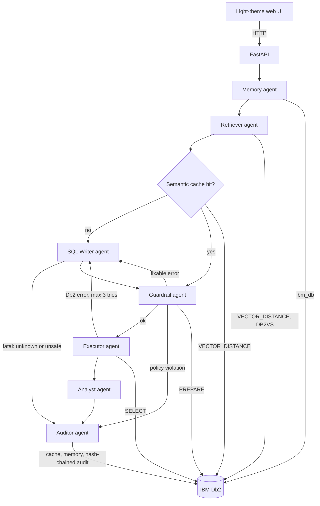

# System Architecture

## Overview
Db2 Cortex is a FastAPI service that runs a LangGraph pipeline of eight agents. Every stateful part of the AI system (business data, vector semantic layer, query cache, memory and audit log) lives in IBM Db2, so retrieval, governance and evidence share one database.

---

## Architecture Diagram



---

## Component Breakdown

1. **User Interface / Client Layer:** single-page light UI with role switch, agent trace, SQL, chart, results and audit tab.
2. **Application Backend Layer:** FastAPI (`src/app.py`) with validated input (3-500 chars, role enum), clean 503 errors when Db2 is down, `/api/audit` and `/api/audit/verify`.
3. **Database Layer (IBM Db2):** relational demo data, `VECTOR(384, FLOAT32)` columns, cache, memory and audit tables.
4. **AI / Model Orchestration Layer:** LangGraph (`src/agents.py`) with conditional edges; model-agnostic LLM factory (`src/llm.py`); embeddings with automatic fallback (`src/embeddings.py`).

---

## Data Flow

1. **Input Ingestion:** the user asks a question; role and session id travel with it.
2. **Context Retrieval:** Db2 returns the last three turns, the top-6 semantic-layer rows (`VECTOR_DISTANCE` COSINE) and glossary rules (DB2VS).
3. **Augmentation & Inference:** a cache hit reuses stored SQL; otherwise the SQL Writer prompts the LLM (or the offline planner). Errors are fed back, max 3 attempts.
4. **Validation & Execution:** the Guardrail checks the SQL with an AST, applies the PII policy and runs Db2 `PREPARE`; the Executor runs it and masks PII again as defence in depth.
5. **State Persistence:** cache entry, session turn and a hash-chained audit row are written to Db2.
6. **Response Delivery:** SQL, rows, chart spec, insight, trace and audit hash return to the UI.

---

## IBM Db2 Schema & Storage Design

```sql
CREATE TABLE CORTEX.SEMANTIC_LAYER (
  ID INT GENERATED ALWAYS AS IDENTITY PRIMARY KEY,
  KIND VARCHAR(12), NAME VARCHAR(100), DESCRIPTION VARCHAR(2000),
  EMB VECTOR(384, FLOAT32));

CREATE TABLE CORTEX.QUERY_CACHE (
  ID INT GENERATED ALWAYS AS IDENTITY PRIMARY KEY,
  QUESTION VARCHAR(500), SQL_TEXT VARCHAR(4000), HITS INT DEFAULT 0,
  EMB VECTOR(384, FLOAT32));

CREATE TABLE CORTEX.AUDIT_LOG (
  ID BIGINT GENERATED ALWAYS AS IDENTITY PRIMARY KEY,
  TS VARCHAR(32), ROLE VARCHAR(12), QUESTION VARCHAR(500), SQL_TEXT VARCHAR(4000),
  STATUS VARCHAR(12), ROWS_RETURNED INT, LATENCY_MS INT, PREV_HASH CHAR(64), HASH CHAR(64));

-- retrieval and cache lookup
SELECT NAME, VECTOR_DISTANCE(EMB, VECTOR('[...]', 384, FLOAT32), COSINE) AS D
FROM CORTEX.SEMANTIC_LAYER ORDER BY D FETCH FIRST 6 ROWS ONLY;
```
`HASH = SHA-256(PREV_HASH | TS | ROLE | QUESTION | SQL | STATUS)`; changing any past row breaks every later link.

---

## Security & Secrets Management
- Credentials and API keys are read from environment variables; `.env` is git-ignored and only `.env.example` with placeholders is committed.
- The Guardrail allows only `SELECT`/`WITH` on five allow-listed `BANKING` tables; DML/DDL, stacked statements, comments and `SYS*` objects are rejected.
- Analyst role: `FULL_NAME` and `EMAIL` and `SELECT *` on `CUSTOMERS` are rejected at parse time, so aliasing cannot bypass the policy.
- Generated vector literals contain only numbers (no string interpolation of user text into SQL).
