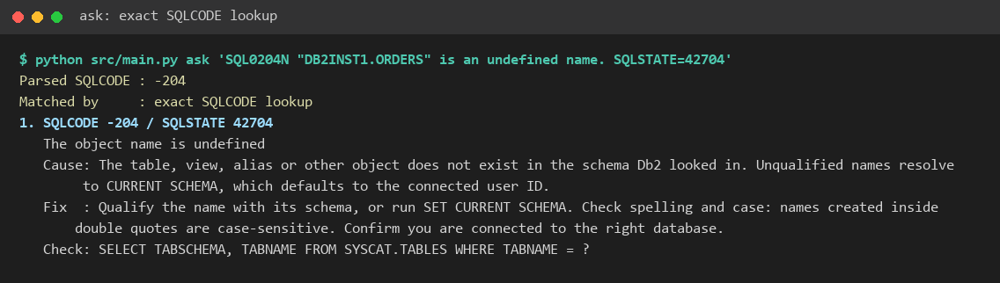
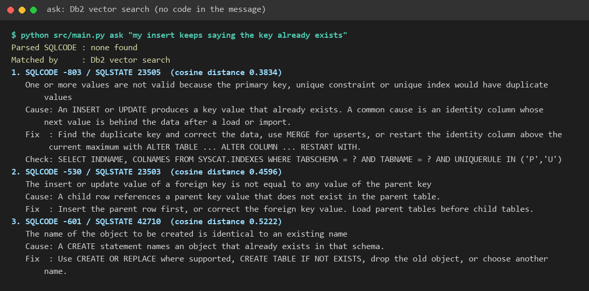
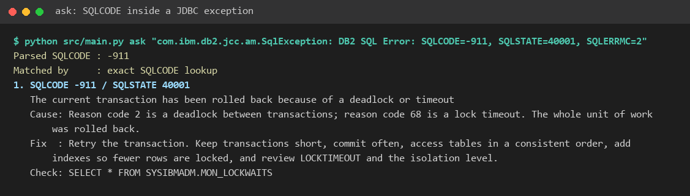
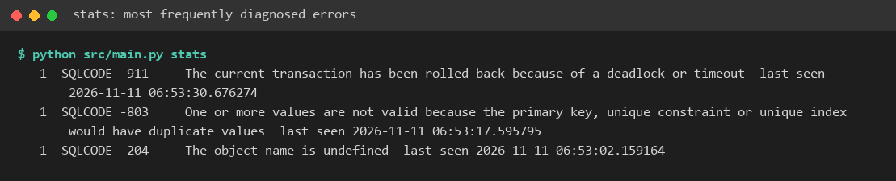
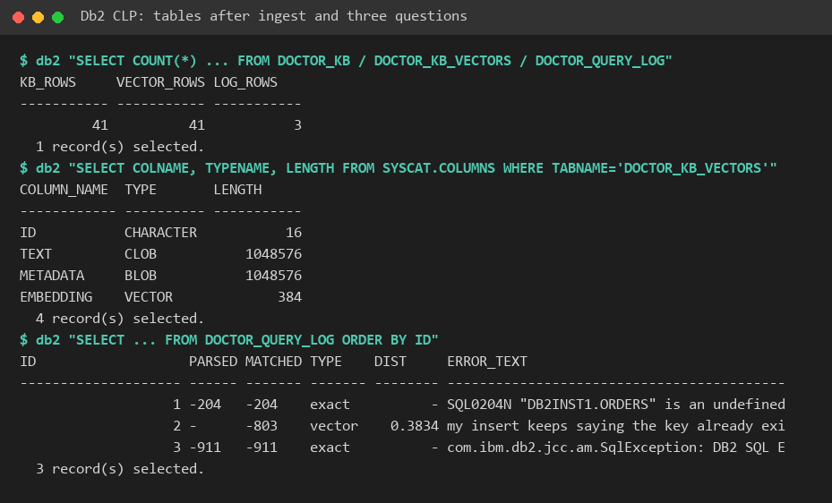
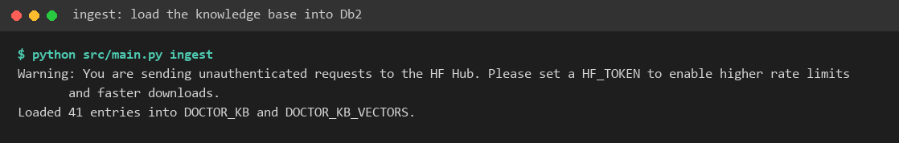

# Db2 Error Doctor

> **One-Line Pitch:** Paste any Db2 error message and get its cause, fix and a catalog query to check — found by exact SQLCODE lookup, or by Db2 vector search when the message contains no code.

## Problem Statement
Developers new to Db2 lose time on messages such as `SQL0668N ... reason code 7` or a bare driver exception with no code at all. Searching the web gives answers for the wrong platform or version. The target users are students and application developers working against Db2 from Python, Java or a SQL editor.

## Solution Overview
- `ingest` loads a curated knowledge base of 41 common Db2 SQLCODEs into Db2, as a relational table and as embeddings in a VECTOR table.
- `ask` diagnoses an error. If the text names a code (`SQL0204N`, `SQLCODE=-803`), the answer is an exact primary-key lookup. If it does not ("my insert says the key already exists"), LangChain's `DB2VS` runs a cosine similarity search inside Db2.
- Every request is logged to Db2, and `stats` reports which errors are diagnosed most often.
- An optional local LLM (Ollama) rewrites the retrieved notes as a short explanation. The tool works fully without it.

## IBM Db2 Integration
- **Db2 Edition & Environment:** Db2 Community Edition in Docker, created with the IBM Db2 Developer Extension for VS Code. Vector support needs Db2 12.1.2 or later.
- **Connector / Driver Used:** `ibm_db` / `ibm_db_dbi`, and `langchain-db2` (`DB2VS`).
- **Database Schema / Data Models:** `DOCTOR_KB` (one row per SQLCODE, primary key), `DOCTOR_KB_VECTORS` (text, metadata and a `VECTOR(384, FLOAT32)` embedding, managed by `DB2VS`), `DOCTOR_QUERY_LOG` (identity key, timestamp, parsed and matched code, match type, distance) with an index on `(MATCHED_CODE, ASKED_AT)`. Full DDL is in [architecture.md](architecture.md).
- **Key Queries & Operations:** primary-key lookup, `VECTOR_DISTANCE(..., COSINE)` top-k search, transactional reload of the knowledge base (`DELETE` + batched `INSERT`, one commit), and a `GROUP BY` + `LEFT JOIN` report. All values are bound with parameter markers.

## AI / LLM Architecture
- **Framework:** LangChain (`langchain-db2`, `langchain-huggingface`, optional `langchain-ollama`).
- **Model Provider & Model:** local `sentence-transformers/all-MiniLM-L6-v2` for embeddings; optional Ollama `llama3.2` for the explanation.
- **RAG Workflow:** the retrieved knowledge-base rows are the only context given to the LLM. The user's error text is wrapped in a delimiter and the system prompt tells the model to treat it as data, not instructions.

## Tech Stack
- **Backend / Core:** Python 3.10+
- **Database:** IBM Db2
- **Frontend / UI:** command line
- **Libraries & Tools:** LangChain, sentence-transformers, python-dotenv, pytest

## Prerequisites
- A running Db2 12.1.2+ instance (Community Edition is free)
- Python 3.10 or later and `pip`
- Optional: Ollama with `llama3.2` pulled

## Setup & Installation
```bash
cd submissions/db2-error-doctor
python -m venv .venv
source .venv/bin/activate  # On Windows: .venv\Scripts\activate
pip install -r src/requirements.txt
```

## Configuration
```bash
cp .env.example .env
```
Set `DB2_PASSWORD` (and host, port, user if they differ). Set `LLM_PROVIDER=ollama` to enable the explanation.

> **Security Warning:** never commit `.env`.

## Running the Project
```bash
python src/main.py ingest
python src/main.py ask "SQL0204N \"DB2INST1.ORDERS\" is an undefined name. SQLSTATE=42704"
python src/main.py ask "my insert keeps saying the key already exists"
python src/main.py stats
```

## Testing & Verification
```bash
pytest tests/
```
The 24 tests run offline against a recording fake connection. They cover SQLCODE parsing, input validation, table-name allow-listing, the exact and vector paths, and that user text is only ever passed as a bound parameter. To verify the Db2 integration, run the four commands above and inspect `DOCTOR_KB_VECTORS` and `DOCTOR_QUERY_LOG` in the VS Code extension.

**Verified end to end** on Db2 Community Edition 12.1.5 (Docker image `icr.io/db2_community/db2`): `ingest` loaded 41 rows into both tables, the three `ask` examples below returned the expected codes, and `stats` reported them. The screenshots show the real output.

## Screenshots & Demo
- **Demo Video Link:** to be added

| | |
|---|---|
| Exact lookup from a message ID |  |
| Db2 vector search from plain words |  |
| SQLCODE inside a JDBC exception |  |
| `stats` report from the query log |  |
| The tables in Db2, including the `VECTOR(384)` column |  |
| `ingest` |  |

## Known Limitations & Future Roadmap
- **Current Limitations:** the knowledge base covers 41 codes; reason codes are described in text, not parsed; the search is exact (no approximate index).
- **Next Steps:** ingest the full Db2 message reference, add a small web UI, and use `stats` to suggest which missing codes to add next.

## Team Members & Credits
| Name | GitHub Handle | Role / Contribution |
|---|---|---|
| Prabodh1231 | [@Prabodh1231](https://github.com/Prabodh1231) | Solo developer |

## License
This project is released under the [MIT License](LICENSE).

Knowledge-base text was written for this project. Third-party libraries are used under their own licences (LangChain: MIT; sentence-transformers and ibm_db: Apache-2.0).
