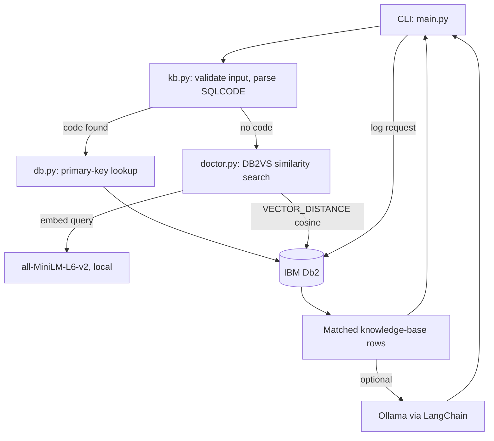

# System Architecture

## Overview
Db2 Error Doctor is a command-line RAG tool. Db2 is the only data store: it holds the knowledge base, its vector embeddings and the request log. LangChain's `DB2VS` handles the vector table; everything else is plain parameterised SQL through `ibm_db_dbi`.

## Architecture Diagram



## Component Breakdown
1. **Client layer — `src/main.py`:** `ingest`, `ask` and `stats` commands; maps configuration, connection and input errors to clear messages and exit codes.
2. **Application layer — `src/doctor.py`, `src/kb.py`, `src/config.py`:** input validation, SQLCODE parsing, the exact-then-vector decision, optional LLM explanation, report formatting.
3. **Database layer — `src/db.py` and `DB2VS`:** schema creation, transactional knowledge-base reload, lookups, logging and analytics.
4. **AI layer:** local sentence-transformers embeddings (384 dimensions); optional `ChatOllama` chain whose only context is the retrieved rows.

## Data Flow
1. **Ingestion:** `sqlcodes.json` is validated, written to `DOCTOR_KB` in one transaction, embedded, and stored in `DOCTOR_KB_VECTORS`.
2. **Input:** the pasted error is stripped of control characters and length-checked (3–2000 characters).
3. **Retrieval:** a parsed code is looked up by primary key. Otherwise the text is embedded and Db2 returns the top-k rows by cosine distance; each hit is joined back to `DOCTOR_KB` by code.
4. **Augmentation (optional):** matched rows and the delimited error text go to the LLM. An LLM failure never fails the diagnosis.
5. **Persistence:** the request, parsed code, matched code, match type and distance are inserted into `DOCTOR_QUERY_LOG`.
6. **Response:** cause, fix and a catalog query to check are printed.

## IBM Db2 Schema & Storage Design

```sql
CREATE TABLE IF NOT EXISTS DOCTOR_KB (
    SQLCODE     VARCHAR(12)   NOT NULL PRIMARY KEY,
    SQLSTATE    CHAR(5),
    TITLE       VARCHAR(200)  NOT NULL,
    CAUSE       VARCHAR(2000) NOT NULL,
    FIX         VARCHAR(2000) NOT NULL,
    EXAMPLE_SQL VARCHAR(1000)
);

-- Created and managed by langchain-db2 (DB2VS)
CREATE TABLE DOCTOR_KB_VECTORS (
    id        CHAR(16) PRIMARY KEY NOT NULL,
    text      CLOB,
    metadata  BLOB,
    embedding VECTOR(384, FLOAT32)
);

CREATE TABLE IF NOT EXISTS DOCTOR_QUERY_LOG (
    ID           BIGINT GENERATED ALWAYS AS IDENTITY PRIMARY KEY,
    ASKED_AT     TIMESTAMP NOT NULL DEFAULT CURRENT_TIMESTAMP,
    ERROR_TEXT   VARCHAR(2000) NOT NULL,
    PARSED_CODE  VARCHAR(12),
    MATCHED_CODE VARCHAR(12),
    MATCH_TYPE   VARCHAR(10) NOT NULL,
    DISTANCE     DOUBLE
);
CREATE INDEX DOCTOR_QUERY_LOG_CODE_IX ON DOCTOR_QUERY_LOG (MATCHED_CODE, ASKED_AT);
```

Design choice: exact lookup runs before vector search because an error that names its code has one right answer; embeddings are used only where they add value, for free-text descriptions.

## Security & Secrets Management
- Credentials are read from environment variables (`.env` locally, ignored by Git); only `.env.example` with placeholders is committed.
- Every user-supplied value is bound with a parameter marker. Table names cannot be bound, so they come only from configuration and must match `^[A-Z][A-Z0-9_]{0,63}$`.
- Input is length-limited and stripped of control characters before use.
- The LLM prompt treats the error text as untrusted data and restricts answers to the retrieved notes.
- The application needs only CREATE TABLE, SELECT, INSERT and DELETE on its three tables; it does not need DBADM.
