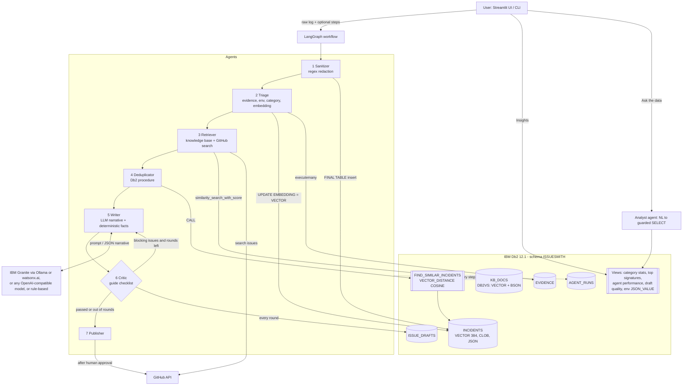
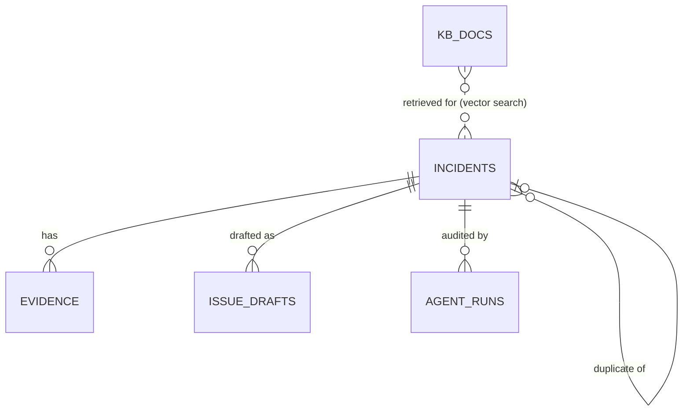

# System Architecture

## Overview
IssueSmith is a Python application with two front ends: a Streamlit UI and a CLI. Both drive one **LangGraph** agent workflow. **IBM Db2** is the system of record for everything the agents do:
- sanitised logs,
- extracted evidence,
- incident embeddings (`VECTOR`),
- the troubleshooting knowledge base (LangChain `DB2VS`),
- every draft round,
- the full agent audit trail.

Duplicate detection runs inside Db2 as a SQL PL stored procedure using `VECTOR_DISTANCE`. Analytics are served by Db2 views.

---

## Architecture Diagram



---

## Component Breakdown

1. **User interface layer** (`src/app.py`, `src/cli.py`)
   - Streamlit tabs: *Analyze a log* (with live agent trace), *Incident history* (draft rounds and audit trail), *Insights* (Db2 views), *Ask the data* (guarded text-to-SQL).
   - The CLI provides `check`, `init-db`, `seed-kb`, `analyze`, `demo` and `stats`.

2. **Agent orchestration layer** (`src/issuesmith/agents/graph.py`)
   - A LangGraph `StateGraph` with typed state, seven nodes and a conditional critic → writer loop (`MAX_CRITIC_ROUNDS`).
   - Each node is wrapped by `_timed`, which writes status, detail and latency to `AGENT_RUNS`. Auditing failures never stop the pipeline.

3. **Domain logic**
   - `sanitizer.py`: ordered regex rules with allow-lists for public endpoints, version numbers and localhost.
   - `log_parser.py`: weighted signals (ERROR / WARNING / OBSERVATION), environment extraction, signature normalisation, classification.
   - `issue_writer.py`: the facts-versus-narrative split, prompt templates, a rule-based fallback writer and the Markdown renderer.
   - `critic.py`: blocking and warning checks, a score out of 100 and feedback for the writer.
   - `sql_agent.py`: natural language to SQL with a validator (single SELECT/WITH, keyword deny-list, schema allow-list, forced row limit).

4. **Database layer** (`src/issuesmith/db.py`, `schema.sql`, `knowledge.py`)
   - `ibm_db_dbi` with parameter markers everywhere, explicit commits, and rollback for read-only analyst queries.
   - The schema is idempotent: "already exists" errors are tolerated, and `--reset` drops and recreates the tables.
   - The knowledge base uses LangChain `DB2VS` with the `COSINE` distance strategy.

5. **Integrations**
   - `llm.py`: Ollama, watsonx.ai (IAM token exchange plus chat API), OpenAI-compatible endpoints, or none.
   - `embeddings.py`: sentence-transformers with a hash fallback, both 384-dimensional.
   - `github_client.py`: issue search and creation.

---

## Data Flow

1. **Input ingestion:** The user uploads, pastes or picks a log and can add reproduction steps and how often it happens.
2. **Sanitisation:** Secrets are removed in memory. Only the sanitised log is inserted into `INCIDENTS` (`SELECT INCIDENT_ID FROM FINAL TABLE (INSERT ...)`).
3. **Triage:** Evidence rows go to `EVIDENCE`. Category, confidence, `ENV_JSON` and the fingerprint embedding (`VECTOR(?, 384, FLOAT32)`) update the incident row.
4. **Context retrieval:** `DB2VS` ranks `KB_DOCS` by cosine distance, `CALL FIND_SIMILAR_INCIDENTS(id)` ranks earlier incidents, and GitHub search finds open issues.
5. **Augmentation and inference:** Evidence, environment, knowledge and critic feedback go into the writer prompt. The LLM returns JSON narrative only.
6. **Validation:** The critic verifies the draft against the sanitised log. Each round is stored in `ISSUE_DRAFTS` with its score and notes.
7. **Response delivery:** The user edits the final draft (saved back to Db2), downloads it, or posts it to GitHub after explicit approval. The URL is stored and the status becomes `POSTED`.
8. **Analytics:** The views aggregate incidents, signatures, agent latency, draft quality and environment (`JSON_VALUE`).

---

## IBM Db2 Schema & Storage Design

The full DDL is in [`src/issuesmith/schema.sql`](src/issuesmith/schema.sql). Key parts:

```sql
CREATE TABLE ISSUESMITH.INCIDENTS (
  INCIDENT_ID      INTEGER GENERATED ALWAYS AS IDENTITY (START WITH 1001) NOT NULL PRIMARY KEY,
  SOURCE_NAME      VARCHAR(255),
  CATEGORY         VARCHAR(30)  NOT NULL DEFAULT 'UNCLASSIFIED',
  CONFIDENCE       DECIMAL(4,3),
  SIGNATURE        VARCHAR(3000),
  ENV_JSON         CLOB(64K),
  SANITIZED_LOG    CLOB(10M),
  REDACTION_COUNT  INTEGER      NOT NULL DEFAULT 0,
  EMBEDDING        VECTOR(384, FLOAT32),
  STATUS           VARCHAR(20)  NOT NULL DEFAULT 'NEW',
  DUPLICATE_OF     INTEGER,
  CREATED_AT       TIMESTAMP    NOT NULL DEFAULT CURRENT TIMESTAMP,
  CONSTRAINT CK_INCIDENT_STATUS CHECK (STATUS IN ('NEW','DRAFTED','DUPLICATE','POSTED'))
);

CREATE OR REPLACE PROCEDURE ISSUESMITH.FIND_SIMILAR_INCIDENTS (IN P_INCIDENT_ID INTEGER)
  LANGUAGE SQL READS SQL DATA DYNAMIC RESULT SETS 1
BEGIN
  DECLARE C1 CURSOR WITH RETURN TO CALLER FOR
    SELECT O.INCIDENT_ID, O.CATEGORY, O.STATUS, O.CREATED_AT,
           VECTOR_DISTANCE(T.EMBEDDING, O.EMBEDDING, COSINE) AS DISTANCE
    FROM ISSUESMITH.INCIDENTS T
    JOIN ISSUESMITH.INCIDENTS O ON O.INCIDENT_ID <> T.INCIDENT_ID
    WHERE T.INCIDENT_ID = P_INCIDENT_ID AND T.EMBEDDING IS NOT NULL AND O.EMBEDDING IS NOT NULL
    ORDER BY DISTANCE FETCH FIRST 5 ROWS ONLY;
  OPEN C1;
END
```

Entity relationships:



Design notes:
- Embeddings are of a normalised error **fingerprint**, not the raw log. Timestamps, numbers, paths and redaction tokens are removed first, so the same failure on different machines lands close together.
- Indexes back the two hottest paths: lookups by incident and grouping by signature or category.
- The evidence foreign key uses `ON DELETE CASCADE`, so deleting an incident removes its evidence and drafts.

---

## Security & Secrets Management
- All database credentials and external API tokens are read at runtime from environment variables (`.env`, never committed). `.env.example` contains placeholders only, and placeholder values are ignored at runtime.
- **Logs are sanitised before persistence or any LLM call.** Raw logs are never written to Db2.
- The critic re-scans every draft for secrets and blocks it if any are found.
- All application SQL uses parameter markers. The analyst agent only runs validated read-only `SELECT`s on the IssueSmith schema, with a row limit, inside a transaction that is rolled back.
- Posting to GitHub requires an explicit human approval checkbox and a user-chosen target repository.
