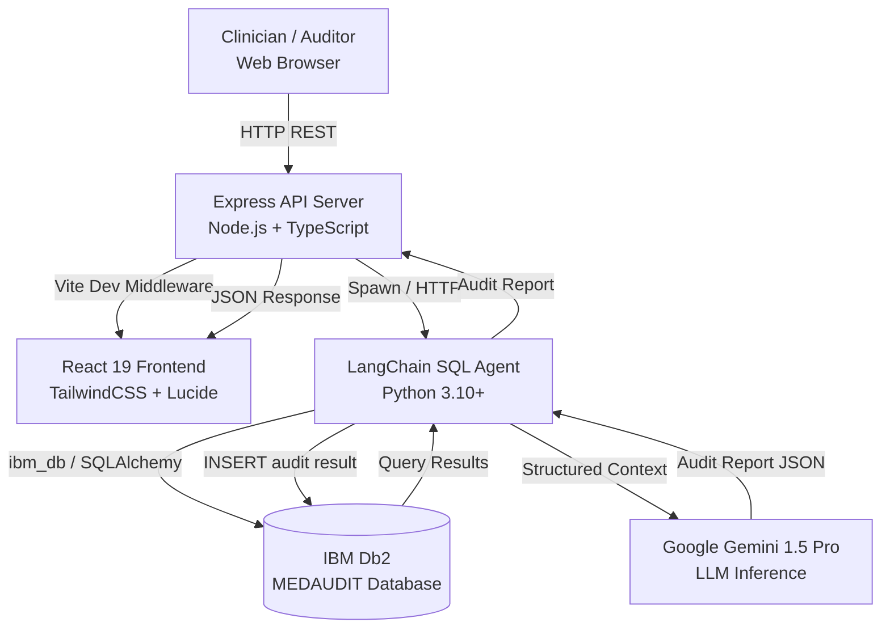

# System Architecture — DB2 MedAudit

## Overview

DB2 MedAudit is a three-layer system: a React + TypeScript frontend, a Node.js/Express API backend, and a Python LangChain AI agent — all anchored on **IBM Db2** as the authoritative data store for clinical guidelines, physician profiles, commission contracts, and audit logs.

---

## Architecture Diagram



---

## Component Breakdown

### 1. User Interface Layer — React 19 + TailwindCSS

| Component | Purpose |
|---|---|
| `AuditWorkspace.tsx` | Prescription input form + audit report viewer |
| `DB2Studio.tsx` | Live SQL query runner against the Db2 schema |
| `KickbackMatrix.tsx` | Doctor suspicion score leaderboard from `DOCTORS` table |
| `SetupGuide.tsx` | In-app onboarding for Db2 and environment setup |
| `Header.tsx` | Navigation header |

### 2. Application Backend — Express + TypeScript

- Serves the compiled React frontend and proxies dev Vite requests.
- Exposes `/api/audit` endpoint that invokes the Python LangChain agent subprocess.
- Reads `GEMINI_API_KEY` and Db2 connection variables from `.env` at startup.

### 3. Database Layer — IBM Db2

- **Buffer pool:** `BP_MEDAUDIT` (8K pages, 5000 pages).
- **Tablespace:** `TS_MEDAUDIT` — all application tables stored here.
- Indexes on high-query columns: `SUSPICION_SCORE DESC` on `DOCTORS`, `POTENTIAL_SAVINGS DESC` on `AUDIT_LOGS`, `COMMISSION_PCT DESC` on `LAB_COMMISSION_CONTRACTS`.

### 4. AI / Model Orchestration Layer — LangChain + Gemini

- `medaudit_langchain_agent.py` creates a LangChain `SQLDatabase` connection to Db2 via `ibm_db_sa`.
- `create_sql_agent(llm, toolkit)` provides the LLM with Db2 schema introspection and parameterised SQL tools.
- The agent automatically issues multi-step queries: first retrieving guidelines, then joining doctor/lab kickback data.
- Gemini generates a structured JSON audit report (flagged tests, savings estimate, risk level).

---

## Data Flow

1. **Input Ingestion**: Auditor enters patient chief complaint, ordered tests, doctor ID, and lab ID via the React Audit Workspace.
2. **API Dispatch**: Express `/api/audit` receives the payload and calls the Python LangChain agent.
3. **Context Retrieval**: The agent queries Db2:
   - `CLINICAL_GUIDELINES` → indicated & unwarranted tests for the condition.
   - `DOCTORS` → suspicion score and historical unnecessary order rate.
   - `LAB_COMMISSION_CONTRACTS` → active kickback agreements for this doctor–lab pair.
   - `TEST_CATALOG` → fair-market pricing for ordered tests.
4. **LLM Augmentation**: Assembled context is injected into a Gemini prompt. The model flags each unwarranted test with clinical rationale and calculates savings.
5. **State Persistence**: Audit result is `INSERT`ed into `AUDIT_LOGS` with kickback alert flag.
6. **Response Delivery**: JSON audit report is returned to the React frontend and rendered in the Audit Workspace.

---

## IBM Db2 Schema & Storage Design

```sql
-- Schema: CLINICAL_INTELLIGENCE
-- Tablespace: TS_MEDAUDIT (8K page size)

-- Evidence-Based Clinical Guidelines (NICE / WHO / ICMR)
CREATE TABLE CLINICAL_GUIDELINES (
    GUIDELINE_ID    VARCHAR(32)  NOT NULL,
    CONDITION_CODE  VARCHAR(32)  NOT NULL,
    CONDITION_NAME  VARCHAR(128) NOT NULL,
    AUTHORITY       VARCHAR(64)  NOT NULL,
    INDICATED_TESTS CLOB(10K),
    UNWARRANTED_TESTS CLOB(10K),
    CONSTRAINT PK_GUIDELINE PRIMARY KEY (GUIDELINE_ID)
) IN TS_MEDAUDIT;

-- Physician Profiles with Suspicion Scoring
CREATE TABLE DOCTORS (
    DOCTOR_ID              VARCHAR(32)   NOT NULL,
    FULL_NAME              VARCHAR(128)  NOT NULL,
    SUSPICION_SCORE        DECIMAL(5,2)  DEFAULT 0.00,
    UNNECESSARY_ORDER_RATE DECIMAL(5,2)  DEFAULT 0.00,
    CONSTRAINT PK_DOCTOR PRIMARY KEY (DOCTOR_ID)
) IN TS_MEDAUDIT;
CREATE INDEX IDX_DOC_SUSP ON DOCTORS(SUSPICION_SCORE DESC);

-- Doctor–Lab Kickback Commission Contracts
CREATE TABLE LAB_COMMISSION_CONTRACTS (
    CONTRACT_ID     VARCHAR(32)  NOT NULL,
    DOCTOR_ID       VARCHAR(32)  NOT NULL,
    LAB_ID          VARCHAR(32)  NOT NULL,
    COMMISSION_PCT  DECIMAL(5,2) NOT NULL,
    IS_ACTIVE       CHAR(1)      DEFAULT 'Y',
    CONSTRAINT PK_CONTRACT PRIMARY KEY (CONTRACT_ID),
    CONSTRAINT FK_CONTRACT_DOC FOREIGN KEY (DOCTOR_ID)
        REFERENCES DOCTORS(DOCTOR_ID) ON DELETE CASCADE
) IN TS_MEDAUDIT;

-- Patient Encounter Audit Logs
CREATE TABLE AUDIT_LOGS (
    AUDIT_ID          VARCHAR(32)   NOT NULL,
    PATIENT_PSEUDONYM VARCHAR(64)   NOT NULL,
    DOCTOR_ID         VARCHAR(32),
    LAB_ID            VARCHAR(32),
    TOTAL_ORDERED_COST  DECIMAL(10,2) NOT NULL,
    JUSTIFIED_COST      DECIMAL(10,2) NOT NULL,
    POTENTIAL_SAVINGS   DECIMAL(10,2) NOT NULL,
    KICKBACK_ALERT      CHAR(1)       DEFAULT 'N',
    AUDIT_TIMESTAMP     TIMESTAMP     NOT NULL DEFAULT CURRENT TIMESTAMP,
    CONSTRAINT PK_AUDIT_LOG PRIMARY KEY (AUDIT_ID)
) IN TS_MEDAUDIT;
CREATE INDEX IDX_AUDIT_SAVINGS ON AUDIT_LOGS(POTENTIAL_SAVINGS DESC);
```

---

## Security & Secrets Management

- All Db2 connection parameters (`DB2_HOST`, `DB2_PORT`, `DB2_USER`, `DB2_PASS`, `DB2_DB`) and the Gemini API key (`GEMINI_API_KEY`) are read exclusively from environment variables via `python-dotenv` and Node.js `process.env`.
- `.env.example` contains only placeholder values (no real credentials).
- `.env` is listed in `.gitignore` and is never committed.
- Patient records use pseudonymised identifiers only — no real PII is stored.
