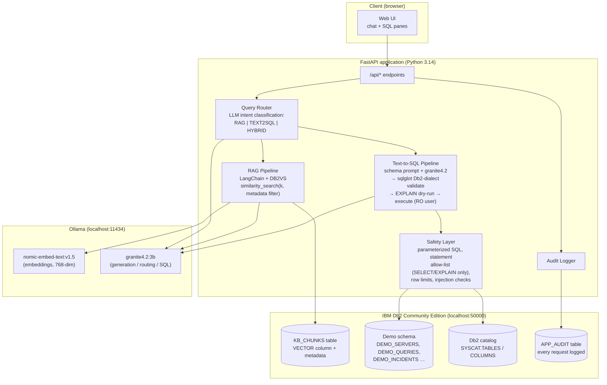
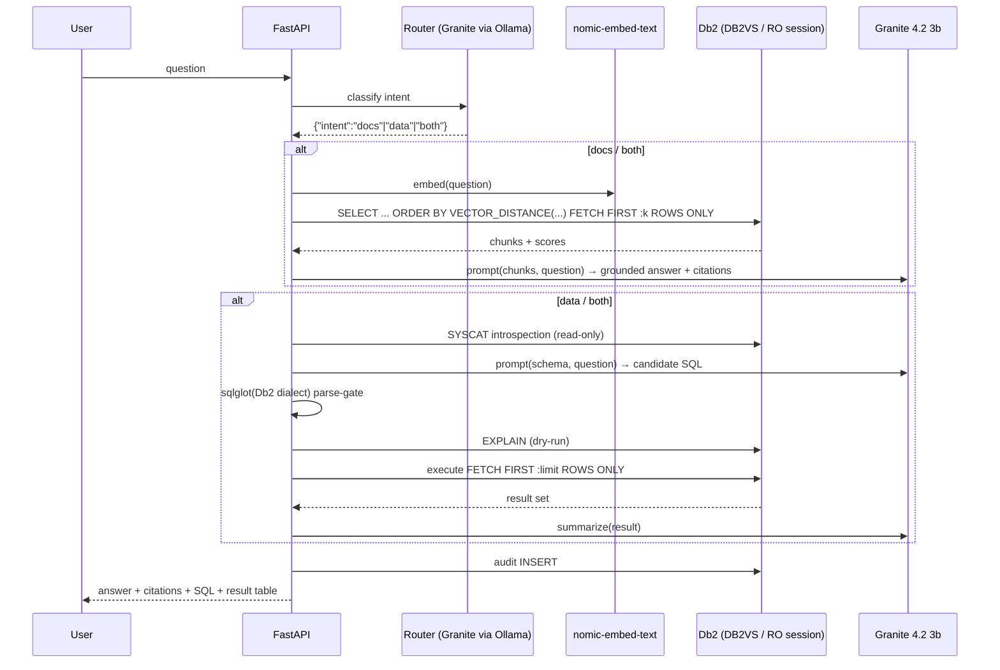

# PROPOSED ARCHITECTURE — "Db2 Ops Copilot" (Concept 5)

**Status:** M0 proposal — historical design document. It was never code at
the time of writing; since then the project has been implemented in staged
form (see `README.md` for current status). Where this document and the
implemented system differ, the implementation + `docs/ARCHITECTURE.md` are
authoritative. All components here remain design intent unless listed as
implemented there.
**Stack:** See `TECH_STACK_DECISION.md`. Python 3.14 · LangChain 1.x · `langchain-db2` (DB2VS) · `ibm_db` · Ollama (`granite4.2:3b`, `nomic-embed-text:v1.5`) · IBM Db2 Community Edition (Docker).

---

## 1. System Architecture



## 2. Component Responsibilities

| Component | Responsibility |
|---|---|
| **Web UI** | Single page: chat transcript, retrieved-chunk citations panel, generated-SQL + EXPLAIN + result-table panel. Built to be *judge-convincing*: every answer shows the Db2 operations behind it. |
| **FastAPI app** | Thin orchestration; all Db2 access through a small `db.py` module (connection factory, read-only role for executed SQL, audit writes). |
| **Query Router** | One LLM call → classified intent (`docs_question` / `data_question` / `both`) with structured JSON output (Granite supports JSON output). Logged. |
| **RAG pipeline** | Embed question (nomic) → `DB2VS.similarity_search(query, k=4, filter={'product':'db2','version':…})` → stuff chunks + question into Granite prompt → answer + citations. |
| **Text-to-SQL pipeline** | Introspect live schema from `SYSCAT` → build schema prompt → Granite generates Db2-dialect SQL → **validate/parse with official `db2-sqlglot-dialect`** → `EXPLAIN` dry-run in Db2 → execute under read-only user with `FETCH FIRST n ROWS ONLY` cap → LLM summarizes result set. |
| **Safety Layer** | Statement allow-list (SELECT & EXPLAIN only), sqlglot parse gate, parameter binding for all app-generated queries, row caps, timeout, deny-list of catalog/system views per config. |
| **Audit Logger** | INSERT per request: timestamp, intent, question, retrieved chunk ids, generated SQL, execution status, latency. Powers a small "activity" panel (extra Db2 depth on display). |

## 3. Data Flow (happy path)



## 4. Database Schema Proposal (Db2 Community Edition, database `testdb`)

All DDL uses only broadly available Db2 LUW features; the vector-specific DDL requires the `VECTOR` type (Db2 12.1.2+, ✅ per Db2 AI Cookbook prerequisites — **image version to be confirmed at provisioning, M1** ❓).

```sql
-- Knowledge base for RAG (LangChain DB2VS manages this table; sketch of what it materializes)
CREATE TABLE KB_CHUNKS (
  ID          INTEGER      GENERATED ALWAYS AS IDENTITY PRIMARY KEY,
  CONTENT     CLOB,
  EMBEDDING   VECTOR(768, FLOAT32) NOT NULL,   -- nomic-embed-text:v1.5 = 768 dims
  METADATA    JSON,                            -- {"source","topic","version"}
  CREATED_AT  TIMESTAMP    DEFAULT CURRENT TIMESTAMP
);

-- Demo relational data (seeded, clearly synthetic) for text-to-SQL
CREATE TABLE DEMO_SERVERS (
  SERVER_ID   INTEGER PRIMARY KEY,
  HOSTNAME    VARCHAR(64),
  ENVIRONMENT VARCHAR(16),     -- prod / staging / dev
  OWNER_TEAM  VARCHAR(32),
  UPTIME_PCT  DECIMAL(5,2)
);
CREATE TABLE DEMO_INCIDENTS (
  INCIDENT_ID INTEGER PRIMARY KEY,
  SERVER_ID   INTEGER REFERENCES DEMO_SERVERS(SERVER_ID),
  SEVERITY    INTEGER,
  OPENED_AT   TIMESTAMP,
  RESOLVED_AT TIMESTAMP
);

-- Audit trail (every copilot request)
CREATE TABLE APP_AUDIT (
  AUDIT_ID    BIGINT GENERATED ALWAYS AS IDENTITY PRIMARY KEY,
  REQ_TS      TIMESTAMP DEFAULT CURRENT TIMESTAMP,
  INTENT      VARCHAR(16),
  QUESTION    CLOB,
  SQL_TEXT    CLOB,
  STATUS      VARCHAR(16),     -- OK / REJECTED_BY_GATE / ERROR
  LATENCY_MS  INTEGER
);
```

Plus a dedicated **read-only Db2 user** for executed generated SQL (see §6). Indexing: DB2VS creates its own vector index structure; add B-tree indexes on demo FKs; note `VECTOR` similarity search performance characteristics to measure in M1 (❓ vector index support in the provisioned version — the cookbook's "Vector indexes in Db2: an early preview" blog suggests it is evolving).

## 5. API Design Outline

| Method & path | Purpose |
|---|---|
| `POST /api/ask` `{question, k?, limit?}` | Main endpoint → router → (RAG \| T2SQL \| hybrid) → `{answer, citations[], sql?, explain?, rows?, intent, timings}` |
| `POST /api/ingest` `{source, text\|files}` | Chunk → embed → insert into KB via DB2VS (`/ingest` locked behind a local admin token) |
| `GET /api/schema` | Live Db2 schema snapshot (from SYSCAT) for the UI's schema panel |
| `GET /api/audit?limit=50` | Recent audit rows (demonstrates logging; doubles as demo eye-candy) |
| `GET /api/health` | Db2 connectivity + Ollama model availability + versions |

## 6. Security Considerations (maps to the website's 15% Security rubric)

1. **Zero secrets:** connection creds only via `.env` (gitignored); `.env.example` placeholders only — enforced by the official validator (✅ forbids committing `.env`, `*.pem`, keys).
2. **Parameterized SQL everywhere** in application code; generated SQL is *never* string-concatenated with user input — it is parsed by `db2-sqlglot-dialect`, restricted to a single SELECT/EXPLAIN statement, and executed on a **least-privilege read-only Db2 user** (grants: SELECT on demo views only; no DDL/DML privileges).
3. **Prompt-injection defenses:** user text is delimited and never interpreted as instructions; router/SQL prompts use fixed templates; sqlglot gate blocks multi-statement/comment-smuggling payloads; row caps + execution timeouts bound blast radius; audit log records everything (explicitly named in the rubric).
4. **No PII:** demo corpus is public documentation + synthetic data; no user content persisted beyond the local audit table.
5. **License hygiene:** Db2 AI Cookbook is Apache-2.0 (✅) — any adapted text/snippets are attributed in README to avoid plagiarism triggers.

## 7. Error Handling Strategy

- **Db2 down / Docker not started:** `/api/health` fails fast with actionable message ("start Docker Desktop / db2server container"); UI shows setup banner, app still renders.
- **Ollama down or model missing:** health check detects; clear message; optional watsonx/OpenAI fallback behind env flag (not default — keeps zero-key demo).
- **SQL gate rejection:** user gets a friendly explanation + the rejected SQL shown as "blocked by safety layer" (turns a failure into a security demo).
- **EXPLAIN/execution error:** Db2 error text captured, fed back to the LLM once for self-repair (single retry loop, bounded), else shown verbatim with docs citation.
- **Slow inference:** streaming responses in UI; hard request timeout; k/limit capped.
- All paths logged to `APP_AUDIT` with status codes.

## 8. Deployment Strategy (demo = local, reproducible)

1. Prereqs (documented in README): Docker Desktop running, `icr.io/db2_community/db2` container (via VS Code extension "Create Db2 instance" **or** `docker run` — final route chosen in M1 after testing both), Ollama + 2 models pulled (models dir on **E:** due to C: space).
2. `python -m venv` not required (Python 3.14 global is compatible); `pip install -r requirements.txt` with **pinned** versions.
3. `python seed.py` → creates tables, ingests corpus, seeds demo data (idempotent).
4. `uvicorn app:app` → UI on localhost.
5. For the submission: everything reproducible from README in ≤4 commands; screenshots + short video recorded as fallback evidence (`video_url` in `submission.json`).

## 9. Demo Workflow (for the judges / video)

1. Show `docker ps` + `/api/health` (Db2 + Ollama live) — *prove real infrastructure*.
2. Show Db2 table `KB_CHUNKS` row count via plain SQL in VS Code extension — *prove data is really in Db2*.
3. Ask a docs question → UI shows retrieved chunks with scores + generated SQL that fetched them + grounded answer — *RAG on Db2 vectors*.
4. Ask a data question → UI shows SYSCAT-derived schema, generated Db2 SQL, sqlglot validation badge, EXPLAIN output, result table — *guardrailed text-to-SQL*.
5. Attempt a malicious SQL question ("drop table…") → safety gate blocks it — *security rubric, live*.
6. Open `/api/audit` → show every step was logged in Db2 — *enterprise touch*.

## 10. Open Questions carried to M1 (❓)

- Db2 Community Edition version in `icr.io/db2_community/db2:latest` — does it include `VECTOR` type (12.1.2+) and how does DB2VS behave on it?
- Measured latency of granite4.2:3b + nomic-embed-text on this CPU for demo-sized workloads.
- Exact closing time of submissions (WhatsApp announcement).
- Which rubric (6-dimension website vs 5-dimension repo) judges apply.
