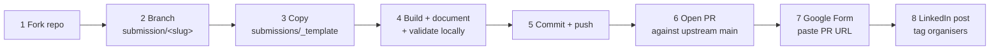

# SUBMISSION GUIDE — IBM Db2 TechX Summit 2026 (Db2Hack)

**Verified on:** 30 October 2026 (IST) against the official repository `KunalGolaIBM/IBM_Db2_TechX_Project_Submission` (README, CONTRIBUTING, PR template, validator script, CI workflow, submissions rules) and the official website `/submit` page.
**Nothing has been submitted. This is a guide only.**

---

## 1. Workflow (exact, official)



### Step 1 — Fork & clone
- Fork `https://github.com/KunalGolaIBM/IBM_Db2_TechX_Project_Submission` to your GitHub account; clone the fork; add `upstream` remote pointing at the official repo.

### Step 2 — Branch
- `git fetch upstream main`
- `git checkout -b submission/<project-slug> upstream/main`
- Slug rules: lowercase alphanumeric + hyphens only, regex `^[a-z0-9]+(-[a-z0-9]+)*$` (enforced by the validator). Candidate slug: **`db2-ops-copilot`** (final name decided at M1).

### Step 3 — Template
- `cp -r submissions/_template submissions/<project-slug>`
- Template provides: `README.md`, `architecture.md`, `submission.json`, `.env.example`, `src/`, `docs/screenshots/`.

### Step 4 — Build, document, validate
- Source code in `src/`. Fill `submission.json` (see §3). Write real `README.md` + `architecture.md`. `.env.example` with dummy values only.
- Local validation: `python scripts/validate_submission.py submissions/<project-slug>` → must print "ALL VALIDATION CHECKS PASSED."

### Step 5 — Commit & push
- `git add submissions/<project-slug>` (stage **only** your folder)
- Commit style (Conventional Commits scoped to slug): `feat(<project-slug>): add hackathon submission`, later `docs(<slug>): …`, `fix(<slug>): …`
- `git push -u origin submission/<project-slug>`

### Step 6 — Pull request
- Base: `KunalGolaIBM/IBM_Db2_TechX_Project_Submission` `main`; head: your fork's `submission/<slug>`.
- **PR title (mandatory format):** `[Submission] <project-slug>: <Short Project Title>` — e.g. `[Submission] db2-ops-copilot: Db2 Ops Copilot`.
- Complete **every** section of the PR template (project overview, team table, Db2 integration summary, tech stack & AI usage, demo links, full checklist).

### Step 7 — Google Form (**mandatory, PR is not enough**)
- ⚠️ The repo still contains the placeholder `[GOOGLE_FORM_LINK_TO_BE_ADDED]`. The website states the form link is distributed **via the mandatory WhatsApp community and by email**. Action: join the WhatsApp group and retrieve the live link; paste the PR URL before the (unannounced) closing time.

### Step 8 — LinkedIn post (**mandatory per website**)
- Post describing the use case clearly, tag the organising team. Best posts get appreciation from IBM experts (this also feeds the "Documentation & presentation" and community criteria).

## 2. What the CI Checks (`.github/workflows/validate-submission.yml`)

- Runs automatically on PRs touching `submissions/**` (ubuntu-latest, Python 3.11) via `scripts/validate_submission.py`.
- Fails the PR if: folder name isn't kebab-case; `README.md` / `architecture.md` / `submission.json` / `.env.example` missing **or shorter than 20 bytes**; any forbidden file present (`.env`, `.env.local`, `.env.*`, `id_rsa`, `id_ed25519`, `*.pem`, `*.pfx`, `*.p12`, `*.key`); `submission.json` invalid; `project.title` or `team.name` still template placeholders; `project.slug` ≠ folder name; `team.members` empty; `ibm_db2.edition` or `ibm_db2.connector` missing.
- Manual-only rules (not machine-checked but graded/ticketed): scope isolation (files outside your folder → CI/organizer rejection), plagiarism, tampering.

## 3. `submission.json` — planned content (draft)

```json
{
  "project": {
    "title": "Db2 Ops Copilot",
    "slug": "db2-ops-copilot",
    "short_description": "Hybrid RAG + guardrailed text-to-SQL copilot that answers Db2 documentation questions from Db2-stored vector embeddings and runs schema-aware, sqlglot-validated read-only SQL against the live Db2 database.",
    "category": "AI / RAG",
    "demo_url": "",
    "video_url": "",
    "repo_url": ""
  },
  "team": {
    "name": "<to be filled — individual entry>",
    "members": [ { "name": "<name>", "github": "<gh-user>", "email": "<email>", "role": "Backend / AI Developer" } ]
  },
  "ibm_db2": {
    "edition": "Db2 Community Edition (Docker)",
    "connector": "ibm_db + langchain-db2 (DB2VS)",
    "features_used": ["Vector / JSON Search", "Relational Tables", "Indexing", "Catalog introspection (SYSCAT)", "Audit logging"]
  },
  "tech_stack": {
    "languages": ["Python"],
    "frameworks": ["FastAPI", "LangChain"],
    "ai_models": ["Ollama granite4.2:3b", "Ollama nomic-embed-text:v1.5"]
  }
}
```
*(final values confirmed at M1; e.g. `video_url` filled after recording)*

## 4. Rubric-Aware Checklist (union of both official rubrics)

- [ ] Db2 used **in code** for: vector storage + retrieval, relational demo schema, catalog introspection, audit logging (Db2 depth 25–30%)
- [ ] At least one mandated framework — **LangChain** via `langchain-db2` (hard requirement)
- [ ] Clear problem statement + real users + value (Innovation 20–25%)
- [ ] Modular code, complete `architecture.md` with diagrams (Arch/AI 15–20%)
- [ ] Security: zero secrets, parameterized SQL, read-only DB role, sqlglot gate, prompt-injection defenses, audit trail (15% on website rubric)
- [ ] Fresh-clone reproducibility: pinned requirements, `.env.example`, ≤4 setup commands, tests (15%)
- [ ] Templates fully filled, no placeholders, screenshots + demo video, clean commit history (10%)
- [ ] PR title/branch/folder/commit conventions exact
- [ ] Google Form submitted with PR URL + LinkedIn post published

## 5. Deadline Posture (⚠️ read carefully)

- Repo README: "Hard Deadline — 29 Oct 2026 7:00 PM IST".
- Live website (checked 30 Oct, event day): "**There is no deadline today**"; submissions "open now and **not strict**"; on-campus build window 30 Oct 14:00–15:00; **closing time to be announced on WhatsApp**.
- **Operating assumption:** submissions are currently accepted; act as if the window can close at any time — target *submitting as early as technically sound*, monitor WhatsApp, and treat the repo deadline text as stale but the unannounced closing time as a genuine risk.

## 6. Explicitly NOT done yet

No fork created, no branch, no template copy, no PR, no Google Form entry, no LinkedIn post. Awaiting M1 approval.
