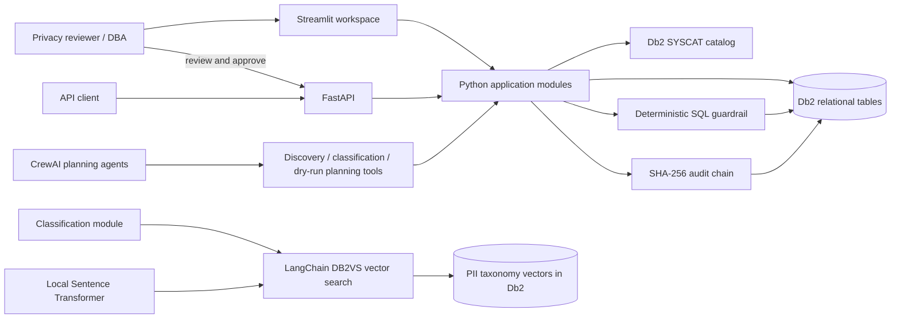

# Architecture

## Overview

Db2 Privacy Copilot is a Streamlit and FastAPI application backed by IBM Db2. Python modules perform schema discovery, classification, consent management, rights-request planning, deterministic SQL validation, and audit logging. CrewAI agents can call planning and discovery tools; they cannot execute erasure SQL.

## Component diagram

## Components

1. **User interface:** Streamlit pages provide the landing experience, demo sign-in, dashboard, and privacy workflow views.
2. **API:** FastAPI exposes health, discovery, classification, consent, rights-request, and audit endpoints. The local Compose API is available on host port 8001.
3. **Application modules:** `app/discovery.py` reads Db2 catalog metadata and builds a foreign-key graph with NetworkX. `app/classify.py` combines value rules with semantic label matching. `app/consent.py`, `app/erasure.py`, and `app/audit.py` implement consent history, dry-run plans, and audit records.
4. **AI-assisted planning:** CrewAI agents receive read-only discovery, classification, and plan-building tools. There is intentionally no agent tool for executing erasure.
5. **Deterministic guardrail:** `app/guardrail.py` validates planned SQL, filters, table scope, approval, and unsafe tokens before the executor can make changes.
6. **Database:** IBM Db2 Community Edition stores the sample clinic schema and application state. Db2 catalog views expose metadata; Db2 temporal tables preserve consent history; DB2VS stores and searches taxonomy vectors.

## Db2 schema and persistence

The bootstrap scripts under `src/sql/` create the sample clinic tables (`PATIENT`, `APPOINTMENT`, `BILLING`, `PRESCRIPTION`, `LAB_REPORT`, `SUPPORT_TICKET`, and `MARKETING_LIST`) plus application tables such as `PII_MAP`, `RETENTION_RULES`, `REQUESTS`, and `AUDIT_LOG`. The consent setup creates `CONSENT` with `CONSENT_HISTORY` as its temporal history table. Vector classification stores embeddings in `PII_TAXONOMY_VECTORS` using Db2 vector support.

The connector is `ibm_db` / `ibm_db_dbi`. Schema discovery queries Db2 catalog tables and references. Classification samples configured demo values, applies deterministic pattern checks, and compares locally generated column-name embeddings with taxonomy vectors through LangChain's Db2 integration. Db2 12.1.2 or newer is required for the vector search path.

## Data and approval flow

1. A user requests schema discovery or starts a privacy review in the UI or API.
2. Python modules query Db2 catalog metadata and, where configured, demo-row values. Classification returns labels, confidence scores, and review flags.
3. A rights-request planner reads subject relationships and retention rules and creates a dry-run plan with a plan hash. CrewAI may orchestrate these planning tools.
4. The plan is stored in Db2 for review. An authorized reviewer approves the request through the API.
5. The application regenerates the plan and validates each statement with the deterministic guardrail. Execution runs transactionally; a failure rolls back changes.
6. The application writes an audit event to Db2's hash-linked audit log. The audit verification endpoint checks chain integrity.

## Security and limitations

Secrets are supplied through environment variables; `.env` is local-only and excluded from source control. The demo uses synthetic data and development role tokens, so it is not suitable for production or real personal data. Seeded retention rules are unverified and need qualified review. Human approval and code guardrails reduce risk but do not make this prototype a complete compliance product.

