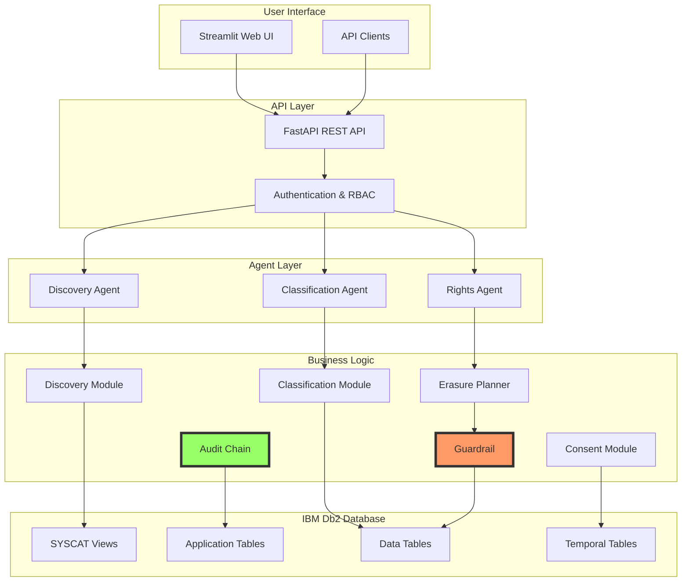
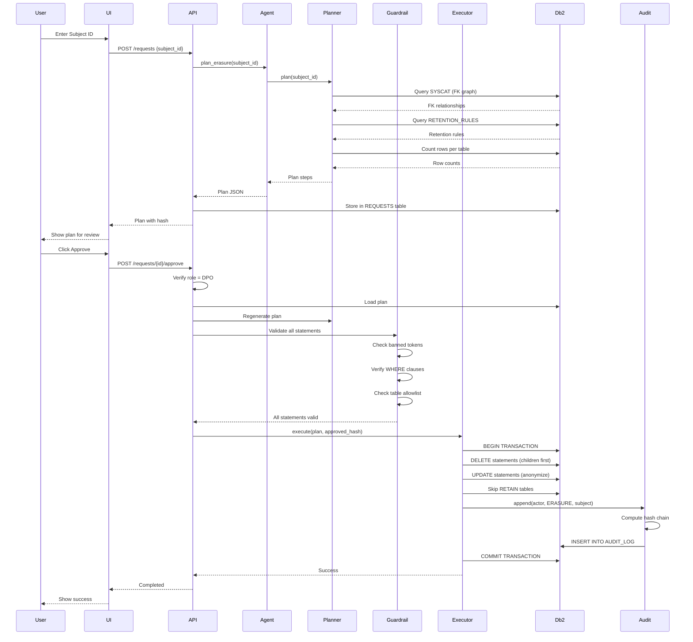

# Architecture - Db2 Privacy Copilot

## System Overview



## Data Flow: Erasure Request



## Component Architecture

### 1. Discovery Module

```
Input: Schema name
Output: Tables, columns, FK relationships, deletion order

Components:
┌──────────────────────────────────────┐
│ Discovery Module                      │
├──────────────────────────────────────┤
│ • columns()      → SYSCAT.COLUMNS   │
│ • tables()       → SYSCAT.TABLES    │
│ • fk_edges()     → SYSCAT.REFERENCES│
│ • delete_order() → NetworkX graph   │
└──────────────────────────────────────┘
           ↓
   ┌──────────────┐
   │ IBM Db2      │
   │ SYSCAT views │
   └──────────────┘
```

### 2. Classification Module

```
Input: Schema name
Output: PII labels with confidence scores

Flow:
┌─────────────┐    ┌──────────────────┐    ┌──────────────┐
│ Column name │───▶│ LangChain DB2VS  │───▶│ Label + conf │
└─────────────┘    │ cosine similarity│    └──────────────┘
                   └──────────────────┘
                   
┌─────────────┐    ┌──────────────────┐    ┌──────────────┐
│ Sample      │───▶│ Value rules      │───▶│ Hit rates    │
│ values      │    │ (regex+Verhoeff) │    │              │
└─────────────┘    └──────────────────┘    └──────────────┘

Decision Logic:
1. Hit rate >= 30% → Use value rule
2. Db2VS cosine distance within threshold → Use semantic name classification
3. Else → NOT_PII or flag for review
```

Live Db2 classification stores PII taxonomy embeddings in
`PII_TAXONOMY_VECTORS` and requires Db2 12.1.2 or newer. Mock mode uses keyword
heuristics and does not initialize the vector store.

### 3. Consent Ledger (Bitemporal)

```
CONSENT table structure:
┌────────────┬─────────┬─────────┬───────────┬─────────┐
│ PATIENT_ID │ PURPOSE │ GRANTED │ BUS_START │ BUS_END │
├────────────┼─────────┼─────────┼───────────┼─────────┤
│            │         │         │           │         │
└────────────┴─────────┴─────────┴───────────┴─────────┘
              ↓
    ┌─────────────────┐
    │ BUSINESS_TIME   │ When was consent valid?
    └─────────────────┘
              ↓
┌─────────────┬───────────┬─────────┐
│ SYS_START   │ SYS_END   │ TRANS_ID│
├─────────────┼───────────┼─────────┤
│             │           │         │
└─────────────┴───────────┴─────────┘
              ↓
    ┌─────────────────┐
    │ SYSTEM_TIME     │ What did we know when?
    └─────────────────┘

Queries:
• FOR BUSINESS_TIME AS OF '2026-06-01'
• FOR SYSTEM_TIME AS OF '2026-03-05-00.00.00'
• Both together → "What was valid on date X as we knew it at time Y"
```

### 4. Guardrail (Security Layer)

```
SQL Statement
     ↓
┌────────────────────────────────┐
│ 1. Check approval required     │
└────────────────────────────────┘
     ↓
┌────────────────────────────────┐
│ 2. Check banned tokens         │
│    (DROP, TRUNCATE, ALTER...)  │
└────────────────────────────────┘
     ↓
┌────────────────────────────────┐
│ 3. Validate statement shape    │
│    (DELETE/UPDATE with WHERE)  │
└────────────────────────────────┘
     ↓
┌────────────────────────────────┐
│ 4. Verify WHERE clause         │
└────────────────────────────────┘
     ↓
┌────────────────────────────────┐
│ 5. Check parameterized (?)     │
└────────────────────────────────┘
     ↓
┌────────────────────────────────┐
│ 6. Verify table in allowlist   │
└────────────────────────────────┘
     ↓
┌────────────────────────────────┐
│ 7. Check for injection patterns│
└────────────────────────────────┘
     ↓
   PASS or BLOCK
```

### 5. Audit Chain (Tamper Detection)

```
Record N-1                Record N                  Record N+1
┌────────────┐           ┌────────────┐           ┌────────────┐
│ hash: ABC  │───────────│ prev: ABC  │───────────│ prev: DEF  │
│            │           │ content... │           │            │
│            │           │ hash: DEF  │           │ hash: GHI  │
└────────────┘           └────────────┘           └────────────┘

Hash = SHA256(prev_hash + actor + action + subject + detail)

Verification:
1. Start with GENESIS
2. For each record:
   - Recompute hash from content
   - Verify matches stored hash
   - Verify prev_hash matches previous record
3. Any mismatch = tampering detected
```

## Db2-Specific Features Used

| Feature | Purpose | Location |
|---------|---------|----------|
| **SYSCAT Views** | Schema discovery | `app/discovery.py` |
| **SYSCAT.COLUMNS** | Column metadata | Discovery |
| **SYSCAT.REFERENCES** | FK relationships | Discovery |
| **SYSCAT.TABLES** | Table listing | Discovery |
| **VECTOR type** | (Future) PII taxonomy | Classification |
| **Temporal Tables** | Bitemporal consent | `app/consent.py` |
| **BUSINESS_TIME** | "Valid when" queries | Consent |
| **SYSTEM_TIME** | "Knew when" queries | Consent |
| **ACID Transactions** | All-or-nothing erasure | `app/erasure.py` |
| **Parameterized Queries** | SQL injection prevention | All modules |
| **RCAC** | (Future) Policy enforcement | Phase 7 |

## Security Architecture

```
Defense in Depth Layers:

1. Authentication (API)
   └─▶ Token/OAuth2 verification

2. Authorization (RBAC)
   └─▶ Role-based endpoint access

3. Agent Tools (Read-Only)
   └─▶ No execute capability

4. Approval Gate
   └─▶ Human DPO approval required

5. Plan Hash Binding
   └─▶ No replay/modification attacks

6. Guardrail (Deterministic)
   └─▶ SQL validation before execution

7. Db2 User Permissions
   └─▶ Minimal privileges per operation

8. Transaction Rollback
   └─▶ Any error = full rollback

9. Audit Chain
   └─▶ Tamper-evident logging
```

## Deployment Architecture

### Development

```
┌──────────────────────────────────────┐
│ Developer Laptop                      │
│                                       │
│  ┌─────────────┐  ┌────────────────┐│
│  │ Streamlit   │  │ Python modules ││
│  │ UI          │  │                ││
│  └─────────────┘  └────────────────┘│
│         ↓                   ↓        │
│  ┌──────────────────────────────┐   │
│  │ Db2 Docker Container         │   │
│  │ (Community Edition)          │   │
│  └──────────────────────────────┘   │
└──────────────────────────────────────┘
```

### Production (Recommended)

```
┌────────────────────────────────────────────┐
│ Load Balancer / API Gateway                │
└─────────────────┬──────────────────────────┘
                  ↓
    ┌─────────────────────────────┐
    │ Application Servers (N)     │
    │                             │
    │ ┌─────────┐  ┌────────────┐│
    │ │ FastAPI │  │ Streamlit  ││
    │ │ (API)   │  │ (UI)       ││
    │ └─────────┘  └────────────┘│
    └──────────────┬──────────────┘
                   ↓
    ┌──────────────────────────────┐
    │ IBM Db2 Enterprise           │
    │ • High Availability          │
    │ • Encryption at rest         │
    │ • TLS connections            │
    │ • Backup/Recovery            │
    └──────────────────────────────┘
```

## Data Model

### Application Tables

```sql
PII_MAP
├─ TABNAME (table being classified)
├─ COLNAME (column being classified)
├─ LABEL (EMAIL, PHONE, PAN, etc.)
├─ CONFIDENCE (0.0 to 1.0)
├─ METHOD (VALUE_RULE, NAME_VECTOR)
└─ REVIEWED_BY (human reviewer)

RETENTION_RULES
├─ TABNAME (which table)
├─ ACTION (ERASE, ANONYMISE, RETAIN)
├─ REASON (why this action)
├─ SOURCE (legal reference)
└─ VERIFIED (Y/N)

REQUESTS
├─ SUBJECT_ID (patient/user ID)
├─ REQUEST_TYPE (ERASURE, ACCESS)
├─ STATUS (RECEIVED, APPROVED, COMPLETED)
├─ PLAN_JSON (execution plan)
├─ PLAN_HASH (for approval binding)
├─ APPROVED_BY (DPO email)
└─ COMPLETED_AT (timestamp)

CONSENT (Temporal)
├─ PATIENT_ID
├─ PURPOSE (MARKETING, RESEARCH, etc.)
├─ GRANTED (Y/N)
├─ BUS_START, BUS_END (business time)
└─ SYS_START, SYS_END (system time)

AUDIT_LOG
├─ ACTOR (who performed action)
├─ ACTION (what was done)
├─ SUBJECT (patient ID if applicable)
├─ DETAIL (JSON metadata)
├─ PREV_HASH (chain link)
└─ HASH (this record's hash)
```

## Technology Stack

```
┌─────────────────────────────────────┐
│ Frontend: Streamlit                 │
├─────────────────────────────────────┤
│ API: FastAPI + Uvicorn              │
├─────────────────────────────────────┤
│ Agents: CrewAI                      │
├─────────────────────────────────────┤
│ Business Logic: Python 3.11         │
│ • NetworkX (graphs)                 │
│ • Sentence Transformers (embeddings)│
│ • Pydantic (validation)             │
├─────────────────────────────────────┤
│ Database: IBM Db2 12.1.2+           │
│ • Community Edition (dev)           │
│ • Enterprise (production)           │
├─────────────────────────────────────┤
│ Testing: pytest, hypothesis         │
├─────────────────────────────────────┤
│ Tools: ruff, mypy, bandit           │
└─────────────────────────────────────┘
```

---

**Version:** 0.1.0  
**Last Updated:** 2026-11-10
