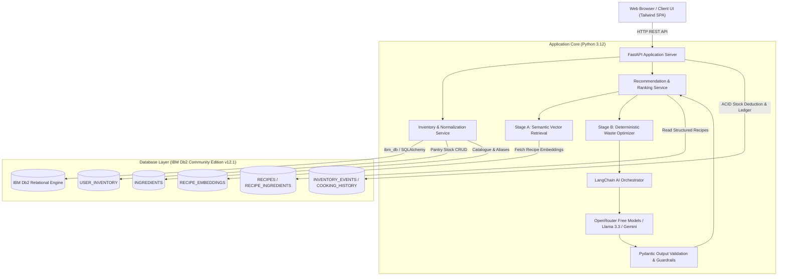

# System Architecture

## Overview
**EcoBite AI** (AI-Powered Recipe & Ingredient Waste Optimizer) couples **IBM Db2** as the authoritative system of record with a **two-stage hybrid recommendation pipeline** and **LangChain** for grounded AI recipe generation.

The design decouples fuzzy natural-language semantic understanding from mathematical inventory calculations:
* **Fuzzy retrieval:** Managed via 384-dimensional dense recipe embeddings stored in IBM Db2.
* **Deterministic business logic:** All unit conversions, stock calculations, expiry prioritization, and missing ingredient penalties are computed strictly in Python.
* **Controlled AI generation:** LangChain formats verified candidates and pantry stock facts into structured recipe instructions with Pydantic output validation.
* **Atomic transaction updates:** Confirmed meals trigger ACID transactions in IBM Db2 that update stock and record audit ledger events.

---

## Architecture Diagram

---

## Component Breakdown

### 1. User Interface Layer
* **Tailwind CSS Single-Page Application:** Served directly by FastAPI at `/` or `/app`.
* **Live Db2 Status Indicator:** Real-time polling of `/health` verifying active Db2 connection status and version.
* **Pantry Management View:** Inventory cards with visual urgency tags (urgent, approaching, safe) and discard buttons.
* **AI Recipe Assistant:** Query prompt bar with servings, dietary filters, and cook-time constraints.
* **Interactive Recipe Card:** Dynamic split between ingredients in stock and additional shopping items, with one-click "I Cooked This Meal" confirmation.
* **Audit Ledger & Waste Analytics:** Visual stats of consumed meals, waste avoidance ratios, and immutable Db2 ledger entries.

### 2. Application Backend Layer (FastAPI)
* **REST Endpoints (`/api/v1`):** Modular routers for inventory CRUD, recipe catalogue browsing, recommendation inference, and cooking confirmation.
* **Pydantic Schemas:** Strict request and response models guaranteeing type safety across all boundaries.
* **Error Handling & Middleware:** Global CORS middleware and graceful error propagation without leaking database credentials.

### 3. IBM Db2 Database Layer
* **System of Record:** Primary database engine running IBM Db2 v12.1.0500 on Linux x86_64 via Docker.
* **Relational Schema:**
  * `INGREDIENTS`: Master canonical ingredient definitions and aliases.
  * `USER_INVENTORY`: Household pantry stock with positive quantity check constraints (`quantity >= 0`).
  * `RECIPES` & `RECIPE_INGREDIENTS`: Foreign-key mapped cookbook catalogue with ON DELETE CASCADE integrity.
  * `RECIPE_EMBEDDINGS`: 384-dimensional dense vectors generated by Sentence-Transformers with text hashes.
  * `COOKING_HISTORY`: Timestamped logs of prepared recipes and servings.
  * `INVENTORY_EVENTS`: Append-only audit ledger tracking every stock mutation (`quantity_delta`, `reason`).
* **ACID Transactions:** When a user marks a recipe as cooked, inventory deduction, event logging, and cooking history creation are executed within a single transactional boundary (`COMMIT` on success, `ROLLBACK` on exception).

### 4. AI & Model Orchestration Layer
* **Embedding Model:** `sentence-transformers/all-MiniLM-L6-v2` generating normalized 384-dimensional dense vectors.
* **LLM Provider:** Configured for OpenRouter Free models (`meta-llama/llama-3.3-70b-instruct:free`) via `langchain-openai`. Pluggable fallback to deterministic rule-based generation when offline.
* **Prompt Engineering & Grounding:** Prompts instruct the LLM to use only the candidate recipe and verified inventory facts. Any hallucinated inventory claim is caught by post-generation Pydantic validation and reclassified.

---

## Multi-Signal Waste Optimization Scoring Formula

The deterministic ranking engine calculates a unified score in $[0, 1]$:

$$\text{Score} = 0.20 \cdot S_{\text{semantic}} + 0.30 \cdot S_{\text{coverage}} + 0.20 \cdot S_{\text{sufficiency}} + 0.20 \cdot S_{\text{expiry}} + 0.10 \cdot S_{\text{preference}} - P_{\text{missing}}$$

* **Semantic Relevance ($S_{\text{semantic}}$):** Cosine similarity between query vector and recipe embedding.
* **Ingredient Coverage ($S_{\text{coverage}}$):** Fraction of required recipe ingredients present in pantry stock.
* **Quantity Sufficiency ($S_{\text{sufficiency}}$):** Ratio of available quantity to scaled recipe requirement for compatible units.
* **Expiry Priority ($S_{\text{expiry}}$):** Higher weights for ingredients nearing expiry:
  * Urgent ($\le 2$ days): $1.0$
  * Approaching ($3-5$ days): $0.6$
  * Safe ($> 5$ days): $0.2$
* **Missing Ingredient Penalty ($P_{\text{missing}}$):** $0.08$ deduction per missing required ingredient (capped at $0.40$).
* **Hard Filters:** Recipes violating dietary exclusions (e.g. non-vegetarian when vegetarian is requested) or exceeding max cooking minutes are rejected with score $-1.0$.

---

## Security & Secrets Management
* **Zero Secrets Committed:** All credentials and API keys are read from environment variables at runtime. `.env.example` contains safe dummy placeholders only; `.env` is ignored by Git.
* **Parameterized SQL:** All queries use parameter binding (`?` placeholders via DB-API 2.0 cursor) preventing SQL injection attacks.
* **DLL Search Path Security:** Windows dynamic link libraries for `clidriver\bin` are registered using explicit `os.add_dll_directory()` calls rather than unsafe global PATH alterations.
