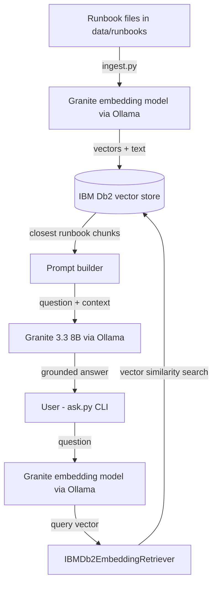

# System Architecture

## Overview
The Db2 Runbook Assistant is a command-line RAG application. Runbooks are embedded with a Granite embedding model (via Ollama) and stored in IBM Db2. At question time, Db2 vector search returns the closest runbook text, and a Granite language model writes the answer from it. A Haystack pipeline connects the steps.

---

## Architecture Diagram

---

## Component Breakdown

1. **User Interface / Client Layer**:
   - `ask.py`: a command-line prompt where the user types a question and reads the answer.
2. **Application Layer**:
   - Python scripts built on Haystack. `ingest.py` loads and stores runbooks, `ask.py` runs the question-answering pipeline, `manage.py` manages the database table, and `config.py` reads the settings from environment variables.
3. **Database Layer (IBM Db2)**:
   - Db2 Community Edition 12.1.2.0 in Docker. It stores runbook text, metadata and embedding vectors in the native `VECTOR` type, and performs cosine similarity search.
4. **AI / Model Orchestration Layer**:
   - Ollama serves two local models: `granite-embedding:278m` for embeddings and `granite3.3:8b` for answers. Haystack connects the embedder, the Db2 retriever, the prompt and the language model.

---

## Data Flow

1. **Ingestion:** `ingest.py` reads the runbook files, turns each into embeddings with the Granite embedding model, and writes text, metadata and vectors to Db2.
2. **Question:** the user types a question in `ask.py`, and the same embedding model turns it into a vector.
3. **Context Retrieval:** Db2 returns the runbook chunks closest to that vector (cosine distance).
4. **Augmentation & Inference:** the chunks and the question are put into a prompt, and the Granite model writes an answer that is based on the retrieved text.
5. **Response Delivery:** the answer is printed in the terminal.

---

## IBM Db2 Schema & Storage Design

The project uses the table created by the Haystack `IBMDb2DocumentStore`. Each row holds one document chunk: its text, its metadata (for example the source runbook file) and its embedding vector stored in a Db2 `VECTOR` column. The distance metric is cosine, and the vector size matches the embedding model's output.

---

## Security & Secrets Management
- All Db2 credentials and model settings are read at runtime from environment variables loaded from a local `.env` file.
- `.env` is listed in `.gitignore` and is never committed. Only `.env.example` with placeholder values is in the repository.
- `docker-compose.yml` reads the Db2 password from the environment (`${DB2_PASSWORD}`), so no password is written in the file.
- User questions are only used as embedding input and prompt text. The project does not build SQL strings from user input.
- Both models run locally through Ollama, so runbook content and questions are not sent to an external service.
