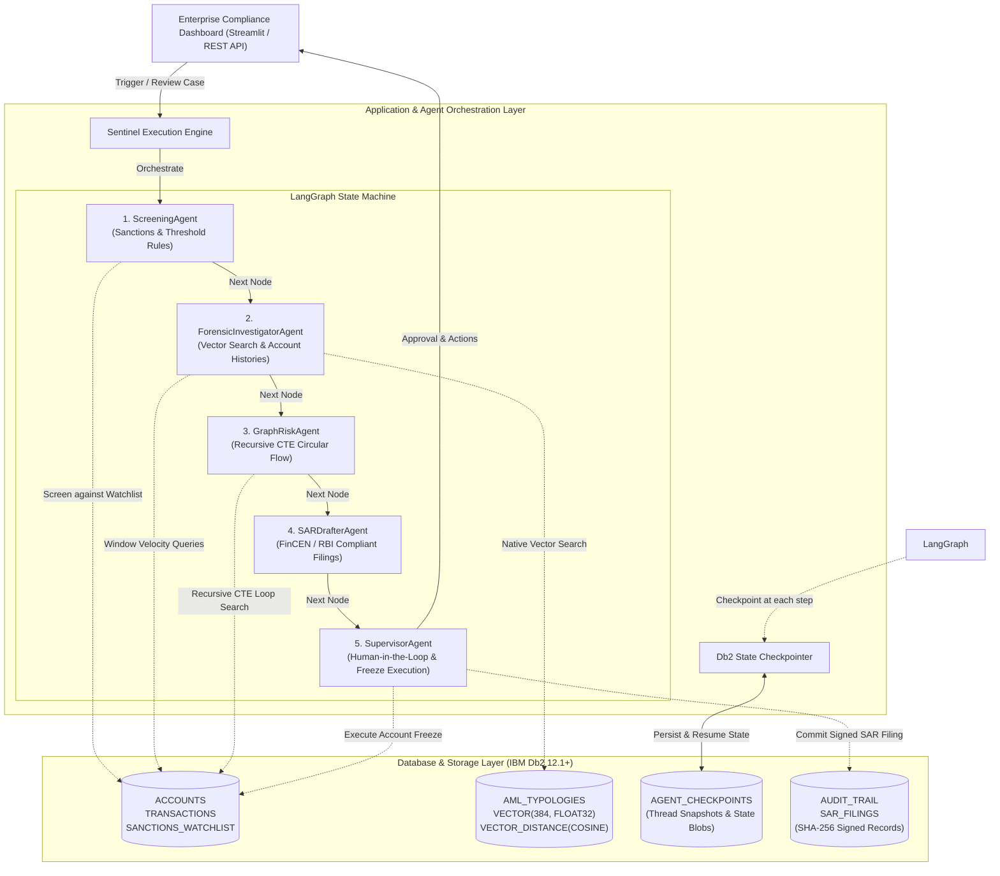
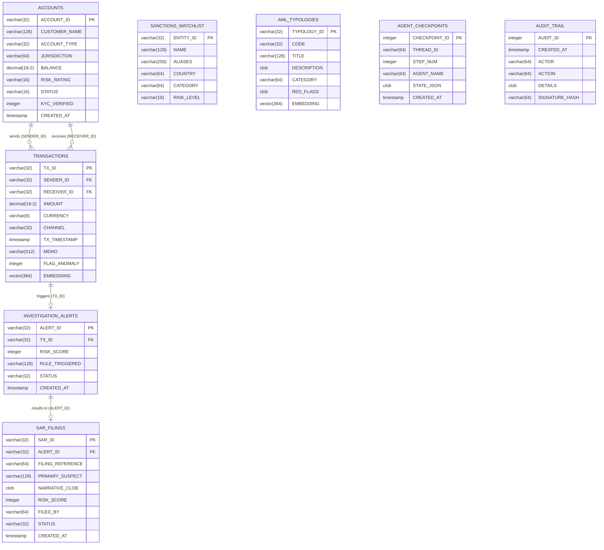

# System Architecture — Db2 Sentinel AI

## Overview

**Db2 Sentinel AI** is an enterprise-grade autonomous surveillance and regulatory compliance platform engineered for mission-critical banking environments. The architecture bridges modern **Cyclical Multi-Agent State Machines (LangGraph)** with **IBM Db2 12.1+ Enterprise Database capabilities**, including native vector similarity search (`VECTOR` data types and `VECTOR_DISTANCE`), Common Table Expressions (`WITH RECURSIVE`), analytical window functions, ACID-compliant agent state checkpointing, and immutable cryptographic audit logging.

---

## Architecture Diagrams

### 1. High-Level System Architecture



---

### 2. LangGraph Multi-Agent State Machine Flow

```mermaid
stateDiagram-v2
    [*] --> START
    START --> ScreeningNode: Intercept Transaction
    
    state ScreeningNode {
        [*] --> CheckSanctionsWatchlist
        CheckSanctionsWatchlist --> CheckStructuringThreshold
        CheckStructuringThreshold --> ComputeBaselineScore
    }
    
    ScreeningNode --> InvestigatorNode: Pass State & Flags
    
    state InvestigatorNode {
        [*] --> EmbedTransactionMemo
        EmbedTransactionMemo --> Db2VectorSearch: VECTOR_DISTANCE(EMBEDDING, 'COSINE')
        Db2VectorSearch --> Db2WindowAggregations: Historical Burst Velocity
        Db2WindowAggregations --> MatchTypologies
    }
    
    InvestigatorNode --> GraphRiskNode: Pass Typology Matches
    
    state GraphRiskNode {
        [*] --> ExecuteRecursiveCTE: WITH RECURSIVE TransferPaths
        ExecuteRecursiveCTE --> DetectClosedCycles: A -> B -> C -> A
        DetectClosedCycles --> AssessNetworkExposure
    }
    
    GraphRiskNode --> SARDrafterNode: Pass Network Topology
    
    state SARDrafterNode {
        [*] --> EvaluateRiskThreshold: Score >= 65?
        EvaluateRiskThreshold --> DraftFormalSAR: Yes (FinCEN / RBI Standard)
        EvaluateRiskThreshold --> ClearCase: No (Routine Clearance)
    }
    
    SARDrafterNode --> SupervisorNode: Pass Drafted Filing & Disposition
    
    state SupervisorNode {
        [*] --> ReviewRecommendedAction
        ReviewRecommendedAction --> ExecuteDb2Freeze: FREEZE_AND_FILE_SAR
        ExecuteDb2Freeze --> StoreSARFilingInDb2
        StoreSARFilingInDb2 --> SignCryptographicAuditTrail: SHA-256 Hash
    }
    
    SupervisorNode --> END: Complete Case Lifecycle
    END --> [*]
```



---

### 3. IBM Db2 Entity-Relationship Diagram (ERD)



---

## Component Breakdown

### 1. User Interface & Presentation Layer
- **Streamlit Enterprise Application** (`src/app.py`):
  - **Transaction Feed & Alerts**: Real-time tabular monitoring of wires with risk heatmaps.
  - **Multi-Agent Canvas**: Visual trace of agent thoughts, steps, and tool execution.
  - **Network Topology Graph**: Interactive network graph (`NetworkX`) visualizing circular routing loops and mule account clusters.
  - **SAR Studio & Audit Viewer**: Regulatory narrative viewer with one-click Markdown/PDF exports and immutable SHA-256 audit logs.
  - **Text-to-SQL Studio**: Natural language to SQL exploration over live Db2 tables.

### 2. Application Backend Layer
- **Db2 Connection Layer** (`src/db/connection.py`):
  - Dual-mode connection management supporting live **IBM Db2 12.1+** via native `ibm_db` and SQLAlchemy `ibm_db_sa`.
  - Automatic zero-setup local emulation engine for instant hackathon evaluation without requiring a 4GB Docker container.
- **Analytical Query Engine** (`src/db/queries.py`):
  - Db2 window aggregation for velocity anomaly scoring.
  - Recursive Common Table Expressions (CTEs) for multi-hop graph path and cycle discovery.
  - Vector similarity search via `VECTOR_DISTANCE`.

### 3. Database Layer (IBM Db2 12.1+)
- **Relational Consistency**: Strict foreign key constraints and transactional integrity (`ACID`).
- **Vector Storage**: Dedicated `VECTOR(384, FLOAT32)` columns on transaction memos and FATF AML crime typologies.
- **Agent State Persistence**: `AGENT_CHECKPOINTS` table storing serialized state snapshots at each agent transition.
- **Tamper-Evident Audit Ledger**: `AUDIT_TRAIL` table persisting every agent action, tool invocation, and decision signed with SHA-256 cryptographic hashes.

### 4. AI & Multi-Agent Orchestration Layer
- **LangGraph State Graph** (`src/agents/workflow.py`):
  - Five specialized agent nodes coordinated with cyclical state transitions.
  - Checkpoint persistence backed directly by IBM Db2.
- **Embedding Pipeline** (`src/utils/embeddings.py`):
  - Generates 384-dimensional dense semantic vectors compatible with IBM Granite embedding models (`ibm-granite/granite-embedding-311m-multilingual-r2`) and SentenceTransformers.

---

## Data Flow

```text
1. Transaction Arrival  ──> 2. Screening Check   ──> 3. Forensic Db2 Vector Query
                                                            │
                                                            ▼
6. Regulatory SAR Filing <── 5. Supervisor Sign-off <── 4. Recursive CTE Cycle Detection
```

1. **Transaction Interception**: Inbound wire transaction is received and logged into Db2 `TRANSACTIONS`.
2. **Rule Screening (`ScreeningAgent`)**: Evaluates transaction amounts against sub-threshold structuring limits ($9,000–$9,999) and screens party names against `SANCTIONS_WATCHLIST`.
3. **Forensic Vector Analysis (`ForensicInvestigatorAgent`)**: Computes dense vector representation of transaction memo; runs in-database Db2 `VECTOR_DISTANCE` against `AML_TYPOLOGIES`. Gathers rolling historical velocity via Db2 window functions.
4. **Network Cycle Detection (`GraphRiskAgent`)**: Executes recursive SQL CTEs to trace fund paths across counterparties and detect circular routing loops (A &rarr; B &rarr; C &rarr; A).
5. **SAR Compilation (`SARDrafterAgent`)**: Synthesizes forensic findings into a standardized 5-part FinCEN/RBI Suspicious Activity Report with citations to Db2 record IDs.
6. **Supervisor Enforcement (`SupervisorAgent`)**: Authorizes emergency account freezing in Db2, persists the formal SAR filing, and seals the record with a SHA-256 cryptographic signature in `AUDIT_TRAIL`.

---

## Security & Secrets Management
- **Zero Committed Credentials**: All production connection strings and API keys are read at runtime via environment variables (`.env`).
- **Input Sanitization**: All database interactions use parameterized SQL statements (`?` placeholders) to prevent SQL injection attacks.
- **Cryptographic Auditability**: Every state transition and regulatory action computes an immutable SHA-256 hash across the actor, timestamp, and payload.
