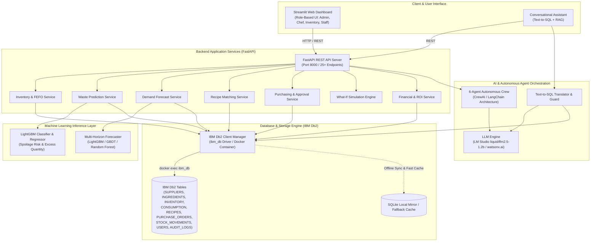
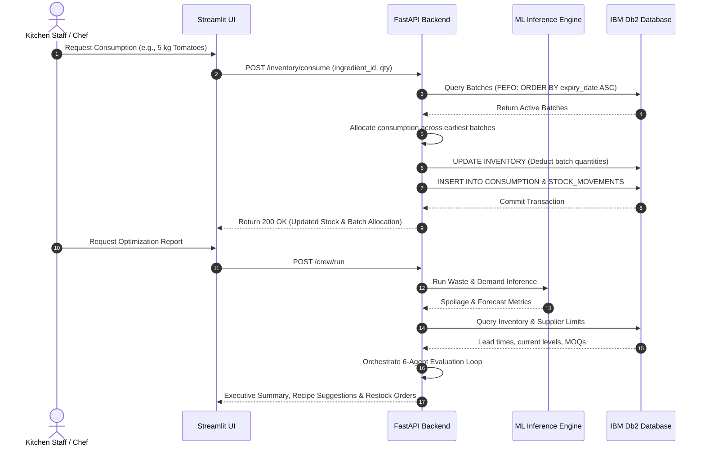

# System Architecture — SmartStock AI

## Overview

**SmartStock AI** is an enterprise-grade food waste reduction and inventory optimization platform engineered for commercial kitchens, restaurants, and hospitality chains. It unifies **IBM Db2** as the authoritative transactional and analytical database engine with machine learning forecasting models (**LightGBM**, **Random Forest**, **Gradient Boosting**) and an autonomous **Multi-Agent AI Crew** (Inventory, Waste Prediction, Demand Forecasting, Recipe, Purchasing, and Reporting agents).

The solution enforces batch-level **First-Expired, First-Out (FEFO)** inventory consumption, automates purchase replenishment with lead-time and MOQ constraints, and provides a conversational Natural Language Assistant (Text-to-SQL & RAG) with read-only SQL guards.

---

## Architecture Diagram



---

## Component Breakdown

### 1. Client & Presentation Layer (Streamlit)
- **Role-Based Portals**: Tailored interfaces for *Administrator*, *Head Chef*, *Inventory Manager*, and *Kitchen Staff*.
- **Interactive Dashboards**: Plotly visualizers for FEFO inventory lifespan, spoilage risk matrices, financial loss rollups, and demand trends.
- **Natural Language Assistant**: Conversational chat interface for natural language querying, inventory status checks, and recipe discovery.

### 2. Application Backend Layer (FastAPI)
- **25+ Domain Endpoints**: Dedicated REST services for batch inventory intake, FEFO consumption, stock movements, supplier management, and purchase order approvals.
- **Business Logic Services**:
  - `inventory_service.py`: Automated batch sorting by expiry (`ORDER BY expiry_date ASC`) and partial consumption deductions.
  - `waste_service.py`: Spoilage risk classification, excess estimation, and monetary loss calculations.
  - `demand_service.py`: 1-day, 3-day, and 7-day ingredient consumption predictions.
  - `recipe_service.py`: Expiry-prioritized recipe scoring to consume vulnerable stock immediately.
  - `purchasing_service.py`: Automated purchase order generation factoring in supplier lead times and minimum order quantities (MOQ).
  - `whatif_service.py`: Demand surge simulation (+10% to +50%) and shortage impact forecasting.

### 3. Machine Learning & Predictive Analytics Layer
- **Food Spoilage Predictor**:
  - **Classifier**: LightGBM binary classifier determining whether a batch will expire prior to consumption (*High Risk* vs. *Low Risk*).
  - **Regressor**: LightGBM regressor calculating predicted excess volume in standard units (kg/L/units).
- **Demand Forecaster**:
  - Ensemble evaluation across Linear Regression, Random Forest, Gradient Boosting, and LightGBM across multi-day horizons.
  - Generates forecast consumption curves based on historical kitchen consumption patterns.

### 4. AI & Autonomous Multi-Agent Layer
- **Multi-Agent Coordination Crew (6 Agents)**:
  1. *Inventory Agent*: Evaluates current stock volumes, batch expiry distribution, and storage temperatures.
  2. *Waste Prediction Agent*: Identifies batches at immediate spoilage risk and flags high-loss ingredients.
  3. *Demand Forecasting Agent*: Projects upcoming ingredient requirements across 1/3/7 day horizons.
  4. *Recipe Agent*: Selects recipes that consume highest-risk perishable ingredients first.
  5. *Purchasing Agent*: Formulates optimized restock purchase orders matching supplier lead-time constraints.
  6. *Reporting Agent*: Synthesizes findings into an executive briefing with ROI savings and actionable alerts.
- **Natural Language Assistant (Text-to-SQL + RAG)**:
  - Converts natural language queries into valid IBM Db2 SQL statements.
  - Guardrail validator blocks destructive operations (`DROP`, `DELETE`, `UPDATE`, `INSERT`, `ALTER`, `TRUNCATE`).
  - Formats Db2 query results with natural language explanations.

### 5. Database Layer (IBM Db2)
- **Authoritative Database**: IBM Db2 Community Edition (running via containerized deployment `db2server`).
- **Driver Integration**: Native `ibm_db` C-bindings via Docker execution bridge, providing ACID guarantees, atomic transactions, and relational integrity.
- **SQLite Mirror / Cache**: High-speed local cache for rapid reads and resilient offline demonstrations.

---

## Data Flow



---

## IBM Db2 Relational Schema Design

The solution relies on 12 relational tables created with strict constraints and foreign keys:

```sql
-- 1. SUPPLIERS
CREATE TABLE SUPPLIERS (
    supplier_id VARCHAR(50) NOT NULL PRIMARY KEY,
    supplier_name VARCHAR(100) NOT NULL,
    contact VARCHAR(100),
    lead_time_days INTEGER DEFAULT 2,
    rating DECIMAL(3, 2) DEFAULT 4.5,
    min_order_qty DECIMAL(10, 2) DEFAULT 5.0
);

-- 2. INGREDIENTS
CREATE TABLE INGREDIENTS (
    ingredient_id VARCHAR(50) NOT NULL PRIMARY KEY,
    ingredient_name VARCHAR(100) NOT NULL,
    category VARCHAR(50) NOT NULL,
    unit VARCHAR(20) NOT NULL,
    unit_price DECIMAL(10, 2) NOT NULL,
    reorder_level DECIMAL(10, 2) DEFAULT 10.0,
    reorder_quantity DECIMAL(10, 2) DEFAULT 25.0,
    storage_temp DECIMAL(5, 2) DEFAULT 4.0,
    shelf_life_days INTEGER DEFAULT 7
);

-- 3. INVENTORY (FEFO Batch Tracking)
CREATE TABLE INVENTORY (
    inventory_id VARCHAR(50) NOT NULL PRIMARY KEY,
    ingredient_id VARCHAR(50) NOT NULL,
    batch_number VARCHAR(50) NOT NULL,
    quantity DECIMAL(10, 2) NOT NULL,
    initial_quantity DECIMAL(10, 2) NOT NULL,
    purchase_date VARCHAR(20) NOT NULL,
    expiry_date VARCHAR(20) NOT NULL,
    unit_price DECIMAL(10, 2) NOT NULL,
    storage_location VARCHAR(50) DEFAULT 'Refrigerator',
    supplier_id VARCHAR(50),
    status VARCHAR(20) DEFAULT 'Active'
);

-- 4. STOCK_MOVEMENTS (Audit Log)
CREATE TABLE STOCK_MOVEMENTS (
    movement_id VARCHAR(50) NOT NULL PRIMARY KEY,
    inventory_id VARCHAR(50),
    ingredient_id VARCHAR(50) NOT NULL,
    movement_type VARCHAR(20) NOT NULL, -- INTAKE, CONSUMPTION, WASTE_DISPOSAL, ADJUSTMENT
    quantity_changed DECIMAL(10, 2) NOT NULL,
    balance_after DECIMAL(10, 2) NOT NULL,
    timestamp VARCHAR(30) NOT NULL,
    reason VARCHAR(150),
    performed_by VARCHAR(100) DEFAULT 'System'
);

-- 5. RECIPES & RECIPE_INGREDIENTS
CREATE TABLE RECIPES (
    recipe_id VARCHAR(50) NOT NULL PRIMARY KEY,
    recipe_name VARCHAR(100) NOT NULL,
    category VARCHAR(50) DEFAULT 'Main Course',
    prep_time INTEGER DEFAULT 30,
    servings INTEGER DEFAULT 4,
    instructions VARCHAR(2000),
    estimated_cost DECIMAL(10, 2) DEFAULT 150.00
);

CREATE TABLE RECIPE_INGREDIENTS (
    recipe_id VARCHAR(50) NOT NULL,
    ingredient_id VARCHAR(50) NOT NULL,
    required_quantity DECIMAL(10, 2) NOT NULL,
    unit VARCHAR(20) NOT NULL,
    PRIMARY KEY (recipe_id, ingredient_id)
);

-- 6. PURCHASE_ORDERS
CREATE TABLE PURCHASE_ORDERS (
    po_id VARCHAR(50) NOT NULL PRIMARY KEY,
    ingredient_id VARCHAR(50) NOT NULL,
    supplier_id VARCHAR(50) NOT NULL,
    order_quantity DECIMAL(10, 2) NOT NULL,
    unit_price DECIMAL(10, 2) NOT NULL,
    total_cost DECIMAL(10, 2) NOT NULL,
    order_date VARCHAR(20) NOT NULL,
    expected_delivery VARCHAR(20) NOT NULL,
    status VARCHAR(20) DEFAULT 'PENDING_APPROVAL',
    approved_by VARCHAR(100)
);

-- 7. USERS (Security & RBAC)
CREATE TABLE USERS (
    user_id VARCHAR(50) NOT NULL PRIMARY KEY,
    username VARCHAR(50) NOT NULL UNIQUE,
    full_name VARCHAR(100) NOT NULL,
    role VARCHAR(30) NOT NULL, -- Administrator, Head Chef, Inventory Manager, Kitchen Staff
    email VARCHAR(100),
    password_hash VARCHAR(64) NOT NULL,
    security_question VARCHAR(200),
    security_answer_hash VARCHAR(64),
    status VARCHAR(20) DEFAULT 'Active'
);
```

---

## Security & Secrets Management

- **Zero Hardcoded Credentials**: Database passwords, hosts, and LLM endpoints are read exclusively from environment variables via `.env`.
- **Public Template Protection**: The repository commits only `.env.example` with sanitized placeholders.
- **Cryptographic Hashing**: User passwords and security recovery answers are hashed using SHA-256 before insertion into IBM Db2.
- **SQL Injection Defenses**: The Text-to-SQL engine strictly inspects generated SQL statements with regex token analysis, enforcing read-only execution (`SELECT`) and refusing DDL/DML commands (`DROP`, `DELETE`, `UPDATE`, `INSERT`, `ALTER`, `TRUNCATE`, `EXEC`).

