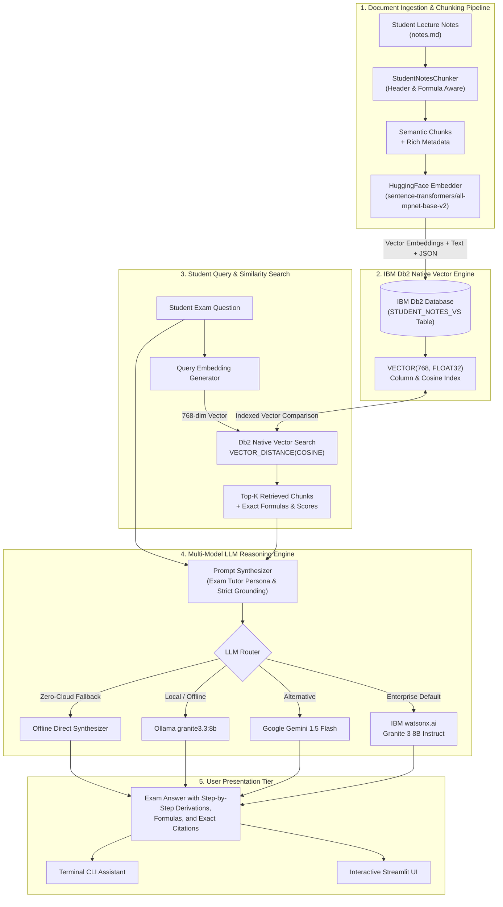
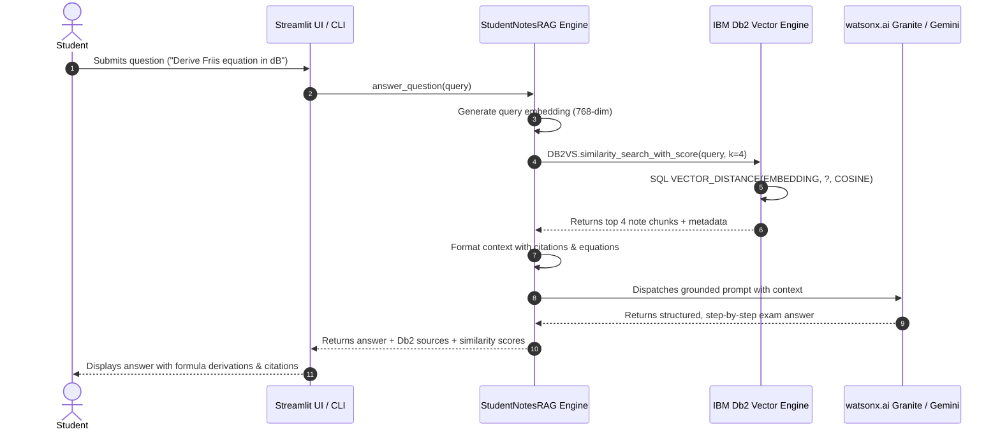

# 🏗️ Technical Architecture: IBM Db2 Vector Search Exam Study Assistant

## Executive Overview
The **IBM Db2 Exam Study Assistant** is a production-grade, retrieval-augmented generation (RAG) system engineered for high-accuracy student revision, formula retrieval, and exam question tutoring. Built directly on top of **IBM Db2 Native Vector Search** and **LangChain** (`langchain-db2`), the architecture combines enterprise-grade relational database reliability with dense semantic vector embeddings.

---

## High-Level System Architecture



---

## Detailed Component Specifications

### 1. Document Ingestion & Chunking (`chunker.py`)
- **Header-Aware Splitting**: Rather than naive fixed-token chunking, the chunker identifies Markdown section headers (`#`, `##`, `###`) to preserve conceptual boundaries (e.g. Friis equation derivation, fading models, traffic theory).
- **Formula & Math Preservation**: Automatically detects LaTeX equations (`$$...$$`), decibel terms (`dB`, `dBm`), and parameter definitions, tagging chunks with `has_formula: True`.
- **Sliding Overlap**: A 150-character overlap window prevents loss of mathematical context across boundaries.
- **Metadata Enrichment**:
  ```json
  {
    "doc_id": "chunk_0012",
    "section_title": "1. FRIIS TRANSMISSION EQUATION",
    "topic": "Radio Wave Propagation",
    "has_formula": true,
    "char_count": 782,
    "source": "notes.md"
  }
  ```

### 2. Dense Vector Embeddings
- **Model**: `sentence-transformers/all-mpnet-base-v2` (768 dimensions) or `all-MiniLM-L6-v2` (384 dimensions).
- **Normalization**: All vectors are unit L2-normalized upon generation to enable ultra-fast cosine similarity calculations.

### 3. IBM Db2 Native Vector Store (`db2_client.py`)
- **Connector**: `ibm_db_dbi` driver managed through `langchain-db2.db2vs.DB2VS`.
- **Database Schema**:
  ```sql
  CREATE TABLE STUDENT_NOTES_VS (
      ID VARCHAR(64) NOT NULL PRIMARY KEY,
      TEXT CLOB(1M),
      METADATA CLOB(64K),
      EMBEDDING VECTOR(768, FLOAT32)
  );
  ```
- **Similarity Search Query Inside Db2**:
  ```sql
  SELECT ID, TEXT, METADATA,
         VECTOR_DISTANCE(EMBEDDING, ?, COSINE) AS DISTANCE
  FROM STUDENT_NOTES_VS
  ORDER BY DISTANCE ASC
  FETCH FIRST 4 ROWS ONLY;
  ```

### 4. RAG Orchestration & Prompt Engineering (`rag_engine.py`)
- **Strict Grounding**: The LLM tutor is prompted to derive answers exclusively from retrieved Db2 notes, minimizing hallucination.
- **Exam Readiness**: Formats outputs with definitions, physical interpretations, numerical derivations, and tips for university examinations.
- **Multi-LLM Fallback**: Seamlessly routes between watsonx.ai Granite, Google Gemini, Ollama, OpenAI, or the built-in offline synthesizer.

---

## Data Flow Sequence Diagram



---

## Scalability & Production Readiness

1. **Native SQL Filtering**: Metadata queries (e.g. filtering by topic `Radio Wave Propagation`) run directly in the same SQL query inside Db2 before vector sorting.
2. **Batch Upserting**: Chunks are processed and inserted in configurable batches to minimize round trips.
3. **Connection Resilience**: Built-in health check (`SELECT 1 FROM SYSIBM.SYSDUMMY1`) and fallback handling ensures zero application downtime during database restarts.
4. **Hardware Efficiency**: Optimized memory footprint on CPU/GPU by utilizing normalized float32 embeddings.

