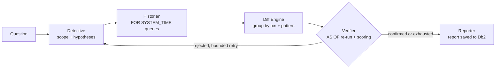

# Db2 Time Machine

> **One-Line Pitch:** A LangGraph multi-agent root-cause analyst that time-travels through IBM Db2 system-period temporal tables to answer "why did this number change?", naming the change, the transaction, the user and the time, and proving the cause with verified, reproducible SQL.

---

## Table of Contents
- [Problem Statement](#problem-statement)
- [Solution Overview](#solution-overview)
- [IBM Db2 Integration](#ibm-db2-integration)
- [AI / LLM Architecture (if applicable)](#ai--llm-architecture-if-applicable)
- [Tech Stack](#tech-stack)
- [Prerequisites](#prerequisites)
- [Setup & Installation](#setup--installation)
- [Configuration](#configuration)
- [Running the Project](#running-the-project)
- [Testing & Verification](#testing--verification)
- [Screenshots & Demo](#screenshots--demo)
- [Known Limitations & Future Roadmap](#known-limitations--future-roadmap)
- [Team Members & Credits](#team-members--credits)

---

## Problem Statement

When a business number suddenly looks wrong (revenue drops, stock counts do not match, a price changes), data engineers and analysts spend hours or days tracing it through batch jobs, bad inserts and silent updates. Most tools only show what the data is *now*. They cannot easily explain *when* it changed, *in which transaction*, *by which user* and *why*.

**Who it is for:** data engineers, analysts, finance and operations teams, and auditors who must explain data changes (billing, inventory, finance or healthcare records).

**Why existing tooling is insufficient:** "chat with your database" assistants generate SQL against the *current* state of the data. They cannot reconstruct history, so asked "why did revenue drop?" they can only report the new, lower number. They can also run unverified or unsafe queries with no audit trail.

**A concrete example.** A nightly batch job silently changes the unit price of an order line from 500 to 50. The next morning the revenue dashboard is too low. A text-to-SQL tool reports the lower total. Db2 Time Machine reports: *"12 order lines for Aurora Laptop changed price from 500 to 50 at 10:00:00 in transaction T, made by `nightly_batch`. That explains -9,450.00 of the change. Without it revenue would be 24,000.00."*

---

## Solution Overview

Db2 already keeps the full history of a system-period temporal table. Db2 Time Machine turns that history into an everyday investigation tool. A user asks a question in plain English and a graph of agents finds the change, explains it and proves it.

**Core features**

| Feature | What it does |
|---|---|
| Plain-English questions | "Why did Aurora Laptop revenue drop since this morning?" |
| Time travel | Reads the table at past moments with `FOR SYSTEM_TIME AS OF` and across a window with `FOR SYSTEM_TIME FROM .. TO ..` |
| Who, when, which transaction | Db2 supplies the time and the transaction-start-ID of every change; triggers record the application user (`CHANGED_BY`) and who deleted rows (`ROW_DELETE_LOG`) |
| Automatic diffing | Groups changes by transaction and pattern: silent price change, bulk quantity update, duplicate load, deleted rows, normal new orders |
| Verification loop | The Verifier scores each hypothesis against the measured change, reconciles the diff against two independent `AS OF` queries, and re-runs them to confirm. Rejected hypotheses send the graph back to the Detective (bounded retries) |
| Incident report | Root cause, affected rows, timeline, time-travel chart and the exact SQL used as evidence |
| Safe by design | Read-only guarded SQL, table allow-list, row limits, LLM never writes SQL text, every agent step is logged to a Db2 audit table |
| Live web UI | Streams the agents' progress, shows rejected and confirmed hypotheses, a time-travel chart, the audit log and past investigations stored in Db2 |



---

## IBM Db2 Integration

- **Db2 Edition & Environment:** Db2 Community Edition on Docker (`icr.io/db2_community/db2`), provided by `docker-compose.yml`. Any Db2 LUW 11.5+ instance, including an IBM-provided one, works by changing `.env`.
- **Connector / Driver Used:** `ibm_db` (native driver, used through its DB-API wrapper `ibm_db_dbi`) for all queries by default, and `ibm_db_sa` (SQLAlchemy dialect, URL `db2+ibm_db://`) as a selectable second path with `DB2_DRIVER=sqlalchemy`. Both go through the same `Db2Gateway`.
- **Database Schema / Data Models** (full DDL in [`db2/01_schema.sql`](db2/01_schema.sql)):

| Table | Purpose |
|---|---|
| `ORDER_ITEMS` | **System-period temporal table** (`SYS_START`, `SYS_END`, `TRANS_ID` maintained by Db2, `PERIOD SYSTEM_TIME`). The table being investigated |
| `ORDER_ITEMS_HISTORY` | History table linked with `ALTER TABLE .. ADD VERSIONING USE HISTORY TABLE` |
| `PRODUCTS`, `ORDERS` | Reference data |
| `KPI_SNAPSHOTS` | Last known-good dashboard values; the default investigation window starts at the latest snapshot |
| `ROW_DELETE_LOG` | Filled by an `AFTER DELETE` trigger so deletions can be attributed to a user |
| `AUDIT_LOG` | Every agent step: run, sequence, agent, action, SQL text, row count, latency, outcome |
| `INCIDENT_REPORTS` | Finished reports (JSON in a `CLOB`) so past investigations can be reopened |

- **Db2 features used:** system-period temporal tables and history tables, `FOR SYSTEM_TIME AS OF` and `FROM .. TO`, the `TRANSACTION START ID` column, `BEFORE INSERT/UPDATE` and `AFTER DELETE` row triggers, special register `CURRENT CLIENT_USERID` with `SYSPROC.WLM_SET_CLIENT_INFO`, `SYSCAT.TABLES.TEMPORALTYPE` catalog introspection, `VARCHAR_FORMAT`, identity columns, `FETCH FIRST n ROWS ONLY`.
- **Key Queries & Operations:**

```sql
-- Revenue as it was at a past moment (time travel)
SELECT COALESCE(SUM(QUANTITY * UNIT_PRICE), 0) AS REVENUE, COUNT(*) AS ROW_COUNT
FROM ORDER_ITEMS FOR SYSTEM_TIME AS OF TIMESTAMP('2026-11-09 08:30:00.000000')
WHERE PRODUCT_ID = 1;

-- Every row version that was valid at any point in the window
SELECT ITEM_ID, QUANTITY, UNIT_PRICE, CHANGED_BY, SYS_START, SYS_END, TRANS_ID
FROM ORDER_ITEMS FOR SYSTEM_TIME FROM TIMESTAMP('2026-11-09 08:30:00.000000')
                                   TO TIMESTAMP('2026-11-09 11:00:00.000000')
WHERE PRODUCT_ID = 1 ORDER BY ITEM_ID, SYS_START;
```

  Transactions: every fault the demo injects is **one SQL transaction**, so all of its changed rows share one `TRANS_ID`; the Diff Engine uses that to group them. Reads run in short transactions that are committed immediately. Temporal reads at fixed timestamps are immutable, which is what lets the Verifier re-run them as a consistency check.

---

## AI / LLM Architecture (if applicable)

- **Framework:** [LangGraph](https://github.com/langchain-ai/langgraph) `StateGraph` with a shared investigation state, a conditional edge from the Verifier, and a bounded retry loop.
- **Model Provider & Model:** optional and pluggable (`LLM_PROVIDER`): Anthropic Messages API, any OpenAI-compatible endpoint (including a local Ollama), or **offline** mode with no model at all. The default model name can be overridden with `LLM_MODEL`.
- **RAG / Tool Calling Workflow:** the "retrieval" is Db2 itself. Facts come from temporal SQL results, never from the model's memory.

| Node | Type | Role |
|---|---|---|
| Detective | LLM + heuristic fallback | Reads the question (product, direction, time window), ranks hypotheses, and on a retry revises the order from the evidence |
| Historian | LLM plan + compiled SQL | The LLM proposes a *structured plan*; code compiles it to `FOR SYSTEM_TIME` SQL. The model never writes SQL text |
| Diff Engine | Deterministic Python | Builds insert/update/delete events from row versions, groups by transaction and pattern |
| Verifier | Deterministic checks | Runs the two `AS OF` queries, reconciles the sum of event impacts against the measured change, scores each hypothesis, re-runs the queries to confirm |
| Reporter | LLM summary + template fallback | Writes a short summary from verified facts only, saves the report and audit entries to Db2 |

**Guardrails and fallbacks.** Every LLM reply is validated (whitelisted hypotheses, valid time kinds, known product names). Any invalid reply, timeout or missing key falls back to a deterministic heuristic, and the fallback is recorded in the audit log. The application works end to end without any API key.

**How a hypothesis is verified.** For a pattern *p*, the share explained is `impact(p) / (revenue_end - revenue_start)`. A hypothesis is confirmed only if it moved the metric in the same direction and explains at least `TM_CONFIRM_SHARE` (default 60%) of the change. Additionally, the sum of all event impacts must equal the change measured by the two independent `AS OF` queries (exact decimal arithmetic), otherwise the report shows a warning and a lower confidence.

---

## Tech Stack

- **Backend / Core:** Python 3.10+, FastAPI, LangGraph, httpx
- **Database:** IBM Db2 (Community Edition in Docker)
- **Frontend / UI:** single-page web app (vanilla JS, SVG chart), no build step, light and dark themes, live updates over Server-Sent Events
- **Libraries & Tools:** `ibm_db`, `ibm_db_sa`, SQLAlchemy (optional path), Docker Compose, pytest

---

## Prerequisites

- Docker (for the local Db2 container) or access to a running Db2 LUW instance
- Python >= 3.10 and `pip`
- Optional: an Anthropic or OpenAI-compatible API key. Without one the app runs in offline heuristic mode.

---

## Setup & Installation

```bash
# 1. Go to the submission directory
cd submissions/db2-time-machine

# 2. Create the environment and install dependencies
python -m venv .venv
source .venv/bin/activate        # On Windows: .venv\Scripts\activate
pip install -r requirements.txt

# 3. Configure (set DB2_PASSWORD; add an LLM key if you have one)
cp .env.example .env

# 4. Start Db2 Community Edition and wait for "(*) Setup has completed."
docker compose up -d
docker compose logs -f db2
```

---

## Configuration

Copy `.env.example` to `.env` and fill in your local or test credentials:

```bash
cp .env.example .env
```

| Variable | Meaning | Default |
|---|---|---|
| `DB2_HOST`, `DB2_PORT`, `DB2_DATABASE` | Db2 connection | `localhost`, `50000`, `TMDB` |
| `DB2_USER`, `DB2_PASSWORD` | Db2 credentials (placeholder in the example file) | `db2inst1`, none |
| `DB2_SCHEMA` | Schema created and used by the app | `TIMEMACHINE` |
| `DB2_DRIVER` | `ibm_db` or `sqlalchemy` (`ibm_db_sa`) | `ibm_db` |
| `LLM_PROVIDER` | `auto`, `anthropic`, `openai`, `offline` | `auto` (uses a key if present) |
| `ANTHROPIC_API_KEY`, `OPENAI_API_KEY`, `OPENAI_BASE_URL`, `LLM_MODEL` | Model access | empty |
| `TM_MAX_ROWS`, `TM_MAX_ITERATIONS`, `TM_CONFIRM_SHARE` | Row limit, retry bound, confirmation threshold | `500`, `4`, `0.60` |

> **Security Warning:** Never commit `.env` or any real API keys or database passwords to Git!

---

## Running the Project

```bash
# Check driver, connection, temporal tables and LLM mode
python -m time_machine doctor            # (run `reset-demo` first on a fresh database)

# Create the schema and load the demo data (about 10 seconds)
python -m time_machine reset-demo

# Start the web UI and API
python -m time_machine serve             # open http://127.0.0.1:8000
```

**A two-minute walk-through in the UI**

1. Click **Reset demo data** (rebuilds the temporal tables, loads orders, takes a KPI snapshot).
2. Click **Silent price change** (one SQL transaction as `nightly_batch`).
3. Ask *"Why did Aurora Laptop revenue drop since this morning?"* and press **Investigate**.
4. Watch the pipeline: the Detective's first guess (rows deleted) is rejected by the Verifier, the graph loops back, and *silent price change* is confirmed.
5. Read the report: root cause, who, when, transaction, affected rows, time-travel chart, evidence SQL. Open **Db2 audit log** to see every step and SQL statement read back from `AUDIT_LOG`.
6. Try the other faults (duplicate load, bulk update, deleted rows) and past investigations stored in Db2.

**The same from the command line**

```bash
python -m time_machine inject price
python -m time_machine investigate "Why did Aurora Laptop revenue drop since this morning?"
python -m time_machine investigate "Why did total revenue change?" --hours 6 --json
```

---

## Testing & Verification

```bash
pytest tests/        # 50+ tests, no Db2 needed
```

The unit tests cover the read-only SQL guard (including injection attempts), the SQL builders, the diff engine, the full LangGraph flow for all four fault types, the retry loop and its bound, LLM validation and fallback, the SSE stream and the REST API. They run against an in-memory test double that mimics Db2's temporal semantics (`memory_repo.py`). The application itself always talks to Db2.

**Verifying the Db2 integration end to end**

```bash
python -m time_machine doctor            # connection + temporal table check
python -m time_machine inject duplicate
python -m time_machine investigate "Why did Aurora Laptop revenue spike?"
```

Then inspect Db2 directly (`docker exec -ti tm-db2 bash -c "su - db2inst1"`, `db2 connect to TMDB`, `db2 "SET SCHEMA TIMEMACHINE"`):

```sql
SELECT TABNAME, TEMPORALTYPE FROM SYSCAT.TABLES WHERE TABSCHEMA = 'TIMEMACHINE' AND TEMPORALTYPE <> 'N';
SELECT ITEM_ID, UNIT_PRICE, CHANGED_BY, SYS_START, SYS_END FROM ORDER_ITEMS_HISTORY ORDER BY SYS_END DESC FETCH FIRST 10 ROWS ONLY;
SELECT SEQ, AGENT, ACTION, ROW_COUNT, LATENCY_MS, OUTCOME FROM AUDIT_LOG ORDER BY LOG_ID DESC FETCH FIRST 20 ROWS ONLY;
SELECT RUN_ID, STATUS, ROOT_CAUSE, ACTOR, IMPACT FROM INCIDENT_REPORTS;
```

---

## Screenshots & Demo

- **Live Demo Link:** not hosted (runs locally with Docker, see Setup)
- **Demo Video Link:** <paste your video link here>
- Screenshots are in `docs/screenshots/`:

  
  
  
  
  

---

## Known Limitations & Future Roadmap

- **Current Limitations:** the investigator is configured for one metric (revenue = quantity x unit price) on one temporal table (`ORDER_ITEMS`), described by a small `TrackedTable` registry in `temporal_sql.py`; rows moved between products inside the window are reported as removed from the product; `CHANGED_BY` and the delete log depend on the triggers in the schema (an unmanaged table would show who as "not recorded"); the SQL targets Db2 LUW 11.5 syntax as documented by IBM.
- **Next Steps:** more tracked tables and metrics discovered from `SYSCAT`, bitemporal (application-period) tables, a side-by-side comparison panel against plain text-to-SQL, watsonx.ai as an additional model provider, export of reports as PDF.

---

## Team Members & Credits

| Name | GitHub Handle | Role / Contribution |
|---|---|---|
| Juhi Gupta | [@Juhi-Gupta-code](https://github.com/Juhi-Gupta-code) | Solo developer: Db2 schema and integration, LangGraph agents, API and UI |

Built with IBM Db2, LangGraph and FastAPI. Released under the MIT License (see `LICENSE`).
