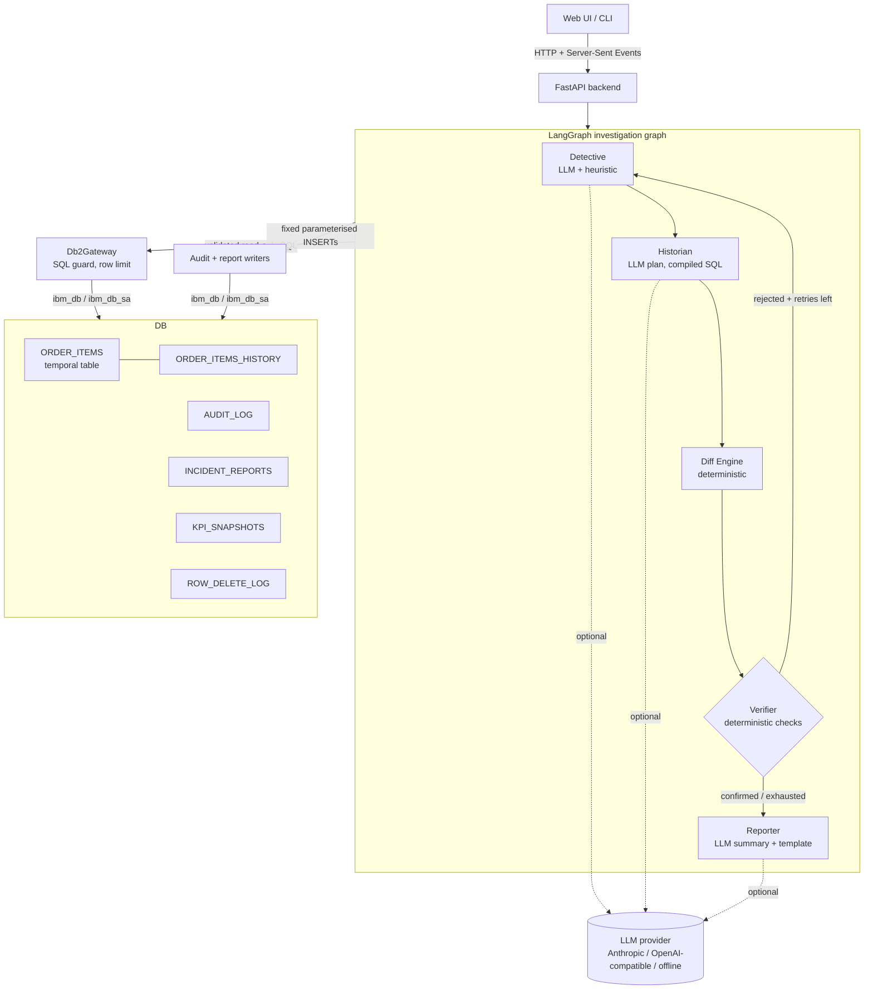

# System Architecture

## Overview

Db2 Time Machine is a small, layered application. A browser (or the CLI) asks a question. A FastAPI backend runs a **LangGraph** investigation graph. The graph's agents read the history of a **Db2 system-period temporal table** through a guarded, read-only gateway, compare row versions, verify the suspected cause, and write an audit trail and an incident report back to Db2.

Db2 is the system of record for everything that matters: the business data and its history (temporal tables), the evidence (temporal queries), the audit trail (`AUDIT_LOG`) and the findings (`INCIDENT_REPORTS`). The LLM is optional and only plans and phrases; it never produces facts or SQL text.

---

## Architecture Diagram



---

## Component Breakdown

1. **User Interface / Client Layer** (`static/index.html`, `cli.py`)
   - Single-page UI: question box, time-window selector, live agent pipeline (one card per node, with the retry loop made visible), hypothesis ledger with confirmed/rejected badges, KPI cards, a time-travel chart (one `AS OF` query per point), root-cause card, timeline, affected rows, evidence SQL with copy buttons, the Db2 audit log tab, and past investigations. Demo buttons reset the data and inject faults.
   - CLI: `doctor`, `init-db`, `seed`, `reset-demo`, `inject`, `investigate`, `serve`.
2. **Application Backend Layer** (`api.py`, `graph.py`)
   - `GET /api/investigate/stream` (SSE), `POST /api/investigate`, `GET /api/reports[/{id}]`, `GET /api/audit/{id}`, `GET /api/curve`, `GET /api/health`, `POST /api/demo/reset|inject/{fault}`. Inputs are validated with Pydantic and identifiers are checked before use.
   - The graph runs in a worker thread and pushes events into a queue that the SSE response drains, so the UI updates as each agent works.
3. **Database Layer (IBM Db2)** (`db.py`, `repository.py`, `temporal_sql.py`, `sql_guard.py`, `db2/*.sql`)
   - `Db2Gateway`: per-thread connections, two interchangeable drivers (`ibm_db_dbi` or SQLAlchemy `ibm_db_sa`), `read()` for guarded queries, `execute()` for fixed writers and demo scripts.
   - `sql_guard.validate_readonly`: one statement, `SELECT`/`WITH`/`VALUES` only, forbidden-keyword scan (literals and comments stripped first), table allow-list, automatic `FETCH FIRST n ROWS ONLY`.
   - `temporal_sql`: compiles validated plans into `FOR SYSTEM_TIME AS OF` and `FROM .. TO` SQL. Timestamps come from `datetime` objects and ids from `int()`, never from free text.
4. **AI / Model Orchestration Layer** (`agents.py`, `llm.py`, `scope.py`, `diff_engine.py`)
   - Five LangGraph nodes sharing one state dictionary; a conditional edge after the Verifier chooses `detective` (retry) or `reporter`. Retries are bounded by `TM_MAX_ITERATIONS`.
   - `LLM`: Anthropic Messages API, OpenAI-compatible chat, or offline. Every LLM answer is validated; every node has a deterministic fallback.

---

## Data Flow

1. **Input Ingestion**: the user asks, for example, "Why did Aurora Laptop revenue drop since this morning?". The backend starts a run with a fresh `run_id`.
2. **Context Retrieval (Detective, Historian)**: the Detective reads the product catalogue, finds the product, direction and window (default: from the latest `KPI_SNAPSHOTS` row to now) and ranks hypotheses. The Historian fetches all row versions overlapping the window with `FOR SYSTEM_TIME FROM .. TO ..` and the deletion log.
3. **Augmentation & Inference (Diff Engine, Verifier)**: versions become insert/update/delete events, grouped by transaction and pattern. The Verifier measures revenue at both ends with `AS OF`, reconciles the event impacts against the measurement, and scores the current hypothesis. If rejected, the graph returns to the Detective, which reorders the remaining hypotheses by how much each moved the metric.
4. **State Persistence**: every step is written to `AUDIT_LOG`; the finished report is written to `INCIDENT_REPORTS`.
5. **Response Delivery**: events stream to the UI as they happen; the report arrives last. The UI then reads the audit log back from Db2.

### Hypothesis scoring and verification

```
observed       = revenue_AS_OF(end) - revenue_AS_OF(start)          # two Db2 queries
impact(p)      = sum of revenue impact of events with pattern p     # from row versions
share(p)       = impact(p) / observed
confirmed(p)   = rows(p) > 0  and  sign(impact(p)) == sign(observed)  and  share(p) >= TM_CONFIRM_SHARE
reconciled     = sum(all event impacts) == observed                  # exact Decimal arithmetic
stable         = re-running both AS OF queries returns identical values
confidence     = high if confirmed and reconciled and stable
```

Patterns: `price_change` (unit price changed), `quantity_change` (quantity changed, price same), `duplicate_load` (inserted row whose natural key already exists), `rows_deleted`, and `new_rows` (inserts that are not duplicates: normal business, never a root cause).

---

## IBM Db2 Schema & Storage Design

Full DDL: [`db2/01_schema.sql`](db2/01_schema.sql). Core excerpt:

```sql
CREATE TABLE ORDER_ITEMS (
    ITEM_ID     INTEGER       NOT NULL PRIMARY KEY,
    ORDER_ID    INTEGER       NOT NULL,
    PRODUCT_ID  INTEGER       NOT NULL,
    QUANTITY    INTEGER       NOT NULL,
    UNIT_PRICE  DECIMAL(10,2) NOT NULL,
    CHANGED_BY  VARCHAR(128)  NOT NULL DEFAULT 'unknown',
    SYS_START   TIMESTAMP(12) NOT NULL GENERATED ALWAYS AS ROW BEGIN,
    SYS_END     TIMESTAMP(12) NOT NULL GENERATED ALWAYS AS ROW END,
    TRANS_ID    TIMESTAMP(12) NOT NULL GENERATED ALWAYS AS TRANSACTION START ID,
    PERIOD SYSTEM_TIME (SYS_START, SYS_END)
);
CREATE TABLE ORDER_ITEMS_HISTORY LIKE ORDER_ITEMS;
ALTER TABLE ORDER_ITEMS ADD VERSIONING USE HISTORY TABLE ORDER_ITEMS_HISTORY;

CREATE TRIGGER TRG_OI_UPD NO CASCADE BEFORE UPDATE ON ORDER_ITEMS
    REFERENCING NEW AS N FOR EACH ROW MODE DB2SQL
BEGIN ATOMIC
    SET N.CHANGED_BY = COALESCE(NULLIF(TRIM(CURRENT CLIENT_USERID), ''), SESSION_USER);
END;
```

Design notes:

- Db2 maintains `SYS_START`, `SYS_END` and `TRANS_ID`; the application never writes them, so the history cannot be forged through normal DML.
- All rows changed in one transaction share one `TRANS_ID` (and one `SYS_START`), which is how the Diff Engine recognises "one batch job".
- A deleted row survives only in the history table, which does not record who deleted it. The `AFTER DELETE` trigger writes `ROW_DELETE_LOG` so deletions can be attributed.
- Timestamps are read with `VARCHAR_FORMAT(.., 'YYYY-MM-DD HH24:MI:SS.FF6')` so drivers never have to parse 12-digit fractional seconds.
- `AUDIT_LOG` is indexed on `(RUN_ID, SEQ)`; `INCIDENT_REPORTS` stores the full report as JSON in a `CLOB`.

---

## Security & Secrets Management

- All database credentials and API keys are read at runtime from environment variables (or a local, git-ignored `.env`). `.env.example` contains placeholders only.
- Agents can only reach Db2 through `Db2Gateway.read()`, which enforces the read-only guard and the allow-list. The only writes are fixed, parameterised `INSERT` statements for the audit log and incident reports.
- The LLM never writes SQL. Product ids, timestamps and window bounds are rendered from typed values (`int`, `datetime`) after validation.
- Only the facts needed for a task are sent to a model (question text, product names, aggregate numbers). With `LLM_PROVIDER=offline` nothing leaves the machine.
- Run ids are validated with a strict pattern before they are used in any lookup.
