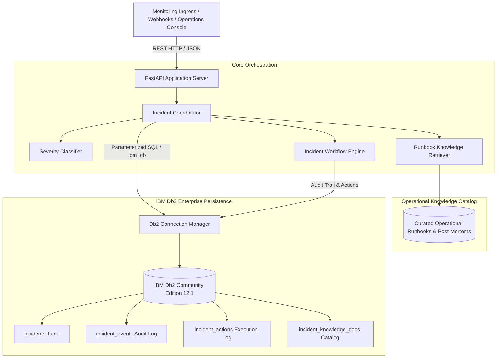

# Db2 WorkRelay Intelligence

> **IBM Db2Hack 2026 Showcase Submission**
> An enterprise operational incident triage, lifecycle automation, and runbook retrieval platform backed by **IBM Db2 Community Edition 12.1.5.0** for structured audit persistence and **LangChain Core** for deterministic knowledge retrieval.

---

## Table of Contents
- [1. Project Description](#1-project-description)
- [2. Problem Statement](#2-problem-statement)
- [3. Proposed Solution](#3-proposed-solution)
- [4. Core Capabilities](#4-core-capabilities)
- [5. Architecture Overview](#5-architecture-overview)
- [6. Technology Stack](#6-technology-stack)
- [7. Project Directory Structure](#7-project-directory-structure)
- [8. Prerequisites](#8-prerequisites)
- [9. Local Installation Instructions](#9-local-installation-instructions)
- [10. Docker Engine and Db2 Setup](#10-docker-engine-and-db2-setup)
- [11. Environment Variable Configuration](#11-environment-variable-configuration)
- [12. Database Initialization](#12-database-initialization)
- [13. Application Startup](#13-application-startup)
- [14. API Endpoints & Usage Examples](#14-api-endpoints--usage-examples)
- [15. Test Execution Instructions](#15-test-execution-instructions)
- [16. Verified Test Results](#16-verified-test-results)
- [17. Troubleshooting](#17-troubleshooting)
- [18. Security Considerations](#18-security-considerations)
- [19. Current Project Limitations & Future Roadmap](#19-current-project-limitations--future-roadmap)
- [Team & Acknowledgments](#team--acknowledgments)

---

## 1. Project Description

**Db2 WorkRelay Intelligence** is an operational incident management platform designed for enterprise hybrid-cloud environments. It leverages **IBM Db2 Community Edition** as the single source of truth for operational state, diagnostic actions, and structured lifecycle audit trails.

By combining **FastAPI** for high-throughput alert intake, **LangChain Core** for deterministic symptom-to-runbook retrieval, and native **`ibm_db`** drivers with transactional safety, Db2 WorkRelay Intelligence enables engineering teams to rapidly triage system failures, match historical post-mortems, and record every diagnostic action with comprehensive operational auditability.

---

## 2. Problem Statement

In modern microservice and distributed database architectures, critical incidents—such as connection pool exhaustion (`SQL30081N`), lock escalations, deadlock storms, and transaction log saturation (`SQL0964C`)—occur under intense operational pressure.

Traditional operational workflows suffer from two critical architectural shortcomings:
1. **Unverifiable Black-Box AI Execution:** Autonomous LLM agents granted unrestricted shell or database execution pose grave reliability and compliance risks due to non-deterministic hallucinations and unrepeatable remediation actions.
2. **Scattered and Ephemeral Incident Knowledge:** Post-mortems, operational runbooks, and diagnostic logs are fragmented across chat channels, ticketing systems, and temporary log aggregators, preventing reliable automated matching when identical failure signatures recur.

---

## 3. Proposed Solution

Db2 WorkRelay Intelligence introduces a governed, deterministic incident management architecture:
- **FastAPI Intake Layer:** Rapidly ingests operational alerts and telemetry via structured REST endpoints.
- **Authoritative IBM Db2 Persistence:** Stores incident state, diagnostic records, and granular state transitions across relational tables with foreign-key referential integrity and B-tree indexing.
- **LangChain Operational Runbook Retrieval:** Converts historical incident post-mortems into LangChain `Document` objects and executes deterministic keyword and symptom matching via a custom `BaseRetriever`.
- **Governed Multi-Phase Workflow Engine:** Decouples knowledge recommendation from execution, transitioning incidents through a strict state machine (`CLASSIFYING -> INVESTIGATING -> REMEDIATING -> VERIFYING -> RESOLVED / ESCALATED`). Every state transition automatically writes a structured audit event to Db2.

---

## 4. Core Capabilities

- **Automated Incident Triage & Classification:** Evaluates incoming telemetry to classify severity (`CRITICAL`, `HIGH`, `MEDIUM`, `LOW`) and extracts primary symptoms.
- **Deterministic LangChain Runbook Retrieval:** Identifies relevant mitigation steps from curated operational playbooks using the standard LangChain `retriever.invoke()` runnable pattern without external LLM dependencies.
- **Chronological Audit Event Logging:** Persists every status change, investigation step, and remediation outcome to the `incident_events` table in IBM Db2.
- **Native IBM Db2 Integration:** Connects directly via the native Python `ibm_db` and `ibm_db_dbi` drivers, utilizing parameterized SQL (`?` positional bindings) to guarantee SQL injection safety and transaction isolation.
- **UTC Timestamp Normalization:** Built-in datetime standardization helper converting timestamps to UTC `YYYY-MM-DD HH:MM:SS.ffffff` format, eliminating Db2 `SQL0180N` syntax errors while preserving microsecond precision.
- **Configured Test Fallback:** Dual-mode connection architecture that connects to genuine IBM Db2 via native `ibm_db` when configured, or activates an in-memory SQLite compatibility mode when `DB2_USE_MOCK=true` is set for offline developer testing and lightweight CI/CD pipelines.

---

## 5. Architecture Overview



For detailed component interactions and schema definitions, see [architecture.md](architecture.md).

---

## 6. Technology Stack

| Component | Technology | Version | Purpose |
|---|---|---|---|
| **Language Runtime** | Python | 3.10.12 | Core backend language |
| **API Framework** | FastAPI | 0.110+ | High-throughput async REST API |
| **ASGI Server** | Uvicorn | 0.28+ | Production ASGI web server |
| **Data Validation** | Pydantic | 2.0+ | Strict request/response modeling |
| **Database Engine** | IBM Db2 Community Edition | 12.1.5.0 | Relational storage & structured audit persistence |
| **Db2 Client Driver** | `ibm_db` / `ibm_db_dbi` | 3.3.0 | Native C-based IBM Db2 driver |
| **Knowledge Engine** | LangChain Core | 1.7.6 | Runbook modeling & custom `BaseRetriever` |
| **Container Engine** | Headless Docker Engine | 29.9.3 | Host runtime for Db2 on Ubuntu WSL2 |
| **Container Orchestration** | Docker Compose | v5.7.0 | Multi-service orchestration tooling |
| **Operating System** | Ubuntu Linux / Windows WSL2 | 22.04.5 LTS | Development and deployment environment |
| **Testing Framework** | Pytest | 9.2.0 | Unit, repository, and live integration testing |

---

## 7. Project Directory Structure

```text
submissions/db2-workrelay-intelligence/
├── .env.example               # Clean configuration template with safe placeholders
├── Dockerfile                 # Multi-stage container build for application runtime
├── README.md                  # Comprehensive project documentation (this file)
├── architecture.md            # In-depth architectural design, data flows, and DDL schema
├── docker-compose.yml         # Compose configuration for app and local Db2 container
├── requirements.txt           # Python dependency definitions
├── submission.json            # Official IBM Db2 TechX Summit metadata descriptor
├── docs/
│   ├── db2-setup-guide.md     # Detailed deployment, WSL2 tuning, and operations guide
│   └── screenshots/           # Architectural and operational UI screenshots
├── src/
│   └── app/
│       ├── __init__.py
│       ├── api.py             # FastAPI route definitions and structured error handlers
│       ├── main.py            # Server entrypoint and CLI runner
│       ├── agent/
│       │   ├── __init__.py
│       │   └── coordinator.py # Incident triage coordinator and severity classifier
│       ├── ai/
│       │   ├── __init__.py
│       │   └── knowledge_retriever.py  # LangChain Document model and BaseRetriever
│       ├── db/
│       │   ├── __init__.py
│       │   ├── connection.py  # Dual-mode Db2/SQLite connection manager
│       │   ├── init_db.py     # Schema creation and baseline incident seeding
│       │   ├── repository.py  # Parameterized SQL CRUD & UTC timestamp normalization
│       │   └── schema_db2.sql # Native IBM Db2 DDL with 4 tables and 7 indexes
│       ├── models/
│       │   ├── __init__.py
│       │   └── incident.py    # Pydantic v2 domain schemas and state definitions
│       └── workflows/
│           ├── __init__.py
│           └── incident_workflow.py # Deterministic multi-phase lifecycle state machine
└── tests/
    ├── __init__.py
    ├── test_ai_retrieval.py   # 7 tests: LangChain Document conversion and retrieval
    ├── test_api.py            # 8 tests: FastAPI routes, query filters, error handling
    ├── test_db2_internals.py  # 9 tests: Row mapping, connection handling, UTC timestamps
    ├── test_db2_live.py       # 2 tests: Real Db2 connectivity and full CRUD integration
    ├── test_db2_repository.py # 4 tests: Repository queries and SQL injection safety
    └── test_models.py         # 3 tests: Pydantic schemas, timestamps, and state transitions
```

---

## 8. Prerequisites

- **Python:** Python 3.10.x or higher.
- **Host OS:** Linux (Ubuntu 20.04/22.04 recommended) or Windows 10/11 with WSL2 (Ubuntu 22.04 LTS).
- **RAM Sizing:**
  - *Offline Mock Mode:* ~500 MB free RAM.
  - *Live Db2 Container Mode:* Minimum 8 GB host physical RAM (tested on Dell Latitude 5400).
- **Container Runtime (Optional for Live Db2):** Headless Docker Engine 24+ or Docker Compose.

---

## 9. Local Installation Instructions

Navigate to the project directory and create a dedicated Python virtual environment:

```bash
# 1. Clone repository and navigate to the submission directory
cd submissions/db2-workrelay-intelligence

# 2. Create Python 3.10 virtual environment
python3 -m venv .venv

# 3. Activate the virtual environment
# On Linux / macOS / WSL:
source .venv/bin/activate
# On Windows PowerShell:
# .venv\Scripts\Activate.ps1

# 4. Upgrade pip and install all project dependencies
pip install --upgrade pip
pip install -r requirements.txt
```

Verify that the native IBM Db2 driver and LangChain Core imported cleanly:
```bash
python -c "import ibm_db, langchain_core; print('Dependencies installed successfully!')"
```

---

## 10. Docker Engine and Db2 Setup

For full live integration testing, IBM Db2 Community Edition 12.1.5.0 can be provisioned locally using native Docker Engine inside Ubuntu WSL2.

> [!TIP]
> **Tested Dell Reference Configuration:**
> On an 8 GB physical RAM machine (e.g., Dell Latitude 5400), set `%USERPROFILE%\.wslconfig` to:
> ```ini
> [wsl2]
> memory=5GB
> processors=4
> swap=6GB
> ```
> Restart WSL via `wsl --shutdown` before launching the container. For detailed step-by-step instructions and troubleshooting, see the [Db2 Setup Guide](docs/db2-setup-guide.md).

### Launching IBM Db2 Community Edition

From the `submissions/db2-workrelay-intelligence` directory:

```bash
# 1. Create persistent Docker volume
docker volume create db2_data

# 2. Start the Db2 Community Edition container
docker run -d \
  --name db2server \
  --privileged=true \
  -p 127.0.0.1:50000:50000 \
  --env-file .env.db2 \
  -v db2_data:/database \
  icr.io/db2_community/db2:latest
```

> [!NOTE]
> **Port Binding & Network Exposure:**
> The command above recommends `-p 127.0.0.1:50000:50000` for fresh local setups to bind Db2 exclusively to the loopback interface, preventing external network exposure. In our verified Dell development environment, the existing `db2server` container was initially launched with `-p 50000:50000` (which `docker port db2server` reports as `50000/tcp -> 0.0.0.0:50000`) and has been preserved without container recreation. Both bindings function identically for local development; loopback-only is recommended whenever network isolation is preferred.
>
> **Privileged Mode Note:**
> The `--privileged=true` flag was used in this tested Ubuntu WSL2 development setup to satisfy IBM Db2's requirements for IPC shared memory segments, semaphores, and kernel resource limits. Privileged execution is a tested development approach on this local WSL2 machine; production environments or locked-down platforms (such as Red Hat OpenShift or Kubernetes) typically evaluate platform-specific security context constraints (SCCs), specialized container capabilities, or custom security profiles evaluated by infrastructure administrators according to their platform security policies, rather than full `--privileged` mode.

Example `.env.db2` (kept git-ignored):
```ini
LICENSE=accept
DB2INSTANCE=db2inst1
DB2INST1_PASSWORD=your_strong_unique_password
DBNAME=testdb
BLU=false
ENABLE_ORACLE_COMPATIBILITY=false
```

### Verifying Container Readiness
Follow the container initialization logs:
```bash
docker logs -f db2server
```
Wait until the setup completion banner appears:
```text
(*) Setup has completed.
```

---

## 11. Environment Variable Configuration

Copy `.env.example` to create your local `.env` runtime configuration:

```bash
cp .env.example .env
```

### Configuration Options in `.env`:

> [!NOTE]
> **Password Synchronization:** The password configured in `DB2_PASSWORD` in `.env` must exactly match the database instance password specified by `DB2INST1_PASSWORD` in `.env.db2`.

```ini
# ========================================================================
# 1. Live IBM Db2 Community Edition Configuration
# ========================================================================
DB2_HOST=localhost
DB2_PORT=50000
DB2_DATABASE=testdb
DB2_USER=db2inst1
DB2_PASSWORD=your_secure_db2_password_here
DB2_PROTOCOL=TCPIP

# Set to false to use the native ibm_db driver against live Db2
DB2_USE_MOCK=false

# ========================================================================
# 2. Offline Mock Execution Mode (Optional)
# ========================================================================
# Set DB2_USE_MOCK=true to bypass Db2 and use in-memory SQLite compatibility:
# DB2_USE_MOCK=true
DB2_SQLITE_PATH=:memory:

# ========================================================================
# 3. Application Server Settings
# ========================================================================
HOST=0.0.0.0
PORT=8000
LOG_LEVEL=INFO

# ========================================================================
# 4. Knowledge Retrieval Settings
# ========================================================================
AI_PROVIDER=local_heuristic
```

> [!IMPORTANT]
> The `.env` file is strictly ignored by Git and must never be committed. Always use `.env.example` with safe placeholder values for repository sharing.

---

## 12. Database Initialization

Execute the database initialization script to build tables, constraints, indexes, and initial seed records:

```bash
# Sourcing credentials safely
set -a && source .env && set +a

# Run the initializer
PYTHONPATH=src python src/app/db/init_db.py
```

### Expected Output:
```text
Initializing database... Mode: ibm_db
Executing native IBM Db2 schema (schema_db2.sql)...
Database initialized and baseline incident created.
```

The script executes `src/app/db/schema_db2.sql`, creating:
- 4 Relational Tables: `incidents`, `incident_events`, `incident_actions`, `incident_knowledge_docs`
- 7 B-Tree Performance Indexes
- Baseline seed record `INC-BASELINE-01` with an `INCIDENT_REGISTERED` audit event.

---

## 13. Application Startup

Start the FastAPI application using the built-in runner or Uvicorn:

```bash
# Option 1: Built-in runner
PYTHONPATH=src python -m app.main

# Option 2: Direct Uvicorn with auto-reload (development)
PYTHONPATH=src uvicorn app.api:app --host 0.0.0.0 --port 8000 --reload
```

The application is now active at `http://localhost:8000`.
Interactive Swagger OpenAPI documentation is available at `http://localhost:8000/docs`.

---

## 14. API Endpoints & Usage Examples

The API provides 7 fully implemented, typed REST endpoints:

| Method | Endpoint | Description |
|---|---|---|
| `GET` | `/health` | System health check, Db2 connectivity probe, AI engine status |
| `POST` | `/incidents` | Register and auto-triage a new operational incident |
| `GET` | `/incidents` | List incidents with filtering (`status`, `severity`, `service`) and pagination |
| `GET` | `/incidents/{id}` | Retrieve incident details, audit events, and remediation actions |
| `PATCH` | `/incidents/{id}` | Update incident status, severity, resolution, or escalation reason |
| `POST` | `/knowledge/query` | Query matching operational runbooks by symptom description |
| `POST` | `/knowledge/ingest` | Ingest new post-mortem or runbook into knowledge base |

---

### Request & Response Examples (Illustrative)

> [!NOTE]
> The request and response payloads below are illustrative examples documenting endpoint schemas, parameter structures, and response models.

#### 1. System Health Check (`GET /health`)
```bash
curl -s http://localhost:8000/health | jq .
```
```json
{
  "status": "healthy",
  "service": "db2-workrelay-intelligence",
  "version": "1.0.0",
  "db2_connected": true,
  "db2_mode": "ibm_db",
  "ai_status": {
    "provider": "langchain_local",
    "retriever": "LangChainRunbookRetriever",
    "document_count": 3,
    "status": "ready"
  }
}
```

#### 2. Register & Auto-Triage an Incident (`POST /incidents`)
```bash
curl -s -X POST http://localhost:8000/incidents \
  -H "Content-Type: application/json" \
  -d '{
    "title": "Db2 Connection Pool Exhaustion",
    "service": "payment-gateway",
    "description": "SQL30081N communication link failure: maximum connections reached on Db2 cluster."
  }' | jq .
```
```json
{
  "incident": {
    "id": "inc-2f8a4e1b",
    "title": "Db2 Connection Pool Exhaustion",
    "description": "SQL30081N communication link failure: maximum connections reached on Db2 cluster.",
    "service": "payment-gateway",
    "severity": "CRITICAL",
    "status": "RESOLVED",
    "current_step": "VERIFYING",
    "workflow": "automated-incident-response",
    "resolution": "Applied runbook RB-DB2-001: Scaled connection pool and cleared idle client handles.",
    "retry_count": 0,
    "metadata": {
      "auto_classify": true,
      "recommended_runbook": "RB-DB2-001"
    },
    "created_at": "2026-11-08 10:23:26.552234",
    "updated_at": "2026-11-08 10:23:27.104512"
  }
}
```

#### 3. List Incidents with Pagination (`GET /incidents`)
```bash
curl -s "http://localhost:8000/incidents?status=RESOLVED&limit=10&offset=0" | jq .
```
```json
{
  "items": [
    {
      "id": "inc-2f8a4e1b",
      "title": "Db2 Connection Pool Exhaustion",
      "service": "payment-gateway",
      "severity": "CRITICAL",
      "status": "RESOLVED"
    }
  ],
  "total": 1,
  "limit": 10,
  "offset": 0
}
```

#### 4. Query Runbook Knowledge (`POST /knowledge/query`)
```bash
curl -s -X POST http://localhost:8000/knowledge/query \
  -H "Content-Type: application/json" \
  -d '{
    "query": "SQL0964C The transaction log for the database is full",
    "service": "db2",
    "top_k": 1
  }' | jq .
```
```json
{
  "query": "SQL0964C The transaction log for the database is full",
  "matches_found": 1,
  "results": [
    {
      "doc_id": "RB-DB2-002",
      "title": "Db2 Transaction Log Saturation Mitigation",
      "category": "database",
      "service": "db2",
      "score": 8,
      "resolution_steps": "1. Run: db2 get db cfg for testdb | grep LOGFILSIZ\n2. Issue: db2 update db cfg for testdb using LOGSECOND 20\n3. Identify offending long-running unit of work via db2pd -transactions."
    }
  ]
}
```

#### 5. Ingest New Operational Runbook (`POST /knowledge/ingest`)
```bash
curl -s -X POST http://localhost:8000/knowledge/ingest \
  -H "Content-Type: application/json" \
  -d '{
    "doc_id": "RB-APP-003",
    "title": "Redis Cache Invalidation Desync",
    "category": "caching",
    "service": "session-service",
    "content": "Redis key ttl expired or memory eviction policy triggered early drop.",
    "resolution_steps": "Flush stale cache keys and restart session replica workers."
  }' | jq .
```
```json
{
  "status": "ingested",
  "doc_id": "RB-APP-003"
}
```

---

## 15. Test Execution Instructions

The project provides comprehensive test coverage spanning data models, LangChain knowledge retrieval, API routes, Db2 internals, and live database integration.

### Mode 1: Full Test Suite with Live IBM Db2

To execute the entire 33-test suite including live database CRUD operations:

```bash
cd submissions/db2-workrelay-intelligence
set -a && source .env && set +a
PYTHONPATH=src pytest tests/ -v
```

### Mode 2: Offline / Mock Test Suite

If running in a lightweight CI/CD pipeline or without a live Db2 container (requires project Python dependencies and pytest installed in an active virtual environment):

```bash
cd submissions/db2-workrelay-intelligence
DB2_USE_MOCK=true PYTHONPATH=src pytest tests/ -v
```
*(Verified result in mock mode: 31 passed, 2 skipped. The two live Db2 connection and CRUD tests safely skip when `DB2_USE_MOCK=true` is set).*

---

## 16. Verified Test Results

The test suite has been executed and verified against a running local IBM Db2 Community Edition 12.1.5.0 container:

```text
============================== test session starts ==============================
platform linux -- Python 3.10.12, pytest-9.2.0, pluggy-1.7.0
rootdir: /home/yemisi/projects/IBM_Db2_TechX_Project_Submission/submissions/db2-workrelay-intelligence
collected 33 items

tests/test_ai_retrieval.py::test_knowledge_retriever_seeded_runbooks PASSED [  3%]
tests/test_ai_retrieval.py::test_runbooks_converted_to_langchain_documents PASSED [  6%]
tests/test_ai_retrieval.py::test_langchain_retriever_direct_invocation PASSED [  9%]
tests/test_ai_retrieval.py::test_knowledge_retriever_query_matching PASSED [ 12%]
tests/test_ai_retrieval.py::test_knowledge_retriever_irrelevant_query_handling PASSED [ 15%]
tests/test_ai_retrieval.py::test_knowledge_retriever_custom_ingest PASSED [ 18%]
tests/test_ai_retrieval.py::test_coordinator_workflow_uses_langchain_retriever PASSED [ 21%]
tests/test_api.py::test_health_endpoint PASSED                           [ 24%]
tests/test_api.py::test_create_and_retrieve_incident PASSED              [ 27%]
tests/test_api.py::test_auto_classification_on_creation PASSED           [ 30%]
tests/test_api.py::test_list_incidents PASSED                            [ 33%]
tests/test_api.py::test_patch_incident_status PASSED                     [ 36%]
tests/test_api.py::test_structured_error_handling_not_found PASSED       [ 39%]
tests/test_api.py::test_knowledge_query_endpoint PASSED                  [ 42%]
tests/test_api.py::test_knowledge_ingest_endpoint PASSED                 [ 45%]
tests/test_db2_internals.py::test_db2_row_mapping_from_tuples PASSED     [ 48%]
tests/test_db2_internals.py::test_db2_row_mapping_none_and_dict PASSED   [ 51%]
tests/test_db2_internals.py::test_db2_connection_failure_handling PASSED [ 54%]
tests/test_db2_internals.py::test_native_schema_db2_file_exists_and_parses PASSED [ 57%]
tests/test_db2_internals.py::test_audit_log_persistence_on_status_change PASSED [ 60%]
tests/test_db2_internals.py::test_db2_timestamp_formatting_utc PASSED    [ 63%]
tests/test_db2_internals.py::test_db2_timestamp_formatting_non_zero_offset PASSED [ 66%]
tests/test_db2_internals.py::test_db2_timestamp_formatting_microseconds_preserved PASSED [ 69%]
tests/test_db2_internals.py::test_db2_timestamp_none_and_native_handling PASSED [ 72%]
tests/test_db2_live.py::test_live_db2_connection_probe PASSED            [ 75%]
tests/test_db2_live.py::test_live_db2_schema_and_crud PASSED             [ 78%]
tests/test_db2_repository.py::test_create_and_get_incident PASSED        [ 81%]
tests/test_db2_repository.py::test_list_incidents_filtering PASSED       [ 84%]
tests/test_db2_repository.py::test_patch_incident PASSED                 [ 87%]
tests/test_db2_repository.py::test_parameterized_query_safety PASSED     [ 90%]
tests/test_models.py::test_incident_creation_and_defaults PASSED         [ 93%]
tests/test_models.py::test_incident_record_event PASSED                  [ 96%]
tests/test_models.py::test_incident_request_models PASSED                [100%]

======================== 33 passed in 66.13s (0:01:06) =========================
```

### Test Breakdown Summary:
- **AI & LangChain Retrieval (`tests/test_ai_retrieval.py`):** 7 passed
- **FastAPI Endpoints (`tests/test_api.py`):** 8 passed
- **Db2 Internals & Timestamps (`tests/test_db2_internals.py`):** 9 passed
- **Live Db2 Integration (`tests/test_db2_live.py`):** 2 passed
- **Db2 Repository Operations (`tests/test_db2_repository.py`):** 4 passed
- **Data Models & State Transitions (`tests/test_models.py`):** 3 passed
- **Total:** **33 passed, 0 failed, 0 skipped**

---

## 17. Troubleshooting

### 1. Db2 SQL0180N: Datetime Format Syntax Error
- **Cause:** IBM Db2 strictly expects `YYYY-MM-DD HH:MM:SS.ffffff` for standard `TIMESTAMP` columns. Supplying ISO 8601 strings with a `T` separator or `+00:00` offset triggers `SQL0180N SQLSTATE=22007`.
- **Resolution:** All timestamps in `src/app/db/repository.py` are normalized using `format_db2_timestamp`, which astimezones the datetime to UTC and strips non-compliant characters before parameter binding.

### 2. WSL2 Container OOM Kill during Database Creation
- **Cause:** When spinning up IBM Db2 on an 8 GB host, the initial `CREATE DATABASE` routine consumes peak memory. With default 2 GB WSL swap, the Linux kernel terminates the container.
- **Resolution:** Allocate `swap=6GB` in `%USERPROFILE%\.wslconfig` and execute `wsl --shutdown`. The swap space absorbs the initial peak without kernel panics, and steady-state RAM usage settles to ~1.5 GB.

### 3. Starlette 1.0+ Route Collection in Custom Test Clients
- **Cause:** In modern FastAPI / Starlette, included routers are wrapped in `_IncludedRouter` entries rather than exposing flat routes on the application root.
- **Resolution:** `ApiTestClient` in `tests/test_api.py` recursively collects routes from nested sub-routers via `_collect(routes)`.

---

## 18. Security Considerations

1. **Zero Secret Leakage:** Runtime credentials and environment files (`.env`, `.env.db2`) are strictly ignored via `.gitignore`. `.env.example` contains only benign placeholders.
2. **SQL Injection Defense:** All queries to IBM Db2 use parameterized positional placeholders (`?`), preventing SQL injection attacks regardless of user input in incident descriptions or query filters.
3. **Restricted File Permissions:** Ensure runtime credentials on Linux/WSL have tight permission bits: `chmod 600 .env .env.db2`.
4. **Governed Workflow Transitions:** Automated actions cannot execute arbitrary shell or SQL commands; all workflow steps are bounded by deterministic state machine transitions.

---

## 19. Current Project Limitations & Future Roadmap

### Current Scope & Capabilities
- Authoritative relational persistence in IBM Db2 Community Edition.
- Structured event audit logging with foreign-key referential integrity.
- Deterministic symptom and keyword overlap matching via LangChain Core `BaseRetriever`.
- Dual-mode connection manager with configurable SQLite in-memory fallback (`DB2_USE_MOCK=true`).

### Future Roadmap
- **Native Db2 12.1+ Vector Search:** Leverage IBM Db2's native vector data types (`VECTOR(n, FLOAT32)`) and SQL distance functions (`COSINE_DISTANCE`) to store and search dense vector embeddings natively within Db2 tables.
- **IBM watsonx.ai Granite LLM Integration:** Synthesize multi-incident trends, generate conversational post-mortem summaries, and provide natural-language root-cause analysis backed by IBM watsonx foundation models.
- **Real-Time Operations Console:** WebSocket event streaming to broadcast incident state changes and audit events live to an interactive operations dashboard.

---

## Team & Acknowledgments

| Name | Role | GitHub |
|---|---|---|
| **Yemmy** | Full-Stack Developer & Backend Integration Specialist | [@Yemmmyc](https://github.com/Yemmmyc) |

*Submitted to the **IBM Db2 TechX Summit 2026** Showcase.*
