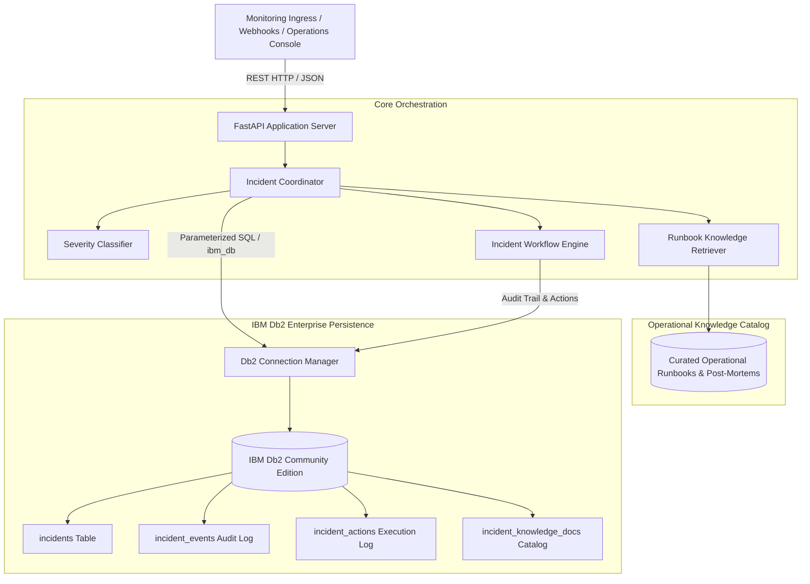
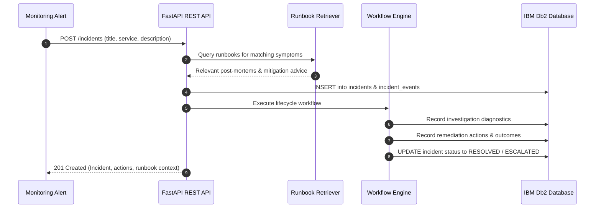

# System Architecture: Db2 WorkRelay Intelligence

## Overview
**Db2 WorkRelay Intelligence** is an enterprise operational incident management and runbook retrieval platform. It combines FastAPI for high-throughput operational intake, **IBM Db2 Community Edition** as the authoritative relational persistence and audit layer via native `ibm_db`, and a deterministic operational knowledge retrieval engine powered by **LangChain**.

The platform decouples **automated triage, classification, and runbook retrieval** from **deterministic operational lifecycle execution**, ensuring that every automated mitigation step and state transition is reproducible, structured, and permanently auditable in Db2.

---

## Architecture Diagram



---

## Component Breakdown

1. **API & Intake Layer (`src/app/api.py`)**:
   - Built on FastAPI with Pydantic v2 validation.
   - Standardized REST endpoints (`/health`, `/incidents`, `/incidents/{id}`, `/knowledge/query`, `/knowledge/ingest`).
   - Structured error handling returning consistent JSON error payloads.

2. **Incident Coordinator & Triage (`src/app/agent/coordinator.py`)**:
   - Automatically determines incident severity (`CRITICAL`, `HIGH`, `MEDIUM`, `LOW`) from telemetry patterns.
   - Coordinates with the Runbook Knowledge Retriever to recommend matching historical post-mortems and mitigation playbooks before executing workflows.

3. **Deterministic Workflow Engine (`src/app/workflows/incident_workflow.py`)**:
   - Executes multi-phase incident response: `CLASSIFYING -> INVESTIGATING -> REMEDIATING -> VERIFYING -> RESOLVED / ESCALATED`.
   - Records each granular phase transition and operational diagnostic as an immutable audit event in Db2.

4. **LangChain Operational Runbook Retrieval Engine (`src/app/ai/knowledge_retriever.py`)**:
   - Structured operational runbooks (e.g., Db2 connection pool exhaustion, transaction log saturation, JWT auth desync) converted into native LangChain `Document` objects (`langchain_core.documents.Document`).
   - Custom `LangChainRunbookRetriever` extending LangChain's `BaseRetriever`.
   - Deterministic keyword and symptom overlap matching with service context scoring executed via LangChain's standard `invoke()` runnable interface.
   - Fully self-contained: zero external LLM API keys, cloud services, or vector stores required.
   - Provides prioritized mitigation recommendations with exact operational command lines.

5. **IBM Db2 Persistence Layer (`src/app/db/`)**:
   - **`connection.py`**: Manages native `ibm_db` and `ibm_db_dbi` driver connections, transactional cursors (`commit`/`rollback`), connection health probes (`SELECT 1 FROM SYSIBM.SYSDUMMY1`), tuple-to-dictionary row mapping (`map_row`), and offline SQLite fallback for unprovisioned environments.
   - **`repository.py`**: Parameterized SQL CRUD operations mapping Db2 rows to domain models, supporting Db2-compliant `OFFSET ? ROWS FETCH NEXT ? ROWS ONLY` pagination.
   - **`schema_db2.sql`**: Native IBM Db2 DDL schema with primary keys, identity sequences, and B-tree indexes.

---

## Implementation Status Breakdown

| Layer | Implemented Status | Description |
|---|---|---|
| **FastAPI REST API** | **Implemented** | Endpoints for health, incident intake, querying, status patching, and knowledge retrieval. |
| **Workflow Engine** | **Implemented** | Deterministic lifecycle state machine with automated actions and event audit logging. |
| **IBM Db2 Driver Layer** | **Implemented** | Native `ibm_db` / `ibm_db_dbi` connection manager, transactional cursors, and parameter bindings. |
| **Native Db2 DDL** | **Implemented** | `schema_db2.sql` using Db2 types (`CLOB`, `INT GENERATED ALWAYS AS IDENTITY`). |
| **Test Environment Fallback** | **Implemented** | In-memory SQLite mode providing zero-crash local unit test execution. |
| **LangChain Runbook Retrieval** | **Implemented** | Curated runbooks converted to LangChain Documents and queried via custom LangChain BaseRetriever. |
| **Live Db2 Execution** | **Environment-Dependent** | Validated against Docker/Cloud Db2 when connection credentials and native drivers are present. |
| **Native Db2 Vector Search** | **Planned / Future** | Roadmap item for Db2 12.1+ native vector embeddings (`VECTOR(n, FLOAT32)`). |
| **LLM Inference Integration** | **Planned / Future** | Roadmap item for IBM watsonx.ai Granite / external LLM generative synthesis. |

---

## Data Flow



---

## IBM Db2 Schema & Storage Design

```sql
-- Main Incidents Table (IBM Db2 Community Edition)
CREATE TABLE incidents (
    id VARCHAR(32) NOT NULL PRIMARY KEY,
    title VARCHAR(255) NOT NULL,
    description CLOB(1M) NOT NULL,
    service VARCHAR(100) NOT NULL,
    severity VARCHAR(20) NOT NULL,
    status VARCHAR(30) NOT NULL,
    current_step VARCHAR(100) NOT NULL,
    workflow VARCHAR(100),
    resolution CLOB(1M),
    escalation_reason CLOB(1M),
    retry_count INT DEFAULT 0 NOT NULL,
    metadata CLOB(1M),
    created_at TIMESTAMP DEFAULT CURRENT_TIMESTAMP NOT NULL,
    updated_at TIMESTAMP DEFAULT CURRENT_TIMESTAMP NOT NULL
);

-- Chronological Lifecycle Event Audit Trail
CREATE TABLE incident_events (
    event_id INT GENERATED ALWAYS AS IDENTITY PRIMARY KEY,
    incident_id VARCHAR(32) NOT NULL,
    event VARCHAR(100) NOT NULL,
    status VARCHAR(30) NOT NULL,
    step VARCHAR(100) NOT NULL,
    details CLOB(1M),
    timestamp TIMESTAMP DEFAULT CURRENT_TIMESTAMP NOT NULL,
    CONSTRAINT fk_event_incident FOREIGN KEY (incident_id) REFERENCES incidents (id) ON DELETE CASCADE
);

-- Operational Diagnostics and Remediation Actions
CREATE TABLE incident_actions (
    action_id INT GENERATED ALWAYS AS IDENTITY PRIMARY KEY,
    incident_id VARCHAR(32) NOT NULL,
    name VARCHAR(100) NOT NULL,
    description VARCHAR(255),
    status VARCHAR(30) NOT NULL,
    result CLOB(1M),
    started_at TIMESTAMP,
    completed_at TIMESTAMP,
    CONSTRAINT fk_action_incident FOREIGN KEY (incident_id) REFERENCES incidents (id) ON DELETE CASCADE
);

-- Curated Operational Knowledge Runbooks
CREATE TABLE incident_knowledge_docs (
    doc_id VARCHAR(64) NOT NULL PRIMARY KEY,
    title VARCHAR(255) NOT NULL,
    category VARCHAR(100) NOT NULL,
    service VARCHAR(100) NOT NULL,
    content CLOB(1M) NOT NULL,
    resolution_steps CLOB(1M) NOT NULL,
    metadata CLOB(1M),
    created_at TIMESTAMP DEFAULT CURRENT_TIMESTAMP NOT NULL
);

-- Performance Indexes
CREATE INDEX idx_incidents_status ON incidents (status);
CREATE INDEX idx_incidents_service ON incidents (service);
CREATE INDEX idx_incidents_severity ON incidents (severity);
CREATE INDEX idx_incidents_created ON incidents (created_at DESC);
CREATE INDEX idx_events_incident ON incident_events (incident_id, timestamp);
CREATE INDEX idx_actions_incident ON incident_actions (incident_id);
CREATE INDEX idx_docs_service ON incident_knowledge_docs (service);
```
