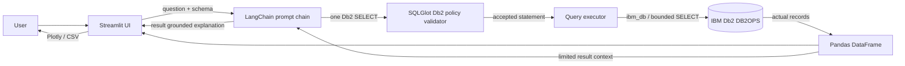

# System Architecture

## Overview

Db2Ops AI is a single-process Streamlit application. Page handlers call a small Python data-access layer built on IBM's `ibm_db` driver. LangChain handles two bounded LLM tasks: generating a Db2 SELECT from the question and explaining the rows returned by Db2. SQLGlot validates the proposed statement before execution.

## Architecture Diagram

## Component Breakdown

1. **User interface:** Streamlit dashboard, AI assistant, table explorer, analytics, session history, connection status, and about page. Custom CSS defines the navy and cyan dashboard styling.
2. **Application layer:** `src/app.py` routes page state and turns user questions into an observable SQL and result flow. `src/database/queries.py` contains fixed, parameterized or allow-listed queries for built-in views.
3. **IBM Db2 layer:** `src/database/connection.py` opens and closes `ibm_db` sessions, sets the configured current schema, checks connectivity using `SYSIBM.SYSDUMMY1`, and fetches at most `DB2_MAX_ROWS` records. `initialization.py` creates and seeds the app tables.
4. **AI layer:** `src/ai/sql_generator.py` defines LangChain prompt templates and runnable chains. `sql_validator.py` parses exactly one statement with SQLGlot's `db2` dialect and allows only the five application tables. `query_executor.py` is the required boundary before AI SQL reaches Db2. `insights.py` sends only a limited DataFrame result to the explanation chain.

## Data Flow

1. Streamlit receives one text question.
2. The application reads column metadata for the five allow-listed tables from Db2's `SYSCAT.COLUMNS`, then passes that schema context and the question to LangChain. Credentials are never part of this prompt.
3. The generated text is stripped of optional code fences and parsed as Db2 SQL. The validator rejects syntax errors, multiple statements, non-query roots, modifying operations, comments, catalog tables, qualified tables, and tables outside the five application tables.
4. The executor adds a Db2 `FETCH FIRST` bound if the model did not add one, opens an `ibm_db` connection, executes the query, and returns a Pandas DataFrame and elapsed milliseconds.
5. The UI displays generated SQL and actual rows, with a CSV download. A separate LangChain prompt receives the original question and up to 30 retrieved rows to produce a concise explanation.
6. The session history stores question, SQL, status, timestamp, and duration in Streamlit session state. It is not persisted to Db2.

## LangChain Workflow

`ChatPromptTemplate` feeds the question and schema to a `ChatOpenAI` model using `OPENAI_MODEL`. The `prompt | model` runnable returns a SQL string. SQLGlot, not the LLM, determines whether that string is accepted. A second prompt/model runnable summarizes JSON-serialized rows returned by Db2. The explanation instruction limits claims to the provided result rows. LLM errors and missing API configuration are surfaced as application errors.

`langchain-db2` is an official LangChain integration for Db2 vector search. The product does not store embeddings or retrieve semantically similar content, so this package would not be used by the current feature set. Db2 access for transactional and analytical SQL is performed directly through `ibm_db`.

## IBM Db2 Schema & Storage Design

The configured schema holds five relational tables:

| Table | Purpose | Key relationships |
|---|---|---|
| `CUSTOMERS` | Customer identity and Indian location | Primary key `CUSTOMER_ID`; unique `EMAIL` |
| `PRODUCTS` | Catalog, category, price, inventory | Primary key `PRODUCT_ID`; nonnegative price and stock |
| `ORDERS` | Order date, status, and total | Customer foreign key; status and nonnegative amount checks |
| `ORDER_ITEMS` | Products and quantities per order | Order and product foreign keys; positive quantity |
| `PAYMENTS` | Payment method, status, amount, and date | Order foreign key; enumerated status and nonnegative amount |

Indexes support customer/date order access, product sales, and payment status/date reporting. Initialization uses `SYSCAT.TABLES` and `SYSCAT.INDEXES` to check existence. Seed rows use primary-key `MERGE` statements for repeatability.

## Security & Secrets Management

- Runtime settings are read from `.env`; `.env` is ignored by Git. The example file contains no active secret.
- The SQL policy rejects DML/DDL roots, more than one statement, comments, qualified objects and non-application tables. SELECT INTO and locking extensions are rejected.
- System catalog reads are performed by the application only for schema discovery and the Data Explorer's column list; generated AI SQL cannot access catalog objects.
- A configured maximum number of rows is fetched, with a `FETCH FIRST` bound added when absent.
- Install the tables with an authorized setup account, then use a separate Db2 principal with SELECT-only grants for the app where feasible. Application validation is not a replacement for database privileges.
- Db2 error details and connection strings are not sent to the LLM or written to application logs.
- The current driver execution path does not claim to enforce a server-side query timeout.
