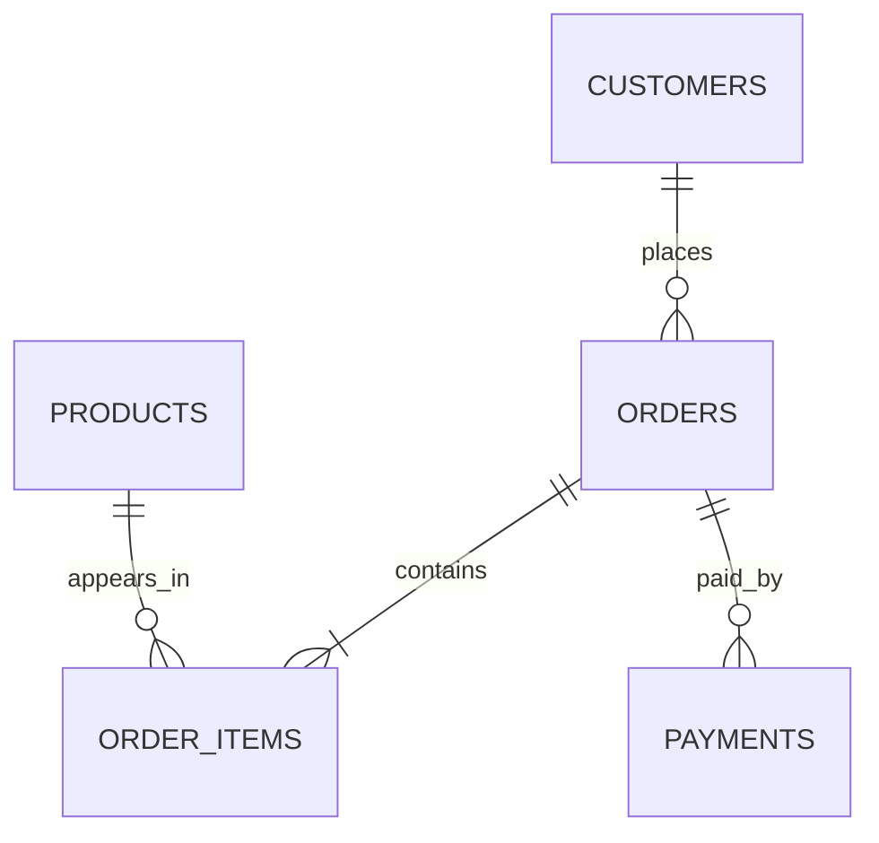

# Database Schema

All names are unquoted Db2 identifiers and therefore stored in uppercase. `scripts/setup_db.py` creates tables and supporting indexes only when missing, then merges deterministic seed IDs.

| Table | Primary key | Foreign keys | Important constraints |
|---|---|---|---|
| CUSTOMERS | CUSTOMER_ID | — | EMAIL unique; country defaults to India |
| PRODUCTS | PRODUCT_ID | — | UNIT_PRICE and STOCK_QUANTITY nonnegative |
| ORDERS | ORDER_ID | CUSTOMER_ID → CUSTOMERS | enumerated ORDER_STATUS; nonnegative TOTAL_AMOUNT |
| ORDER_ITEMS | ITEM_ID | ORDER_ID → ORDERS; PRODUCT_ID → PRODUCTS | positive QUANTITY; nonnegative values |
| PAYMENTS | PAYMENT_ID | ORDER_ID → ORDERS | enumerated PAYMENT_STATUS; nonnegative AMOUNT |

Seed volume: 24 customers, 15 products, 60 orders, 120 order items, and 60 payment records. Rows use Indian cities, rupee-denominated product prices, relationships, and multiple order/payment states.
