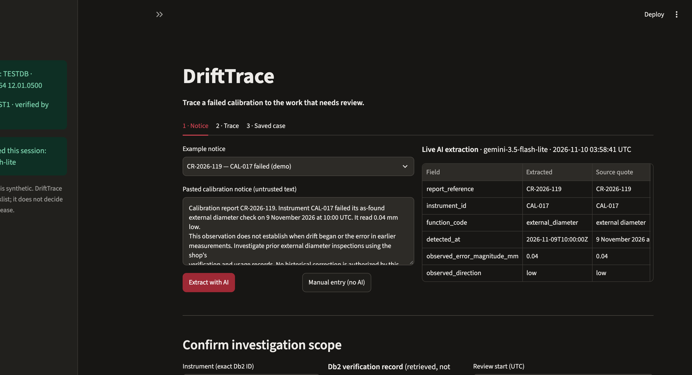
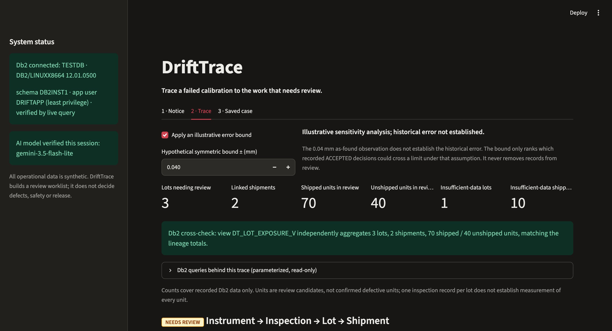
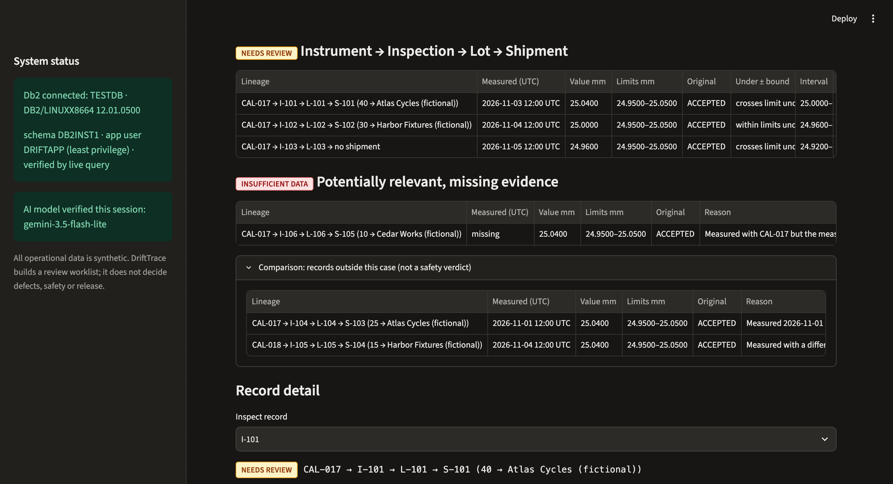
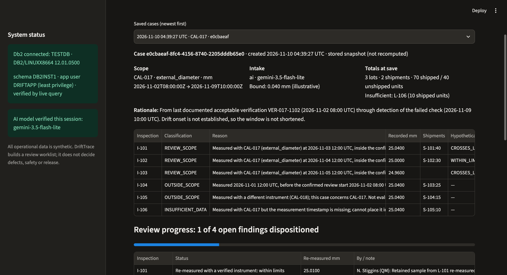
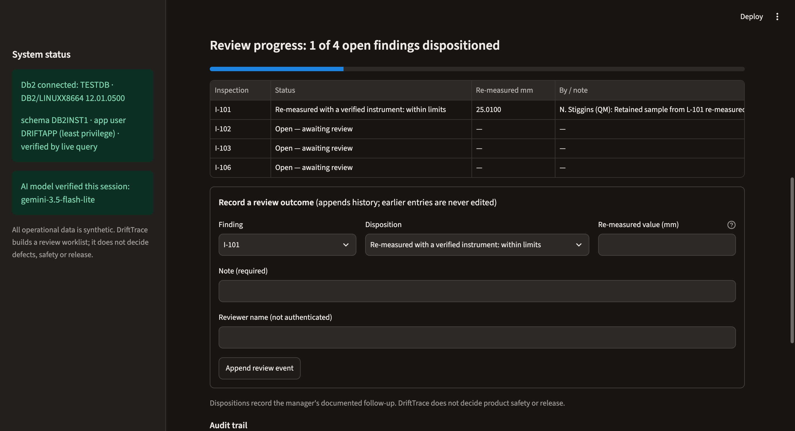

# DriftTrace — calibration failure impact tracing

> **One-Line Pitch:** Your measuring instrument failed calibration. DriftTrace finds the inspections, production lots and customer shipments that need review, with a traceable reason for every result.

---

## Table of Contents
- [Problem Statement](#problem-statement)
- [Solution Overview](#solution-overview)
- [IBM Db2 Integration](#ibm-db2-integration)
- [AI / LLM Architecture](#ai--llm-architecture)
- [Tech Stack](#tech-stack)
- [Prerequisites](#prerequisites)
- [Setup & Installation](#setup--installation)
- [Configuration](#configuration)
- [Running the Project](#running-the-project)
- [Testing & Verification](#testing--verification)
- [Screenshots & Demo](#screenshots--demo)
- [Known Limitations & Future Roadmap](#known-limitations--future-roadmap)
- [Team Members & Credits](#team-members--credits)

---

## Problem Statement
- When a caliper or gauge fails its as-found calibration check, a quality manager must find every acceptance decision it may have influenced since its last good verification, and which of those lots already shipped.
- Target user: the quality manager at a small precision machine shop. The notice arrives as text; the inspection, lot and shipment records live in a relational database.
- Spreadsheet look-ups lose the lineage, silently drop records with missing dates, and invite over-confident conclusions. The as-found error does **not** establish when drift began or how large earlier errors were.

## Solution Overview
1. **Notice** — paste the calibration notice; LangChain + Gemini extract the instrument, function, detection time and error **with verbatim source quotes**. Deterministic checks verify every quote and require an exact Db2 instrument match. Ambiguous or limited scope is flagged for review.
2. **Confirm scope** — the manager confirms the instrument and a conservative window from the last documented acceptable verification (retrieved from Db2) through detection, with a rationale.
3. **Trace** — Db2 lineage Instrument → Inspection → Lot → Shipment, with every inspection classified as **needs review**, **outside this case** (with the specific reason) or **insufficient data** (e.g. missing timestamp). Counts of lots, shipments, shipped and unshipped units are computed from the data.
4. **Hypothetical sensitivity** — an optional ± error bound shows which recorded ACCEPTED decisions *could* cross a specification limit under that assumption. It is labelled illustrative and never removes records from review.
5. **Saved case** — case, per-inspection evidence snapshots and an audit event are committed in one Db2 transaction, survive reload, resist duplicate saves and export as JSON/CSV.
6. **Close the loop** — for each open finding the manager appends a review outcome (re-measured within/outside limits, parts unavailable, no further action). A re-measured verdict must agree with the stored spec limits, the history is append-only in Db2, and the case shows review progress.

DriftTrace builds a review worklist. It makes no defect, safety, recall or release determination.

## IBM Db2 Integration
- **Db2 Edition & Environment:** IBM Db2 Community Edition 12.1.5 (`icr.io/db2_community/db2:latest`, Docker, `linux/amd64`), database `TESTDB`, schema `DB2INST1`.
- **Connector / Driver Used:** native `ibm_db` 3.3.0 (`prepare` + bound `?` parameters for every value).
- **Database Schema / Data Models:** eight tables (`DT_INSTRUMENTS`, `DT_LOTS`, `DT_INSPECTIONS`, `DT_SHIPMENTS`, `DT_CASES`, `DT_FINDINGS`, `DT_AUDIT`, `DT_REVIEW_EVENTS`) with primary, foreign (incl. composite) and CHECK constraints, a unique client submission ID, four indexes, an aggregate view and eight triggers. See [`sql/schema.sql`](sql/schema.sql) and [architecture.md](architecture.md).
- **Key Queries & Operations:**
  - left-joined lineage query that keeps NULL-dated rows visible; separate shipment query so totals use distinct lots/shipments;
  - **in-database cross-check**: view `DT_LOT_EXPOSURE_V` (`GROUP BY` + `LEFT JOIN`) re-aggregates exposure in Db2; a mismatch with the application totals blocks saving;
  - one-transaction save of case + findings + audit with a data-fingerprint stale check and rollback on error;
  - **Db2-enforced integrity**: triggers make cases, findings, audit and review history append-only (`SQLSTATE 75001`) even for the administrator; CHECK constraints make a re-measured disposition carry a value;
  - **least privilege**: the app connects as `DRIFTAPP` with only `SELECT` on operational data and `SELECT, INSERT` on case tables; schema and grants run as the admin only in `seed.py`;
  - idempotent migrations via `SYSCAT.TABLES/INDEXES/VIEWS/TRIGGERS`.

## AI / LLM Architecture
- **Framework:** LangChain (`langchain-core` 1.7.6, `langchain-google-genai` 4.4.3): `ChatPromptTemplate | ChatGoogleGenerativeAI.with_structured_output(NoticeExtraction, method="json_schema")`.
- **Model Provider & Model:** Google Gemini Developer API; model set by `AI_MODEL` (tested: see [Testing](#testing--verification)).
- **Workflow:** the model only proposes structured fields with quotes. Code verifies quotes and exact instrument identity; a human confirms scope; Db2 queries run with bound parameters. No RAG/vectors are needed: instrument, function and time filters are exact relational predicates. Prompt-injection text in a notice is flagged and has no effect.

## Tech Stack
- **Backend / Core:** Python 3.12
- **Database:** IBM Db2 Community Edition 12.1.5
- **Frontend / UI:** Streamlit 1.67
- **Libraries & Tools:** ibm_db, LangChain, Pydantic 2, python-dotenv, pandas, pytest, Docker

## Prerequisites
- Docker (Db2 Community Edition container) or another reachable Db2 instance
- Python 3.12
- A Gemini API key from Google AI Studio (optional: manual entry works without it)

## Setup & Installation

All commands run from the **official repository root**. The virtual environment and private env files stay outside `submissions/drifttrace/` (the official validator rejects env files inside the submission folder).

**One command** (macOS/Linux, Docker running):

```bash
bash submissions/drifttrace/setup.sh
```

It creates `.venv`, writes `.env.db2.drifttrace` and `.env.drifttrace` with random passwords (gitignored, never printed), starts Db2 Community Edition (`LICENSE=accept` accepts IBM's Db2 Community Edition license; first start takes 5–20 min), creates the least-privilege `driftapp` user, applies schema/grants/synthetic data and runs the tests. Re-running is safe.

<details><summary>Manual steps</summary>

```bash
python3.12 -m venv .venv
.venv/bin/pip install -r submissions/drifttrace/requirements.txt
cp submissions/drifttrace/.env.example .env.drifttrace     # then edit values
# .env.db2.drifttrace: LICENSE=accept, DB2INSTANCE=db2inst1, DB2INST1_PASSWORD=<admin pwd>, DBNAME=testdb
docker run -d --name drifttrace-db2 --privileged --platform linux/amd64 --shm-size=1g --ipc=host \
  -p 127.0.0.1:50000:50000 --env-file .env.db2.drifttrace \
  -v drifttrace_db2_data:/database icr.io/db2_community/db2:latest
docker exec drifttrace-db2 useradd -M -s /sbin/nologin driftapp
docker exec -it drifttrace-db2 passwd driftapp                 # same as DB2_PWD
.venv/bin/python submissions/drifttrace/src/seed.py
```
</details>

## Configuration

`config.py` loads the file named by the `DB_ENV_FILE` environment variable, defaulting to `<repo root>/.env.drifttrace`; already-set environment variables take precedence. Keys are listed in [`.env.example`](.env.example): the app user (`DB2_UID`/`DB2_PWD`), the admin used only for setup (`DB2_ADMIN_UID`/`DB2_ADMIN_PWD`), `DB2_SCHEMA`, `GOOGLE_API_KEY` and `AI_MODEL`. For IBM Cloud Db2 set `DB2_SECURITY=SSL` and the service's host/port/credentials. Without a Gemini key the app offers clearly labelled manual entry.

> **Security Warning:** Never commit `.env*` files or real keys or passwords.

## Running the Project

```bash
.venv/bin/python submissions/drifttrace/src/check_db2.py   # prints server identity + time, never credentials
.venv/bin/python submissions/drifttrace/src/seed.py        # idempotent schema + synthetic data
.venv/bin/streamlit run submissions/drifttrace/src/app.py  # http://localhost:8501
```

Demo path: choose the **CR-2026-119** example → **Extract with AI** → review quotes → **Confirm scope** → **2 · Trace** (inspect I-101/I-102/I-103 and the I-106 insufficient-data row; toggle the bound, e.g. 0.040 vs 0.060) → confirm → **Save case to Db2** → **3 · Saved case** (reload the page; the case reopens from `?case=<id>`).

## Testing & Verification

```bash
.venv/bin/python -m pytest submissions/drifttrace/tests -v -p no:cacheprovider
```

- `tests/test_rules.py` — exact instrument match, inclusive windows, UTC handling, missing-data bucket, Decimal bound equality/crossing, review scope unchanged by bound, distinct-lot aggregation, quote validation, injection flagging.
- `tests/test_db2_integration.py` — **live Db2**: idempotent seed, expected trace counts, Db2 view cross-check, save persistence, duplicate-save idempotency, stale-preview rejection, forced-failure rollback, snapshot stability after operational change, **app user denied UPDATE/DELETE/INSERT/DROP on operational tables**, **append-only triggers reject tampering even by the admin**, server-side input limits, SQL-injection text stored inert, review dispositions with history and audit. Skipped (and reported as skipped) if Db2 is unreachable.
- Also run: `bandit -r submissions/drifttrace/src` (static analysis) and `pip-audit -r submissions/drifttrace/requirements.txt` (dependency CVEs).
- `tests/test_rules.py` additionally covers disposition/limit consistency.

Expected trace from the synthetic data: 3 lots in review (L-101, L-102, L-103), 2 linked shipments / 70 shipped units, 40 unshipped units; L-106 in insufficient data (missing timestamp, 10 shipped units); I-104 outside the window; I-105 a different instrument. At ±0.040 mm I-101 and I-103 cross a limit under the assumption; at ±0.060 mm all three do.

Results recorded on 2026-11-10 (UTC):
- `pytest`: **40 passed, 0 skipped** (24 live Db2 integration incl. security, 16 pure). With Db2 unreachable the live tests are reported as skipped.
- `bash submissions/drifttrace/setup.sh` (re-run on the existing environment): all 6 steps passed.
- `bandit -r submissions/drifttrace/src`: **0 issues**. `pip-audit -r submissions/drifttrace/requirements.txt`: **no known vulnerabilities**.
- Live LangChain extraction with `gemini-3.5-flash-lite`: CR-2026-119 → `CAL-017`, `external_diameter`, `2026-11-09T10:00:00Z`, 0.04 mm low, every field backed by a verbatim quote, no flags. Limited-range notice → flagged for scope review. Adversarial notice → look-alike `CAL-0l7` blocked, injection text flagged, no data changed. A transient model timeout was shown as a clear error with manual entry offered.
- Browser run (Chrome, app connected as `DRIFTAPP`): extract → confirm scope → trace (3/2/70/40, L-106 insufficient, Db2 view cross-check matched) → ±0.040 bound (I-101, I-103 cross; I-102 within) → save → rapid double click returned the same case → reopened from `?case=` → disposition recorded (1 of 4) → no browser console errors.
- Official validator: `python3 scripts/validate_submission.py submissions/drifttrace` → passed.

## Screenshots & Demo
- **Demo Video Link:** TODO
- Screenshots from the running application (real Db2, live model):

  
  
  
  
  

## Security

| Threat | Control | Verified by |
|---|---|---|
| Leaked credentials | Secrets only in env files outside the submission folder (`DB_ENV_FILE`); `.env.example` placeholders; credentials never printed; API key redacted from error messages | official validator; `grep` scan of the submission tree |
| SQL injection | Every value bound with `ibm_db.prepare` + `?`; identifiers are allowlisted constants; the model never writes SQL | `test_sql_injection_text_is_inert`; bandit: 0 issues |
| Over-privileged app | App connects as `DRIFTAPP`: `SELECT` on operational data, `SELECT, INSERT` on case tables only | `test_app_user_cannot_modify_operational_data` |
| Tampering with evidence | Db2 triggers make cases, findings, audit and review events append-only for every user, including the admin | `test_saved_records_are_append_only_even_for_admin` |
| Prompt injection | Notice isolated as untrusted data; schema-validated output; verbatim-quote and exact-ID checks; human confirms scope; injection text flagged | adversarial example; `test_injection_text_is_flagged_and_does_not_resolve` |
| Stored XSS / markdown injection | Db2, user and model text escaped before rendering (`html.escape`, markdown escaping) | code review |
| CSV formula injection | Export cells starting with `= + - @` are prefixed | `sanitize()` in `app.py` |
| Oversized input / cost abuse | Notice ≤ 8,000 chars, rationale ≤ 1,000, bound 0–1 mm; enforced in UI and again server-side; model only on explicit click, 20 s timeout | `test_server_side_input_limits` |
| Duplicate / partial writes | Unique `CLIENT_SUBMISSION_ID`; single transaction with rollback; stale-preview fingerprint | duplicate, rollback and stale tests |
| Vulnerable dependencies | Pinned versions | `pip-audit`: no known vulnerabilities |

Not in scope for this local demo: user authentication (the reviewer name is self-declared), TLS to a local container (supported via `DB2_SECURITY=SSL` for cloud Db2), and cryptographic signing of audit records.

## Known Limitations & Future Roadmap
- **Data:** all records are **synthetic** and authored for this demo; customers are fictional. One inspection record per lot does not establish measurement of every unit.
- **Scope:** one measurement function (`external_diameter`, mm). Notices with limited test ranges, other units or conflicting scope are flagged for manual review rather than applied automatically.
- **Analysis:** the hypothetical bound is illustrative sensitivity analysis; historical error and drift onset are not established. No probability scores, defect claims or release decisions.
- **Storage:** saved records are append-only in Db2 (triggers), but a database administrator could still drop the triggers; records are not cryptographically signed. No authentication, ERP integration or customer messaging.
- **Next steps:** multiple measurement functions and test-point ranges, ERP/QMS import, signed audit records, authenticated reviewers and assignment.

## Team Members & Credits
| Name | GitHub Handle | Role / Contribution |
|---|---|---|
| Noah Stiggins | [@LordBusiness011124](https://github.com/LordBusiness011124) | Solo: Db2 schema and lineage, LangChain extraction, Streamlit UI, tests |

## License
MIT — see [LICENSE](LICENSE).
