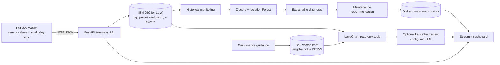

# EnergySense AI — Architecture and Design

## 1. Objective

Extend the original ESP32/Wokwi appliance-runtime prototype with persistent IBM Db2 telemetry, appliance-specific anomaly detection, explainable maintenance guidance and an optional LangChain tool-calling assistant.

## 2. Architecture

## 3. Data acquisition and local protection

The carried-forward prototype uses ESP32 analog inputs and Wokwi potentiometers to emulate voltage/current signals. Its local threshold path operates the simulated relay, buzzer and LCD. The new HTTP sender example accepts already-computed values from that firmware; calibration and physical hardware integration remain to be completed by the participant. AI, Wi-Fi and Db2 are outside the relay cutoff loop.

## 4. Ingestion and validation

`POST /api/v1/telemetry` validates identifier lengths, sensor ranges, finite numeric values, ISO-8601 timestamps and source provenance. At least one numeric sensor/runtime measurement is required. The API does not accept a relay command or any control instruction.

## 5. IBM Db2 relational layer

The `ibm_db_dbi` adapter creates these tables if missing:

- `ESAI_EQUIPMENT`: equipment and appliance metadata.
- `ESAI_TELEMETRY`: sensor values, runtime, relay state, source label and UTC record time.
- `ESAI_EVENTS`: severity, anomaly score, primary feature, baseline context, diagnosis and maintenance recommendation.

The history and event paths have appliance/time indexes. Values are bound parameters. Per-request connections are committed/rolled back and closed. The API process caches one configured store instance so it does not attempt DDL on every request.

SQLite mirrors the schema for offline tests. It is explicitly not the submission proof for Db2; the live `src.verify_db2` command performs a real Db2 insert/read check when a Db2 instance is configured.

## 6. Detection and explanation

1. Monitoring retrieves the newest 120 history rows for the selected appliance.
2. Baseline logic uses at least five earlier finite samples for a feature. It calculates mean, standard deviation with a 3%/0.01 noise floor, and z-score.
3. Both high-side and low-side deviations at an absolute z-score of 3 or more are flagged. A severity of HIGH is assigned at an absolute z-score of 5 or more; otherwise a detected anomaly is MEDIUM.
4. Isolation Forest runs when there are at least 20 prior rows and at least two usable features. It uses complete finite feature vectors and a fixed random seed for repeatability.
5. Diagnostic text identifies measurements and possible operating changes, not confirmed failures. When only the multivariate model flags an anomaly, an auditable `multivariate_pattern` event is still persisted.

The anomaly score is a ranking aid, not a failure probability. This analytics layer does not replace the original local protection thresholds.

## 7. LangChain and Db2 vector retrieval

The optional natural-language agent is built with LangChain `create_agent` and read-only tools to:

- retrieve recent telemetry;
- analyse the appliance's latest history using the deterministic baseline engine;
- retrieve relevant maintenance notes from Db2 via `langchain-db2` `DB2VS`;
- inspect previous anomaly events.

`ESAI_KNOWLEDGE` is the Db2 vector-store table. Current DB2VS documentation requires Db2 12.1.2+ with vector-search support. The live-demo configuration uses `langchain-huggingface` with `sentence-transformers/all-MiniLM-L6-v2` semantic embeddings. A deterministic 384-dimensional hash embedding is retained as a lightweight offline/test option. Keep the embedding model consistent between indexing and querying; rebuild the vector table if switching models. The assistant is optional and needs a model API key. No assistant-generated output can issue commands to the hardware.

## 8. Failure handling and safety boundary

- If the API, Wi-Fi, Db2, vector store or LLM is unavailable, AI analytics/assistant functions can stop without disabling the local ESP32 relay protection logic.
- Database/LLM recommendations are advisory and require human verification.
- No endpoint sends relay commands.
- Wokwi potentiometer inputs and prototype voltage/current thresholds are simulation settings, not calibrated physical sensor data or certified protection values.
- Apparent power is stored in VA. kWh billing/energy accounting is not claimed without validated real-power and power-factor measurement.
- Do not test exposed mains. Use qualified supervision, verified isolation, proper fusing and rated enclosures/components.

## 9. Evaluation and proof plan

| Judging area | Evidence to capture |
|---|---|
| Db2 integration and depth | Live Db2 connection, relational table rows, indexed history query, event write/read, Db2VS vector search |
| Innovation and impact | Appliance-specific baseline, both high/low anomaly examples, historical trend and guided maintenance review |
| AI/technical architecture | LangChain agent's read-only tool calls grounded in telemetry and retrieved Db2 notes |
| Reproducibility and code quality | CI tests, `pytest -q`, `python -m src.verify_db2`, documented environment setup |
| Documentation and demo | Dashboard, API response, screenshots and short narrated demo |

## 10. Implementation status

The original presentation documents a Wokwi prototype with potentiometer-emulated inputs and local threshold response. The upgraded Python source package includes API, SQLite test storage, Db2 adapter, deterministic anomaly pipeline, LangChain assistant wiring, Db2 vector-store adapter and dashboard. Automated tests run locally. A live participant Db2 connection, real DB2VS operation, OpenAI call and ESP32 physical HTTP test remain to be performed on the participant's machine; no result is claimed for those unexecuted checks.
