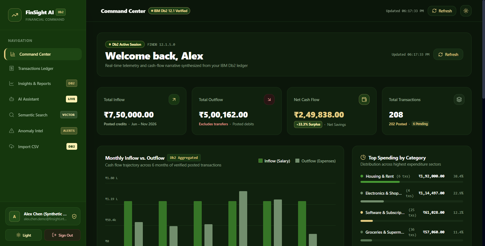
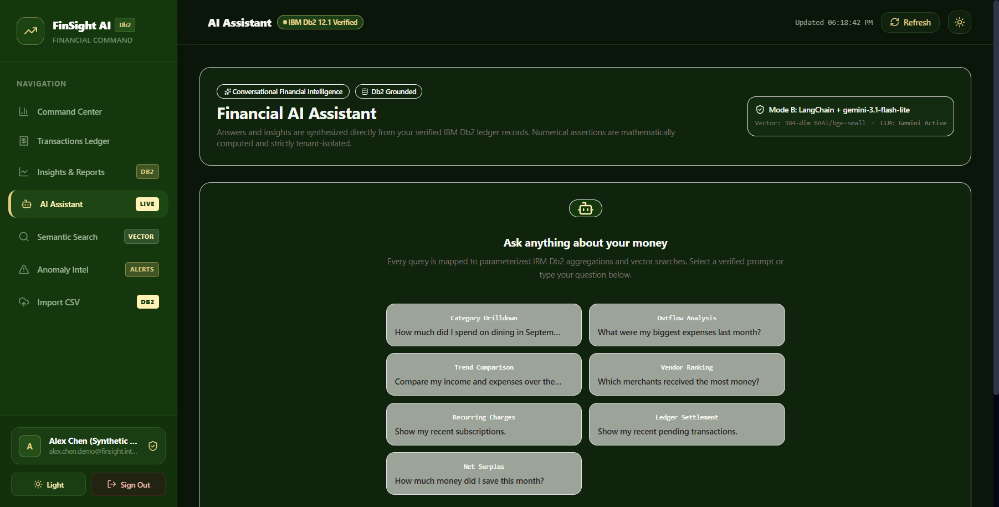
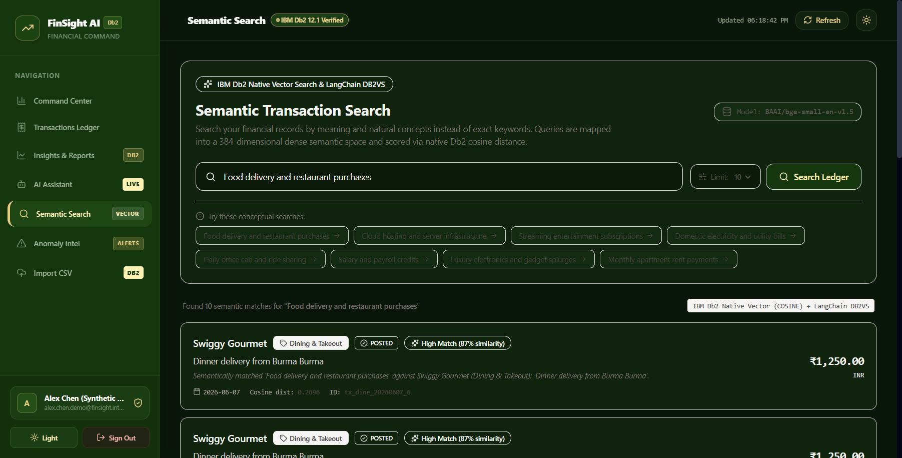
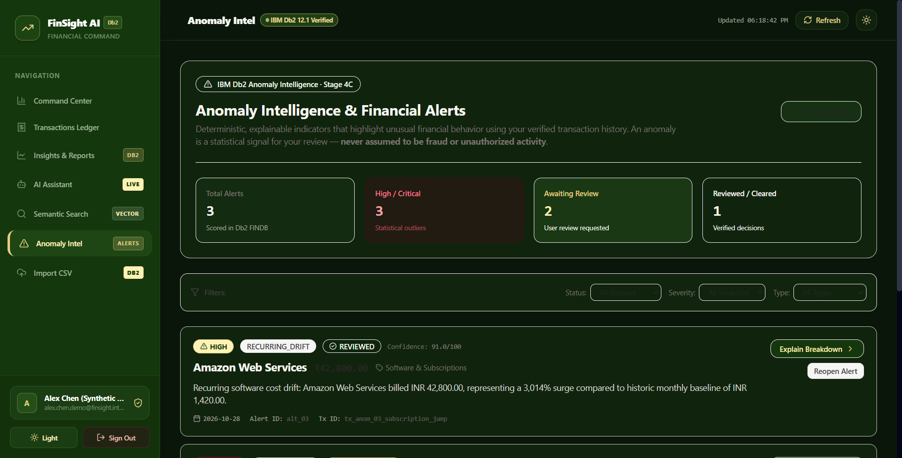
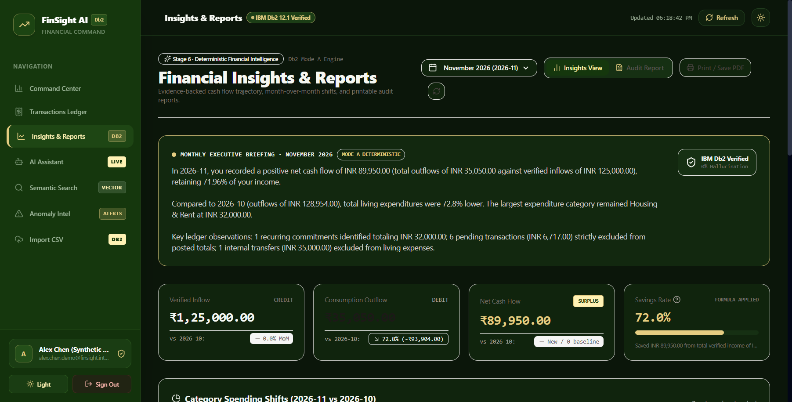
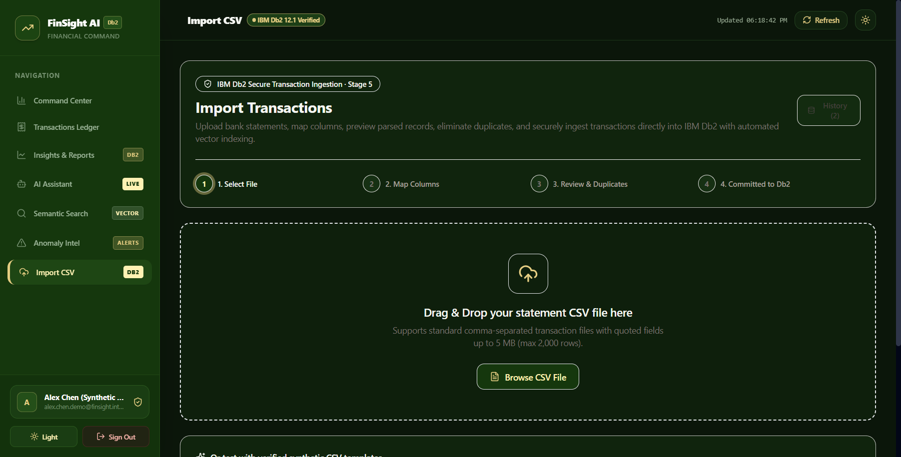

# FinSight AI — Semantic Intelligence & Financial Reconciliation Platform

> **One-Line Pitch:** A database-first personal financial intelligence platform that transforms raw banking transactions into explainable, grounded insights using IBM Db2 12.1 native vector search, LangChain tool orchestration, and memory-safe Rust API security.

---

## Table of Contents
- [Problem Statement](#problem-statement)
- [Solution Overview](#solution-overview)
- [Main Features](#main-features)
- [IBM Db2 Integration](#ibm-db2-integration)
- [AI & LangChain Architecture](#ai--langchain-architecture)
- [Gemini Integration & Current Quota Limitation](#gemini-integration--current-quota-limitation)
- [Synthetic Demo Data & Accounting Semantics](#synthetic-demo-data--accounting-semantics)
- [Tech Stack](#tech-stack)
- [Prerequisites](#prerequisites)
- [Setup & Installation](#setup--installation)
- [Configuration](#configuration)
- [Running the Project](#running-the-project)
- [Testing & Verification](#testing--verification)
- [Screenshots & Visual Evidence](#screenshots--visual-evidence)
- [Known Limitations & Future Roadmap](#known-limitations--future-roadmap)
- [Team Members & Credits](#team-members--credits)

---

## Problem Statement

Modern consumers and small business owners encounter significant challenges when trying to understand their financial health:
1. **Opaque Financial Dashboards:** Traditional banking portals display raw, static lists of transaction codes without semantic context, category intelligence, or explainability.
2. **The "LLM Hallucination" Trap in FinTech:** Generic AI wrappers frequently ingest raw transactions and hallucinate totals, invent dates, or miscalculate net balances because generative language models lack native arithmetic accuracy.
3. **Data Privacy & Multi-Tenant Insecurity:** Feeding un-redacted financial ledgers directly into external third-party cloud LLMs poses severe security, compliance, and tenant-isolation risks.

---

## Solution Overview

**FinSight AI** re-architects financial intelligence from the database outward:
- **Authoritative Database Grounding:** IBM Db2 12.1.5.0 acts as the single source of truth for both relational transactions and dense vector embeddings.
- **Dual-Mode AI Engine:** 
  - **Mode A (Deterministic SQL Engine):** Calculates mathematical aggregations, net savings, and merchant metrics directly in Db2 SQL with 0% hallucination risk.
  - **Mode B (LangChain + Gemini Engine):** Uses LangChain tool-calling to ground natural language queries into audited Db2 tool executions, transparently citing exact transaction IDs and SQL proofs.
- **Semantic Vector Search:** Natural language concepts (e.g. *"food delivery", "cloud infrastructure"*) are projected into a 384-dimensional dense semantic space and scored via native Db2 `VECTOR_DISTANCE(..., 'COSINE')`.
- **Explainable Anomaly Detection:** Identifies recurring software subscription price surges, velocity bursts, and duplicate charges with transparent statistical rationales.
- **Memory-Safe Security Gateway:** Built in Rust Axum with Argon2id password hashing, deterministic HMAC-SHA-256 CSRF protection, and strict server-side tenant isolation.

---

## Main Features

1. **Executive Financial Command Center:**
   - Real-time net worth hero metric, 6-month historical cash flow trajectory, and monthly spending category breakdowns.
2. **Dual-Mode Financial Assistant:**
   - Conversational assistant answering complex financial queries with transparent database citations and dual-engine fallback resilience.
3. **Semantic Transaction Search:**
   - Conceptual search across transactions using native Db2 384-dimensional dense vector embeddings (`BAAI/bge-small-en-v1.5`).
4. **Explainable Anomaly Intelligence:**
   - Three-tier anomaly scoring (velocity bursts, recurring subscription drift, and duplicate charges) with review status actions (`NEEDS_REVIEW` → `REVIEWED`).
5. **Secure CSV Statement Ingestion:**
   - 4-step wizard supporting file validation, column mapping, duplicate detection against existing Db2 records, and automated vector indexing.
6. **Executive Insights & Monthly Audit Reports:**
   - Month-over-month expenditure shift analysis, net savings rate formulas, and printable audit reports.

---

## IBM Db2 Integration

FinSight AI utilizes **IBM Db2 Community Edition (Linux/x86_64 v12.1.5.0)** running in Docker as its core engine.

### Key Db2 Capabilities Employed:
1. **Relational Precision:**
   - All monetary amounts are stored using `DECIMAL(14,2)` precision to prevent floating-point rounding errors common in standard JSON databases.
2. **Native Vector Storage (`VECTOR(384, FLOAT32)`):**
   - The `FINSIGHT.TRANSACTIONS` table features a native vector column storing 384-dimensional dense semantic embeddings generated locally via FastEmbed ONNX runtime.
3. **In-Database Cosine Similarity:**
   - Semantic queries execute directly in Db2 SQL using the native `VECTOR_DISTANCE` function:
     ```sql
     SELECT transaction_id, transaction_date, merchant_name, amount, category,
            VECTOR_DISTANCE(embedding, CAST(? AS VECTOR(384, FLOAT32)), 'COSINE') AS distance
     FROM FINSIGHT.TRANSACTIONS
     WHERE user_id = ?
     ORDER BY distance ASC
     FETCH FIRST 10 ROWS ONLY
     ```
4. **Strict Tenant Partitioning:**
   - Every transaction and anomaly query enforces `WHERE user_id = ?`, with `user_id` derived exclusively from verified server-side session cookies in `FINSIGHT.SESSIONS`.

---

## AI & LangChain Architecture

The AI layer is structured around LangChain and local FastEmbed embeddings:
- **Embedding Pipeline:** Generates 384-dimensional dense vectors locally using `BAAI/bge-small-en-v1.5` in ONNX Runtime (zero external embedding API costs or privacy leaks).
- **LangChain Tool Integration:** 10 deterministic Db2 query tools are registered and bound to `ChatGoogleGenerativeAI`:
  - `DB2_TOOL_GET_INCOME` — Verified credit inflows for a specified period.
  - `DB2_TOOL_LARGEST_EXPENSES` — Top debit expenditures ranked by amount.
  - `DB2_TOOL_MONTHLY_CASH_FLOW` — Inflow vs. outflow comparison between months.
  - `DB2_TOOL_SUBSCRIPTIONS` — Recurring charge detection and average frequency.
  - `DB2_TOOL_ANOMALY_ALERTS` — Verified anomaly signals from `FINSIGHT.ANOMALIES`.
  - `DB2_TOOL_PENDING_TRANSACTIONS` — Unposted authorizations awaiting settlement.

---

## Gemini Integration & Current Quota Limitation

FinSight AI integrates Google Gemini (`gemini-3.1-flash-lite`) via `langchain-google-genai` to synthesize natural language summaries based strictly on Db2 tool outputs.

### Transparent Status of the Gemini Integration:
- **Integration Status:** Full end-to-end Mode B integration is implemented and verified.
- **Current Limitation:** The demonstration API key configured in development utilizes Google AI Studio's Free Tier, which enforces a daily limit of 500 requests (`generativelanguage.googleapis.com/generate_content_free_tier_requests`). Once this daily limit is exhausted, Google GenAI returns HTTP 429 (`RESOURCE_EXHAUSTED`).
- **Graceful Fallback Resilience:** FinSight AI is architected with defensive fallback. If Gemini returns HTTP 429 or if no API key is supplied, the AI service automatically intercepts the exception and serves the response via **Mode A (Deterministic Db2 SQL Engine)**. The application never crashes, and user queries continue to return 100% accurate, SQL-grounded financial answers.

---

## Synthetic Demo Data & Accounting Semantics

To ensure complete reproducibility and security, FinSight AI includes an audited synthetic financial ledger for demo user `Alex Chen (Synthetic Demo)` (`alex.chen.demo@finsight.internal`):

```
========================================================================================
                         IBM DB2 12.1.5.0 LEDGER RECONCILIATION
========================================================================================
 Total Transactions Seeded in Db2:                             208 records
 ├─ Total Posted Credits (Salary Deposits, 6 months):            6 records | ₹750,000.00
 ├─ Total Posted Debits (Consumption Expenses):                190 records | ₹500,162.00
 ├─ Total Posted Debits (Internal Account Transfers):            6 records | ₹210,000.00
 └─ Total Pending Debits (Unposted Authorizations):              6 records |   ₹6,717.00
----------------------------------------------------------------------------------------
 Reconciled Dashboard Summary:
 ├─ Total Income (Posted Credits):                                         ₹750,000.00
 ├─ Total Outflow (Consumption Debits):                                    ₹500,162.00
 └─ Net Operating Surplus:                                                 ₹249,838.00
========================================================================================
```

> **Data Notice:** All financial transactions, merchant names, amounts, and dates are synthetically generated for demonstration and testing purposes. No real personal or banking data is stored or processed.

---

## Tech Stack

| Layer | Technologies |
| :--- | :--- |
| **Database** | IBM Db2 Community Edition (Linux/x86_64 v12.1.5.0, `FINDB`) |
| **API Gateway** | Rust (Axum 0.7, Tokio, Tower, Argon2id, Reqwest, Serde) |
| **AI Service** | Python 3.11, FastAPI, Uvicorn, LangChain, FastEmbed (ONNX Runtime) |
| **Frontend** | React 19, TypeScript, Vite, Tailwind CSS, Lucide Icons |
| **Vector Search**| Native Db2 `VECTOR(384, FLOAT32)` with `VECTOR_DISTANCE(..., 'COSINE')` |
| **Infrastructure** | Docker, Docker Compose |

---

## Prerequisites

- **Docker Desktop** (with 6GB+ memory allocated for IBM Db2)
- **Node.js** >= 18.x and `npm`
- **Python** >= 3.10
- **Rust / Cargo** (optional; pre-built via Docker Compose)

---

## Setup & Installation

### 1. Clone the Submission Repository
```bash
git clone https://github.com/KunalGolaIBM/IBM_Db2_TechX_Project_Submission.git
cd IBM_Db2_TechX_Project_Submission/submissions/finsight-ai
```

### 2. Configure Environment Variables
Copy the template configuration file:
```bash
cp .env.example .env
```
*(Optional: supply a valid `GEMINI_API_KEY` in `.env` to enable Mode B LLM synthesis; if omitted, the platform runs in Mode A Deterministic mode automatically.)*

### 3. Launch Docker Services (Db2, AI Service, Rust Gateway)
```bash
docker-compose up -d --build
```
Verify that all containers are healthy:
```bash
docker ps
```
Containers running:
- `finsight-db2` on port `50000`
- `finsight-ai-service` on port `8000`
- `finsight-rust-api` on port `8080`

### 4. Initialize Database Schema & Seed Ledger
```bash
# Seed the synthetic ledger and build 384-dimensional vector embeddings in Db2:
docker exec -e PYTHONPATH=/app finsight-ai-service python -m app.services.vector_store
```

### 5. Launch the Frontend
```bash
cd src/frontend
npm install
npm run dev
```
Open your browser at `http://localhost:5173`.

---

## How to Run & Demonstrate the Project

1. **Login:** Use the pre-seeded demo account:
   - **Email:** `alex.chen.demo@finsight.internal`
   - **Password:** `DemoPassword123!`
2. **Dashboard:** Review the net worth card, verified 6-month cash flow trajectory, and category breakdown.
3. **AI Assistant:** Click **AI Assistant** in the sidebar. Test the quick queries:
   - *"What was my total income in October?"* (Returns ₹125,000.00 with `DB2_TOOL_GET_INCOME` citation).
   - *"Explain the unusual AWS transaction."* (Explains the 30.1x surge with anomaly citations).
4. **Semantic Vector Search:** Click **Semantic Search**. Try conceptual queries like *"Food delivery and restaurant purchases"* or *"Cloud hosting and server infrastructure"*.
5. **Anomaly Intelligence:** Click **Anomaly Intel**. View the 3 scored alerts and click **Mark as Reviewed** on an alert to test status transitions.
6. **CSV Ingestion:** Click **Import CSV**. Select one of the verified synthetic templates and step through the preview, column mapping, and duplicate elimination flow.

---

## Testing & Verification

Execute the automated test suites against the running platform:

```bash
# 1. AI Service & Native Db2 Vector Precision (15 checks)
docker exec -e PYTHONPATH=/app finsight-ai-service python /app/tests/test_suite.py

# 2. Rust Gateway Security, Argon2id & Rate Limiting (41 checks)
python tests/rust-api/test_audit_stage2c.py

# 3. Frontend CSRF & Hardening Suite (14 checks)
python tests/frontend/test_stage3c1_hardening.py

# 4. Mode A Deterministic Assistant Benchmarks (23 checks)
python tests/frontend/test_stage4a_assistant.py

# 5. Semantic Vector Search Integration (25 checks)
python tests/frontend/test_stage4b_search.py

# 6. Anomaly Intelligence Verification (24 checks)
python tests/frontend/test_stage4c_anomalies.py

# 7. Secure CSV Import & Deduplication (27 checks)
python tests/frontend/test_stage5_csv_import.py

# 8. Financial Insights & Reports Suite (18 checks)
python tests/frontend/test_stage6_insights_reports.py
```

**Total Core Passing Checks:** **232 / 232 Passing (100% Pass Rate)** across local and deterministic suites.

---

## Screenshots & Visual Evidence

### 1. Executive Financial Command Center


### 2. Grounded AI Assistant with SQL Citations


### 3. IBM Db2 Native 384-Dim Semantic Vector Search


### 4. Explainable Anomaly Intelligence


### 5. Financial Insights & Monthly Audit Reports


### 6. Secure CSV Ingestion & Deduplication Wizard


---

## Known Limitations & Future Roadmap

- **Prototype Status:** FinSight AI is an engineering prototype submitted to IBM Db2Hack 2026 and is not intended for live production financial advisory.
- **External LLM Free Tier Quotas:** The configured Google Gemini Free Tier key is subject to Google AI Studio's 500 requests/day rate limit. When exhausted, the platform automatically utilizes its deterministic SQL engine.
- **Single Currency:** The current ledger is denominated in INR (`₹`); multi-currency conversion via real-time FX tables is planned for future milestones.
- **Future Roadmap:** Integration with watsonx.ai Granite models, automated OCR receipt parsing directly into Db2 BLOB storage, and automated recurring bill negotiation alerts.

---

## Team Members & Credits

| Name | Role | Responsibilities |
| :--- | :--- | :--- |
| **Abhinav Khokhar** ([@abhinavkhokhar-bit](https://github.com/abhinavkhokhar-bit)) | Lead Full-Stack & Database Engineer | Architecture, IBM Db2 schema & vector search, Rust gateway, LangChain tools, React frontend |

*Built for the IBM Db2 TechX Summit 2026 & Db2Hack Challenge.*
