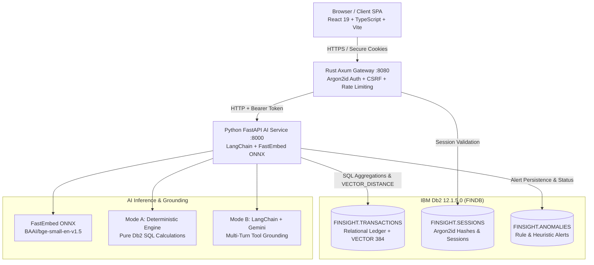

# FinSight AI — System Architecture

**Product:** FinSight AI — *"Your money has a story. Understand it."*  
**Hackathon Event:** IBM Db2 TechX Summit 2026 / Db2Hack Challenge  
**Database:** IBM Db2 Community Edition (Linux/x86_64 v12.1.5.0)

---

## 1. System Overview

FinSight AI is a database-first financial intelligence and anomaly analytics platform designed to solve the critical trust, explainability, and isolation deficiencies of generic AI wrappers. Rather than piping sensitive financial ledgers to an external LLM, FinSight AI anchors all financial truth, semantic indexing, and mathematical calculations directly inside **IBM Db2 12.1.5.0**.

The architecture decouples the client-facing presentation layer from high-performance authentication and background AI processing through a three-tier design:
1. **Presentation Layer:** React 19 + TypeScript + Vite + Tailwind CSS responsive single-page application.
2. **Gateway & Security Layer:** High-concurrency Rust Axum reverse-proxy and authentication gateway with cryptographic CSRF protection and Argon2id session management.
3. **Internal AI & Ingestion Engine:** Python FastAPI service executing ONNX Runtime dense vector embeddings, native IBM Db2 cosine vector search via LangChain, and dual-mode financial synthesis (Mode A Deterministic SQL and Mode B Gemini LLM).
4. **Data & Vector Layer:** IBM Db2 12.1.5.0 database (`FINDB`) acting as the transactional, relational, and vector similarity source of truth.

---

## 2. Architecture Diagram



---

## 3. Component Breakdown

### A. Presentation Layer (Frontend)
- **Framework:** React 19 with strict TypeScript typing (`npx tsc --noEmit` verified).
- **Design Tokens:** Refined fintech palette consisting of Forest Green (`#15370D`), Sage Green (`#728E6D`), Muted Gold (`#E5CD82`), and Butter Cream (`#FFF2B4`).
- **State & Security:** In-memory CSRF token store refreshed via `/api/v1/auth/me`; `HttpOnly`, `SameSite=Lax` session cookie handling; zero client-side storage of passwords or internal tokens.
- **Views:**
  - Executive Financial Command Center (Net worth hero, cash flow breakdown, 6-month historical trajectory).
  - Server-paginated Transactions Ledger with category and status filters.
  - Dual-Mode Conversational Financial Assistant with SQL citation tool badges.
  - Semantic Transaction Search powered by 384-dimensional dense cosine similarity.
  - Explainable Anomaly Intelligence scoring velocity bursts, recurring drift, and duplicate candidates.
  - Multi-step CSV Transaction Ingestion Wizard with duplicate pre-check and automated Db2 vector generation.
  - Monthly Executive Financial Insights & printable audit reports.

### B. Gateway & Security Layer (Rust Axum)
- **Framework:** Axum 0.7, Tokio asynchronous runtime, Tower middleware.
- **Session Authentication:** Validates session cookies against `FINSIGHT.SESSIONS` in Db2; injects validated `X-User-Id` into downstream requests. Clients cannot spoof `user_id`.
- **Cryptographic CSRF Protection:** Generates and validates deterministic HMAC-SHA-256 tokens using a server-side secret (`CSRF_SECRET`). Constant-time comparison prevents timing attacks.
- **Traffic Protection:** Governor-based in-memory token bucket rate limiting (10 requests/minute on `/auth/login`, 60/minute on standard endpoints) returning HTTP 429 on abuse.
- **Memory Safety:** Rust's compile-time ownership guarantees zero memory-leak and buffer overflow vulnerabilities at the public ingress boundary.

### C. Internal AI & Ingestion Service (Python FastAPI)
- **Framework:** FastAPI with Uvicorn worker runtime, Pydantic schemas.
- **Authentication:** Protected by internal bearer token (`AI_SERVICE_INTERNAL_TOKEN`) passed strictly between the Rust gateway and AI service.
- **Dual-Mode Architecture:**
  - **Mode A (Deterministic Db2 SQL Engine):** Executes curated, audited SQL aggregations with 0% LLM hallucination risk. Citations include exact transaction IDs, dates, and amounts.
  - **Mode B (LangChain + Gemini Engine):** Binds 10 deterministic Db2 query tools to Google Gemini (`gemini-3.1-flash-lite`). If Gemini returns quota exhaustion (HTTP 429) or is unconfigured, the service automatically falls back to Mode A without crashing.
- **Local Dense Embeddings:** Generates 384-dimensional vectors locally via `fastembed` and `onnxruntime` using the `BAAI/bge-small-en-v1.5` model (no external embedding API dependencies).

### D. Data & Vector Layer (IBM Db2 12.1.5.0)
- **Container Runtime:** `icr.io/db2_community/db2:latest` deployed via Docker Compose with dedicated database `FINDB`.
- **Connector:** Standard `ibm_db` driver and native SQL execution.
- **Financial Precision:** Currency fields stored as `DECIMAL(14,2)` to eliminate floating-point calculation drift.
- **Native Vector Type:** Transaction text representations embedded and stored in `VECTOR(384, FLOAT32)` columns.
- **Vector Search:** Direct SQL similarity queries utilizing `VECTOR_DISTANCE(embedding, ?, 'COSINE')`.

---

## 4. End-to-End Data Flow

### A. Semantic Search Data Flow
1. User enters natural language concept (e.g., *"Cloud hosting and server infrastructure"*).
2. Request passes Rust Axum gateway; session cookie is verified, and client `X-User-Id` is appended.
3. FastAPI AI service encodes the query string into a 384-dimensional float vector via local ONNX runtime.
4. AI service executes native Db2 SQL query:
   ```sql
   SELECT transaction_id, transaction_date, merchant_name, amount, category,
          VECTOR_DISTANCE(embedding, CAST(? AS VECTOR(384, FLOAT32)), 'COSINE') AS distance
   FROM FINSIGHT.TRANSACTIONS
   WHERE user_id = ?
   ORDER BY distance ASC
   FETCH FIRST 10 ROWS ONLY
   ```
5. Db2 returns the nearest neighbor transactions ranked by cosine distance. Results are formatted and delivered to the client.

### B. Conversational Financial Assistant Flow
1. User asks: *"What was my total income in October?"*
2. Request routed through Rust Gateway with valid CSRF token and session cookie.
3. In Mode B, LangChain evaluates the query and triggers `DB2_TOOL_GET_INCOME` with `{ month: 10, year: 2026 }`.
4. The tool executes verified SQL against `FINSIGHT.TRANSACTIONS` for `CREDIT` and `POSTED` transactions, returning `₹125,000.00`.
5. The LLM synthesizes the verified figure with transparent citations to the underlying Db2 record.
6. If the external LLM encounters quota exhaustion, Mode A catches the exception and returns the deterministic SQL result immediately.

---

## 5. IBM Db2 Schema Design

```sql
-- Schema Definition
CREATE SCHEMA FINSIGHT;

-- 1. User Accounts
CREATE TABLE FINSIGHT.USERS (
    user_id VARCHAR(64) NOT NULL PRIMARY KEY,
    email VARCHAR(255) NOT NULL UNIQUE,
    password_hash VARCHAR(255) NOT NULL,
    full_name VARCHAR(255) NOT NULL,
    created_at TIMESTAMP DEFAULT CURRENT_TIMESTAMP
);

-- 2. Sessions
CREATE TABLE FINSIGHT.SESSIONS (
    session_id VARCHAR(64) NOT NULL PRIMARY KEY,
    user_id VARCHAR(64) NOT NULL,
    created_at TIMESTAMP DEFAULT CURRENT_TIMESTAMP,
    expires_at TIMESTAMP NOT NULL,
    FOREIGN KEY (user_id) REFERENCES FINSIGHT.USERS(user_id) ON DELETE CASCADE
);

-- 3. Core Financial Ledger with Native Vector Storage
CREATE TABLE FINSIGHT.TRANSACTIONS (
    transaction_id VARCHAR(64) NOT NULL PRIMARY KEY,
    user_id VARCHAR(64) NOT NULL,
    transaction_date DATE NOT NULL,
    merchant_name VARCHAR(255) NOT NULL,
    amount DECIMAL(14,2) NOT NULL,
    direction VARCHAR(10) NOT NULL CHECK (direction IN ('DEBIT', 'CREDIT')),
    category VARCHAR(100) NOT NULL,
    status VARCHAR(20) NOT NULL DEFAULT 'POSTED' CHECK (status IN ('POSTED', 'PENDING')),
    account_type VARCHAR(50) NOT NULL,
    description VARCHAR(500),
    embedding VECTOR(384, FLOAT32),
    created_at TIMESTAMP DEFAULT CURRENT_TIMESTAMP,
    FOREIGN KEY (user_id) REFERENCES FINSIGHT.USERS(user_id) ON DELETE CASCADE
);

-- 4. Anomaly Alerts Store
CREATE TABLE FINSIGHT.ANOMALIES (
    alert_id VARCHAR(64) NOT NULL PRIMARY KEY,
    user_id VARCHAR(64) NOT NULL,
    transaction_id VARCHAR(64) NOT NULL,
    anomaly_type VARCHAR(50) NOT NULL CHECK (anomaly_type IN ('VELOCITY_SPIKE', 'RECURRING_DRIFT', 'DUPLICATE_CANDIDATE', 'AMOUNT_OUTLIER')),
    severity VARCHAR(20) NOT NULL CHECK (severity IN ('LOW', 'MEDIUM', 'HIGH', 'CRITICAL')),
    confidence_score DECIMAL(5,2) NOT NULL,
    explanation CLOB NOT NULL,
    review_status VARCHAR(20) NOT NULL DEFAULT 'NEEDS_REVIEW' CHECK (review_status IN ('NEEDS_REVIEW', 'REVIEWED', 'DISMISSED')),
    created_at TIMESTAMP DEFAULT CURRENT_TIMESTAMP,
    FOREIGN KEY (user_id) REFERENCES FINSIGHT.USERS(user_id) ON DELETE CASCADE,
    FOREIGN KEY (transaction_id) REFERENCES FINSIGHT.TRANSACTIONS(transaction_id) ON DELETE CASCADE
);
```

---

## 6. Security and Isolation Principles

- **Tenant Isolation:** Every SQL query in the application strictly binds `WHERE user_id = ?` using the session identity extracted from the server session store. No client-supplied identifier can access or mutate another tenant's financial data.
- **Zero Secrets in Code:** All database passwords, internal tokens, and API credentials are injected strictly through environment variables.
- **Fail-Safe Startup:** The Rust API gateway exits immediately (`exit(101)`) if started in production without a cryptographic `CSRF_SECRET`.
