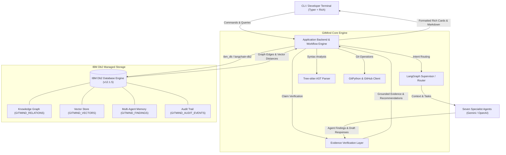

# System Architecture

## Overview
GitMind transforms software version history, Abstract Syntax Tree (AST) code structures, pull requests, issues, and past engineering investigations into a persistent, searchable, and auditable institutional memory powered by **IBM Db2**.

The system operates across four primary tiers:
1. **Client Tier**: A developer-focused CLI powered by Typer and Rich that interfaces with local Git repositories, developers' working directories, and CI/CD pipelines.
2. **Backend Engine Tier**: LangGraph functional workflow orchestration, Tree-sitter AST analysis, and an Evidence Verification Layer that grounds AI statements against repository facts.
3. **AI / LLM Orchestration Tier**: Seven specialist agents orchestrated by a Query Router that collaborate using structured system prompts and bounded execution loops with Google Gemini and OpenAI.
4. **Database Tier (IBM Db2)**: IBM Db2 Community Edition (v12.1.5) or IBM Db2 on Cloud, serving as the relational knowledge graph, native vector similarity store (`DB2VS`), persistent multi-agent memory, and append-only audit trail.

---

## Architecture Diagram



---

## Component Breakdown

1. **User Interface / Client Layer**:
   - **CLI Commands (`cli.py`)**: Built with Typer and Rich to deliver an intuitive terminal user experience. Commands include:
     - `gitmind ask "<query>"`: Multi-agent conversational query answering with citation grounding.
     - `gitmind review [--base <ref>]`: Historical change-risk and regression intelligence on working tree diffs.
     - `gitmind story [--days <N>]`: Generates chronological repository narratives linked to modified symbols.
     - `gitmind recover`: Scans dangling commits in `git reflog` and generates safe recovery plans.
     - `gitmind index [--days <N>]`: Full and incremental repository indexing into IBM Db2.
     - `gitmind memory search "<topic>"`: Queries past engineering findings and historical fixes.
     - `gitmind db2 [doctor|migrate|status|test]`: Health probes, live schema migrations, and connection diagnostics.
   - **Terminal Output Formatting (`utils/output.py`)**: Formats findings, risk cards, evidence citations, and ASCII banners.

2. **Application Backend Layer**:
   - **Workflow Orchestration (`workflows/orchestrator.py`)**: Implements LangGraph functional workflows with `@entrypoint` and `@task` primitives.
   - **Query Router (`workflows/router.py`)**: Directs user queries to the appropriate specialist agent with sub-second deterministic fast-paths for structured queries.
   - **Code & AST Intelligence (`tools/code_tools.py`)**: Parses source files using Tree-sitter for Python, JavaScript, and TypeScript, extracting functions, classes, and structural boundaries.
   - **Change-Risk Engine (`workflows/review.py`)**: Analyzes git diffs, identifies modified AST symbols, recalls past reverts/regressions from Db2, and calculates an explainable risk score (0–100) across 7 weighted signals.
   - **Evidence Verification Layer (`workflows/synthesizer.py`, `data/evidence_models.py`)**: Cross-checks commit hashes, file paths, and PR IDs against Db2 records, classifying statements into *Verified Facts* vs. *Historical Inferences* to eliminate hallucinations.
   - **Git Safety Engine (`tools/git_tools.py`)**: Wraps GitPython with strict safety guardrails that block destructive operations (`reset --hard`, `push -f`, `branch -D`) by default.

3. **Database Layer (IBM Db2)**:
   - **Connection Management (`data/db2/connection.py`)**: Manages secure connections via `ibm_db` and `ibm_db_dbi`, featuring SSL/TLS support, capability auto-detection (Db2 v12.1.2+ native vector check), bounded retries, and sanitized logging.
   - **Native Vector Store (`data/db2/vector_store.py`)**: Utilizes official `langchain-db2` (`DB2VS`) storing high-dimensional embeddings directly in `VECTOR(768, FLOAT32)` columns with server-side `VECTOR_DISTANCE(..., COSINE)`.
   - **Relational Knowledge Graph (`GITMIND_RELATIONS`)**: Stores relationships between commits, parent commits, modified files, AST functions, PRs, and issues with foreign keys and cascade deletion.
   - **Persistent Agent Memory (`data/repository_memory.py`)**: Persists engineering discoveries in `GITMIND_FINDINGS` and `GITMIND_FINDING_EVIDENCE`, indexed by repository ID and searchable via semantic vector queries.
   - **Schema Migration Engine (`data/db2/migrations.py`)**: Applies versioned, idempotent DDL migrations tracked in `GITMIND_SCHEMA_MIGRATIONS`.
   - **Audit & Governance (`GITMIND_AUDIT_EVENTS`)**: An append-only log recording every indexing run, review assessment, and query execution.

4. **AI / Model Orchestration Layer**:
   - **Seven Specialist Agents**:
     - *History Agent*: Explores evolution narratives, commit lineages, and author blame.
     - *Code Agent*: Inspects Tree-sitter AST nodes, signatures, and structural changes.
     - *Recovery Agent*: Analyzes dangling commits and reflog entries for recovery.
     - *GitHub Agent*: Traces commits to PR discussions and GitHub issues.
     - *Suggest Agent*: Evaluates repository hygiene, branch staleness, and uncommitted changes.
     - *Project Agent*: Synthesizes architectural documentation and contributor guides.
     - *Docs Agent*: Surfaces verified Git documentation and CLI help.
   - **Model Providers (`config.py`)**: Configurable dual-provider LLM support:
     - Google Gemini (`gemini-3.1-flash-lite`, `gemini-3.8-flash`, `models/gemini-embedding-001` with `output_dimensionality=768`).
     - OpenAI (`gpt-4o`, `text-embedding-3-small`).
   - **Resilience**: Configured with bounded retries, 30-second timeouts, and max iteration limits to prevent infinite loops and quota stalls.

---

## Data Flow

1. **Input Ingestion**:
   - The developer invokes a command via the CLI (e.g., `gitmind review --base main` or `gitmind ask "Why was authentication refactored?"`).
   - The CLI parses arguments, verifies local Git repository status, and computes a deterministic `REPO_ID`.

2. **Context Retrieval**:
   - The backend runs Tree-sitter AST symbol extraction against local files/diffs.
   - Parameterized queries are dispatched to IBM Db2 to fetch:
     - Historical commits touching the modified files or functions.
     - Knowledge graph relations from `GITMIND_RELATIONS`.
     - Cosine-nearest vector matches from `GITMIND_VECTORS` using `VECTOR_DISTANCE`.
     - Relevant past engineering findings from `GITMIND_FINDINGS`.

3. **Augmentation & Inference**:
   - Context items are sanitized to remove sensitive tokens or private keys (`utils/security.py`).
   - The Query Router injects repository facts, AST symbol tables, and retrieved Db2 records into specialist prompt templates.
   - The selected specialist agent(s) analyze the evidence and generate structured conclusions.

4. **State Persistence**:
   - The Evidence Verification Layer verifies all cited commit SHAs and file paths against actual Db2 records.
   - If a new risk or architectural pattern is identified, it is saved to `GITMIND_FINDINGS` and its citations to `GITMIND_FINDING_EVIDENCE`.
   - An immutable audit entry is appended to `GITMIND_AUDIT_EVENTS`.

5. **Response Delivery**:
   - Results are rendered in the developer's terminal as formatted Rich tables, color-coded risk cards, or markdown summaries, cleanly separating *Verified Facts* from *Historical Inferences*.

---

## IBM Db2 Schema & Storage Design

GitMind uses 9 relational and vector tables inside IBM Db2, partitioned by `REPO_ID`:

```sql
-- 1. Repository Catalog
CREATE TABLE GITMIND_REPOSITORIES (
    REPO_ID VARCHAR(64) NOT NULL PRIMARY KEY,
    REPO_KEY VARCHAR(255) NOT NULL,
    REMOTE_URL VARCHAR(512),
    DEFAULT_BRANCH VARCHAR(128) DEFAULT 'main',
    INDEXED_HEAD_SHA VARCHAR(64),
    EMBEDDING_MODEL VARCHAR(128),
    EMBEDDING_DIMENSION INTEGER,
    SCHEMA_VERSION VARCHAR(32) DEFAULT '2.0',
    LAST_INDEXED_AT TIMESTAMP,
    CREATED_AT TIMESTAMP NOT NULL,
    UPDATED_AT TIMESTAMP NOT NULL,
    CONSTRAINT UQ_REPO_KEY UNIQUE (REPO_KEY)
);

-- 2. Repository Artifacts (Commits, Files, AST Functions, PRs, Issues)
CREATE TABLE GITMIND_ARTIFACTS (
    ARTIFACT_ID VARCHAR(64) NOT NULL PRIMARY KEY,
    REPO_ID VARCHAR(64) NOT NULL,
    ARTIFACT_TYPE VARCHAR(64) NOT NULL,
    SOURCE_KEY VARCHAR(255) NOT NULL,
    TITLE VARCHAR(512),
    CONTENT CLOB,
    FILE_PATH VARCHAR(512),
    COMMIT_SHA VARCHAR(64),
    AUTHOR VARCHAR(255),
    SOURCE_URL VARCHAR(512),
    CONTENT_HASH VARCHAR(64) NOT NULL,
    START_LINE INTEGER,
    END_LINE INTEGER,
    CREATED_AT TIMESTAMP NOT NULL,
    UPDATED_AT TIMESTAMP NOT NULL,
    CONSTRAINT FK_ART_REPO FOREIGN KEY (REPO_ID)
        REFERENCES GITMIND_REPOSITORIES(REPO_ID) ON DELETE CASCADE,
    CONSTRAINT UQ_ART_SOURCE UNIQUE (REPO_ID, ARTIFACT_TYPE, SOURCE_KEY)
);

CREATE INDEX IDX_ART_REPO_TYPE ON GITMIND_ARTIFACTS(REPO_ID, ARTIFACT_TYPE);
CREATE INDEX IDX_ART_COMMIT ON GITMIND_ARTIFACTS(COMMIT_SHA);
CREATE INDEX IDX_ART_FILE ON GITMIND_ARTIFACTS(FILE_PATH);

-- 3. Knowledge Graph Relations
CREATE TABLE GITMIND_RELATIONS (
    RELATION_ID VARCHAR(64) NOT NULL PRIMARY KEY,
    REPO_ID VARCHAR(64) NOT NULL,
    SOURCE_ARTIFACT_ID VARCHAR(64) NOT NULL,
    TARGET_ARTIFACT_ID VARCHAR(64) NOT NULL,
    RELATION_TYPE VARCHAR(64) NOT NULL,
    CREATED_AT TIMESTAMP NOT NULL,
    CONSTRAINT FK_REL_REPO FOREIGN KEY (REPO_ID)
        REFERENCES GITMIND_REPOSITORIES(REPO_ID) ON DELETE CASCADE,
    CONSTRAINT FK_REL_SRC FOREIGN KEY (SOURCE_ARTIFACT_ID)
        REFERENCES GITMIND_ARTIFACTS(ARTIFACT_ID) ON DELETE CASCADE,
    CONSTRAINT FK_REL_TGT FOREIGN KEY (TARGET_ARTIFACT_ID)
        REFERENCES GITMIND_ARTIFACTS(ARTIFACT_ID) ON DELETE CASCADE,
    CONSTRAINT UQ_RELATION UNIQUE (REPO_ID, SOURCE_ARTIFACT_ID, TARGET_ARTIFACT_ID, RELATION_TYPE)
);

CREATE INDEX IDX_REL_SRC ON GITMIND_RELATIONS(SOURCE_ARTIFACT_ID);
CREATE INDEX IDX_REL_TGT ON GITMIND_RELATIONS(TARGET_ARTIFACT_ID);
CREATE INDEX IDX_REL_TYPE ON GITMIND_RELATIONS(REPO_ID, RELATION_TYPE);

-- 4. Native Vector Embeddings (Official langchain-db2 DB2VS schema)
CREATE TABLE GITMIND_VECTORS (
    ID CHAR(16) NOT NULL PRIMARY KEY,
    TEXT CLOB,
    METADATA BLOB,
    EMBEDDING VECTOR(768, FLOAT32)
);

-- 5. Persistent Multi-Agent Findings (Institutional Memory)
CREATE TABLE GITMIND_FINDINGS (
    FINDING_ID VARCHAR(64) NOT NULL PRIMARY KEY,
    REPO_ID VARCHAR(64) NOT NULL,
    AGENT_RUN_ID VARCHAR(64),
    AGENT_NAME VARCHAR(64) NOT NULL,
    FINDING_TYPE VARCHAR(64) NOT NULL,
    TITLE VARCHAR(512) NOT NULL,
    SUMMARY CLOB NOT NULL,
    SEVERITY VARCHAR(32),
    STATUS VARCHAR(32) DEFAULT 'ACTIVE',
    CREATED_AT TIMESTAMP NOT NULL,
    CONSTRAINT FK_FIND_REPO FOREIGN KEY (REPO_ID)
        REFERENCES GITMIND_REPOSITORIES(REPO_ID) ON DELETE CASCADE
);

CREATE INDEX IDX_FIND_TYPE ON GITMIND_FINDINGS(REPO_ID, FINDING_TYPE);

-- 6. Finding Grounded Evidence References
CREATE TABLE GITMIND_FINDING_EVIDENCE (
    EVIDENCE_ID VARCHAR(64) NOT NULL PRIMARY KEY,
    FINDING_ID VARCHAR(64) NOT NULL,
    ARTIFACT_ID VARCHAR(64),
    COMMIT_SHA VARCHAR(64),
    FILE_PATH VARCHAR(512),
    START_LINE INTEGER,
    END_LINE INTEGER,
    EVIDENCE_TYPE VARCHAR(64),
    CONTENT_HASH VARCHAR(64),
    SOURCE_URL VARCHAR(512),
    CREATED_AT TIMESTAMP NOT NULL,
    CONSTRAINT FK_EVID_FIND FOREIGN KEY (FINDING_ID)
        REFERENCES GITMIND_FINDINGS(FINDING_ID) ON DELETE CASCADE
);

-- 7. Append-Only Compliance & Audit Trail
CREATE TABLE GITMIND_AUDIT_EVENTS (
    EVENT_ID VARCHAR(64) NOT NULL PRIMARY KEY,
    REPO_ID VARCHAR(64) NOT NULL,
    EVENT_TYPE VARCHAR(64) NOT NULL,
    ACTOR VARCHAR(128) NOT NULL,
    DETAILS CLOB,
    CREATED_AT TIMESTAMP NOT NULL,
    CONSTRAINT FK_AUDIT_REPO FOREIGN KEY (REPO_ID)
        REFERENCES GITMIND_REPOSITORIES(REPO_ID) ON DELETE CASCADE
);

CREATE INDEX IDX_AUDIT_REPO_TIME ON GITMIND_AUDIT_EVENTS(REPO_ID, CREATED_AT);

-- 8. Indexing Runs Log
CREATE TABLE GITMIND_INDEX_RUNS (
    RUN_ID VARCHAR(64) NOT NULL PRIMARY KEY,
    REPO_ID VARCHAR(64) NOT NULL,
    INDEX_MODE VARCHAR(32) NOT NULL,
    STARTING_HEAD_SHA VARCHAR(64),
    ENDING_HEAD_SHA VARCHAR(64),
    INDEXED_ARTIFACTS INTEGER DEFAULT 0,
    GENERATED_CHUNKS INTEGER DEFAULT 0,
    FAILED_ARTIFACTS INTEGER DEFAULT 0,
    START_TIME TIMESTAMP NOT NULL,
    COMPLETION_TIME TIMESTAMP,
    STATUS VARCHAR(32) NOT NULL,
    ERROR_SUMMARY CLOB,
    CONSTRAINT FK_IDX_REPO FOREIGN KEY (REPO_ID)
        REFERENCES GITMIND_REPOSITORIES(REPO_ID) ON DELETE CASCADE
);

-- 9. Agent Execution Runs
CREATE TABLE GITMIND_AGENT_RUNS (
    RUN_ID VARCHAR(64) NOT NULL PRIMARY KEY,
    REPO_ID VARCHAR(64) NOT NULL,
    QUERY_HASH VARCHAR(64),
    QUERY_SUMMARY VARCHAR(1024),
    WORKFLOW_NAME VARCHAR(64),
    AGENTS_INVOKED VARCHAR(512),
    LLM_PROVIDER VARCHAR(64),
    LLM_MODEL VARCHAR(64),
    PROMPT_VERSION VARCHAR(32),
    STATUS VARCHAR(32),
    START_TIME TIMESTAMP NOT NULL,
    COMPLETION_TIME TIMESTAMP,
    CONSTRAINT FK_AGRUN_REPO FOREIGN KEY (REPO_ID)
        REFERENCES GITMIND_REPOSITORIES(REPO_ID) ON DELETE CASCADE
);
```

---

## Security & Secrets Management
- All database credentials (`DB2_HOST`, `DB2_PORT`, `DB2_DATABASE`, `DB2_USER`, `DB2_PASSWORD`, `DB2_SSL`) and external API keys (`GEMINI_API_KEY`, `OPENAI_API_KEY`, `GITHUB_TOKEN`) are read at runtime strictly from environment variables.
- Sensitive production connection strings and credentials are never checked into version control.
- Ingestion pipelines run automatic regex secret scanning (`utils/security.py`) that redacts API keys, tokens, and private keys prior to vectorization or LLM prompt injection.
- Destructive Git operations are strictly blocked by default to preserve repository integrity.
- All SQL operations use parameterized statements with strict `REPO_ID` filtering to guarantee multi-tenant repository isolation and eliminate SQL injection vectors.
