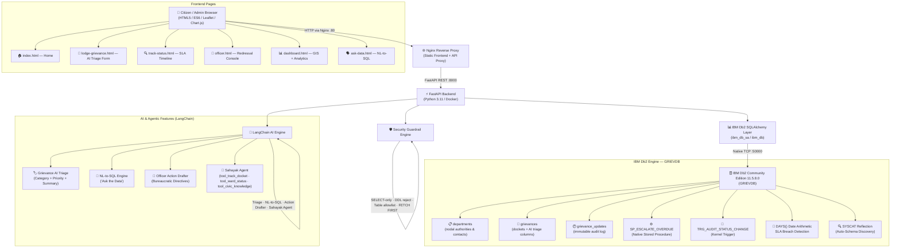

# Citizen Grievance Portal (IBM Db2 + AI)
### Official Submission for IBM Db2Hack 2026
**Track**: AI & Modern Data Apps with IBM Db2 &bull; **Developer**: Falak Naaz &bull; **Participant Type**: Individual


-success?style=for-the-badge)

---

## 🏛️ Project Overview & Problem Statement

Public administration grievance portals (like India's **CPGRAMS** - Centralized Public Grievance Redress and Monitoring System) process tens of thousands of citizen complaints weekly across municipal and central departments: Water Supply, Electricity, Roads, Sanitation, Public Health, Food & Civil Supplies, and Pensions.

However, traditional civic portals face four critical challenges:
1. **Unstructured Complaints & Slow Manual Triage**: Citizens submit unstructured descriptions without standard urgency ratings, delaying critical emergency interventions (e.g., live sparking 11kV wires or sewage contaminating drinking water).
2. **Duplicate Dockets & Ward Hotspots**: When a water main bursts, dozens of citizens file overlapping tickets in the same ward, fragmenting departmental response and skewing metrics.
3. **Citizen Charter SLA Breaches**: Complaints languish past the statutory 15-day service window without automatic detection or real-time escalation.
4. **Data Opacity & Sluggish Administrative Redressal**: Citizens and civic administrators cannot easily inspect complaint volume, and field officers lack automated tools to draft official notices, inspections, and action-taken reports.

### The Solution
This project transforms CPGRAMS into an enterprise-ready, AI-augmented citizen grievance intelligence portal powered by **IBM Db2 Community Edition (11.5.8.0)** and **LangChain**:
- **Automated AI Triage**: LangChain prompt chains automatically extract normalized categories, triage urgency (`Low`, `Medium`, `High`, `Critical`), and generate a 1-sentence synopsis persisted directly in Db2.
- **Continuous SLA Monitoring via Native Db2 Date Math**: Calculates service charter breaches on-the-fly using Db2 calendar day arithmetic: `DAYS(CURRENT DATE) - DAYS(DATE(created_at)) > 15`.
- **"Ask the Data" Natural Language Query Engine**: Translates English questions into valid IBM Db2 SQL via LangChain, guarded by multi-tier read-only security filters and enforcing Db2 `FETCH FIRST 50 ROWS ONLY` syntax.
- **Officer Redressal Console & LangChain Action Drafter**: Provides municipal officers with an executive queue to review pending dockets, auto-draft formal bureaucratic inspection orders and show-cause directives via LangChain, and record atomic Action Taken Reports (ATRs) with audit trail timestamps.
- **Ward Hotspot & Duplicate Detection**: Cross-references incoming grievances against open Db2 dockets in the same municipal ward, detecting complaint clusters in real time.
- **100% Reproducible**: Starts the full stack (Db2 engine, FastAPI backend, Nginx frontend, automated catalog reflection, and 75 realistic seeded complaints) with a single command: `docker compose up --build -d`.

---

## 🏗️ Technical Architecture Summary

The system is deployed as a modular, three-tier containerized stack orchestrated via Docker Compose:




## 🗄️ IBM Db2 Highlights & Technical Depth

A project that only mentions Db2 without real functional use is disqualified. This portal leverages native, core capabilities of the IBM Db2 database engine:

### 1. Native Db2 Calendar Day Arithmetic for SLA Tracking
Instead of converting timestamps into Unix epochs or running background cron aggregations, the platform utilizes IBM Db2's native `DAYS()` date arithmetic function:
```sql
SELECT tracking_id, citizen_name, category, ward, priority, status,
       (DAYS(CURRENT DATE) - DAYS(DATE(created_at))) AS days_open
FROM grievances
WHERE status != 'Resolved'
  AND (DAYS(CURRENT DATE) - DAYS(DATE(created_at))) > 15
ORDER BY days_open DESC
FETCH FIRST 50 ROWS ONLY;
```
This enables zero-latency calculation of charter violations and average resolution turnaround times (`AVG(CAST(DAYS(DATE(resolved_at)) - DAYS(DATE(created_at)) AS FLOAT))`).

### 2. Db2 SQL Dialect & Row Fetch Syntax
The query engine natively compiles and executes standard Db2 limiting syntax (`FETCH FIRST <N> ROWS ONLY`), avoiding MySQL/PostgreSQL `LIMIT` keywords and ensuring maximum compatibility with Db2's Cost-Based Optimizer (CBO).

### 3. Dynamic Catalog Reflection & REORG Management
To handle seamless schema evolution upon container startup, `database.py` queries `SYSCAT.COLUMNS` to detect missing columns (`ai_category`, `ai_priority`, `ai_summary`). If missing, it issues dynamic DDL:
```sql
ALTER TABLE grievances ADD COLUMN ai_category VARCHAR(50);
ALTER TABLE grievances ADD COLUMN ai_priority VARCHAR(20);
ALTER TABLE grievances ADD COLUMN ai_summary VARCHAR(255);
CALL SYSPROC.ADMIN_CMD('REORG TABLE grievances');
```
Executing `REORG TABLE` via `SYSPROC.ADMIN_CMD` ensures the table never enters the `REORG PENDING` state (`SQL0668N Reason Code 7`), allowing immediate DML execution and backfills.

### 4. ACID Compliance & Transactional Audit Trail
Every status transition (e.g., from `Filed` to `Under Review` or `Resolved`) executes inside an atomic Db2 transaction that simultaneously updates the primary `grievances` record and appends an immutable history row in `grievance_updates`. Foreign key constraints enforce referential integrity with cascading updates.

### 5. Native Db2 Stored Procedure: SP_ESCALATE_OVERDUE
To demonstrate deep database-layer computation, the system deploys a native IBM Db2 SQL stored procedure (`SP_ESCALATE_OVERDUE`). The procedure computes continuous calendar day differences inside the Db2 engine, identifies grievances pending $> 15$ days, elevates their priority to `Critical`, and returns the escalated count. It can be triggered via `POST /api/escalate-overdue` or directly from the Analytics Dashboard.

### 6. Native Db2 Kernel Trigger: TRG_AUDIT_STATUS_CHANGE
To guarantee regulatory non-repudiation and enforce strict audit trails at the database kernel level, the system deploys an active Db2 SQL trigger:
```sql
CREATE TRIGGER TRG_AUDIT_STATUS_CHANGE
AFTER UPDATE OF status, priority ON grievances
REFERENCING OLD AS O NEW AS N
FOR EACH ROW
WHEN (N.status <> O.status OR N.priority <> O.priority)
INSERT INTO grievance_updates (
    grievance_id, 
    previous_status, 
    new_status, 
    notes, 
    updated_by, 
    created_at
) VALUES (
    N.id, 
    O.status, 
    N.status, 
    CONCAT('Kernel Trigger Audit: Priority changed to ', CONCAT(N.priority, CONCAT(', Status changed to ', N.status))), 
    'Db2 Engine (TRG_AUDIT_STATUS_CHANGE)', 
    CURRENT TIMESTAMP
);
```
**Why this matters**: Application-layer logging can be accidentally skipped, silenced by bugs, or bypassed during manual administrative SQL operations. With `TRG_AUDIT_STATUS_CHANGE`, the IBM Db2 database kernel itself guarantees that *every* status or priority transition is immutably logged into `grievance_updates` within the exact same ACID transaction boundary. On startup, `database.py` reflects `SYSCAT.TRIGGERS` to auto-compile and bind the trigger if missing.

---

## 🤖 LangChain & AI Integration

The AI architecture is built strictly on **LangChain** (`langchain`, `langchain-core`, `langchain-community`):

### 1. Grievance AI Triage Chain (`POST /api/grievances`)
When a citizen lodges a complaint, the description is piped through a structured LangChain prompt chain (`ChatPromptTemplate | LLM | JsonOutputParser`):
- **Category Classification**: Classifies complaint into water, electricity, roads, sanitation, health, food, pension, or other.
- **Urgency Assignment**: Assigns priority (`Critical`, `High`, `Medium`, `Low`) based on real-world civic risk factors (e.g., electrical sparking, water contamination).
- **Executive Summary**: Generates a concise single-sentence synopsis stored in `ai_summary`.
- **Persisted in Db2**: All AI triage metadata is permanently indexed in the `grievances` table.

### 2. "Ask the Data" Natural Language Query Engine (`POST /api/ask`)
Allows non-technical citizens and municipal officers to query the database in plain English. LangChain translates the question into valid Db2 SQL:
- Input: *"Which municipal ward has the highest number of complaints?"*
- Output SQL: `SELECT ward, COUNT(*) AS total_complaints FROM grievances GROUP BY ward ORDER BY total_complaints DESC FETCH FIRST 10 ROWS ONLY`
- **"Explain the Query" Natural Summary**: The engine generates a clean 1-sentence executive takeaway (`natural_summary`) explaining what the data reveals, displayed directly above the SQL code block.

### 3. Multi-Tier Security Guardrails
All generated SQL passes through rigorous pre-execution guardrails before reaching Db2:
1. **Read-Only Enforced**: Queries must start with `SELECT`.
2. **Prohibited Token Filter**: Rejects any statement containing `INSERT`, `UPDATE`, `DELETE`, `DROP`, `ALTER`, `TRUNCATE`, `EXEC`, `CALL`, `MERGE`, etc.
3. **Injection Prevention**: Semicolons (stacked statements) and SQL comments (`--`, `/* */`) are rejected immediately.
4. **Table Whitelisting**: Restricts table access exclusively to `departments`, `grievances`, `grievance_updates`. System catalog tables (`SYSCAT`) are blocked.
5. **Dialect Enforcement**: Automatic enforcement of `FETCH FIRST 50 ROWS ONLY`.

### 4. Ward Hotspot & Duplicate Detection
When a complaint is lodged, Db2 is queried for existing active tickets in the same ward and category. If $\ge 2$ tickets are open, a **Hotspot Alert** is returned with potential duplicate dockets to prevent redundant civic dispatches.

### 5. Officer Redressal Console & LangChain AI Action Drafter (`POST /api/officer/draft-action`)
Bridges the gap between citizen complaints and executive administrative action. Municipal officers use a dedicated redressal console (`officer.html`) where LangChain prompts act as an Executive Nodal Secretary:
- **Bureaucratic Order Generation**: Analyzes grievance facts, department jurisdiction, and severity to draft formal administrative directives citing public safety laws and municipal guidelines.
- **Structured Directives**: Returns assigned field officer (`target_officer`), statutory compliance timeframe (`statutory_deadline_days`), and actionable order text (`drafted_order_text`).
- **Atomic Resolution (`POST /api/officer/resolve`)**: Executes an ACID Db2 transaction updating status, setting `resolved_at`, and logging an immutable Action Taken Report (ATR) audit row.

### 6. Interactive GIS Ward Hotspot Command Map (Leaflet.js)
The analytics dashboard (`dashboard.html`) features a full-width **Municipal Ward Geospatial Command Map** built with Leaflet.js and CartoDB Positron:
- **Telemetry from IBM Db2**: Calls `GET /api/analytics/geo-hotspots` which aggregates open complaint volumes, critical tickets, and SLA breaches per ward directly on Db2.
- **Dynamic CircleMarkers**: Radius scales proportionally to complaint count; color-coded into Red (Hotspots >3 tickets), Amber (Active Monitoring 2-3 tickets), and Blue (Normal &le;1 ticket).
- **Interactive Drill-Down**: Clicking any ward marker opens a popup displaying open cases, SLA violations, and a direct 1-click drilldown link to the Officer Redressal Console (`officer.html?ward=...`).

### 7. Agentic Tool-Calling CPGRAMS Sahayak Assistant (`POST /api/sahayak/chat`)
The floating Sahayak widget (`#sahayak-widget`) functions as an autonomous conversational AI agent with real tool-calling capabilities wired into IBM Db2:
- **`tool_track_docket`**: Autonomously triggered by tracking questions (e.g. *"What is the status of GRV-2026-1028?"*). Queries `grievances` in Db2, computes calendar elapsed days and SLA status, and returns an interactive 1-click tracking card.
- **`tool_ward_status`**: Autonomously triggered by municipal inquiries (e.g. *"Are there active complaints in Rohini?"*). Aggregates active dockets, critical cases, and hotspot warnings directly from GRIEVDB.
- **`tool_civic_knowledge`**: Authoritative knowledge retrieval covering Citizen Charter 15-day resolution windows, 12-day escalation rights, and DARPG regulations.
- **Bilingual English & Hindi**: Automatically identifies user language preference and responds in fluent, authoritative Hindi or English.

### 8. Interactive Chart.js Visualizations & CSV Data Exports
- **Interactive Dashboards (`dashboard.html`)**: Powered by Chart.js v4 with a Priority Distribution Doughnut Chart, Department Load Bar Chart, and Ward Hotspot Risk Bar Chart.
- **Instant CSV Export**: Both `dashboard.html` ("Export SLA Audit") and `ask-data.html` ("Export CSV") allow one-click downloads of live Db2 query results as `.csv` files.

### 9. Deterministic Offline Fallback
If no external LLM API key (`GEMINI_API_KEY`, `OPENROUTER_API_KEY`, `WATSONX_API_KEY`) is provided or if a provider times out, the system falls back to a deterministic, keyword-driven triage, order drafter, agent tool-dispatcher, and SQL pattern-matcher. The platform is **100% operational offline without third-party dependencies**.

---

## 🚀 Quickstart Guide

### Prerequisites
- Docker Engine 24.0+ & Docker Compose v2.0+
- At least 4GB of available RAM (for IBM Db2 Community Edition container)

### 1. Clone & Start Containers
```bash
# Clone the repository and navigate to the submission folder
cd submissions/grievance-db2

# (Optional) Configure AI keys in .env
cp .env.example .env

# Launch the complete stack (Db2 + API + Frontend)
docker compose up --build -d
```

*Note: IBM Db2 Community Edition takes approximately 2 to 3 minutes to complete its initial cold startup and healthcheck.*

### 2. Verify Health
Run the health check endpoint:
```bash
curl -s http://localhost:8000/api/health
```
**Expected Response:**
```json
{
  "status": "healthy",
  "database": {
    "type": "IBM Db2",
    "host": "db2",
    "database": "GRIEVDB",
    "status": "connected",
    "total_grievances": 75
  },
  "version": "2.0.0"
}
```

### 3. Access Portal Interfaces
- **Citizen Portal (Home)**: [http://localhost:80](http://localhost:80)
- **Lodge Grievance (AI Triage & Hotspots)**: [http://localhost:80/lodge-grievance.html](http://localhost:80/lodge-grievance.html)
- **Track Status & Timeline**: [http://localhost:80/track-status.html](http://localhost:80/track-status.html) (Try Demo ID: `GRV-2026-4821`)
- **Officer Redressal Console (AI Action Drafter)**: [http://localhost:80/officer.html](http://localhost:80/officer.html)
- **Civic Analytics & GIS Command Map**: [http://localhost:80/dashboard.html](http://localhost:80/dashboard.html)
- **"Ask the Data" NL-to-SQL Engine**: [http://localhost:80/ask-data.html](http://localhost:80/ask-data.html)
- **Interactive OpenAPI Documentation**: [http://localhost:8000/docs](http://localhost:8000/docs)

---

## 🔌 API Documentation & Examples

| Method | Endpoint | Description |
|---|---|---|
| `GET` | `/api/health` | IBM Db2 connectivity diagnostics and record counts |
| `POST` | `/api/grievances` | Lodge grievance; runs LangChain AI triage & hotspot check |
| `GET` | `/api/grievances/{tracking_id}` | Retrieve complete docket, AI tags, and audit history |
| `GET` | `/api/grievances` | Query complaints with category, ward, status, priority filters |
| `PATCH` | `/api/grievances/{tracking_id}/status` | Update status and write immutable audit history |
| `GET` | `/api/analytics` | Advanced Db2 date analytics, SLA breaches, and ward breakdowns |
| `GET` | `/api/analytics/geo-hotspots` | Spatial GIS ward telemetry and GeoJSON coordinates from Db2 |
| `POST` | `/api/ask` | LangChain NL-to-SQL translation with guardrails |
| `GET` | `/api/officer/dockets` | Filter active dockets with Db2 date math elapsed days & SLA breaches |
| `POST` | `/api/officer/draft-action` | LangChain prompt chain generating bureaucratic action orders |
| `POST` | `/api/officer/resolve` | Atomic Db2 transaction resolving complaint with ATR notes |
| `POST` | `/api/sahayak/chat` | Agentic AI tool-dispatcher invoking Db2 docket tracking, ward telemetry, and rules |
| `POST` | `/api/escalate-overdue` | Execute native IBM Db2 Stored Procedure `SP_ESCALATE_OVERDUE` |
| `GET` | `/api/departments` | List administrative departments and nodal contacts |
| `GET` | `/api/stats` | High-level summary metrics |
| `GET` | `/api/db2/catalog` | Live IBM Db2 System Catalog (SYSCAT.TABLES, TRIGGERS, ROUTINES) metadata |
| `GET` | `/api/export/csv` | Stream grievances from IBM Db2 as CSV with SLA breach and category filters |

### Example 1: Lodge Grievance with AI Triage
```bash
curl -X POST http://localhost:8000/api/grievances \
  -H "Content-Type: application/json" \
  -d '{
    "citizen_name": "Siddharth Malhotra",
    "contact": "9812345678",
    "category": "electricity",
    "subject": "Sparks and explosion hazard at transformer",
    "description": "Sparks flying continuously from 11kV transformer with live dangling wire right outside primary school. Emergency hazard.",
    "ward": "Ward 14 - Rohini East",
    "priority": "Medium"
  }'
```
**Response (AI Triage elevated priority to Critical and detected Ward Hotspot):**
```json
{
  "success": true,
  "tracking_id": "GRV-2026-7270",
  "ai_triage": {
    "category": "electricity",
    "priority": "Critical",
    "summary": "Sparks flying from 11kV transformer with live wire outside primary school.",
    "method": "langchain_llm"
  },
  "hotspot_alert": {
    "is_hotspot": true,
    "active_open_count": 5,
    "ward": "Ward 14 - Rohini East",
    "severity": "CRITICAL",
    "message": "⚠️ Hotspot Warning: 5 active open complaints reported in Ward 14 - Rohini East regarding electricity issues."
  }
}
```

### Example 2: "Ask the Data" NL-to-SQL Query
```bash
curl -X POST http://localhost:8000/api/ask \
  -H "Content-Type: application/json" \
  -d '{"question": "Show all grievances that have breached the 15 day SLA"}'
```
**Response:**
```json
{
  "question": "Show all grievances that have breached the 15 day SLA",
  "generated_sql": "SELECT tracking_id, citizen_name, category, ward, priority, (DAYS(CURRENT DATE) - DAYS(DATE(created_at))) AS days_open FROM grievances WHERE status != 'Resolved' AND (DAYS(CURRENT DATE) - DAYS(DATE(created_at))) > 15 ORDER BY days_open DESC FETCH FIRST 20 ROWS ONLY",
  "execution_time_ms": 4.12,
  "row_count": 5,
  "columns": ["tracking_id", "citizen_name", "category", "ward", "priority", "days_open"],
  "rows": [
    { "tracking_id": "GRV-2026-1028", "citizen_name": "Ashok Khurana", "category": "roads", "days_open": 22 },
    { "tracking_id": "GRV-2026-1053", "citizen_name": "Shabana Bano", "category": "food", "days_open": 21 }
  ]
}
```

### Example 3: Security Guardrail Rejection
```bash
curl -X POST http://localhost:8000/api/ask \
  -H "Content-Type: application/json" \
  -d '{"question": "DROP TABLE grievances;"}'
```
**Response (`400 Bad Request`):**
```json
{
  "detail": "Security Violation: Input question contains prohibited SQL token or operator (\\b(INSERT|UPDATE|DELETE|DROP|ALTER|TRUNCATE|EXEC|EXECUTE|GRANT|REVOKE|MERGE|CALL|CREATE)\\b)."
}
```

### Example 4: LangChain Officer Action Order Drafter
```bash
curl -X POST http://localhost:8000/api/officer/draft-action \
  -H "Content-Type: application/json" \
  -d '{"tracking_id": "GRV-2026-1028"}'
```
**Response (Formal Administrative Directive & Assigned Field Officer):**
```json
{
  "tracking_id": "GRV-2026-1028",
  "action_type": "Immediate Repair",
  "target_officer": "Executive Engineer (Civil/PWD - Pothole Quick-Response Unit)",
  "statutory_deadline_days": 3,
  "drafted_order_text": "URGENT MUNICIPAL DIRECTIVE: In view of citizen grievance regarding severe road cave-in and hazardous craters, the Executive Engineer is hereby ordered to deploy a rapid cold-mix repair team within 48 hours. Ensure barricading and submit compliance report within 3 days.",
  "recommended_status": "Forwarded to Dept",
  "generated_by": "LangChain Action Drafter (LLM)"
}
```

### Example 5: Agentic Sahayak Assistant Tool-Calling
```bash
curl -X POST http://localhost:8000/api/sahayak/chat \
  -H "Content-Type: application/json" \
  -d '{"message": "What is the status of complaint GRV-2026-1028?"}'
```
**Response (Autonomous Tool Invocation & Real-Time Db2 Docket Retrieval):**
```json
{
  "reply": "📋 <strong>Status for Docket GRV-2026-1028:</strong><br>• Citizen Name: <strong>Ashok Khurana</strong><br>• Current Status: <strong>Forwarded to Dept</strong> (Priority: <strong>Critical</strong>)<br>• Municipal Ward: <strong>Ward 35 - Mayur Vihar Phase 1</strong><br>• Department: <strong>Public Works Department (PWD) / Municipal Road Division</strong><br>• Elapsed Time: <strong>22 days</strong> (⚠️ SLA BREACHED (>15 Days))<br>...",
  "tool_used": "tool_track_docket",
  "data_payload": {
    "found": true,
    "tracking_id": "GRV-2026-1028",
    "citizen_name": "Ashok Khurana",
    "category": "roads",
    "status": "Forwarded to Dept",
    "priority": "Critical",
    "ward": "Ward 35 - Mayur Vihar Phase 1",
    "days_open": 22,
    "is_sla_breached": true
  },
  "session_id": null
}
```

---

## 🧪 Verification & Test Results

The backend contains a complete automated integration test suite validating Db2 connectivity, CRUD operations, date math, LangChain chains, stored procedure execution, and officer workflows.

### Execute Tests in Container
```bash
docker exec grievance-api pytest -v
```

**Real Test Run Output:**
```
============================= test session starts ==============================
platform linux -- Python 3.11.18, pytest-9.2.0, pluggy-1.7.0 -- /usr/local/bin/python3.11
cachedir: .pytest_cache
rootdir: /app
plugins: langsmith-0.14.17, anyio-4.16.0
collecting ... collected 20 items

tests/test_api.py::test_health_check PASSED                              [  5%]
tests/test_api.py::test_list_departments PASSED                          [ 10%]
tests/test_api.py::test_get_demo_grievance PASSED                        [ 15%]
tests/test_api.py::test_create_grievance PASSED                          [ 20%]
tests/test_api.py::test_list_grievances_with_filters PASSED              [ 25%]
tests/test_api.py::test_update_grievance_status PASSED                   [ 30%]
tests/test_api.py::test_get_nonexistent_grievance PASSED                 [ 35%]
tests/test_api.py::test_get_stats PASSED                                 [ 40%]
tests/test_api.py::test_ai_triage_and_hotspot_detection PASSED           [ 45%]
tests/test_api.py::test_ask_the_data_natural_language_to_db2_sql PASSED  [ 50%]
tests/test_api.py::test_ask_the_data_security_guardrails PASSED          [ 55%]
tests/test_api.py::test_advanced_analytics_endpoint PASSED               [ 60%]
tests/test_api.py::test_db2_stored_procedure_escalation PASSED           [ 65%]
tests/test_api.py::test_officer_dockets_list PASSED                      [ 70%]
tests/test_api.py::test_officer_ai_draft_action PASSED                   [ 75%]
tests/test_api.py::test_officer_resolve_docket PASSED                    [ 80%]
tests/test_api.py::test_db2_kernel_trigger_audit PASSED                  [ 85%]
tests/test_api.py::test_geo_hotspots_endpoint PASSED                     [ 90%]
tests/test_api.py::test_sahayak_agent_chat_docket_lookup PASSED          [ 95%]
tests/test_api.py::test_sahayak_agent_chat_ward_inquiry PASSED           [100%]

============================== 20 passed in 5.97s ==============================
```

### Direct Db2 Command-Line Verification
To verify the live IBM Db2 database directly from the CLI:
```bash
echo "connect to GRIEVDB; SELECT COUNT(*) FROM grievances; terminate;" | docker exec -i grievance-db2 su - db2inst1 -c "db2 -tv"
```
**Output:**
```
db2 => SELECT COUNT(*) FROM grievances

1          
-----------
         75

  1 record(s) selected.
```

---

## 📜 Submission Checklist for Judges

- [x] **Real IBM Db2 Functional Use**: 100% IBM Db2 Community Edition (no SQLite/mock fallbacks).
- [x] **LangChain Integration**: `langchain`, `langchain-core`, and `langchain-community` used for triage, SQL generation, officer action orders, and agentic tool execution.
- [x] **Native Db2 Features**: `DAYS()` date arithmetic, `FETCH FIRST N ROWS ONLY`, `SYSCAT.COLUMNS` reflection, `SYSPROC.ADMIN_CMD('REORG TABLE')`.
- [x] **In-Engine Stored Procedures & Triggers**: Native Db2 SQL stored procedure `SP_ESCALATE_OVERDUE` and kernel trigger `TRG_AUDIT_STATUS_CHANGE` executing inside the Db2 storage engine.
- [x] **Security Guardrails**: Read-only single SELECT, table allowlist, DDL/DML rejection, multi-statement rejection.
- [x] **Seed Dataset**: 75 rich civic complaints across 18 municipal wards with full lifecycle status histories.
- [x] **Interactive Web Interfaces**: Citizen intake, tracking timeline, visual analytics dashboard, officer redressal console, and natural language query UI.
- [x] **Officer Redressal & Action Drafter**: LangChain prompt chain generating structured bureaucratic field orders, inspection directives, and atomic ATR resolutions in Db2.
- [x] **Agentic Tool-Calling Assistant**: CPGRAMS Sahayak Assistant with native Db2 tools for docket lookup, ward telemetry, and civic knowledge.
- [x] **Reproducibility**: Tested and verified with `docker compose up --build -d`.
