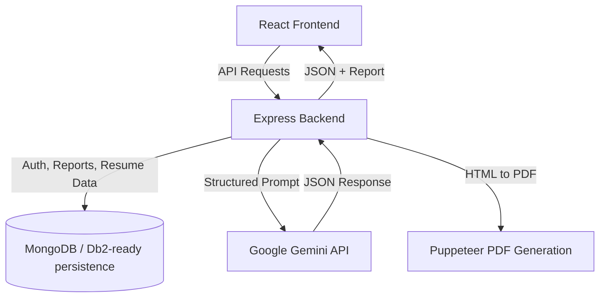

# System Architecture

## Overview
The interview platform has a layered architecture with a React frontend, an Express backend, AI generation services, and persistence support. The candidate uploads resume content and job requirements, and the backend orchestrates an AI workflow to generate an interview report, matching insights, and a tailored resume.

---

## Architecture Diagram



---

## Component Breakdown

1. User Interface Layer
   - Login/register experience
   - Interview dashboard and home screens
   - Resume and job-description input forms

2. Application Backend Layer
   - Express routes for auth and interview flow
   - Middleware for validation and file handling
   - Business logic for profile analysis and report generation

3. Database Layer
   - Candidate and interview metadata persisted in MongoDB in the prototype
   - Schema is designed to map cleanly to IBM Db2 relational tables for enterprise deployment

4. AI / Model Orchestration Layer
   - Gemini prompt generation
   - JSON schema validation with Zod
   - Report generation, score analysis, and interview prep plan creation

---

## Data Flow

1. User enters resume and job information.
2. Backend validates input and stores the request context.
3. AI model evaluates profile fit and generates structured JSON.
4. The app builds a resume and interview report from that data.
5. Puppeteer converts HTML to PDF for export.
6. Data is returned to the frontend for viewing and download.

---

## IBM Db2 Schema & Storage Design

```sql
CREATE TABLE candidates (
    id INT GENERATED ALWAYS AS IDENTITY PRIMARY KEY,
    name VARCHAR(255),
    email VARCHAR(255),
    resume_text CLOB,
    self_description CLOB,
    created_at TIMESTAMP DEFAULT CURRENT_TIMESTAMP
);

CREATE TABLE jobs (
    id INT GENERATED ALWAYS AS IDENTITY PRIMARY KEY,
    title VARCHAR(255),
    description CLOB,
    created_at TIMESTAMP DEFAULT CURRENT_TIMESTAMP
);

CREATE TABLE interview_reports (
    id INT GENERATED ALWAYS AS IDENTITY PRIMARY KEY,
    candidate_id INT,
    job_id INT,
    match_score INT,
    report_json CLOB,
    created_at TIMESTAMP DEFAULT CURRENT_TIMESTAMP
);
```

---

## Security & Secrets Management
- Keys are read from environment variables at runtime.
- Real credentials are never committed to Git.
- The same pattern can be used for IBM Db2 credentials and AI provider keys in production.

