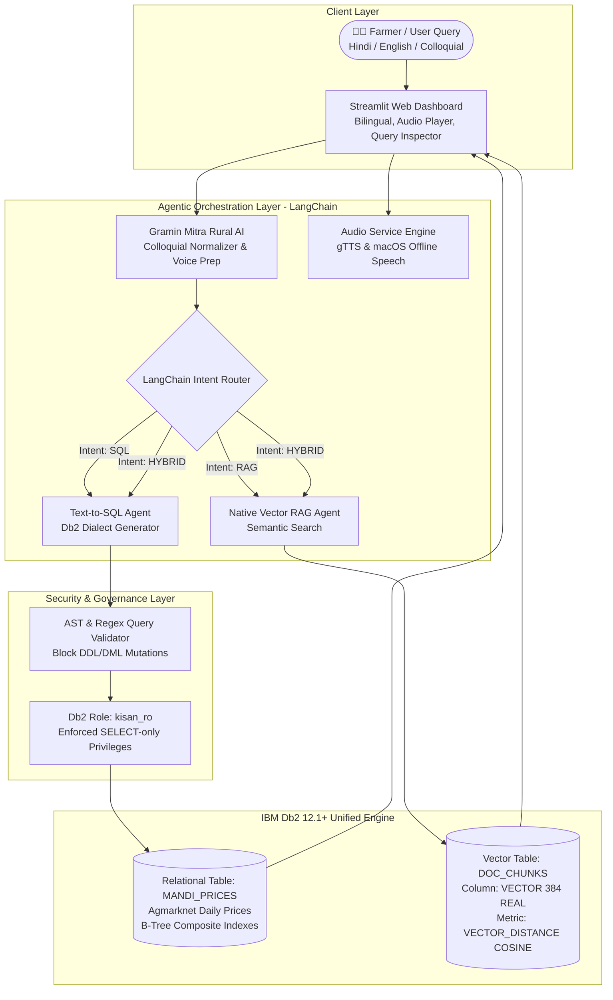

# System Architecture - Kisan Mitra (किसान मित्र)
### IBM Db2 TechX Summit 2026 Submission

## 1. Overview
Kisan Mitra is a bilingual (Hindi/English) agentic AI assistant designed for Indian agricultural households. It demonstrates genuine, native integration with **IBM Db2 12.1+** utilizing both high-performance relational analytics and native in-database vector similarity search.

---

## 2. Architecture Diagram

---

## 3. IBM Db2 Integration Details

### A. Relational Engine (`MANDI_PRICES`)
- **Schema**: Daily arrivals, minimum, maximum, and modal prices across agricultural markets.
- **Indexes**:
  - `idx_mandi_state_comm_date (state, commodity, arrival_date)`
  - `idx_mandi_district_market (district, market, arrival_date)`
  - `idx_mandi_commodity_date (commodity, arrival_date)`
- **SQL Generation**: Utilizes IBM Db2 syntax:
  - Date arithmetic: `arrival_date >= CURRENT DATE - 7 DAYS`
  - Result limiting: `FETCH FIRST 5 ROWS ONLY`

### B. Native Vector Search (`DOC_CHUNKS`)
- **Schema**: Document chunks extracted from official guidelines (PM-KISAN, PMFBY, KCC).
- **Column**: `embedding VECTOR(384, REAL)`
- **Distance Metric**: `VECTOR_DISTANCE(embedding, VECTOR(?, 384, REAL), COSINE)`
- **Advantage**: Fully in-engine vector search without requiring external vector databases (no Pinecone, FAISS, or ChromaDB).

### C. Security & Read-Only Governance
- Text-to-SQL execution runs strictly under `USER kisan_ro` with `REVOKE INSERT, UPDATE, DELETE, DROP`.
- Application-level AST parsing rejects queries with semicolons, mutations, or administrative procedures.

---

## 4. Audio & Accessibility (Gramin Mitra)
- Specially tailored for illiterate/neo-literate farmers:
  - Complex administrative language is simplified into 2-3 actionable village bullet points (ग्राम चौपाल शैली).
  - High-fidelity audio playback via HTML5 `st.audio` using `gTTS` and offline fallback.
