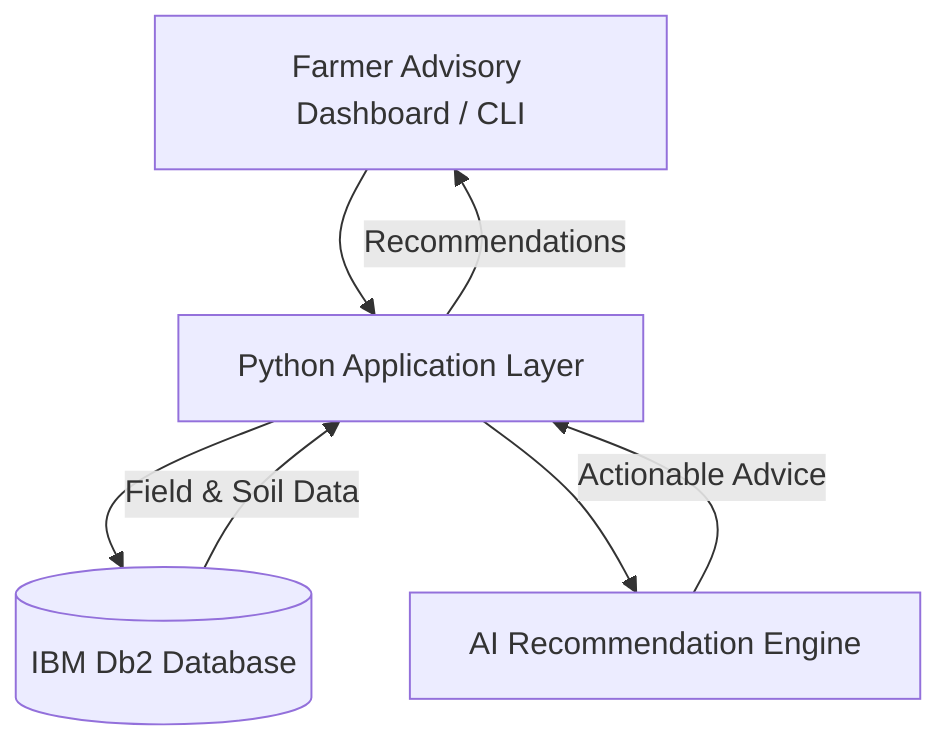

# System Architecture

## Overview

KisanRakshak AI is built around a simple pipeline: field and weather data are stored in IBM Db2, analyzed by Python business logic, and enriched with AI-generated recommendations for farmers.

---

## Architecture Diagram



---

## Component Breakdown

1. User Interface Layer
   - CLI or dashboard interface for farmers and agronomy staff.
2. Application Layer
   - Handles validation, recommendations, and data orchestration.
3. Database Layer
   - Stores farmer, field, weather, and recommendation records in IBM Db2.
4. AI Layer
   - Summarizes field conditions and generates advisory guidance.

---

## Data Flow

1. Input: farmer field observations are entered.
2. Storage: data is written into IBM Db2 tables.
3. Retrieval: app loads current field status and risk patterns.
4. Analysis: Python logic calculates risk and the AI engine produces a recommendation.
5. Output: recommendation is returned to the user.

---

## IBM Db2 Schema & Storage Design

```sql
CREATE TABLE fields (
    id INT GENERATED ALWAYS AS IDENTITY PRIMARY KEY,
    farmer_id INT NOT NULL,
    crop VARCHAR(100),
    soil_type VARCHAR(100),
    acreage DECIMAL(10,2),
    district VARCHAR(100),
    irrigation_status VARCHAR(50),
    last_updated TIMESTAMP DEFAULT CURRENT_TIMESTAMP
);

CREATE TABLE recommendations (
    id INT GENERATED ALWAYS AS IDENTITY PRIMARY KEY,
    field_id INT NOT NULL,
    category VARCHAR(50),
    recommendation_text CLOB,
    confidence_score DECIMAL(5,2),
    created_at TIMESTAMP DEFAULT CURRENT_TIMESTAMP
);
```

---

## Security & Secrets Management

- Database credentials are read from `.env` at runtime.
- API keys and database passwords are never committed.
- Connection settings stay in environment variables, not in source files.

