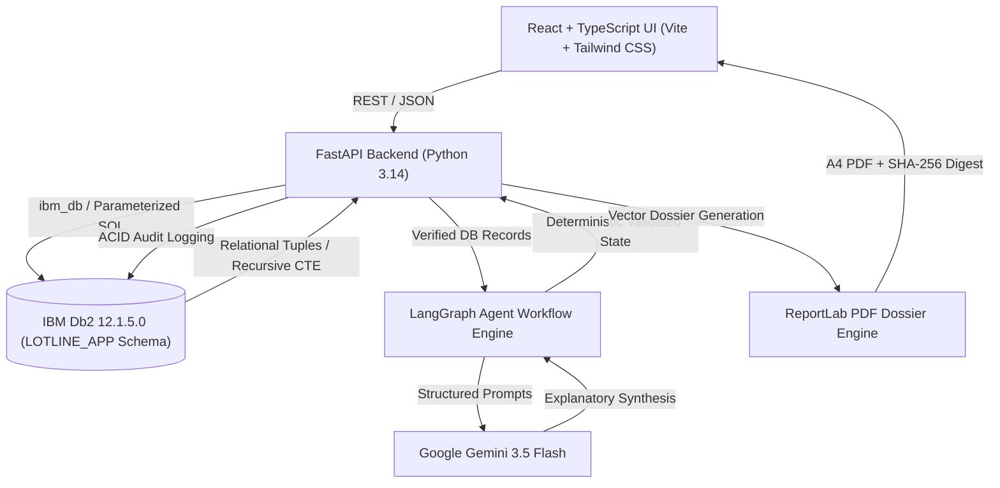

# LOTLINE System Architecture

## Overview
LOTLINE is an enterprise agentic product recall intelligence and closed-loop execution control platform. It pairs the relational reliability and ACID guarantees of **IBM Db2 12.1.5.0** with **LangGraph** multi-agent orchestration and **Google Gemini 3.5 Flash** reasoning.

The architectural boundary is strictly defined: **IBM Db2 is the sole factual authority**. AI agents interpret verified database evidence and draft operational recommendations, but can never alter database state, invent downstream batches, or bypass human governance gates.

---

## Architecture Diagram

---

## Component Breakdown

1. **User Interface / Client Layer (React 19, TypeScript, Vite, Tailwind CSS)**:
   - High-contrast **Soffit 002** visual direction (marine navy `#06131f` and turquoise `#23cad2`).
   - Interactive recursive production genealogy tree with downstream batch filtering.
   - Closed-Loop Recall Execution Control Tower across 7 operational domains:
     - Mass Reconciliation (50.0 KG raw mass variance tracking)
     - Consignee Communications (notice lifecycles and acknowledgments)
     - Logistics Interception (real-time in-transit cargo halting)
     - Recovery Reconciliation (quarantined vs trade circulation returns)
     - Controlled Dispositions (destruction authorizations with evidence verification)
     - FSSAI Schedule-I Checklist (14 statutory fields and 24-hr awareness countdown)
     - Effectiveness & Closure Blockers (12 statutory indicators and closure rejection)
   - Real-time Dossier Export Modal with binary download and SHA-256 integrity digest verification.

2. **Application Backend Layer (FastAPI, Python)**:
   - Clean modular architecture separated into `routers/api.py`, `services/db2_service.py`, `services/agent_service.py`, and `services/pdf_report_service.py`.
   - Comprehensive error handling, strict Pydantic DTO validation, and zero sensitive credential leakage.
   - Atomic transaction management via `ibm_db.autocommit(conn, False)` ensuring that business actions, inventory updates, and audit trail rows commit or roll back together.

3. **Database Layer (IBM Db2 Community Edition v12.1.5.0 on Podman)**:
   - Schema `LOTLINE_APP` with 14 normalized relational tables.
   - Recursive SQL Common Table Expressions (`WITH DOWNSTREAM_BATCHES (...)`) traversing multi-level production trees (Raw -> WIP -> Finished Goods) in single database round-trips.
   - Parameterized queries across all operations eliminating SQL injection risks.
   - Append-only persistent `AUDIT_LOG` table recording operator identity, before/after states, and millisecond timestamps.

4. **Multi-Agent Orchestration Layer (LangGraph & Google Gemini 3.5 Flash)**:
   - Four specialist state graph agents:
     - **Intake Agent**: Classifies hazard virulence and matches discovery logs.
     - **Traceability Agent**: Grounds recursive lot genealogy in Db2 records.
     - **Risk Assessment Agent**: Quantifies finished-goods commercial exposure.
     - **Response Planning Agent**: Formulates proposed mitigations (ACT-001..004).
   - Server-side response validation rejecting hallucinations (invented suppliers, modified quantities, or non-existent pathogens).
   - Deterministic offline fallback engine providing 100% operational availability if Gemini is unavailable.

5. **Regulatory Dossier Engine (ReportLab)**:
   - Dynamic 6-page A4 vector PDF compiler adhering to enterprise incident documentation standards.
   - Embeds contamination lineage, exposure breakdowns, mitigation history, and immutable audit logs.
   - Two-pass `NumberedCanvas` computing SHA-256 tamper-evident digest stamped on all page footers.

---

## Data Flow

1. **Incident Intake**: Quality Assurance registers positive screening log for Salmonella in raw spinach lot `RAW-204`.
2. **Recursive Traceability**: Backend executes recursive Db2 CTE identifying 3 intermediate WIP lots (`WIP-301..303`) and 3 finished products (`FIN-401..403`).
3. **Exposure Calculation**: Db2 aggregates inventory and shipment records, establishing 2,400 finished units exposed (1,350 warehouse quarantined, 850 retail delivered, 200 in-transit).
4. **Agent Synthesis**: LangGraph invokes Gemini 3.5 Flash with verified database tuples to produce operational interpretations and four response actions.
5. **Human Authorization**: Safety Officer approves or rejects proposed actions; backend wraps state transition and audit log insert in an ACID Db2 transaction.
6. **Execution Control**: Operations team records logistics carrier interceptions, trade returns, and destruction evidence certificates.
7. **Dossier Generation**: Operator downloads comprehensive 6-page A4 PDF dossier with SHA-256 digest.

---

## IBM Db2 Schema & Storage Design

The database schema is defined in `src/database/schema.sql`. Core tables include:
- `LOTLINE_APP.INCIDENTS`: Incident records, contaminants, discovery details.
- `LOTLINE_APP.SUPPLIERS` & `FACILITIES`: Supply chain entities and locations.
- `LOTLINE_APP.LOTS`: Material inventory lots (Raw, WIP, Finished Goods).
- `LOTLINE_APP.LOT_LINEAGE`: Parent-child production transformation genealogy.
- `LOTLINE_APP.INVENTORY`: Facility storage bins and quarantine balances.
- `LOTLINE_APP.SHIPMENTS`: Consignee dispatch telemetry and delivery states.
- `LOTLINE_APP.RECALL_ACTIONS`: Mitigation action proposals and operator approvals.
- `LOTLINE_APP.RECALL_COMMUNICATIONS`: Formal consignee notice lifecycle tracking.
- `LOTLINE_APP.LOGISTICS_INTERVENTIONS`: Active carrier interceptions for transit cargo.
- `LOTLINE_APP.PRODUCT_RECOVERIES`: Physical product recovery verification logs.
- `LOTLINE_APP.PRODUCT_DISPOSITIONS`: Controlled destruction authorizations and evidence.
- `LOTLINE_APP.REGULATORY_SUBMISSIONS`: FSSAI FoSCoS portal tracking records.
- `LOTLINE_APP.AUDIT_LOG`: Immutable audit trail for all operational transitions.

---

## Security & Secrets Management
- All database passwords, API keys, and connection strings are loaded exclusively at runtime via environment variables (`.env`).
- Automated regex filters in API serializers redact passwords and API tokens from all client-facing responses and test assertions.
- `.env` and credential files are strictly excluded from version control via `.gitignore` and verified by pre-commit secret scans.
