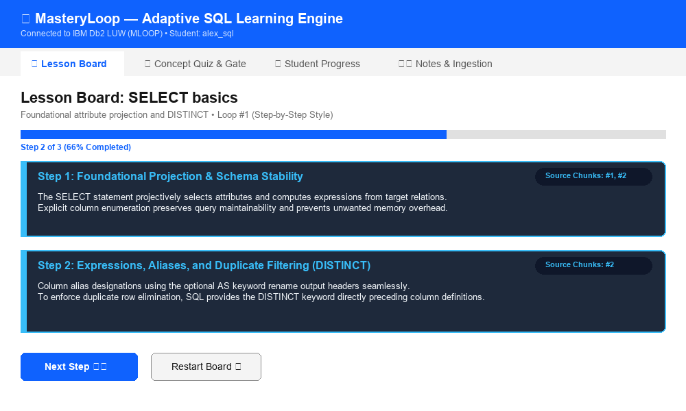
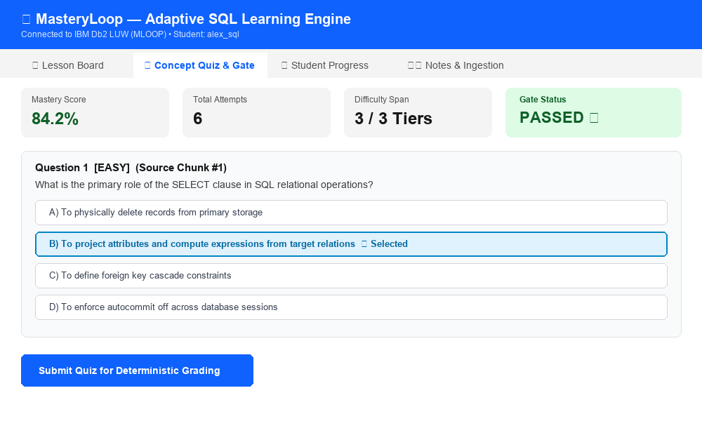
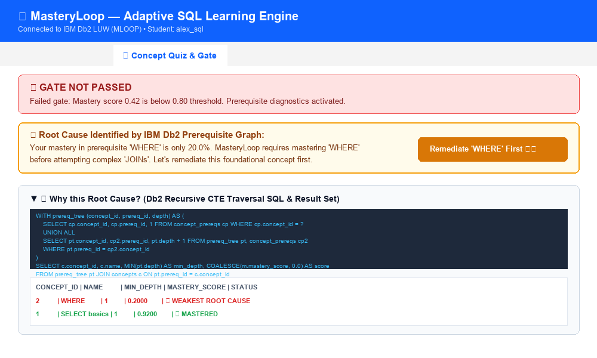
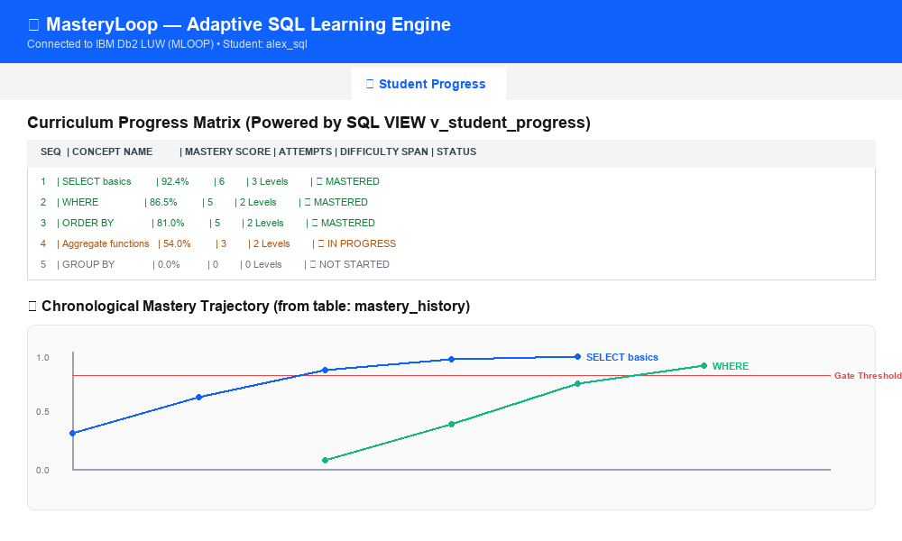

# MasteryLoop (mastree)

> **One-Line Pitch:** MasteryLoop is an open-source adaptive tutor (MIT License) that unites Bloom's mastery learning pedagogy, Google Gemini generative instruction, and IBM Db2 LUW recursive graph analytics to diagnose learning bottlenecks, deliver multi-format instruction, and guide learners to complete conceptual mastery.

---

## Author
- **Author:** Suryakanth ([@Suryakanth25](https://github.com/Suryakanth25))
- **Status:** Solo Participant

---

## Table of Contents
- [What It Does](#what-it-does)
- [The 8-Step MasteryLoop Workflow](#the-8-step-masteryloop-workflow)
- [Three Input Modes](#three-input-modes)
- [Dual Teaching Formats](#dual-teaching-formats)
- [Interactive Visual Schemas](#interactive-visual-schemas)
- [REST API Reference (/docs)](#rest-api-reference-docs)
- [Prerequisites](#prerequisites)
- [Db2 Database Setup (MLOOP Database & User)](#db2-database-setup-mloop-database--user)
- [Setup & Installation](#setup--installation)
- [.env Setup](#env-setup)
- [Running the Project](#running-the-project)
- [Testing & Verification](#testing--verification)
- [Screenshots](#screenshots)
- [IBM Db2 Architecture & Schema Highlights](#ibm-db2-architecture--schema-highlights)
- [Known Limitations and Roadmap](#known-limitations-and-roadmap)
- [Attributions & Credits](#attributions--credits)

---

## What It Does
MasteryLoop is an adaptive tutoring platform designed to eliminate learning plateaus in technical disciplines. Unlike conventional platforms that repeat static questions or offer generic hints when a student fails, MasteryLoop:
1. **Curates and Ingests Knowledge:** Fetches educational articles on any subject from Wikipedia (with optional Google Search grounding via Gemini), parses user-uploaded PDF/Markdown/Text notes, or provides a pre-seeded 9-concept SQL curriculum.
2. **Embeds and Stores in IBM Db2 LUW:** Partitions text into ~120-word chunks, generates embeddings via Google Gemini in a single batched call, and persists them directly in Db2 (`concepts`, `documents`, and `chunks` tables).
3. **Offers Dual Teaching Formats:** Allows learners to select between a progressive step-by-step written **Board** with chunk citations or an interactive **Video Lecture** player with synchronized Web Speech narration, animated flow diagrams, and captions.
4. **Enforces Grounded Pedagogy:** Instructs strictly using retrieved Db2 chunks—citing chunk IDs with zero hallucination.
5. **Assesses Comprehension:** Delivers a deterministic 5-question multiple-choice quiz (easy, medium, hard) verified against source chunks.
6. **Diagnoses Prerequisite Root Causes via Db2 Recursive CTEs:** If a student does not pass the mastery gate ($\ge 80\%$, $\ge 5$ attempts, $\ge 2$ difficulty levels), an IBM Db2 recursive query navigates the prerequisite dependency graph to identify the deepest unmastered ancestor. The student is then guided through targeted remediation in a new pedagogical style (overview, worked example, analogy, step-by-step) in their chosen format.

---

## The 8-Step MasteryLoop Workflow

```
1. Login ─────────► 2. Ingest ─────────► 3. Db2 RAG ─────────► 4. Format
(Username only)     (Wiki/Upload/SQL)    (Store Chunks)       (Board / Video)
       ▲                                                             │
       │                                                             ▼
8. Persistence ◄─── 7. Gate Decision ◄── 6. Assessment ◄────── 5. Grounded
(All in Db2)        (Recursive CTE)      (5 MCQs)              Teaching
```

1. **Passwordless Learner Login:** Student enters a username without password overhead; new students are automatically provisioned in IBM Db2 (`students` table).
2. **Three Flexible Input Modes:**
   - **(a) Search Any Topic:** Free-text query dynamically searched and fetched from Wikipedia via the MediaWiki API (and optional Gemini Google Search grounding).
   - **(b) Attach Notes:** Upload `.txt`, `.md`, or `.pdf` (parsed via `pypdf`) or paste custom notes.
   - **(c) Course (SQL):** Pick from the curated 9-concept SQL curriculum graph.
3. **Non-Blocking Background RAG Ingestion into IBM Db2:** Material is chunked (~120 words), batch-embedded in one call (with keyword retrieval fallback), and stored in Db2 (`concepts`, `documents`, and `chunks` tables) within an atomic transaction. UI polls status and displays: *"Stored N chunks in Db2"*.
4. **Teaching Format Selection:** Learner chooses their preferred format: **"Board"** (step-by-step interactive card deck) or **"Video lecture"** (in-browser narrated classroom player using the Web Speech API, not an exported MP4).
5. **Grounded AI Teaching:** The AI teaches using **ONLY** the retrieved Db2 chunks, displaying explicit citation badges (`#chunk_id`) with zero external hallucination.
6. **Deterministic Assessment:** Student takes a 5-question multiple-choice quiz (A–D, mixed difficulty) generated and verified from the same chunks, evaluated instantaneously without LLM latency.
7. **Mastery Gate & Remediation Loop:**
   - **Mastered ($\ge 80\%$, $\ge 5$ attempts, $\ge 2$ difficulty levels):** Unlocks and recommends the next curriculum topic.
   - **Not Mastered:** Executes an IBM Db2 **Recursive Common Table Expression (CTE)** over the prerequisite graph to diagnose the deepest unmastered ancestor. Re-teaches the prerequisite first (or re-teaches the current concept in a different style: overview $\rightarrow$ worked example $\rightarrow$ analogy $\rightarrow$ step-by-step) in the **same format** chosen by the student, serving new questions. Maximum 3 remediation loops before escalating to *"Needs Human Help"*.
8. **End-to-End Db2 Persistence:** Everything—materials, documents, chunks, lessons, quiz attempts, mastery history, loop events, and optional illustrations—is persisted and audited in IBM Db2 LUW.

---

## Three Input Modes

1. **Search Any Topic (Wikipedia & Web):**
   - Queries the MediaWiki API (`action=query`, `list=search`) with a 10s timeout to return candidate articles.
   - Optional Google Search grounding via Gemini when `GEMINI_WEB_SEARCH=1`.
   - Fetches clean plain text extract, capped at 3000 words / 25 chunks.
   - Allows optional prerequisite linking to existing topics so the Db2 recursive CTE diagnostic engine works for custom topics too.
2. **Attach My Notes (Upload / Paste):**
   - Supports `.txt`, `.md`, and `.pdf` documents (using `pypdf`), or direct pasting into a text area.
   - Prompts for a required Topic Name and optional prerequisite associations.
   - Ingestion runs in a background worker thread with in-memory polling.
3. **Course (SQL Curriculum):**
   - Pre-seeded 9-concept SQL DAG with verified guides and worked example queries.
   - Topological prerequisite hierarchy: `SELECT basics` $\rightarrow$ `WHERE` / `ORDER BY` $\rightarrow$ `Aggregate functions` $\rightarrow$ `GROUP BY` $\rightarrow$ `HAVING` $\rightarrow$ `JOINs` $\rightarrow$ `Subqueries` $\rightarrow$ `Window functions`.

---

## Dual Teaching Formats

- **Board (Step-by-Step):**
  - Card-based progressive deck revealing educational scenes step-by-step with "Next Step" and "Previous Step" buttons.
  - Every step cites source chunk IDs with interactive badges (`#chunk_id`).
  - High-contrast visual styling for both light and dark themes.
- **Video Lecture (In-Browser Narrated Classroom Player):**
  - **Important:** *Video lecture = in-browser narrated lecture player using the Web Speech API, not an exported MP4.*
  - Self-contained 16:9 dark classroom screen rendered with zero external CDN or network dependencies.
  - Animated scene transitions, staggered bullet reveals, glowing key-term badges, and animated process flow diagrams.
  - Voice narration driven by browser `window.speechSynthesis` with auto-advance on utterance completion (and automatic timer fallback with captions if speech is unavailable).
  - Full player controls: Play/Pause, Previous/Next scene, Speed selector (0.8x / 1x / 1.25x), Captions toggle, and Mute.

---

## Interactive Visual Schemas

MasteryLoop generates structured, safe visual objects with zero raw HTML or SVG from the LLM. Visual types:
1. `flow`: Sequential process boxes with arrows (`{"type": "flow", "steps": ["Step 1", "Step 2", ...]}`)
2. `cycle`: Looped phase badges (`{"type": "cycle", "steps": ["Phase A", "Phase B", ...]}`)
3. `hierarchy`: Nested root and children nodes (`{"type": "hierarchy", "root": {"label": "Root", "children": [...]}}`)
4. `compare`: Side-by-side comparison card (`{"type": "compare", "left": {"title": "A", "points": [...]}, "right": {"title": "B", "points": [...]}}`)
5. `timeline`: Chronological events (`{"type": "timeline", "events": [{"label": "Phase 1", "detail": "..."}]}`)
6. `concept_map`: Nodes and directional edges (`{"type": "concept_map", "nodes": [...], "edges": [{"from": "A", "to": "B"}]}`)
7. `equation`: Clean math / SQL syntax formula box with explanation (`{"type": "equation", "latex": "...", "explanation": "..."}`)
8. `bullets`: Fallback structured bullet summary (`{"type": "bullets"}`)

---

## REST API Reference (/docs)

Interactive OpenAPI / Swagger documentation is available at `http://localhost:8000/docs`. All errors conform to the uniform JSON format: `{"error": "<ErrorType>", "detail": "<Human readable description>"}`.

| Method | Endpoint | Description | Request Body / Parameters |
|---|---|---|---|
| `POST` | `/api/login` | Student login / auto-provision | `{"username": "alex"}` |
| `GET` | `/api/courses` | List all curriculum concepts & prereq graph | *None* |
| `POST` | `/api/search` | Search Wikipedia & optional Web grounding | `{"query": "B-Tree", "include_web": false}` |
| `POST` | `/api/ingest` | Queue background ingestion (wiki/web/course) | `{"source_type": "wikipedia", "topic_name": "ACID"}` |
| `POST` | `/api/ingest/upload` | Ingest file (.pdf/.txt/.md) or pasted text | Multipart form (`file`, `text`, `topic_name`, `prereq_ids`) |
| `GET` | `/api/ingest/{job_id}` | Poll background ingestion status & progress | URL path parameter `job_id` |
| `POST` | `/api/lesson` | Synthesize 5-6 scene grounded lesson | `{"student_id": 1, "concept_id": 1, "format": "board", "style": "overview"}` |
| `POST` | `/api/quiz/generate` | Generate 5 verified MCQs (answer key hidden) | `{"concept_id": 1, "student_id": 1}` |
| `POST` | `/api/quiz/answer` | Grade quiz & update Bloom mastery in Db2 | `{"student_id": 1, "concept_id": 1, "answers": [...]}` |
| `POST` | `/api/gate` | Evaluate 3-factor gate & Db2 recursive CTE | `{"student_id": 1, "concept_id": 1, "loop_count": 1}` |
| `GET` | `/api/progress/{student_id}` | Read view `v_student_progress` & history | URL path parameter `student_id` |
| `GET` | `/api/why/{event_id}` | Inspect exact SQL and recursive CTE rows | URL path parameter `event_id` |
| `GET` | `/api/illustration/{lesson_id}` | Serve generated illustration BLOB | URL path parameter `lesson_id` |

---

## Prerequisites
- **Python:** 3.11 or higher (Python 3.12 verified)
- **IBM Db2:** Running instance of IBM Db2 LUW (v11.5 or v12.1 on Windows, Linux, or Docker container)
- **Package Manager:** `pip`

---

## Db2 Database Setup (MLOOP Database & User)

If configuring a fresh IBM Db2 instance:

```bash
# 1. Open the Db2 Command Window (db2cmd on Windows, or su - db2inst1 on Linux)
db2cmd

# 2. Create the MLOOP database
db2 "CREATE DATABASE MLOOP USING CODESET UTF-8 TERRITORY US"

# 3. Connect to MLOOP as administrator
db2 "CONNECT TO MLOOP"

# 4. Grant authority to application user 'mloop' (or db2admin / db2inst1)
db2 "GRANT DBADM, DATAACCESS ON DATABASE TO USER mloop"
db2 "CONNECT RESET"
```

---

## Setup & Installation

```bash
# 1. Navigate to submissions/mastree
cd submissions/mastree

# 2. Create and activate a Python virtual environment
python -m venv .venv

# On Windows:
.venv\Scripts\activate
# On Linux / macOS:
# source .venv/bin/activate

# 3. Install dependencies
pip install -r requirements.txt
```

---

## .env Setup

Copy `.env.example` to `.env`:

```bash
cp .env.example .env
```

Edit `.env` with your local credentials:
```ini
# IBM Db2 LUW Connection Configuration
DB2_HOST=localhost
DB2_PORT=50000
DB2_DATABASE=MLOOP
DB2_USER=mloop
DB2_PASSWORD=your_db2_password_here

# Google Gemini API Settings (Free Tier / Generative AI SDK)
GEMINI_API_KEY=your_gemini_api_key_here
GEMINI_MODEL=gemini-2.5-flash
GEMINI_EMBED_MODEL=gemini-embedding-001

# Optional Operational Flags
DEMO_MODE=0
GEMINI_WEB_SEARCH=0
```

> **Security Note:** Never commit `.env` to Git. `.env.example` contains dummy values only and is tracked in version control.

---

## Running the Project

### 1. Initialize Database Schema & Seed Curriculum
Executes idempotent DDL, creates all 13 tables and view `v_student_progress`, checks `SYSCAT.COLUMNS` for migrations (`is_custom`, `created_by`, `source_type`, `source_url`), and seeds the 9 SQL concepts with 11 prerequisite edges and 28 text chunks:

```bash
python src/init_db.py
```

To wipe all tables completely and start with a 100% clean slate for custom search and uploaded notes:
```bash
python src/init_db.py --clean
```
*(You can also click the **Clean DB** button directly in the application header or call `POST /api/admin/reset`).*

### 2. Verify Db2 Health & Seed Counts (Optional Check)
Confirms table row counts, prerequisite graph integrity, and active Db2 server version:

```bash
python src/check_db.py
```

### 3. Launch the Server & Static Frontend
From the `src/` directory, launch Uvicorn:

```bash
cd src
uvicorn api:app --port 8000
```
Open your browser at `http://localhost:8000` to interact with the application.
Open `http://localhost:8000/docs` to explore the interactive OpenAPI documentation.

---

## Testing & Verification

Run the comprehensive 35-test `pytest` suite:

```bash
pytest tests/ -v
```

The test suite covers:
- **Mastery Formula:** Empty state, single attempt, recency decay calculation ($0.85^{\text{age}}$), and difficulty weights (1.0, 1.5, 2.0).
- **Gate Rule:** Threshold boundary tests, attempt minimums, and difficulty span requirements.
- **Db2 Integration:** Live Db2 engine verification, transactional attempt logging, `v_student_progress` view queries, persistent `llm_cache` storage, and recursive CTE execution with root-cause identification.
- **Chunking Algorithm:** Word count bounds and sentence integrity preservation.
- **Wikipedia Mocking:** MediaWiki search API parsing and extract cleaning with mocked HTTP responses.
- **Scene-JSON Validation:** Strict visual schema validation (`flow`, `cycle`, `hierarchy`, `compare`, `timeline`, `concept_map`, `equation`, `bullets`) and bounds enforcement (narration $\le 45$ words, bullets $\le 4$).
- **FastAPI Smoke Tests:** `TestClient` endpoint verification (`/api/login`, `/api/courses`, `/api/search`, `/api/progress/{id}`, error handling).

---

## Screenshots

The following screenshots in `docs/screenshots/` illustrate key system views:

- **Step-by-Step Lesson Board:** Progressive card deck with chunk citations.
  

- **Concept Assessment & Gate Evaluation:** Instantaneous letter evaluation with mastery gate criteria.
  

- **Db2 Recursive CTE Root Cause Diagnosis:** Automated traversal pinpointing prerequisite gaps.
  

- **Student Progress Matrix:** Real-time completion analytics via SQL VIEW `v_student_progress`.
  

---

## IBM Db2 Architecture & Schema Highlights

- **Db2 LUW Dialect Adherence:**
  - Auto-incrementing primary keys: `INTEGER GENERATED ALWAYS AS IDENTITY PRIMARY KEY`.
  - Recursive CTE: `WITH prereq_tree (concept_id, prereq_id, depth) AS (...)` with **no** `RECURSIVE` keyword, and comma-join syntax in the recursive member to comply with Db2 rule `SQL0345N`.
  - Paging: `FETCH FIRST n ROWS ONLY` instead of `LIMIT`.
  - Parameter markers: Native `?` parameter markers via `ibm_db.prepare` / `ibm_db.execute` to eliminate SQL injection risks.
  - Atomic transactions: Multi-step writes wrapped with autocommit disabled, committing on success or rolling back on exception.
- **Tables (13):** `students`, `concepts`, `concept_prereqs`, `documents`, `chunks`, `lessons`, `questions`, `attempts`, `mastery`, `mastery_history`, `loop_events`, `llm_cache`, `lesson_images`.
- **View (1):** `v_student_progress` cross-joins students with curriculum concepts and computes real-time gate pass status.
- **Rate-Limit & Gemini Cache:** Table `llm_cache` caches generative and embedding outputs by SHA-256 hash (`model::prompt`), enabling cost-free repeat sessions and offline demonstrations with `DEMO_MODE=1`.

---

## Known Limitations and Roadmap

- **Known Limitations:**
  - **Wikipedia Ingestion Latency:** Wikipedia ingestion depends on the Gemini free tier API for batch vector embeddings; embedding long articles can encounter free-tier rate limits (15 RPM). When throttled, the engine falls back to BM25 keyword retrieval.
  - **Web Speech API Voice Variance:** Voice synthesis quality in the Video Lecture depends on the client browser's local OS voices. Subtitles and captions are rendered on screen to ensure accessibility if speech synthesis is muted or unavailable.
- **Roadmap & Future Work:**
  - Multi-source search beyond Wikipedia (e.g. arXiv papers, StackOverflow docs, and GitHub readmes).
  - Illustrated boards with dynamically generated SVG diagrams and animated database execution plans.
  - Custom standalone HTML UI export bundles for LMS (Learning Management System) integration.
  - Interactive SQL sandbox allowing learners to execute live SQL queries directly inside temporary Db2 sessions.
  - Multi-tenant cohort analytics for database instructors using Db2 window functions.

*(Note: Dual teaching formats—step-by-step interactive Boards and in-browser narrated Video Lectures with Web Speech API—and the FastAPI backend with vanilla static frontend are already fully implemented and operational.)*

---

## Attributions & Credits

- **DeepTutor Inspiration:**
  > "Inspired by the teach-and-assess idea in DeepTutor (HKUDS/DeepTutor, Apache-2.0). All code in this project was written from scratch. Wikipedia text is CC BY-SA."
- **Content Licensing:** Wikipedia educational text fetched via the MediaWiki API is licensed under [CC BY-SA 4.0](https://creativecommons.org/licenses/by-sa/4.0/).
- **License:** MasteryLoop is open-source under the [MIT License](LICENSE).
