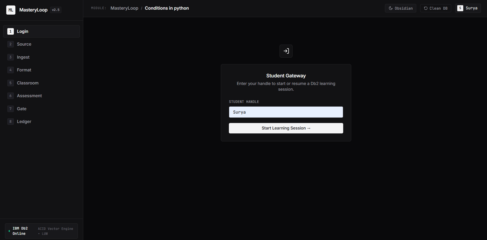
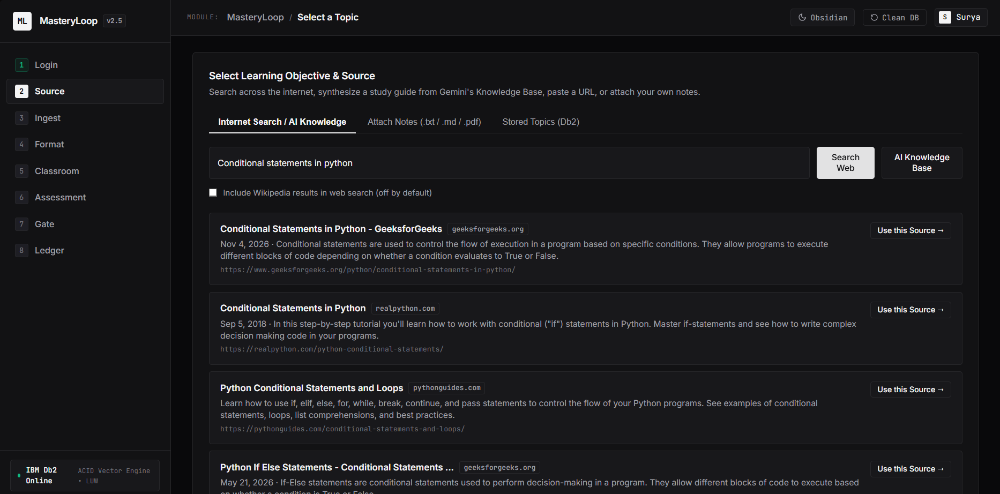
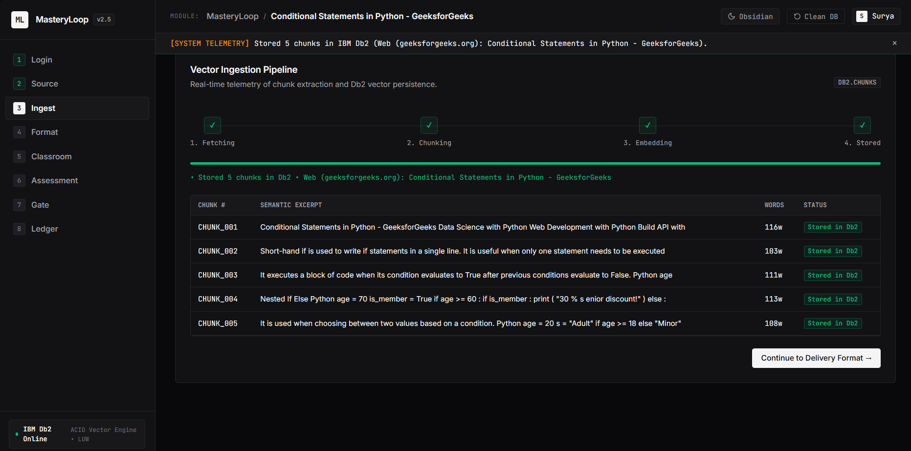
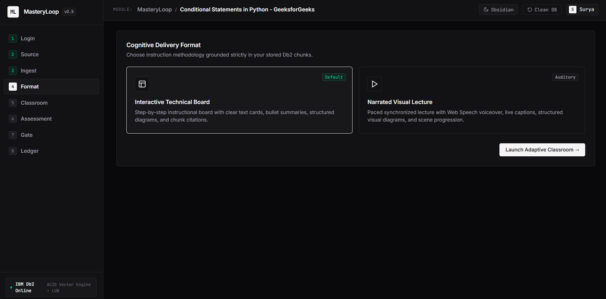
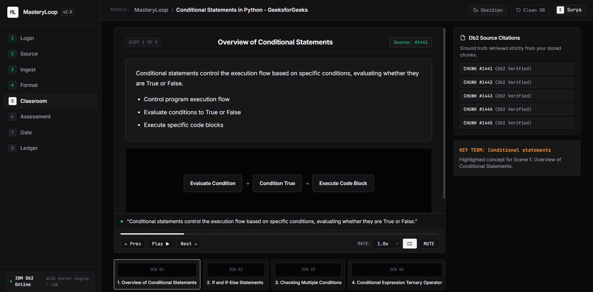
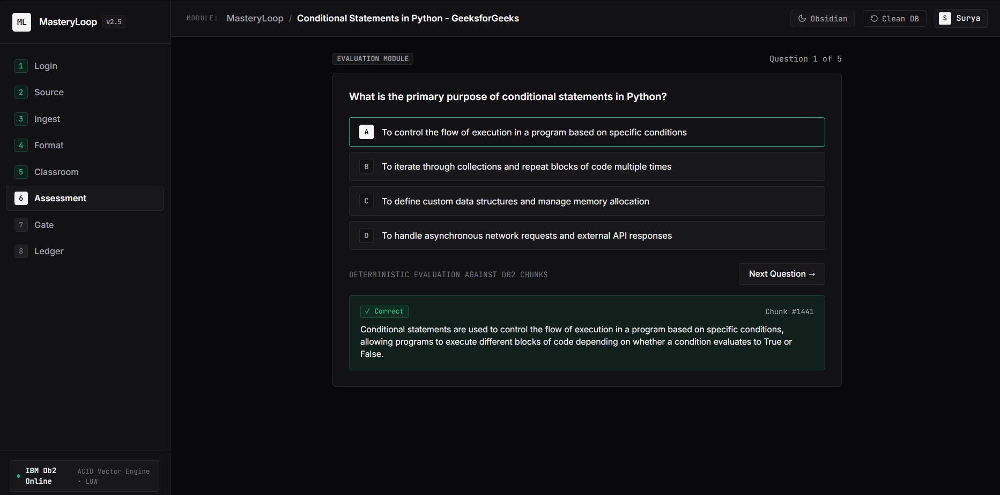
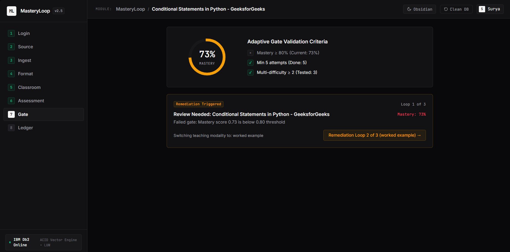
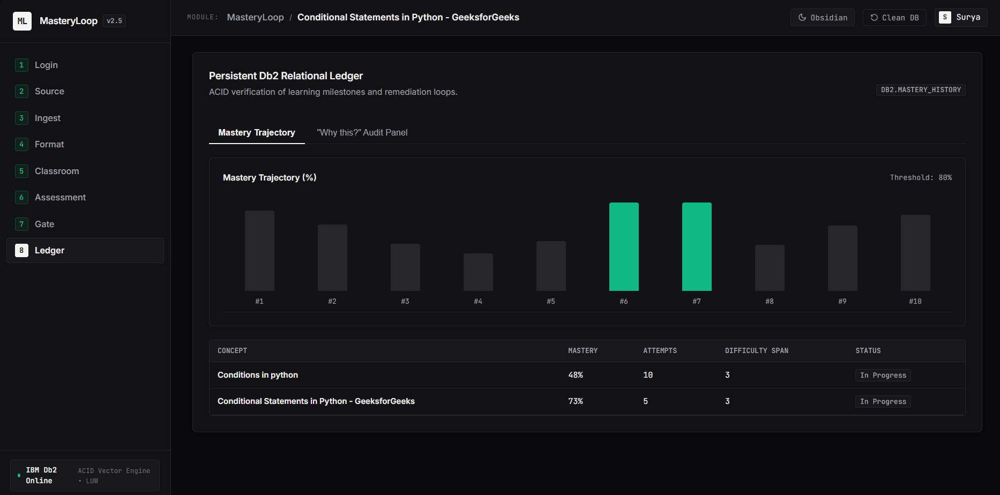

# MasteryLoop (`mastree`)

> **One-Line Pitch:** MasteryLoop is an open-source adaptive learning tutor (MIT License) uniting Bloom's mastery learning pedagogy, Google Gemini generative instruction, open-internet/document RAG, and IBM Db2 LUW recursive graph analytics to diagnose prerequisite gaps and guide learners to verified mastery.

---

## Table of Contents
- [Problem Statement](#problem-statement)
- [Solution Overview](#solution-overview)
- [IBM Db2 Integration](#ibm-db2-integration)
- [AI / LLM Architecture](#ai--llm-architecture)
- [Tech Stack](#tech-stack)
- [Prerequisites](#prerequisites)
- [Db2 Database Setup](#db2-database-setup)
- [Setup & Installation](#setup--installation)
- [Configuration](#configuration)
- [Running the Project](#running-the-project)
- [REST API Reference (/docs)](#rest-api-reference-docs)
- [Testing & Verification](#testing--verification)
- [Screenshots & Demo](#screenshots--demo)
- [Known Limitations & Future Roadmap](#known-limitations--future-roadmap)
- [Team Members & Credits](#team-members--credits)

---

## Problem Statement
- **Static Tutoring Loops:** Traditional e-learning quizzes repeat identical questions on the same surface text when a learner fails, failing to diagnose *which* upstream foundation caused the mistake.
- **Target Audience:** Students, self-taught developers, and technical teams mastering structured programming, databases, or custom study notes.
- **Why Existing Tooling Falls Short:** Most AI tutor prototypes wrap external chat APIs without transactional mastery tracking, verifiable source-chunk citations, deterministic gating rules, or recursive dependency graph analytics in an enterprise relational engine.

---

## Solution Overview
MasteryLoop resolves learning plateaus through an **8-step adaptive workflow** persisted end-to-end in IBM Db2 LUW:

```text
1. Login ─────────► 2. Source ────────► 3. Ingest ────────► 4. Format
(Username only)     (Web / AI KB /      (Chunk & Embed      (Board / Video)
                    URL / Notes / DB)    into Db2)                 │
       ▲                                                           ▼
8. Ledger ◄──────── 7. Gate Rule ◄───── 6. Assessment ◄──── 5. Classroom
(Trajectory &       (Recursive CTE      (5 Verified MCQs)   (Grounded Scenes
 "Why this?" SQL)    Root Cause)                             Citing Chunks)
```

1. **Passwordless Login:** Learners sign in with a handle; records are created or resumed in IBM Db2 (`students`).
2. **Flexible Knowledge Acquisition (`4+` Channels):**
   - **Open-Internet Search:** Queries DuckDuckGo (`ddgs`), Hacker News Algolia, StackExchange API, and OpenAlex open-access papers—excluding Wikipedia by default (with an opt-in checkbox if desired).
   - **Gemini AI Knowledge Base (`ai_kb`):** Synthesizes an 800–1,100-word structured 5-section study guide directly when no external URL or file is needed.
   - **Direct URL / PDF Import (`url`):** Fetches readable content or PDFs directly from any `http(s)://` URL (`10s` HTTP timeout).
   - **Attach Notes (`upload` / `paste`) & Optional Seeded SQL Curriculum (`course`):** Upload `.txt`, `.md`, or `.pdf` files (`pypdf`), paste notes, attach optional prerequisite concepts, or select from stored topics in Db2.
3. **Non-Blocking Background Ingestion into IBM Db2:** Content (capped at `3,000` words / `25` chunks of ~120 words) is batch-embedded in a single call and committed atomically to Db2 (`concepts`, `documents`, `chunks`) while the UI polls live job progress.
4. **Dual Teaching Formats (`format` selector):**
   - **Interactive Technical Board:** Progressive step-by-step instructional cards with structured visual diagrams, code blocks, and verified chunk badges.
   - **Narrated Visual Lecture:** In-browser `16:9` classroom stage driven by Web Speech synthesis (`window.speechSynthesis`), live captions, timeline scrub bar, scene thumbnails, playback speed controls (`0.75x`, `1.0x`, `1.25x`, `1.5x`), Mute, and CC toggles *(in-browser narrated stage, not an exported MP4 file)*.
5. **Grounded 5–6 Scene Pedagogy & 8 Visual Schemas:** Scenes cite verified Db2 `chunk_id`s and render structured visuals (`flow`, `cycle`, `hierarchy`, `compare`, `timeline`, `concept_map`, `equation`, `bullets`)—zero raw LLM HTML/SVG.
6. **Non-Repeating 5-MCQ Assessment:** Synthesizes and audits 5 topic-specific MCQs prioritizing previously untested chunks across loops and blocking repeated stems. Graded deterministically without extra LLM calls.
7. **3-Factor Mastery Gate & Recursive CTE Remediation:**
   - **Pass Rule:** `mastery >= 0.80` AND `attempts >= 5` AND `distinct_difficulties >= 2`.
   - **Recency-Weighted Formula:** Exponential decay (`0.85^age`) × difficulty weight (`easy=1.0`, `medium=1.5`, `hard=2.0`).
   - **Gate Fail Diagnosis:** Executes an IBM Db2 Recursive CTE over `concept_prereqs` to isolate the deepest unmastered ancestor, shifting style across remediation loops (`overview` → `worked example` → `analogy` → `step-by-step`) up to 3 loops before flagging *"Needs Human Help"*.
8. **Persistent Ledger & Explainability:** Displays mastery progression, concept completion matrix (`v_student_progress`), and the exact executed Recursive CTE SQL (`"Why this?"`).

---

## IBM Db2 Integration
- **Db2 Edition & Environment:** IBM Db2 LUW (Community Edition / Enterprise Server v11.5+ / v12.1.x, local or Docker).
- **Connector / Driver Used:** Native Python `ibm_db` driver using parameterized `?` markers (zero raw string interpolation).
- **Database Schema / Data Models ([`src/schema.sql`](src/schema.sql)):**
  - **13 Tables:** `students`, `concepts` (with `is_custom`, `created_by`), `concept_prereqs`, `documents` (`source_type`, `source_url`), `chunks` (text + vector `CLOB`), `lessons`, `questions`, `attempts`, `mastery`, `mastery_history`, `loop_events`, `llm_cache`, and `lesson_images` (`BLOB(5M)`).
  - **12 Indexes** on foreign-key and `(student_id, concept_id)` composite predicates.
  - **1 Analytics View (`v_student_progress`):** Cross-joins `students` × `concepts` with `mastery` to expose live per-concept gate pass indicators.
- **Key Db2 LUW Operations ([`src/db.py`](src/db.py)):**
  - **Recursive CTE (`find_root_cause_prereq`):** Uses strict Db2 LUW syntax (`WITH prereq_tree (concept_id, prereq_id, depth) AS (...)` without the `RECURSIVE` keyword, and comma-join syntax in the recursive member to satisfy rule `SQL0345N`).
  - **Atomic Transactions (`transaction`):** Wraps multi-table writes (`record_attempt_and_update_mastery`, ingestion commits) with `autocommit` disabled, explicit commit, and rollback on error.
  - **Idempotent DDL & Migrations (`src/init_db.py`):** Queries `SYSCAT.TABLES` and `SYSCAT.COLUMNS` before altering tables; uses `IDENTITY_VAL_LOCAL()` and `FETCH FIRST n ROWS ONLY`.

---

## AI / LLM Architecture
- **Framework:** Custom lightweight Python orchestration on the official `google-genai` SDK (**no LangChain**).
- **Model Provider & Failover (`src/ai.py`):**
  - Primary generative model: Google Gemini **`gemini-3.5-flash-lite`** with automatic failover across `gemini-3.5-flash`, `gemini-3.6-flash`, and `gemini-3.8-flash` on `404`/`500`/`503`/`504`/timeout responses (`25s` `HttpOptions` timeout).
  - Embedding model: **`gemini-embedding-001`** in a single batched call per ingestion job (`batch_embed_texts`) using a single pooled Db2 connection for cache reads/writes.
  - Optional image model: `GEMINI_IMAGE_MODEL` stores PNG illustrations into `lesson_images` (`/api/illustration/{lesson_id}`).
- **RAG & Anti-Repetition Workflow:**
  - Open-web search & extraction ([`src/web_search.py`](src/web_search.py)) feeds clean article/PDF chunks into Db2 `chunks`.
  - Vector cosine similarity retrieval with automatic **BM25 keyword fallback** (`retrieve_top_chunks`).
  - Prioritizes unseen chunks across loops on `/api/lesson` and `/api/quiz/generate`, passes `excluded_questions` to avoid repeated quiz stems, audits MCQs in a 1-call verification pass (`_batch_verify_questions`), and caches responses by SHA-256 (`model::prompt`) in `llm_cache` (enabling `DEMO_MODE=1` offline demos and deterministic fallbacks).

---

## Tech Stack
- **Backend / Core:** Python 3.11+ (verified on 3.12), FastAPI, Uvicorn, Pydantic
- **Database:** IBM Db2 LUW via `ibm_db`
- **Frontend / UI:** Static Vanilla HTML5, CSS3 (Swiss Light & Obsidian Dark themes), ES6+ JavaScript, Web Speech API (`window.speechSynthesis`)
- **AI, Search & Document Parsing:** `google-genai`, `ddgs`, `pypdf`, `requests`, `numpy`
- **Testing:** `pytest`, `httpx` (FastAPI `TestClient`)

---

## Prerequisites
- **Python:** 3.11 or higher (verified on Python 3.12)
- **IBM Db2:** Running instance of IBM Db2 LUW (v11.5 or v12.1 on Windows, Linux, or Docker `icr.io/db2_community/db2:latest`)
- **Package Manager:** `pip`
- **Google Gemini API Key:** Free-tier or paid Gemini key (or set `DEMO_MODE=1` for offline fallback/cache evaluation)

---

## Db2 Database Setup

If configuring a fresh IBM Db2 instance:

```bash
# 1. Open Db2 Command Window (db2cmd on Windows, or su - db2inst1 on Linux / Docker container shell)
db2 "CREATE DATABASE MLOOP USING CODESET UTF-8 TERRITORY US"

# 2. Verify connection (default admin user db2inst1, or grant privileges to your dedicated user)
db2 "CONNECT TO MLOOP"
# Optional: db2 "GRANT DBADM, DATAACCESS ON DATABASE TO USER db2inst1"
db2 "CONNECT RESET"
```

---

## Setup & Installation

```bash
# 1. Navigate to the submission directory
cd submissions/mastree

# 2. Create and activate a Python virtual environment
python -m venv .venv
# Linux / macOS:
source .venv/bin/activate
# Windows PowerShell:
# .venv\Scripts\Activate.ps1

# 3. Install dependencies
pip install -r requirements.txt
```

---

## Configuration

Copy `.env.example` to `.env` and fill in your local credentials:

```bash
# Linux / macOS:
cp .env.example .env
# Windows PowerShell:
# Copy-Item .env.example .env
```

Example `.env` variables ([`.env.example`](.env.example)):

```ini
# IBM Db2 LUW Connection Configuration (Dummy placeholders only)
DB2_HOST=localhost
DB2_PORT=50000
DB2_DATABASE=MLOOP
DB2_USER=db2inst1
DB2_PASSWORD=your_db2_password_here

# Google Gemini API Settings (Free Tier / Generative AI SDK)
GEMINI_API_KEY=your_gemini_api_key_here
GEMINI_MODEL=gemini-3.5-flash-lite
GEMINI_EMBED_MODEL=gemini-embedding-001
GEMINI_IMAGE_MODEL=

# Operational Mode (Set DEMO_MODE=1 for offline cache-only demonstration)
DEMO_MODE=0
```

> **Security Warning:** Never commit `.env` or real database passwords/API keys to Git. `.gitignore` excludes `.env`, `.env.*`, `.venv/`, `.pytest_cache/`, and `__pycache__/`.

---

## Running the Project

### 1. Initialize Database Schema (Clean Workspace by Default)
Creates all 13 tables, 12 indexes, and view `v_student_progress` idempotently via `SYSCAT` inspection **without** pre-seeding sample SQL courses:

```bash
python src/init_db.py
```

- **Optional SQL Sample Curriculum:** Seed the 9 SQL concepts, 11 prerequisite edges, and `sql_notes.md` chunks:
  ```bash
  python src/init_db.py --seed
  ```
- **Wipe All Tables Clean:** Clear all user progress, chunks, concepts, and caches completely (also accessible from the UI **Clean DB** button):
  ```bash
  python src/init_db.py --clean
  ```

### 2. Verify Db2 Schema & Connectivity (Optional)
```bash
python src/check_db.py
```

### 3. Launch FastAPI Server & Static Frontend
Run Uvicorn from inside `submissions/mastree/src/`:

```bash
cd src
uvicorn api:app --port 8000
```

- **Web Application:** Open `http://localhost:8000`
- **Interactive Swagger / OpenAPI Docs:** Open `http://localhost:8000/docs`

---

## REST API Reference (/docs)

All errors conform cleanly to `{"error": "<ErrorType>", "detail": "<Human-readable description>"}`.

| Method | Endpoint | Description | Request Body / Parameters |
|---|---|---|---|
| `POST` | `/api/login` | Student login / auto-provision | `{"username": "surya"}` |
| `GET` | `/api/courses` | List stored concepts, `chunk_count`, and prereqs | *None* |
| `POST` | `/api/search` | Open-internet search (opt-in Wikipedia) | `{"query": "Python decorators", "include_web": true, "include_wikipedia": false}` |
| `POST` | `/api/ingest` | Queue background ingestion (`web`/`url`/`ai_kb`/`wikipedia`/`course`/`paste`) | `{"source_type": "ai_kb", "topic_name": "B-Trees", "replace_existing": true}` |
| `POST` | `/api/ingest/upload` | Ingest `.txt`/`.md`/`.pdf` or pasted text | Multipart form (`file`, `text`, `topic_name`, `student_id`, `prereq_ids`) |
| `GET` | `/api/ingest/{job_id}` | Poll ingestion job step, progress & `chunks_preview` | Path parameter `job_id` |
| `POST` | `/api/lesson` | Generate/retrieve 5–6 scene grounded lesson | `{"student_id": 1, "concept_id": 1, "format": "board", "style": "overview", "loop_count": 1}` |
| `POST` | `/api/quiz/generate` | Generate 5 chunk-verified MCQs across unseen chunks | `{"concept_id": 1, "student_id": 1, "loop_index": 1}` |
| `POST` | `/api/quiz/answer` | Grade quiz deterministically & update mastery | `{"student_id": 1, "concept_id": 1, "answers": [...]}` |
| `POST` | `/api/gate` | Evaluate 3-factor gate & execute Db2 Recursive CTE | `{"student_id": 1, "concept_id": 1, "loop_count": 1}` |
| `GET` | `/api/progress/{student_id}` | Read `v_student_progress`, trajectory & `latest_event_id` | Path parameter `student_id` |
| `GET` | `/api/why/{event_id}` | Inspect executed Db2 Recursive CTE SQL & rows | Path parameter `event_id` |
| `GET` | `/api/illustration/{lesson_id}` | Serve PNG illustration `BLOB` from `lesson_images` | Path parameter `lesson_id` |
| `POST` | `/api/admin/reset` | Clear Db2 data (`wipe_all=true` clears concepts too) | `{"wipe_all": true}` |

---

## Testing & Verification

Run the **38-test** `pytest` suite covering mastery math, gate evaluation, live IBM Db2 integration & Recursive CTEs, chunking, mocked web/Wikipedia parsing, visual schema JSON validation, anti-repetition quiz fallbacks, and end-to-end FastAPI smoke flows:

```bash
pytest tests/ -v
```

*(Note: After running tests against your local Db2 database, run `python src/init_db.py --clean` if you want an empty workspace afterward.)*

---

## Screenshots & Demo

- **Hackathon Pitch Deck:** [MasteryLoop_Pitch_Deck.pptx](docs/MasteryLoop_Pitch_Deck.pptx) *(10-slide Swiss & Obsidian presentation deck)*

Captures of the **Obsidian** cockpit UI running against IBM Db2 LUW (`MLOOP`):

- **1. Student Gateway (Login):**
  

- **2. Multi-Source Discovery (Open Internet Search / AI Knowledge Base / Attach Notes):**
  

- **3. Asynchronous RAG Vector Ingestion Pipeline (`DB2.CHUNKS`):**
  

- **4. Cognitive Delivery Format Selection (Technical Board vs. Narrated Visual Lecture):**
  

- **5. Grounded Classroom Stage with Visual Schemas & Db2 Citations:**
  

- **6. Deterministic 5-MCQ Assessment with Source-Chunk Feedback:**
  

- **7. 3-Factor Adaptive Mastery Gate & Loop Remediation:**
  

- **8. Persistent Db2 Relational Ledger (`v_student_progress` & Mastery Trajectory):**
  

---

## Known Limitations & Future Roadmap
- **Current Limitations:**
  - Some JavaScript-heavy client-rendered webpages yield <40 extractable words in plain HTTP GET requests; in those cases the UI directs learners to select another search result, import a PDF/markdown source, or use **AI Knowledge Base** synthesis.
  - Web Speech synthesis (`window.speechSynthesis`) voice quality varies across browser/OS installations (captions and scene progression remain active even when muted).
- **Roadmap:**
  - Server-side neural voiceover (`edge-tts` / Kokoro) with word-level caption synchronization and downloadable MP4 lesson export.
  - Native Db2 `VECTOR` / `VECTOR_DISTANCE` SQL execution for Db2 v12.1.2+ deployments alongside JSON fallback.
  - Live interactive SQL sandbox sessions against isolated temporary schemas.

---

## Team Members & Credits

| Name | GitHub Handle | Role / Contribution |
|---|---|---|
| Suryakanth | [@Suryakanth25](https://github.com/Suryakanth25) | Solo Participant — Full-Stack Architecture, IBM Db2 LUW Schema & Recursive CTEs, RAG & Gemini Engine |

- **Pedagogical Inspiration:** *"Inspired by the teach-and-assess idea in DeepTutor (HKUDS/DeepTutor, Apache-2.0). All code in this project was written from scratch. Wikipedia text (when optionally toggled) is CC BY-SA."*
- **License:** Open-source under the [MIT License](LICENSE).
