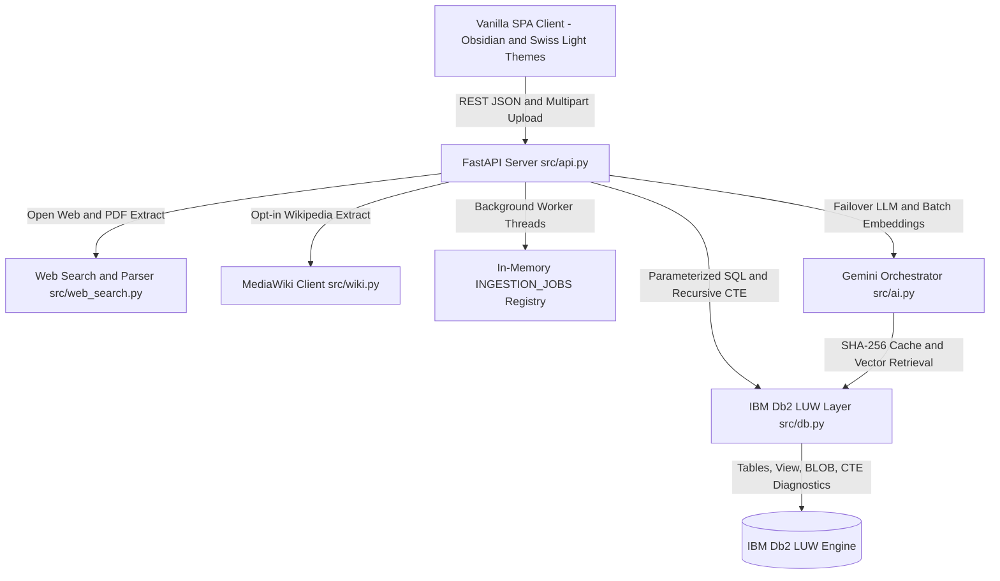

# MasteryLoop System Architecture

## Overview
**MasteryLoop** (project slug: `mastree`) is an open-source adaptive learning platform implementing Benjamin Bloom's mastery learning pedagogy over **IBM Db2 LUW**. Students can learn any topic sourced from **open-internet tutorials/papers (`ddgs`, Hacker News Algolia, StackExchange, OpenAlex)**, **direct webpage or PDF URLs**, **Gemini AI Knowledge Base (`ai_kb`) synthesis**, **uploaded/pasted notes (`.txt`, `.md`, `.pdf`)**, **opt-in Wikipedia**, or an **optional seeded 9-concept SQL curriculum (`--seed`)**.

The application pairs a **FastAPI** REST backend (serving a zero-dependency vanilla HTML5/CSS/JS frontend at `/`) with custom **Google Gemini (`google-genai`) orchestration** and a transactional **IBM Db2 LUW** relational database layer. When a learner misses a mastery gate, Db2 executes a **Recursive Common Table Expression (CTE)** across the prerequisite directed acyclic graph (`concept_prereqs`) to pinpoint the deepest unmastered root cause and trigger style-shifted remediation.

---

## Architecture Diagram



---

## Component Breakdown

1. **User Interface / Client Layer (`frontend/index.html`, `frontend/app.js`)**:
   - Single-page 8-step cockpit (`Login` → `Source` → `Ingest` → `Format` → `Classroom` → `Assessment` → `Gate` → `Ledger`) with Obsidian Dark and Swiss Light CSS themes and high-contrast Technical Board cards.
   - Polls asynchronous ingestion status (`GET /api/ingest/{job_id}`), renders 8 safe visual schemas (`renderVisualHtml`), synchronizes Web Speech API playback (`0.75x`, `1.0x`, `1.25x`, `1.5x`), renders mastery bar charts, and inspects live Recursive CTE SQL (`"Why this?"`).
2. **Application Backend Layer (`src/api.py`)**:
   - Exposes 14 JSON/multipart REST endpoints with uniform `{"error", "detail"}` exception handling, mounts `frontend/` cleanly at `/`, and runs background ingestion workers in daemon threads tracked via `INGESTION_JOBS`.
3. **Database Layer (`src/db.py`, `src/schema.sql`, `src/init_db.py`)**:
   - Native `ibm_db` connector enforcing Db2 LUW conventions: `GENERATED ALWAYS AS IDENTITY`, `IDENTITY_VAL_LOCAL()`, `FETCH FIRST n ROWS ONLY`, `?` parameter markers, atomic `transaction()` contexts (`autocommit` off + rollback), catalog inspection (`SYSCAT.TABLES`, `SYSCAT.COLUMNS`), and non-`RECURSIVE` comma-join CTE traversal (`SQL0345N`-compliant).
4. **AI, Search & Retrieval Layer (`src/ai.py`, `src/web_search.py`, `src/wiki.py`)**:
   - Custom pipeline (**no LangChain**) featuring multi-provider internet search (`ddgs` → HN Algolia → StackExchange → OpenAlex), clean HTML/PDF extraction, Gemini Knowledge Base authoring, ~120-word chunking (capped at `3,000` words / `25` chunks), pooled single-call batch embeddings (`gemini-embedding-001`) with BM25 fallback, `gemini-3.5-flash-lite` failover chain, schema-validated scenes, and 2-pass non-repeating MCQ synthesis + verification backed by `llm_cache`.

---

## Data Flow

1. **Knowledge Acquisition & Background Ingestion**:
   - Client initiates search (`POST /api/search`) or submits a source via `POST /api/ingest` (`web`, `url`, `ai_kb`, `wikipedia`, `course`, `paste`) or `POST /api/ingest/upload` (`.txt`, `.md`, `.pdf`).
   - Background worker fetches text (capped at `3,000` words / `25` chunks of ~120 words), executes one batched `gemini-embedding-001` call (caching vectors in `llm_cache`), optionally cleans prior stale chunks when `replace_existing=true`, and commits `concepts`, `documents`, and `chunks` in a single Db2 transaction.
2. **Grounded Lesson Generation**:
   - `POST /api/lesson` selects top-k chunks scoped strictly to `concept_id` (deprioritizing previously covered chunks on `loop_count > 1`) and synthesizes 5–6 scenes (`<= 45` words narration, `<= 4` bullets, validated `citations` + `visual` schema) in a single cached Gemini call, storing the lesson in Db2 `lessons` (plus optional PNG in `lesson_images`).
3. **Non-Repeating Assessment & Mastery Update**:
   - `POST /api/quiz/generate` prioritizes untested chunks, excludes prior question stems (`excluded_questions`), and verifies 5 MCQs (easy/medium/hard) against cited chunks before saving to `questions`.
   - `POST /api/quiz/answer` deterministically grades selections, inserts into `attempts`, recomputes recency-decay weighted mastery (`0.85^age` × difficulty weight), and atomically updates `mastery` + `mastery_history`.
4. **Gate Evaluation & Recursive Remediation**:
   - `POST /api/gate` checks all 3 criteria (`mastery >= 0.80`, `attempts >= 5`, `distinct_difficulties >= 2`). On failure, Db2 runs `find_root_cause_prereq`, logs `loop_events` with the exact executed SQL query, returns the ancestor chain (`prereq_chain`), and cycles pedagogical styles up to 3 remediation loops.

---

## Dual Teaching Formats & Visual Schemas

- **Interactive Technical Board:** Progressive card deck displaying scene narrative, worked syntax/code blocks, bullet points, visual schema widgets, and interactive `#chunk_id` source badges.
- **Narrated Visual Lecture:** In-browser `16:9` presentation canvas *(not an exported MP4)* pairing structured visual diagrams with browser `window.speechSynthesis`, live captions, Play/Pause, Prev/Next, rate selector (`0.75x`, `1.0x`, `1.25x`, `1.5x`), Mute, and CC toggles.
- **8 Validated Visual Schemas (Zero LLM-authored HTML/SVG):** `flow`, `cycle`, `hierarchy`, `compare`, `timeline`, `concept_map`, `equation`, `bullets`.

---

## IBM Db2 Schema & Storage Design

Defined in [`src/schema.sql`](src/schema.sql) and initialized cleanly (empty workspace by default via `python src/init_db.py`; optional SQL curriculum via `--seed`; full reset via `--clean`):

```sql
-- 13 Core Tables + 12 Indexes + 1 Analytics View

CREATE TABLE students (
    student_id INTEGER GENERATED ALWAYS AS IDENTITY PRIMARY KEY,
    username VARCHAR(100) NOT NULL UNIQUE,
    created_at TIMESTAMP DEFAULT CURRENT_TIMESTAMP
);

CREATE TABLE concepts (
    concept_id INTEGER GENERATED ALWAYS AS IDENTITY PRIMARY KEY,
    name VARCHAR(100) NOT NULL UNIQUE,
    description VARCHAR(500),
    seq_order INTEGER NOT NULL,
    is_custom SMALLINT DEFAULT 0,
    created_by INTEGER,
    created_at TIMESTAMP DEFAULT CURRENT_TIMESTAMP,
    CONSTRAINT fk_concept_creator FOREIGN KEY (created_by) REFERENCES students(student_id) ON DELETE SET NULL
);

CREATE TABLE concept_prereqs (
    concept_id INTEGER NOT NULL,
    prereq_id INTEGER NOT NULL,
    PRIMARY KEY (concept_id, prereq_id),
    CONSTRAINT fk_cp_concept FOREIGN KEY (concept_id) REFERENCES concepts(concept_id) ON DELETE CASCADE,
    CONSTRAINT fk_cp_prereq FOREIGN KEY (prereq_id) REFERENCES concepts(concept_id) ON DELETE CASCADE
);

CREATE TABLE documents (
    doc_id INTEGER GENERATED ALWAYS AS IDENTITY PRIMARY KEY,
    concept_id INTEGER NOT NULL,
    title VARCHAR(200) NOT NULL,
    source VARCHAR(50) NOT NULL,
    source_type VARCHAR(20) DEFAULT 'seed',
    source_url VARCHAR(500),
    content CLOB NOT NULL,
    created_at TIMESTAMP DEFAULT CURRENT_TIMESTAMP,
    CONSTRAINT fk_doc_concept FOREIGN KEY (concept_id) REFERENCES concepts(concept_id) ON DELETE CASCADE
);

CREATE TABLE chunks (
    chunk_id INTEGER GENERATED ALWAYS AS IDENTITY PRIMARY KEY,
    doc_id INTEGER NOT NULL,
    concept_id INTEGER NOT NULL,
    chunk_index INTEGER NOT NULL,
    content CLOB NOT NULL,
    embedding CLOB,
    created_at TIMESTAMP DEFAULT CURRENT_TIMESTAMP,
    CONSTRAINT fk_chunk_doc FOREIGN KEY (doc_id) REFERENCES documents(doc_id) ON DELETE CASCADE,
    CONSTRAINT fk_chunk_concept FOREIGN KEY (concept_id) REFERENCES concepts(concept_id) ON DELETE CASCADE
);

CREATE TABLE lessons (
    lesson_id INTEGER GENERATED ALWAYS AS IDENTITY PRIMARY KEY,
    student_id INTEGER NOT NULL,
    concept_id INTEGER NOT NULL,
    loop_count INTEGER DEFAULT 1,
    style VARCHAR(50) DEFAULT 'step-by-step',
    steps_json CLOB NOT NULL,
    created_at TIMESTAMP DEFAULT CURRENT_TIMESTAMP,
    CONSTRAINT fk_les_student FOREIGN KEY (student_id) REFERENCES students(student_id) ON DELETE CASCADE,
    CONSTRAINT fk_les_concept FOREIGN KEY (concept_id) REFERENCES concepts(concept_id) ON DELETE CASCADE
);

CREATE TABLE questions (
    question_id INTEGER GENERATED ALWAYS AS IDENTITY PRIMARY KEY,
    concept_id INTEGER NOT NULL,
    source_chunk_id INTEGER,
    question_text CLOB NOT NULL,
    option_a VARCHAR(500) NOT NULL,
    option_b VARCHAR(500) NOT NULL,
    option_c VARCHAR(500) NOT NULL,
    option_d VARCHAR(500) NOT NULL,
    correct_letter VARCHAR(2) NOT NULL,
    explanation CLOB NOT NULL,
    difficulty VARCHAR(20) NOT NULL,
    loop_index INTEGER DEFAULT 1,
    created_at TIMESTAMP DEFAULT CURRENT_TIMESTAMP,
    CONSTRAINT fk_q_concept FOREIGN KEY (concept_id) REFERENCES concepts(concept_id) ON DELETE CASCADE,
    CONSTRAINT fk_q_chunk FOREIGN KEY (source_chunk_id) REFERENCES chunks(chunk_id) ON DELETE SET NULL
);

CREATE TABLE attempts (
    attempt_id INTEGER GENERATED ALWAYS AS IDENTITY PRIMARY KEY,
    student_id INTEGER NOT NULL,
    concept_id INTEGER NOT NULL,
    question_id INTEGER NOT NULL,
    selected_letter VARCHAR(2) NOT NULL,
    is_correct SMALLINT NOT NULL,
    difficulty VARCHAR(20) NOT NULL,
    attempt_time TIMESTAMP DEFAULT CURRENT_TIMESTAMP,
    CONSTRAINT fk_att_student FOREIGN KEY (student_id) REFERENCES students(student_id) ON DELETE CASCADE,
    CONSTRAINT fk_att_concept FOREIGN KEY (concept_id) REFERENCES concepts(concept_id) ON DELETE CASCADE,
    CONSTRAINT fk_att_question FOREIGN KEY (question_id) REFERENCES questions(question_id) ON DELETE CASCADE
);

CREATE TABLE mastery (
    mastery_id INTEGER GENERATED ALWAYS AS IDENTITY PRIMARY KEY,
    student_id INTEGER NOT NULL,
    concept_id INTEGER NOT NULL,
    mastery_score DOUBLE NOT NULL,
    attempt_count INTEGER NOT NULL,
    distinct_difficulties INTEGER NOT NULL,
    updated_at TIMESTAMP DEFAULT CURRENT_TIMESTAMP,
    CONSTRAINT uq_stud_concept UNIQUE (student_id, concept_id),
    CONSTRAINT fk_mas_student FOREIGN KEY (student_id) REFERENCES students(student_id) ON DELETE CASCADE,
    CONSTRAINT fk_mas_concept FOREIGN KEY (concept_id) REFERENCES concepts(concept_id) ON DELETE CASCADE
);

CREATE TABLE mastery_history (
    history_id INTEGER GENERATED ALWAYS AS IDENTITY PRIMARY KEY,
    student_id INTEGER NOT NULL,
    concept_id INTEGER NOT NULL,
    mastery_score DOUBLE NOT NULL,
    attempt_id INTEGER,
    recorded_at TIMESTAMP DEFAULT CURRENT_TIMESTAMP,
    CONSTRAINT fk_mh_student FOREIGN KEY (student_id) REFERENCES students(student_id) ON DELETE CASCADE,
    CONSTRAINT fk_mh_concept FOREIGN KEY (concept_id) REFERENCES concepts(concept_id) ON DELETE CASCADE,
    CONSTRAINT fk_mh_attempt FOREIGN KEY (attempt_id) REFERENCES attempts(attempt_id) ON DELETE SET NULL
);

CREATE TABLE loop_events (
    event_id INTEGER GENERATED ALWAYS AS IDENTITY PRIMARY KEY,
    student_id INTEGER NOT NULL,
    concept_id INTEGER NOT NULL,
    event_type VARCHAR(50) NOT NULL,
    gate_passed SMALLINT NOT NULL,
    mastery_score DOUBLE NOT NULL,
    attempt_count INTEGER NOT NULL,
    distinct_difficulties INTEGER NOT NULL,
    root_cause_concept_id INTEGER,
    reason CLOB NOT NULL,
    sql_query CLOB,
    created_at TIMESTAMP DEFAULT CURRENT_TIMESTAMP,
    CONSTRAINT fk_le_student FOREIGN KEY (student_id) REFERENCES students(student_id) ON DELETE CASCADE,
    CONSTRAINT fk_le_concept FOREIGN KEY (concept_id) REFERENCES concepts(concept_id) ON DELETE CASCADE,
    CONSTRAINT fk_le_rc FOREIGN KEY (root_cause_concept_id) REFERENCES concepts(concept_id) ON DELETE SET NULL
);

CREATE TABLE llm_cache (
    cache_key VARCHAR(64) NOT NULL PRIMARY KEY,
    model_name VARCHAR(100) NOT NULL,
    prompt_text CLOB NOT NULL,
    response_text CLOB NOT NULL,
    created_at TIMESTAMP DEFAULT CURRENT_TIMESTAMP
);

CREATE TABLE lesson_images (
    image_id INTEGER GENERATED ALWAYS AS IDENTITY PRIMARY KEY,
    lesson_id INTEGER,
    concept_id INTEGER NOT NULL,
    image_data BLOB(5M) NOT NULL,
    mime_type VARCHAR(50) DEFAULT 'image/png',
    created_at TIMESTAMP DEFAULT CURRENT_TIMESTAMP,
    CONSTRAINT fk_lim_concept FOREIGN KEY (concept_id) REFERENCES concepts(concept_id) ON DELETE CASCADE
);

CREATE VIEW v_student_progress AS
SELECT 
    s.student_id, s.username, c.concept_id, c.name AS concept_name, c.seq_order,
    COALESCE(m.mastery_score, 0.0) AS current_mastery,
    COALESCE(m.attempt_count, 0) AS total_attempts,
    COALESCE(m.distinct_difficulties, 0) AS distinct_difficulties,
    CASE 
        WHEN COALESCE(m.mastery_score, 0.0) >= 0.8 
             AND COALESCE(m.attempt_count, 0) >= 5 
             AND COALESCE(m.distinct_difficulties, 0) >= 2 THEN 1 
        ELSE 0 
    END AS is_mastered,
    m.updated_at AS last_assessed_at
FROM students s
CROSS JOIN concepts c
LEFT JOIN mastery m ON s.student_id = m.student_id AND c.concept_id = m.concept_id;
```

---

## Recursive CTE Prerequisite Root-Cause Query

```sql
WITH prereq_tree (concept_id, prereq_id, depth) AS (
    SELECT cp.concept_id, cp.prereq_id, 1
    FROM concept_prereqs cp
    WHERE cp.concept_id = ?
    UNION ALL
    SELECT pt.concept_id, cp2.prereq_id, pt.depth + 1
    FROM prereq_tree pt, concept_prereqs cp2
    WHERE pt.prereq_id = cp2.concept_id
)
SELECT c.concept_id, c.name, c.seq_order,
       MIN(pt.depth) AS min_depth,
       COALESCE(m.mastery_score, 0.0) AS mastery_score,
       COALESCE(m.attempt_count, 0) AS attempt_count,
       COALESCE(m.distinct_difficulties, 0) AS distinct_difficulties
FROM prereq_tree pt
JOIN concepts c ON pt.prereq_id = c.concept_id
LEFT JOIN mastery m ON m.student_id = ? AND m.concept_id = c.concept_id
GROUP BY c.concept_id, c.name, c.seq_order, m.mastery_score, m.attempt_count, m.distinct_difficulties
ORDER BY mastery_score ASC, min_depth DESC;
```

---

## Security, Attributions & Secrets Management
- **Author:** Suryakanth ([@Suryakanth25](https://github.com/Suryakanth25)), solo participant.
- **Secrets Policy:** Runtime configuration loads via `.env` (excluded by `.gitignore`) while `.env.example` contains dummy placeholders only. All SQL executes with `?` parameter markers to prevent injection.
- **DeepTutor Attribution:** *"Inspired by the teach-and-assess idea in DeepTutor (HKUDS/DeepTutor, Apache-2.0). All code in this project was written from scratch. Wikipedia text (when optionally enabled) is CC BY-SA."*
- **License:** MIT License ([`LICENSE`](LICENSE)).
