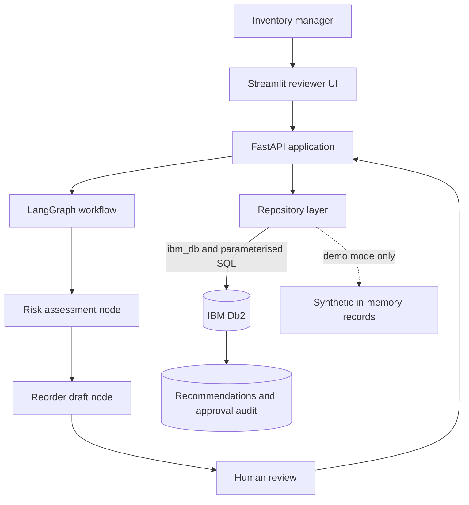

# System Architecture

## Overview

MediFlow AI separates the reviewer interface, API, bounded workflow and data-access layer. IBM Db2 is the operational store when `DATA_BACKEND=db2` is configured. Workflow nodes receive structured records through the repository interface and do not receive database credentials or unrestricted SQL access.

## Architecture diagram

## Component breakdown

1. **Presentation:** Streamlit displays the inventory snapshot, risk explanation, draft quantity and review controls.
2. **API:** FastAPI exposes health, inventory, workflow execution and review endpoints.
3. **Agent workflow:** LangGraph orchestrates deterministic risk assessment and recommendation-draft nodes. It is intentionally bounded and does not execute arbitrary SQL or place purchase orders.
4. **Repository layer:** A common interface selects either synthetic demo data or the IBM Db2 adapter. Db2 values are passed as bound parameters.
5. **Database:** Db2 stores medicine catalogue, suppliers, inventory, batches, usage history, recommendations and approval events.

## Data flow

1. The reviewer opens the dashboard; the API/repository loads an inventory snapshot.
2. The workflow computes days of cover and checks lead-time, reorder-level and expiry thresholds.
3. A draft quantity and explanation are prepared for items with a detected risk.
4. The reviewer explicitly approves or rejects the draft.
5. In Db2 mode, recommendation status and the reviewer action are persisted transactionally as operational and audit records.

## Db2 schema and storage design

The DDL is maintained in `src/db/schema.sql`. Primary/foreign keys maintain relationships across the seven tables. Indexes support batch-expiry, usage-history and recommendation-status lookups. `docs/DB2_SETUP.md` contains illustrative synthetic seed statements.

## Security and safety

- Database credentials are read from local environment variables and must not be committed.
- SQL parameters are bound through `ibm_db` rather than interpolated into query strings.
- Synthetic demo data is clearly labelled; no patient-identifiable data is required.
- Human review is required before a recommendation is marked approved.
- The MVP does not send orders or make clinical decisions.
