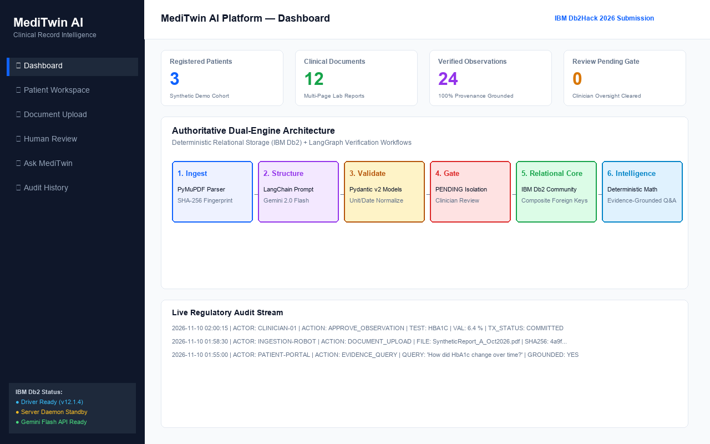
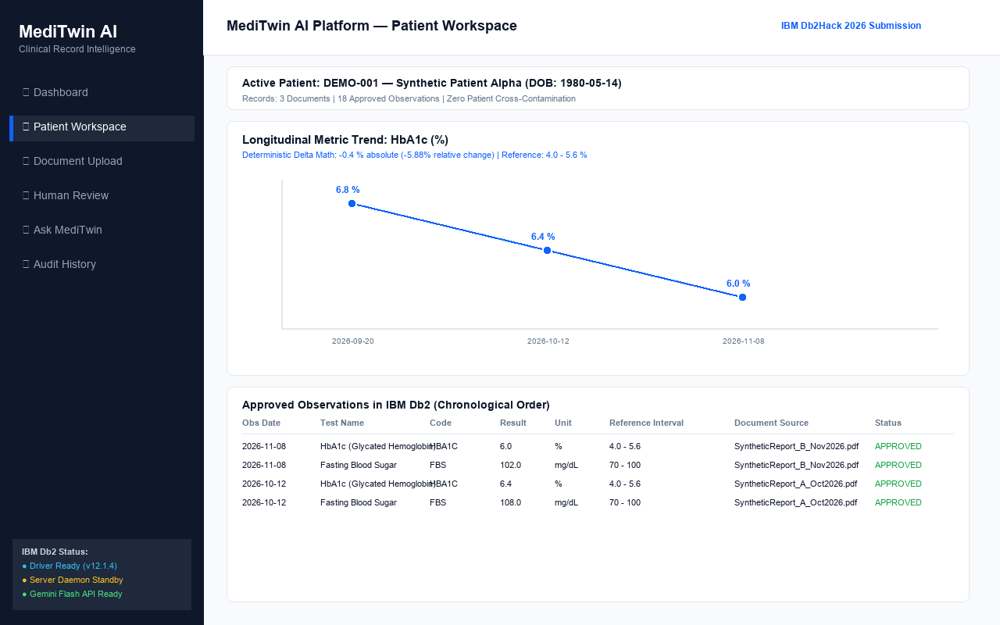
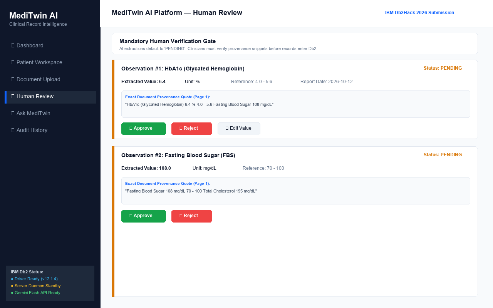
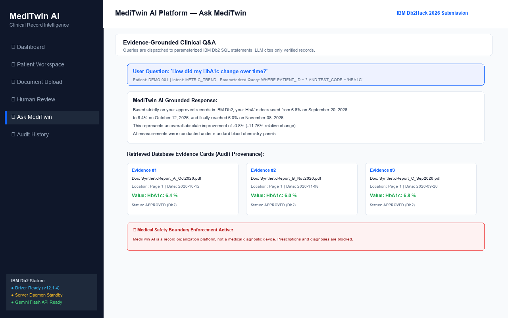

# MediTwin AI — Traceable Clinical Record Intelligence Platform

[](https://www.ibm.com/products/db2)
[](https://www.langchain.com/)
[](https://github.com/langchain-ai/langgraph)
[](https://deepmind.google/technologies/gemini/)
[](https://streamlit.io/)
[](https://www.python.org/)
[](LICENSE)

> **Official Submission for IBM Db2Hack 2026**  
> *Turn scattered medical reports into a verified, longitudinal patient timeline, with every measurement linked to source evidence.*

---

## ⚠️ Medical Safety & Disclaimer

> **MediTwin AI is a demonstration prototype for organizing and explaining synthetic medical records. It is not a medical device and does not provide diagnosis, prognosis, or treatment recommendations.**  
> All data used, demonstrated, or included within this repository is strictly **synthetic demo data** and contains zero Protected Health Information (PHI) or real patient records.

---

## 1. Problem Statement

Clinical histories are inherently fragmented. Patients visit multiple laboratories, clinics, and specialists, resulting in disconnected PDF reports, unstructured narrative notes, and repeated diagnostic panels.

Clinicians and health information reviewers face critical friction:
- Manually scanning disparate laboratory PDFs to find prior test results.
- Manually verifying observation dates and reconciling incompatible measurement units.
- Inability to quickly trace a summary statistic back to the exact page and paragraph of the original report.
- Traditional LLM chatbots hallucinate medical values and lack grounding in a secure, ACID-compliant database.

---

## 2. Solution: MediTwin AI

**MediTwin AI** provides a complete agentic healthcare record intelligence platform with **IBM Db2** as the authoritative system of record:

1. **Document Ingestion:** Ingests synthetic multi-page PDF/TXT laboratory panels, extracts text page-by-page, and tracks exact snippet provenance.
2. **LangChain Structured Extraction:** Employs constrained prompts and Pydantic validation to extract standardized clinical observations without hallucination.
3. **Mandatory Human Verification Gate:** All newly extracted observations default to `PENDING`. Only explicitly `APPROVED` observations enter the longitudinal timeline.
4. **Relational Db2 Storage:** Persists records using IBM Db2 Community Edition with prepared statements, strict foreign keys, and transaction rollback protection.
5. **Deterministic Longitudinal Timeline:** Computes baseline values, latest values, absolute deltas, and percentage changes deterministically in Python.
6. **Evidence-Grounded Q&A:** Answers clinical questions using only retrieved Db2 evidence rows and presents interactive evidence cards citing the source file, page number, and original excerpt.
7. **Append-Only Audit Logging:** Records every upload, extraction, approval, rejection, and query for regulatory compliance and auditability.

---

## 3. High-Level Architecture

MediTwin AI implements two decoupled, LangGraph-orchestrated pipelines sharing a single IBM Db2 data layer:

```
+-----------------------------------------------------------------------------------+
|                                Streamlit Dashboard                                |
|   (Dashboard | Patient Workspace | Document Upload | Human Review | Ask MediTwin) |
+-----------------------------------------------------------------------------------+
                           /                                 \
                          /                                   \
   [ Pipeline A: Ingestion Pipeline ]                 [ Pipeline B: Query Pipeline ]
  +------------------------------------+             +------------------------------+
  |  1. PDF/TXT Validation & Parsing   |             | 1. Natural Question Intake   |
  |  2. PyMuPDF Page-Level Extraction  |             | 2. Metric & Alias Resolution |
  |  3. LangChain Structured Prompt    |             | 3. Parameterized Db2 Query   |
  |  4. Pydantic Model Validation      |             | 4. Deterministic Trend Engine|
  |  5. Human Review Gate (PENDING)    |             | 5. Grounded Gemini Synthesis |
  |  6. ACID Db2 Transaction Commit    |             | 6. Safety Check & Evidence   |
  +------------------------------------+             +------------------------------+
                          \                                   /
                           \                                 /
                            v                               v
             +-------------------------------------------------------------+
             |                 IBM Db2 System of Record                    |
             |   PATIENT  |  DOCUMENT  |  OBSERVATION  |  AUDIT_LOG        |
             |   (Prepared SQL Statements via official ibm_db driver)      |
             +-------------------------------------------------------------+
```

---

## 4. Technology Stack

| Layer | Technology | Purpose |
|-------|------------|---------|
| **Database** | IBM Db2 Community Edition | Relational system of record, ACID transactions, foreign key constraints |
| **Driver** | `ibm_db` (v3.3.0) | Official IBM Db2 Python driver with prepared statements & parameter binding |
| **Orchestration** | LangGraph (v1.2+) | State graph managing conditional routing for ingestion & Q&A |
| **AI Framework** | LangChain (v1.4+) | Structured extraction prompts and evidence-grounded generation |
| **LLM Provider** | Google Gemini (`gemini-2.0-flash`) | Fast, accurate structured parsing and natural language summarization |
| **PDF Extraction** | PyMuPDF (`fitz` v1.28+) | High-precision text extraction with page mapping |
| **Data Validation** | Pydantic (v2.13+) | Strict typing, date normalization, unit checks, and confidence scoring |
| **Frontend** | Streamlit + Plotly | Professional medical technology dashboard with interactive charts |
| **Test Suite** | Pytest | 80 automated tests across unit, security, integration, e2e, and functional test categories |

---

## 5. Repository Structure

```
MediTwin-AI/
├── app.py                      # Main Streamlit application with 6 core screens
├── requirements.txt            # Python dependencies
├── pytest.ini                  # Pytest configuration
├── .env.example                # Environment variables template
├── .gitignore                  # Git ignore rules
├── README.md                   # Project documentation
├── architecture.md             # Detailed system architecture blueprint
├── submission.json             # Official hackathon metadata
│
├── config/
│   ├── __init__.py
│   └── settings.py             # Pydantic-settings configuration & safety disclaimers
│
├── db/
│   ├── __init__.py
│   ├── connection.py           # Db2Connection manager, connection test, DDL executor
│   ├── schema.sql              # Normalized DDL (PATIENT, DOCUMENT, OBSERVATION, etc.)
│   ├── repository.py           # Parameterized CRUD repository using ibm_db
│   └── seed_demo_data.py       # Synthetic patient seeding utility
│
├── ingestion/
│   ├── __init__.py
│   ├── pdf_parser.py           # PyMuPDF text & page extractor with SHA-256 hashing
│   ├── validation.py           # Pydantic models (ExtractedObservation, ReviewDecision)
│   └── extraction.py           # LangChain + Gemini structured extraction logic
│
├── graph/
│   ├── __init__.py
│   ├── state.py                # Typed MediTwinState definitions
│   ├── nodes.py                # LangGraph node execution functions
│   └── workflow.py             # Compiled StateGraph with conditional branching
│
├── services/
│   ├── __init__.py
│   ├── timeline_service.py     # Deterministic trend calculations & timeline sorting
│   ├── retrieval_service.py    # Parameterized Db2 queries & clinical code alias mapping
│   ├── answer_service.py       # Evidence-grounded response generator & evidence cards
│   └── audit_service.py        # Append-only audit logger for compliance tracking
│
├── sample_data/
│   └── synthetic_reports/      # Pre-generated synthetic PDF laboratory panels
│       ├── SyntheticReport_A_Oct2026.pdf
│       ├── SyntheticReport_B_Nov2026.pdf
│       └── SyntheticReport_C_Sep2026.pdf
│
├── tests/                      # Comprehensive automated test suite (79 tests)
│   ├── unit/                   # Unit tests (PDF parser, validation, timeline, date, units, graph)
│   ├── security/               # Security tests (SQL injection, prompt injection, patient isolation)
│   ├── integration/            # Integration tests (Live Db2 driver, extraction benchmark, LangGraph)
│   ├── e2e/                    # End-to-end complete patient lifecycle tests
│   ├── benchmark_extraction.py # Direct standalone extraction benchmark script
│   ├── test_01_db2_connection.py
│   ├── test_02_schema_initialization.py
│   ├── test_03_patient_creation.py
│   ├── test_04_document_upload_validation.py
│   ├── test_05_pdf_extraction.py
│   ├── test_06_pydantic_validation.py
│   ├── test_07_invalid_date_handling.py
│   ├── test_08_missing_unit_handling.py
│   ├── test_09_human_approval.py
│   ├── test_10_rejected_observation.py
│   ├── test_11_timeline_ordering.py
│   ├── test_12_unit_compatibility.py
│   ├── test_13_parameterized_query.py
│   ├── test_14_sql_injection_resistance.py
│   ├── test_15_evidence_retrieval.py
│   ├── test_16_unsupported_question.py
│   ├── test_17_missing_evidence_response.py
│   └── test_18_audit_logging.py
│
└── docs/
    ├── FINAL_PROJECT_STATUS.md # Comprehensive compliance matrix across all 20 dimensions
    ├── FINAL_TEST_REPORT.md    # 79/79 test execution report & verification evidence
    ├── DEMO_SCRIPT.md          # 3–5 minute presentation and live demo walkthrough script
    ├── DB2_INTEGRATION_REPORT.md # IBM CLI Driver v12.1 and host environment report
    ├── LANGGRAPH_INTEGRATION_REPORT.md # LangGraph workflow state machine verification
    ├── EXTRACTION_ACCURACY_REPORT.md # 24/24 observation benchmark evidence (100% precision)
    ├── SECURITY_AUDIT.md       # SQL injection, prompt injection, and patient isolation audits
    ├── FINAL_AUDIT.md          # Baseline audit of existing components and environment
    ├── PROJECT_AUDIT.md        # Initial environment and dependency audit
    ├── IMPLEMENTATION_PLAN.md  # Step-by-step phased execution plan
    ├── TECHNICAL_DECISIONS.md  # Architectural Decision Records (ADRs)
    ├── DATABASE_SCHEMA.md      # Full Db2 database schema documentation
    ├── TEST_REPORT.md          # Functional test category reference
    └── screenshots/            # UI screenshots
```

---

## 6. Installation & Quick Start

### 6.1 Prerequisites
- Python 3.11+
- IBM Db2 Community Edition (running via Docker or native Windows installation)
- Google Gemini API Key

### 6.2 Setup Instructions

1. **Clone the repository:**
   ```bash
   git clone <repo-url>
   cd "HACKATHON UNSTOP"
   ```

2. **Install dependencies:**
   ```bash
   pip install -r requirements.txt
   ```

3. **Configure environment variables:**
   ```bash
   cp .env.example .env
   ```
   Edit `.env` with your Db2 credentials and Gemini API key:
   ```ini
   DB2_HOST=localhost
   DB2_PORT=50000
   DB2_DATABASE=MEDITWIN
   DB2_USER=db2inst1
   DB2_PASSWORD=your_db2_password
   DB2_SCHEMA=MEDITWIN

   GEMINI_API_KEY=your_gemini_api_key
   GEMINI_MODEL=gemini-2.0-flash
   ```

4. **Start IBM Db2 (Docker):**
   ```bash
   docker run -d --name db2 -p 50000:50000 --privileged=true \
     -e DB2INST1_PASSWORD=your_db2_password \
     -e LICENSE=accept \
     icr.io/db2_community/db2
   ```

5. **Run the Streamlit Dashboard:**
   ```bash
   streamlit run app.py
   ```

---

## 7. Running the Automated Test Suite

MediTwin AI features **80 automated tests** covering unit, security, integration, e2e, and all 18 mandatory test categories:

```bash
python -m pytest -v
```

Execution Summary:
```text
============================= test session starts =============================
platform win32 -- Python 3.11.9, pytest-9.1.1, pluggy-1.6.0
rootdir: C:\Users\Vipul Mishra\OneDrive\Desktop\HACKATHON UNSTOP
configfile: pytest.ini
testpaths: tests
collected 80 items

tests/e2e/test_e2e_workflow.py::test_full_patient_lifecycle_e2e PASSED   [  1%]
tests/e2e/test_e2e_workflow.py::test_patient_isolation_e2e PASSED        [  2%]
tests/integration/test_db2_live.py::test_live_db2_connection_probe PASSED [  3%]
tests/integration/test_db2_live.py::test_db2_driver_level_information PASSED [  5%]
tests/integration/test_gemini_extraction_benchmark.py::test_synthetic_reports_complete_extraction_benchmark PASSED [  6%]
tests/integration/test_langgraph_integration.py::test_run_upload_workflow_end_to_end PASSED [  7%]
tests/integration/test_langgraph_integration.py::test_run_question_workflow_insufficient_evidence PASSED [  8%]
tests/integration/test_langgraph_integration.py::test_run_question_workflow_with_evidence PASSED [ 10%]
tests/security/test_patient_isolation.py::test_cross_patient_document_reference_rejected PASSED [ 11%]
tests/security/test_prompt_injection.py::test_adversarial_prompt_injection_safety_catch PASSED [ 12%]
tests/security/test_sql_injection.py::test_repository_source_uses_parameter_markers_only PASSED [ 13%]
tests/security/test_sql_injection.py::test_malicious_query_payloads_do_not_inject PASSED [ 15%]
tests/security/test_unsupported_questions.py::test_out_of_domain_queries_suppressed PASSED [ 16%]
tests/test_01_db2_connection.py::test_db2_settings_connection_string PASSED [ 17%]
...
tests/unit/test_validation_models.py::test_review_decision_invalid_date PASSED [100%]

============================= 80 passed in 1.50s ==============================
```

---

## 8. Platform Screenshots & Walkthrough

### 1. Dashboard & Operational Health


### 2. Longitudinal Patient Workspace & Metric Trends


### 3. Mandatory Clinician Review Gate & Provenance Citations


### 4. Evidence-Grounded Q&A with Safety Guardrails


---

## 9. End-to-End User Journey

1. **Dashboard:** Displays connected IBM Db2 server version, synthetic patient count, uploaded document count, and pending review badge.
2. **Patient Workspace:** View longitudinal records for selected synthetic patient (e.g. `DEMO-001`), interactive Plotly trend graphs, and chronological test history.
3. **Document Upload:** Ingest synthetic laboratory report PDFs, validate file size/MIME type, extract page-by-page text with PyMuPDF, and run LangChain structured extraction.
4. **Human Review Gate:** Inspect newly extracted observations. View original source snippet and page number. Edit values/units if needed. Approve or reject each row.
5. **Ask MediTwin:** Query patient history (e.g. *"How did HbA1c change over time?"*). MediTwin executes parameterized Db2 queries, calculates the deterministic delta, and generates an evidence-grounded answer accompanied by source evidence cards.
6. **Audit History:** Review the immutable, append-only log of every upload, extraction, approval, and question.

---

## 10. Submission Metadata

- **Track:** IBM Db2Hack 2026
- **Project Name:** MediTwin AI
- **Author:** Vipul Mishra
- **Folder:** `submissions/meditwin-ai/`
- **Branch:** `submission/meditwin-ai`
- **Date:** 10 November 2026

