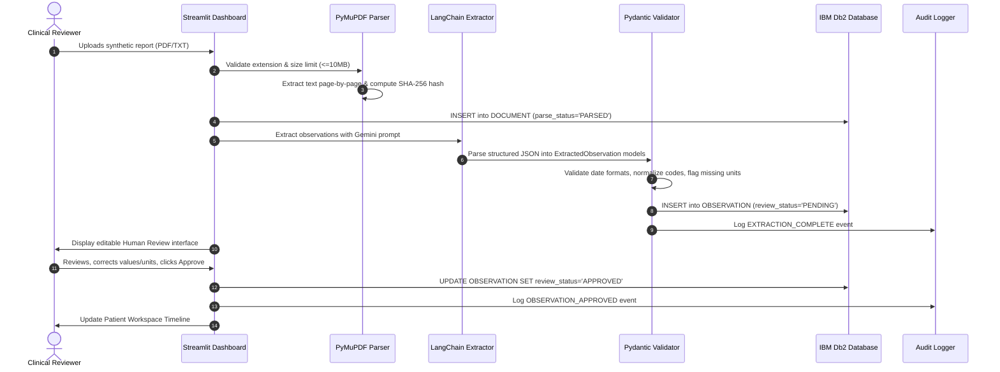
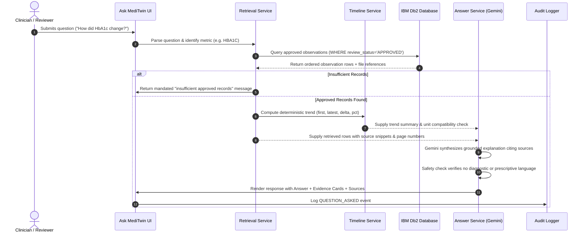
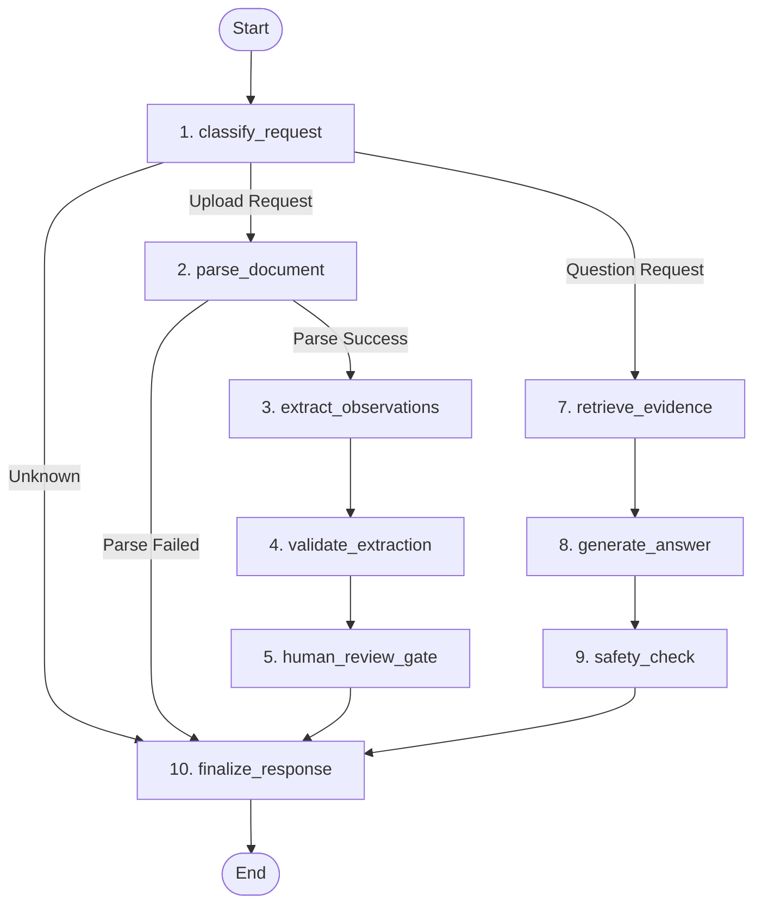
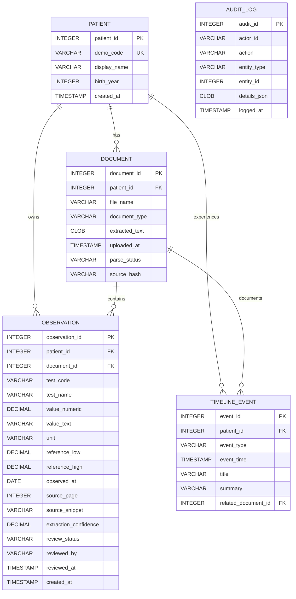

# MediTwin AI — System Architecture Specification

## 1. Executive Summary

**MediTwin AI** is a clinical record intelligence platform engineered for **IBM Db2Hack 2026**. It solves a fundamental problem in modern digital health: clinical data is fragmented across disconnected laboratory PDFs, physician notes, and repeated diagnostic panels. Clinicians and reviewers spend substantial time manually comparing dates, reconciling incompatible units, and hunting for source documentation.

MediTwin AI bridges this gap by converting unstructured synthetic medical documents into a verified, longitudinal patient timeline where **every observation is permanently linked to its exact document, page, and text snippet**.

```
                           +-------------------------------------+
                           |            Streamlit UI             |
                           +-------------------------------------+
                                      /               \
                                     /                 \
                     [ Pipeline A: Ingestion ]   [ Pipeline B: Intelligence ]
                                   v                     v
                        +--------------------+  +--------------------+
                        |      LangGraph     |  |      LangGraph     |
                        | Ingestion Workflow |  |    Query Workflow  |
                        +--------------------+  +--------------------+
                                   |                     |
                        +--------------------+  +--------------------+
                        |  LangChain + LLM   |  | Parameterized Query|
                        |   Extraction &     |  |     Templates      |
                        | Pydantic Validator |  |   (Zero Dynamic)   |
                        +--------------------+  +--------------------+
                                   |                     |
                        +--------------------+           |
                        | Human Review Gate  |           |
                        | (PENDING->APPROVED)|           |
                        +--------------------+           |
                                   \                     /
                                    \                   /
                                     v                 v
                           +-------------------------------------+
                           |         IBM Db2 System of Record    |
                           |   (ibm_db Prepared Transactions)    |
                           +-------------------------------------+
```

---

## 2. Core Architectural Principles

1. **IBM Db2 as Authoritative System of Record:** The database is the single source of truth. The LLM performs language extraction and summarization, never factual record keeping.
2. **Deterministic Computation:** Longitudinal trends (absolute change, percentage delta) are computed deterministically in Python rather than entrusted to LLM arithmetic.
3. **Mandatory Human-in-the-Loop Gate:** All newly extracted observations default to `PENDING`. Only `APPROVED` records enter trusted timelines and evidence-grounded Q&A.
4. **Zero Dynamic SQL:** The LLM is never provided database credentials and never generates executable SQL. All queries use pre-compiled prepared statements with parameter markers (`?`).
5. **Strict Provenance:** Every observation retains `source_document`, `source_page`, and `source_snippet`.
6. **Medical Safety Safeguards:** Strict enforcement of synthetic demo data, no autonomous disease diagnosis, no medication prescribing, and explicit clinical disclaimers.

---

## 3. Detailed Data Pipelines

### Pipeline A: Document Ingestion & Verification



#### Step Details:
1. **Validation:** Checks MIME type, PDF/TXT extension, and 10MB file size ceiling.
2. **Page Mapping:** PyMuPDF segments text by individual page number (1-indexed) and preserves character offsets.
3. **LangChain Extraction:** A constrained prompt instructs Gemini to output a strict JSON array of observations with source snippets.
4. **Pydantic Validation:** `ExtractedObservation` validates that:
   - Dates are standardized to `YYYY-MM-DD` and not in the distant future.
   - Test codes are normalized to standard identifiers (`HBA1C`, `FBS`, `CHOL`, `TSH`, etc.).
   - Values with missing units or dates trigger `needs_review=True`.
5. **Human Review Gate:** Observations are staged in Db2 with `PENDING` status. The clinician reviews side-by-side with document excerpts and can edit values before approving.

---

### Pipeline B: Patient Intelligence & Evidence Q&A



#### Step Details:
1. **Query Template Selection:** Standard clinical aliases map natural phrasing to verified metrics (`HbA1c` -> `HBA1C`, `fasting sugar` -> `FBS`).
2. **Parameterized Retrieval:** `SELECT ... FROM OBSERVATION WHERE patient_id = ? AND test_code = ? AND review_status = 'APPROVED' ORDER BY observed_at ASC`.
3. **Deterministic Trend Calculation:** Calculates first recorded value, latest recorded value, absolute difference, and percentage delta. Verifies unit compatibility before calculating.
4. **Grounded Generation:** Gemini receives only retrieved database rows and computed metrics. It cannot query external knowledge to speculate on patient health.
5. **Evidence Display:** Every returned fact renders with an expandable evidence card displaying test name, value, unit, date, source file, page number, and original snippet.

---

## 4. LangGraph Workflow Architecture

MediTwin AI employs a unified, typed `StateGraph` with explicit conditional branching:



State is managed by a typed `MediTwinState` model preserving complete execution context, intermediate payloads, validation flags, and audit traces.

---

## 5. IBM Db2 Database Schema Architecture

The relational schema is implemented in `db/schema.sql`:



### Key Database Guarantees:
- **Foreign Key Cascades:** Deleting a synthetic test patient automatically purges dependent documents and observations.
- **Append-Only Audit Log:** `AUDIT_LOG` has no foreign key cascade and no update/delete procedures.
- **Check Constraints:** `review_status IN ('PENDING', 'APPROVED', 'REJECTED')`, `parse_status IN ('PENDING', 'PARSED', 'FAILED')`.
- **Prepared Execution:** All CRUD operations in `db/repository.py` use prepared statements with positional parameters (`?`).

---

## 6. Security, Compliance & Medical Safety

| Requirement | Implementation Detail |
|-------------|-----------------------|
| **Synthetic Data Only** | Strict use of artificial identifiers (`DEMO-001`, `DEMO-002`, `DEMO-003`). No PHI/PII stored. |
| **No Autonomous Diagnosis** | LLM temperature set to 0.1–0.2; prompt explicitly restricts output to reporting stored values. |
| **Safety Filter Node** | `safety_check` node inspects generated text for diagnostic or prescriptive keywords and appends mandatory disclaimers. |
| **Zero SQL Injection** | No SQL string concatenation. Repository uses prepared statements exclusively. |
| **Credential Protection** | Database credentials and API keys stored in `.env`; omitted from Git and prompts. |
| **Traceability** | 100% of approved observations link to source document, page, and snippet. |

