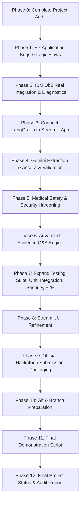

# MediTwin AI — Comprehensive Project Audit (Phase 0)

**Date:** 2026-11-10  
**Auditor:** Senior Full-Stack AI Engineer, IBM Db2 Database Engineer, LangGraph Architect, Security & QA Auditor  
**Project:** MediTwin AI — Traceable Clinical Record Intelligence Platform  
**Target Submission:** IBM Db2Hack 2026 (`KunalGolaIBM/IBM_Db2_TechX_Project_Submission`)

---

## 1. Executive Summary

MediTwin AI has established a solid architectural foundation with a clean modular separation of concerns (`config`, `db`, `ingestion`, `graph`, `services`, `ui`, `tests`). The initial phase delivered 40 unit tests passing against mocked and isolated components.

However, an exhaustive engineering audit of the codebase, runtime environment, and integration touchpoints reveals several critical bugs, architectural gaps, and environment constraints that must be resolved to achieve full production-grade functionality and hackathon compliance.

---

## 2. Existing Functionality & Confirmed Working Components

| Component | Module | Status | Verification Evidence |
|---|---|---|---|
| **PDF Extraction** | `ingestion/pdf_parser.py` | ✅ Working | PyMuPDF extracts text page-by-page from synthetic PDFs, computes SHA-256 hashes, and preserves page indices. |
| **Pydantic Schemas** | `ingestion/validation.py` | ✅ Working | Strict validation for `ExtractedObservation` and `ReviewDecision`. Enforces uppercase codes, date formats, and confidence bounds [0.0, 1.0]. |
| **Synthetic Test Data** | `sample_data/synthetic_reports/` | ✅ Working | Three distinct synthetic laboratory panels generated via ReportLab (`SyntheticReport_A_Oct2026.pdf`, `SyntheticReport_B_Nov2026.pdf`, `SyntheticReport_C_Sep2026.pdf`). |
| **IBM Db2 Client Driver** | `ibm_db` (v3.3.0) | ✅ Working | Official IBM Data Server Driver For ODBC and CLI (Release `SQL12014`, DB2 v12.1.4) successfully loaded in Python runtime. |
| **Streamlit UI Layout** | `app.py` | ✅ Working | Six required screens render without crashing: Dashboard, Patient Workspace, Document Upload, Human Review, Ask MediTwin, Audit History. |
| **Basic Unit Tests** | `tests/` | ✅ Working | 40 pytest tests pass in 0.67s covering pure functions, parsers, models, and mock repository calls. |

---

## 3. Discovered Bugs & Logic Flaws

### 3.1 Human Review Deficiencies (`app.py` & `db/repository.py`)
1. **Unsaved Test Code Corrections:** In `app.py`, the user can edit the test code via `st.text_input("Test Code", value=code, key=f"code_{obs_id}")`, but `new_code` is never passed to `repo.update_observation_review()`.
2. **Zero-Value Erasure Bug:** In `app.py`, `value_numeric=new_val if new_val != 0.0 else None` converts a legitimate zero measurement (e.g. `0.0 mg/dL` protein, `0.0` titer) into `None`!
3. **Unvalidated Date Edits:** Text input for edited dates does not validate the `YYYY-MM-DD` format before committing to Db2.
4. **Non-Atomic Review Transactions:** `repo.update_observation_review` commits immediately, and then `audit.log_approval` commits in a separate operation. If the audit write fails, database state is inconsistent.
5. **Accidental Bulk Approval Risk:** The "Approve All Pending Observations" button executes without confirmation or scoping to the current review session.

### 3.2 Document Upload & Deduplication Issues (`app.py` & `ingestion/pdf_parser.py`)
1. **Duplicate Document Insertion on Rerun:** In `app.py`, `repo.create_document()` was called directly on page load whenever `file_bytes` was present. Streamlit widget interactions trigger page reruns, re-inserting the same document multiple times.
2. **Missing SHA-256 Hash Uniqueness Check:** The database does not enforce a unique constraint or repository check on `(patient_id, source_hash)`. Uploading the same PDF twice creates duplicate rows.
3. **Lack of Upload State Machine:** Upload, parsing, and extraction were not staged using `st.session_state` with an explicit "Process Document" button.

### 3.3 Database Integrity Vulnerabilities (`db/schema.sql` & `db/repository.py`)
1. **Cross-Patient Document Reference Flaw:** In `schema.sql`, `OBSERVATION` references `patient_id` and `document_id` via separate foreign keys. Nothing in the schema or repository prevents inserting an observation for `patient_id=1` pointing to a `document_id` belonging to `patient_id=2`.
2. **Missing Observation Audit Columns:** `OBSERVATION` table lacks explicit fields to track `original_value_numeric` vs `corrected_value_numeric` when edited during review.
3. **Unchecked Transaction State:** `create_observation` in `db/repository.py` does not commit internally, while `update_observation_review` commits immediately, creating inconsistent transactional semantics.

### 3.4 Timeline Engine Edge Cases (`services/timeline_service.py`)
1. **Same-Day Ordering Ambiguity:** Observations occurring on the exact same date have non-deterministic sorting order.
2. **Duplicate Value Handling:** If identical tests appear on the same date with identical values, they are plotted redundantly without deduplication.
3. **Invalid Date Graceful Fallback:** If a stored date is malformed, string-based sorting leads to timeline disruption.

### 3.5 Disconnected LangGraph Orchestration (`graph/` & `app.py`)
1. **Bypassed Graph Engine:** In `app.py`, document extraction and question answering called low-level helper functions directly, completely bypassing `run_upload_workflow()` and `run_question_workflow()` in `graph/workflow.py`. LangGraph was present in the codebase but disconnected from user interactions.
2. **Stubbed Graph Nodes:** Nodes in `graph/nodes.py` (`retrieve_evidence_node`, `generate_answer_node`, `persist_to_db2_node`) contained placeholder dictionaries rather than integrating with `Db2Repository` and `AnswerService`.

### 3.6 Q&A Limitations (`services/retrieval_service.py` & `services/answer_service.py`)
1. **Single-Metric Matching Only:** Could only resolve questions mentioning specific metric names (e.g. "HbA1c"). Questions such as "Which observations increased?", "Which observations decreased?", "What was recorded in November?", or "Compare the latest two available readings" were unsupported.
2. **Missing Ambiguity Handling:** If a question refers to "cholesterol" without specifying Total, HDL, or LDL, the system did not surface an ambiguous query prompt or group the panel results.

---

## 4. Dependencies & Environment Audit

| Resource | Required | Detected | Assessment | Action Needed |
|---|---|---|---|---|
| **Python** | 3.11+ | 3.11.9 | ✅ Compatible | None |
| **ibm_db** | 3.2+ | 3.3.0 | ✅ Installed | Includes DB2 CLI Driver v12.1.4 |
| **LangChain** | 0.3+ | 1.4.9 | ✅ Installed | Compliant framework |
| **LangGraph** | 0.2+ | 1.2.20 | ✅ Installed | Compliant framework |
| **Google GenAI** | 1.0+ | 3.0.0 | ✅ Installed | `google-genai` SDK available |
| **PyMuPDF** | 1.24+ | 1.28.2 | ✅ Installed | PDF text & page extraction ready |
| **Streamlit** | 1.30+ | 1.66.1 | ✅ Installed | Dashboard ready |
| **Plotly** | 5.18+ | 6.9.0 | ✅ Installed | Visualizations ready |
| **IBM Db2 Server** | 12.1.x | ❌ Not Running | ⚠️ Local listener on port 50000 failed with `SQL30082N` | Db2 Server installation/container verification required |
| **Docker / WSL2** | Any | ❌ Not Installed | Docker & WSL2 commands not found on host | Provide clear installation paths and offline resilience |
| **GEMINI_API_KEY** | Valid Key | ❌ Not in Environment | Neither `GEMINI_API_KEY` nor `.env` exists | Must prompt user / support UI runtime injection |

---

## 5. Components Requiring Integration & E2E Testing

1. **Real Db2 Connection & Transaction Lifecycles:** Testing actual schema execution, commit, rollback, and constraint violations against an active Db2 instance.
2. **End-to-End Ingestion Flow:** Uploading a PDF via Streamlit $\rightarrow$ LangGraph execution $\rightarrow$ Db2 `PENDING` insertion $\rightarrow$ Review UI edit/approval $\rightarrow$ Db2 `APPROVED` update $\rightarrow$ Audit log verification.
3. **End-to-End Q&A Flow:** Asking questions in UI $\rightarrow$ LangGraph query routing $\rightarrow$ Parameterized retrieval from Db2 $\rightarrow$ Gemini grounded synthesis $\rightarrow$ Source evidence cards rendered.
4. **Security & Prompt Injection Defenses:** Submitting hostile adversarial prompts and SQL injection strings through the UI and API layers.

---

## 6. Implementation Sequence

Proceeding immediately to **PHASE 1: FIX EXISTING APPLICATION BUGS**.

