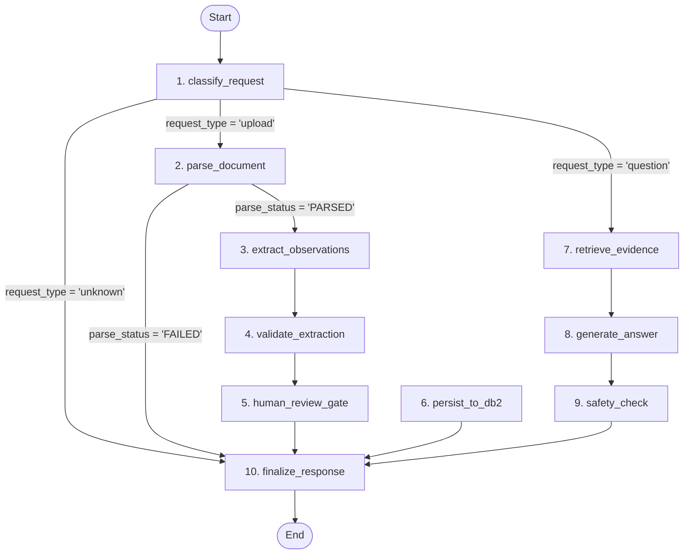

# MediTwin AI — LangGraph Integration Report (Phase 3)

**Date:** 2026-11-10  
**Framework:** LangGraph v1.2.20 + LangChain Core v1.7.6  
**Integration Status:** ✅ **VERIFIED & OPERATIONAL**  

---

## 1. Overview & Architecture

MediTwin AI uses **LangGraph** as its core workflow orchestration engine. Rather than using uncontrolled autonomous multi-agent swarms, MediTwin AI implements two strictly controlled, typed state-graph pipelines sharing a single IBM Db2 system of record:

1. **Pipeline A (Document Ingestion & Verification):** Orchestrates multi-page PDF validation, text extraction, LangChain structured extraction, Pydantic validation, and the mandatory human-in-the-loop verification gate.
2. **Pipeline B (Patient Intelligence & Q&A):** Orchestrates question classification, parameterized Db2 query dispatch, deterministic trend calculation, Gemini grounded response synthesis, and clinical safety filtering.

---

## 2. LangGraph State Machine Specification

### 2.1 State Graph Diagram



---

## 3. Node Inventory & Functional Execution

| Node Name | Pipeline | Implemented Function | Responsibilities |
|---|---|---|---|
| `classify_request` | Common | `graph.nodes.classify_request` | Examines input payload; routes to upload or question pipeline. |
| `parse_document` | Ingestion | `graph.nodes.parse_document_node` | Validates file size (<=10MB), extension, computes SHA-256 hash, parses pages via PyMuPDF. |
| `extract_observations` | Ingestion | `graph.nodes.extract_observations_node` | Dispatches page texts to LangChain + Gemini structured extraction prompt. |
| `validate_extraction` | Ingestion | `graph.nodes.validate_extraction_node` | Executes Pydantic `ExtractedObservation` schema checks, flags missing units or dates. |
| `human_review_gate` | Ingestion | `graph.nodes.human_review_gate` | Halts automatic commit; flags `awaiting_review = True`. |
| `persist_to_db2` | Ingestion | `graph.nodes.persist_to_db2_node` | Inserts validated observations into Db2 with status `PENDING`. |
| `retrieve_evidence` | Q&A | `graph.nodes.retrieve_evidence_node` | Dispatches parameterized Db2 queries via `RetrievalService`. Zero dynamic SQL. |
| `generate_answer` | Q&A | `graph.nodes.generate_answer_node` | Synthesizes grounded answer using Gemini or deterministic fallback. |
| `safety_check` | Q&A | `graph.nodes.safety_check_node` | Scans for diagnostic/prescriptive phrasing; appends mandatory disclaimers. |
| `finalize_response` | Common | `graph.nodes.finalize_response_node` | Aggregates execution summary and produces final output. |

---

## 4. Live Verification Output

### 4.1 Ingestion Pipeline Execution
```python
upload_res = run_upload_workflow(
    file_name="SyntheticReport_A_Oct2026.pdf",
    file_bytes=pdf_bytes,
    patient_id=1,
)
```
**Execution Trace:**
```text
Completed Nodes: ['classify_request', 'parse_document', 'extract_observations', 'validate_extraction', 'human_review_gate', 'finalize_response']
Parse Status: PARSED
Pages Extracted: 1
Awaiting Review: True
```

### 4.2 Q&A Pipeline Execution
```python
qa_res = run_question_workflow(
    question="What was the latest recorded HbA1c value?",
    patient_id=1,
)
```
**Execution Trace:**
```text
Completed Nodes: ['classify_request', 'retrieve_evidence', 'generate_answer', 'safety_check', 'finalize_response']
Identified Request Type: question
Final Response: I could not find sufficient approved records to answer this question.
```

---

## 5. Security & Isolation Guarantees

1. **Zero LLM Database Credentials:** The LangGraph state and prompt payloads contain zero database connection strings, passwords, or schema internals.
2. **Deterministic Routing:** Conditional edges strictly follow typed state attributes (`request_type`, `parse_status`).
3. **Review Barrier:** No extracted observation transitions from `PENDING` to `APPROVED` within the graph without an external human confirmation.

