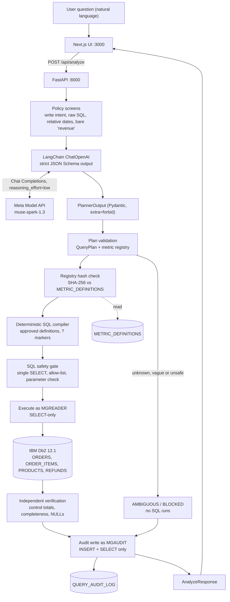

# System Architecture

## Overview

MetricGuard turns a business question into a **governed, verified IBM Db2 query**. The language model (Meta Muse Spark 1.3 through LangChain) only fills a closed, typed plan: metrics, dimensions, filters, dates, sort and limit. It never writes SQL and never names a table or column. Everything after planning is deterministic code and Db2: registry validation, SQL compilation, a SQL guard, read-only execution, independent reconciliation and an append-only audit record.

The design answers one question: *how do we know the number is the number the business means?* A definition in Db2, a compiler that implements it, a reconciliation that checks the output, and an audit row that proves what ran.

---

## Architecture Diagram



Request path, in words: natural-language request → Meta Muse Spark via LangChain → structured query plan → validation → deterministic SQL compiler → read-only IBM Db2 execution → numerical verification → audit logging → frontend response.

---

## Component Breakdown

| Layer | Component | Path (under `src/`) | Role |
|---|---|---|---|
| UI | Next.js 16 app | `frontend/` | Answer, chart, executed SQL, 11 checks, metric definitions, audit history. Calls FastAPI directly; no proxy |
| API | FastAPI | `backend/metricguard/api/` | Frozen Pydantic contract (v1.2.0), error mapping, audit endpoints |
| Policy | Screens | `backend/metricguard/planner/policy.py` | Deterministic checks that can only make an outcome stricter |
| AI | LangChain planner | `backend/metricguard/planner/llm.py` | `ChatOpenAI` to the Meta Model API, strict structured output, safe error mapping |
| AI | Demo planner | `backend/metricguard/planner/rules.py` | Rule-based, always labelled `DEMO_RULE_BASED`; never a silent fallback |
| Core | Registry, validator | `backend/metricguard/core/registry.py`, `validator.py` | Six approved metrics, allowed dimensions and filters, hashes |
| Core | Compiler | `backend/metricguard/core/compiler.py` | Plan to parameterized Db2 SQL |
| Core | SQL guard | `backend/metricguard/core/sql_guard.py` | Allow-list and forbidden-keyword gate on every SQL text |
| Pipeline | Analysis | `backend/metricguard/analysis/` | Checks V01–V11, status precedence, deterministic answer text |
| Db2 | Client | `backend/metricguard/db/client.py` | `ibm_db`, parameter markers, query timeout, sanitized errors |
| Db2 | Seed, oracle | `backend/metricguard/seed/` | Deterministic dataset and an independent pure-Python oracle |
| Db2 | DDL | `db/schema/` | Tables, constraints, indexes |

---

## LangChain + Meta Structured Planner

- `ChatOpenAI(base_url=https://api.meta.ai/v1, model="muse-spark-1.3").with_structured_output(PlannerOutput, method="json_schema", strict=True)`; `reasoning_effort=low` is forwarded in the request.
- `PlannerOutput` is a Pydantic model with `extra="forbid"` and every field required, so the JSON Schema is closed. Fields: `intent` (`analysis | ambiguous | write_request | out_of_scope`), `metrics`, `dimensions`, `filters`, `start_date`, `end_date`, `order_by`, `limit`, `ambiguous_metric`, `relative_time_phrase`.
- The question is passed as untrusted data. The model has no free-text field that can reach SQL, and identifiers never come from the model.
- Malformed, truncated or refused output surfaces as `PLAN_SCHEMA_INVALID` (V01 FAIL, `BLOCKED`, audited). Provider outages (auth, 429, 5xx, timeout) become `PLANNER_UNAVAILABLE` with a fixed message; keys never reach responses or logs.
- Per-attempt timeout 30 s with one SDK retry, so the worst case is about 61 s, below the browser's 90 s limit.

---

## Data Flow

1. **Screen.** The question is checked for write intent, raw SQL, relative dates and a bare "revenue". A hit can only make the result stricter (BLOCKED or AMBIGUOUS).
2. **Plan.** LangChain asks Muse Spark for a `PlannerOutput`.
3. **Validate.** Pydantic, then `QueryPlan` and the registry: metric exists and is `APPROVED` at the current version, dimensions and filters are allowed (V01, V02, V04). Versions come from the registry, never from the model.
4. **Integrity.** The runtime definition's SHA-256 must equal `METRIC_DEFINITIONS.DEFINITION_HASH` read from Db2 as `MGREADER` (V03). A mismatch is `REGISTRY_DRIFT`.
5. **Compile.** One parameterized `SELECT` (V05). Refunds are pre-aggregated per order line before the join, so a line is never multiplied by its refund rows. Dates run as half-open intervals.
6. **Guard.** Single `SELECT`, four allow-listed tables, no DDL, DML or system catalogs (V06); marker count equals parameter count and no plan value appears in the SQL text (V07).
7. **Execute.** Db2 runs it as `MGREADER` with a 15 s query timeout and a 500-row cap (V08).
8. **Verify.** Additive metrics: the sum of groups must equal an independent ungrouped Db2 query, and every returned group must equal the same group in a separate control grouping, so top-N results are checked too. AOV and refund rate are recomputed from reconciled components (V09). Completeness and NULL semantics follow (V10, V11).
9. **Status.** `VERIFIED` only if every applicable check passes; otherwise `EXECUTED_WITH_WARNINGS`, `AMBIGUOUS`, `BLOCKED` or `EXECUTION_FAILED`.
10. **Audit.** The request, plan, SQL, parameters, checks, planner provider and model, and timings are inserted into `QUERY_AUDIT_LOG` as `MGAUDIT`, including for blocked and ambiguous requests (`sql = null`).
11. **Respond.** The UI renders the headline, chart, SQL, checks, metric definitions with hash status, and an AI disclosure that matches what actually happened.

---

## IBM Db2 Schema & Storage Design

Full DDL: `src/db/schema/001_tables.sql`, `002_indexes.sql`. Abridged:

```sql
-- Excerpt of src/db/schema/001_tables.sql
CREATE TABLE METRICGUARD.ORDERS (
    ORDER_ID        INTEGER       NOT NULL,
    ORDER_TS        TIMESTAMP     NOT NULL,
    STATUS          VARCHAR(16)   NOT NULL,
    REGION_CODE     VARCHAR(8)    NOT NULL,
    CHANNEL_CODE    VARCHAR(12)   NOT NULL,
    SHIPPING_AMOUNT DECIMAL(10,2) NOT NULL DEFAULT 0,
    -- ... other columns omitted
    CONSTRAINT PK_ORDERS PRIMARY KEY (ORDER_ID),
    CONSTRAINT CK_ORDERS_STATUS CHECK (STATUS IN ('COMPLETED','CANCELLED','PENDING')),
    CONSTRAINT CK_ORDERS_REGION CHECK (REGION_CODE IN ('NA','EMEA','APAC','LATAM'))
);

CREATE TABLE METRICGUARD.REFUNDS (
    REFUND_ID       INTEGER       NOT NULL,
    ORDER_ID        INTEGER       NOT NULL,
    ORDER_ITEM_ID   INTEGER       NOT NULL,
    REFUND_AMOUNT   DECIMAL(10,2) NOT NULL,
    STATUS          VARCHAR(12)   NOT NULL,
    -- ... other columns omitted
    CONSTRAINT PK_REFUNDS PRIMARY KEY (REFUND_ID),
    -- a refund must belong to a line of the same order
    CONSTRAINT FK_REFUNDS_ITEM FOREIGN KEY (ORDER_ITEM_ID, ORDER_ID)
        REFERENCES METRICGUARD.ORDER_ITEMS (ORDER_ITEM_ID, ORDER_ID) ON DELETE RESTRICT,
    CONSTRAINT CK_REFUNDS_AMOUNT CHECK (REFUND_AMOUNT > 0)
);
```

| Table | Purpose |
|---|---|
| `ORDERS`, `ORDER_ITEMS`, `PRODUCTS`, `REFUNDS` | Business data: 2,924 / 6,540 / 40 / 1,032 rows (seed `20260107`, Jan–Jun 2026) with CHECK and composite FK constraints and 9 supporting indexes |
| `METRIC_DEFINITIONS` | Approved metric versions, owner, grain, lifecycle status and SHA-256 hash; checked on every request |
| `QUERY_AUDIT_LOG` | Append-only audit trail; question stored through a parameter marker (at most 1,000 characters), plan and result as CLOB JSON; 2 indexes |

| Account | Grants | Used for |
|---|---|---|
| `db2inst1` | admin | Setup, `RUNSTATS`, health only |
| `mgreader` | SELECT on the business and registry tables | Every analytical query and the hash check |
| `mgaudit` | INSERT, SELECT on `QUERY_AUDIT_LOG` | Audit writes and audit reads |

`make db-verify` proves the boundaries: `DELETE` as the reader is rejected with SQLSTATE 42501, and the audit writer can neither read business data nor update or delete audit rows. It also compares seven golden queries with the independent oracle digit for digit, and runs four naive-SQL traps, for example the order-by-refund join that inflates H1 2026 gross revenue from $667,622.16 to $781,330.86.

---

## Error Handling

| Situation | Result |
|---|---|
| Write intent, raw SQL, unknown metric, disallowed dimension | `BLOCKED` with a reason code; no SQL; audited |
| Vague metric or relative period | `AMBIGUOUS` with clickable interpretations; no SQL; audited |
| Malformed or refused model output | `BLOCKED` (`PLAN_SCHEMA_INVALID`), audited |
| Meta API unreachable, 401, 429, 5xx, timeout | HTTP 503 `PLANNER_UNAVAILABLE`; the UI says nothing was verified; no fallback to the demo planner |
| Db2 down or driver error | HTTP 503 `DATABASE_UNAVAILABLE` or `DB2_ERROR` with a fixed message; SQLSTATE returned, driver text and credentials stripped; sanitized server log |
| Query exceeds the timeout | `EXECUTION_FAILED`, SQLSTATE 57014, audited |
| Reconciliation, completeness or NULL check warns | `EXECUTED_WITH_WARNINGS` with the failing check shown |

---

## Security & Secrets Management

- Secrets live only in an untracked `.env`. `.env.example` holds placeholders and an empty `MODEL_API_KEY`. The built frontend bundle contains no key or password.
- Two least-privilege Db2 accounts: a SELECT-only reader and an INSERT-plus-SELECT audit writer. Neither can change business data.
- Every value reaches Db2 as a `?` marker. There is no channel from model text to SQL.
- Provider and driver errors map to fixed messages. `PWD=` is stripped from any driver text.
- The UI renders questions and audit text as plain React text (no `innerHTML`, `eval` or `dangerouslySetInnerHTML`).
- CORS allows `http://localhost:3000` only.

---

## Limitations

- **Latency:** the Meta request dominates (about 2–5 s for clear questions, up to about 15 s for vague ones). Db2, verification and audit together add under 0.15 s.
- **Interpretation ambiguity:** for a vague prompt such as "Show our best-performing region." the model returned AMBIGUOUS once and BLOCKED later. Both are non-executing.
- **Known intermittent audit-history risk:** `GET /api/audit*` returned 503 intermittently in development. It was not reproduced in 100 probe requests; the root cause is unknown. The UI offers Retry and the API now logs the SQLSTATE.
- **Limited evaluation:** 37 live Meta cases plus 4 bounded end-to-end checks on one seeded synthetic dataset. This is a smoke test, not an accuracy rate, and it says nothing about other datasets or other models.
- **Development and demo environment:** single host, one Db2 connection per request, tested only on macOS Apple Silicon with Db2 under QEMU emulation. Fenced routines need the documented post-setup fix. Not production-certified.
- **Not a correctness certificate:** `VERIFIED` means approved definitions, governed SQL and reconciled totals. It does not prove that the underlying data is right, and MetricGuard does not catch every possible wrong query.
- **Not used:** Db2 vector search, RAG and Db2 AI features.
