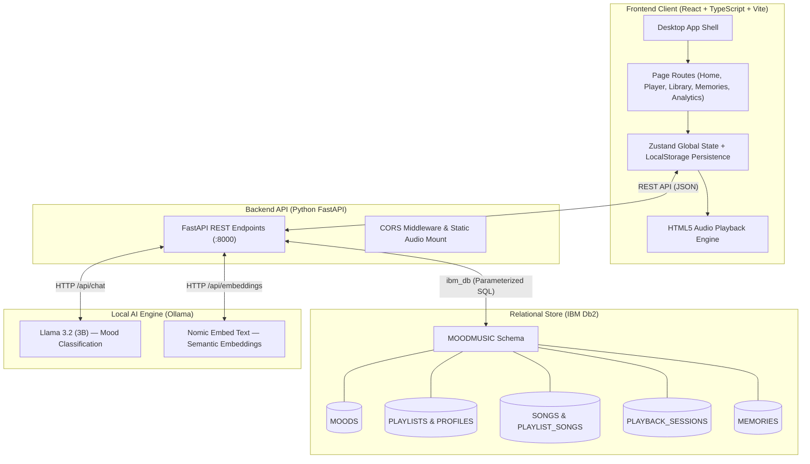

# 🎵 Mood-to-Music Memory

> A desktop music companion that connects emotional state to music playback, memory journaling, and listening analytics — powered by **IBM Db2** and local AI via **Ollama**.

[](https://react.dev)
[](https://typescriptlang.org)
[](https://vitejs.dev)
[](https://tailwindcss.com)
[](https://fastapi.tiangolo.com)
[](https://www.ibm.com/products/db2)
[](https://ollama.ai)

---

## 📖 Executive Summary

**Mood-to-Music Memory** transforms everyday music listening into an emotional journey and reflective memory journal.

Instead of endlessly browsing through thousands of tracks, users express how they feel:
- Choose from 5 curated mood profiles: **Sad · Happy · Romantic · Wholesome · Ghazal**
- Or describe their feelings in natural language, interpreted locally by **Ollama (`llama3.2:3b`)** without sending personal data to the cloud.

Every listening session, song transition, and saved personal reflection is persisted securely in **IBM Db2**, driving live listening analytics and emotional memory retrieval.

---

## 🏛️ System Architecture



---

## ✨ Key Capabilities

### 1. 🏠 Emotional Mood Selection & AI Detection
- Five primary mood cards: **Sad · Happy · Romantic · Wholesome · Ghazal**.
- **Free-Text AI Mood Classification**: Users can type descriptive thoughts (e.g., *"It's raining outside and I miss college days"*). The local Ollama model classifies the input into an optimal mood profile.
- Quick stats: active streak, total songs played, and saved memories.

### 2. 🎵 Synchronized Music Player
- **Dedicated Player & Persistent Bottom Mini-Player**: Single playback state managed across all 5 pages.
- Real offline audio playback powered by HTML5 `<audio>` engine.
- Interactive scrubbable progress bar, volume slider, shuffle, repeat, and playlist queue.
- Playback profile display (volume level, pacing, and mood-tailored fade-in).
- **"Save This Moment"** shortcut to instantly capture a reflection tied to the active song.

### 3. 📚 Music Library & File Import
- **My Songs**: Comprehensive table showing artwork, title, artist, duration, and mood.
- **Playlists**: Visual card grid of all mood-linked playlists.
- **Instant Search**: Real-time filtering across tracks and artists.
- **Import Audio**: Import local `.mp3`, `.wav`, or `.m4a` files with instantaneous browser playback and Db2 cataloging.

### 4. 💭 Memory Journaling & Semantic Recall
- Create, view, edit, bookmark, and delete personal memories tied to songs and moods.
- Fully synchronized with IBM Db2 `MEMORIES` table.
- **Similar Memories** panel powered by semantic vector embeddings.

### 5. 📊 Live Db2 Analytics
- Live connection indicator displaying real-time synchronization with IBM Db2.
- Interactive session frequency activity chart.
- Mood distribution percentage breakdown.
- Top played tracks and recent session audit logs.

---

## 🗄️ IBM Db2 Architecture (`MOODMUSIC` Schema)

| Table | Purpose | Key Columns |
|---|---|---|
| `MOODS` | Master catalog of moods | `MOOD_ID`, `MOOD_CODE`, `DISPLAY_NAME` |
| `PLAYBACK_PROFILES` | Volume, speed, and fade configuration | `PROFILE_ID`, `VOLUME_PERCENT`, `FADE_IN_SECONDS` |
| `PLAYLISTS` | Curated mood playlists | `PLAYLIST_ID`, `PLAYLIST_NAME`, `PROFILE_ID` |
| `MOOD_PLAYLISTS` | Relationship between moods and playlists | `MOOD_ID`, `PLAYLIST_ID`, `PRIORITY` |
| `SONGS` | Track metadata and audio paths | `SONG_ID`, `SONG_TITLE`, `LOCAL_FILE_PATH`, `DURATION_SECONDS` |
| `PLAYLIST_SONGS` | Ordered playlist track mapping | `PLAYLIST_ID`, `SONG_ID`, `POSITION` |
| `PLAYBACK_SESSIONS` | User listening session tracking | `SESSION_ID`, `MOOD_ID`, `STARTED_AT`, `ENDED_AT` |
| `MEMORIES` | Personal mood reflections | `MEMORY_ID`, `MEMORY_TEXT`, `SONG_TITLE`, `MOOD_TAG`, `SAVED_AT` |

> All queries use **parameterized statements (`?` markers)** via `ibm_db` to guarantee complete protection against SQL injection.

---

## 🚀 Quick Start Guide

### Prerequisites
- **Node.js** (v18+) & **pnpm**
- **Python** (v3.11 or v3.12)
- **IBM Db2** running locally (or via Docker)
- **Ollama** (for local AI features)

### 1. Environment Setup

Copy `.env.example` to `.env` in the project root:

```env
DB2_DATABASE=MDMUSIC
DB2_HOST=localhost
DB2_PORT=50000
DB2_USER=db2inst1
DB2_PASSWORD=your_password
OLLAMA_BASE_URL=http://localhost:11434
OLLAMA_MODEL=llama3.2:3b
MUSIC_DIR=d:\mood-to-music-memory\music
```

### 2. Automated One-Command Setup (Windows)

```powershell
.\setup.ps1
```

### 3. Manual Step-by-Step Setup

```powershell
# 1. Activate Python virtual environment & install dependencies
python -m venv .venv
.\.venv\Scripts\activate
pip install -r requirements.txt

# 2. Setup Db2 Schema and Seed initial playlists
python db/setup_db2.py
python db/seed_db.py

# 3. Generate offline audio files for all 5 moods
python generate_mood_audio.py

# 4. Pull local AI models via Ollama
ollama pull llama3.2:3b
ollama pull nomic-embed-text

# 5. Start Backend API
uvicorn backend.main:app --port 8000 --reload

# 6. Start Frontend (in a new terminal)
cd frontend
pnpm install
pnpm dev
```

Visit **http://localhost:5173** to launch the application.

---

## 🧪 Verification & Testing

Verify end-to-end functionality across all REST endpoints and the Db2 database:

```powershell
.\.venv\Scripts\python.exe smoke_test.py
```

Expected output:
```
==================================================
  Mood-to-Music Memory — Smoke Test
==================================================
[Health]
  ✅ GET /api/health  (200)
[Moods]
  ✅ GET /api/moods  (200)
[Songs]
  ✅ GET /api/songs  (200)
[Playlists]
  ✅ GET /api/playlists  (200)
[Create Memory]
  ✅ POST /api/memories  (201)
[Delete Memory]
  ✅ DELETE /api/memories/1  (200)
[Session]
  ✅ POST /api/session/start  (201)
  ✅ POST /api/session/end  (200)
[Analytics]
  ✅ GET /api/analytics  (200)

  PASSED: 9   FAILED: 0
==================================================
```

---

## 🗺️ Future Roadmap

- [ ] **Native Desktop Packaging**: Package as an Electron / Tauri Windows executable.
- [ ] **Smart Mood Transitions**: Dynamic cross-fading and tempo morphing between mood shifts.
- [ ] **Voice Input**: Speech-to-text mood capture using OpenAI Whisper running locally via Ollama.
- [ ] **Biometric Input Integration**: Optional smart-band integration to suggest playlists matching heart rate and stress levels.

---

## 📄 License & Attribution

Built for the **IBM Db2 TechX Summit 2026**.  
Engineered with 💜 by **Tushar**.
