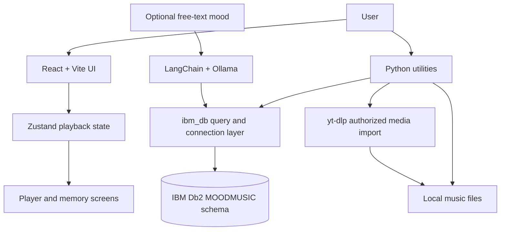

# System Architecture

## Overview

Mood-to-Music Memory has a React/Vite presentation layer and a Python service
layer. The Python layer owns the Db2 connection, schema setup, playlist
queries, session tracking, memory persistence, and authorized media import.
The browser UI currently demonstrates the experience with local mock data while
the database services are exercised independently through scripts and
`smoke_test.py`.

## Architecture Diagram

## Components

1. **React client:** Provides mood selection, player controls, library,
   memories, and analytics views in `frontend/src/`.
2. **Db2 connection layer:** `src/db/connection.py` reads environment
   variables, opens `ibm_db` connections, and sets the `MOODMUSIC` schema.
3. **Query layer:** `src/db/queries.py` exposes typed dataclasses and
   parameterized queries for moods, playlists, songs, sessions, and memories.
4. **Database setup:** `db/schema.sql`, `db/setup_db2.py`, and `db/seed_db.py`
   create and populate the relational model.
5. **Media utilities:** `download_and_store.py` and `import_song.py` store
   metadata and local paths while keeping audio files on disk.
6. **Optional AI:** `src/ai/mood_interpreter.py` uses a local Ollama model
   through LangChain for free-text mood classification.

## Data Flow

1. The user chooses a supported mood in the UI or enters optional mood text.
2. The service validates the mood code and retrieves the highest-priority
   active playlist from Db2.
3. The playlist query joins its playback profile and ordered song metadata.
4. A playback session can be recorded in `PLAYBACK_SESSIONS`.
5. The local player uses the stored path and playback profile; audio bytes do
   not enter Db2.
6. A user can explicitly save a reflection in `MEMORIES`.

## IBM Db2 Schema

The schema in `db/schema.sql` uses these tables:

- `MOODS` and `PLAYBACK_PROFILES` define supported moods and playback behavior.
- `PLAYLISTS` and `MOOD_PLAYLISTS` map moods to active, prioritized playlists.
- `SONGS` and `PLAYLIST_SONGS` store metadata and playlist ordering.
- `PLAYBACK_SESSIONS` records listening sessions and optional feedback.
- `MEMORIES` stores reflections, song metadata, mood tags, and timestamps.

Important indexes support mood playlist priority, playlist ordering, memory
mood filtering, and memory date ordering.

## Security and Secrets

All Db2 credentials and optional local-model settings are read from environment
variables. `.env.example` contains placeholders only. User input in the query
layer is bound with `ibm_db.prepare`, `bind_param`, and `execute`; schema names
are fixed constants rather than user input.

Media import is intended for user-authorized content only. Downloaded audio
files remain in the local `music` directory and are excluded from version
control.
