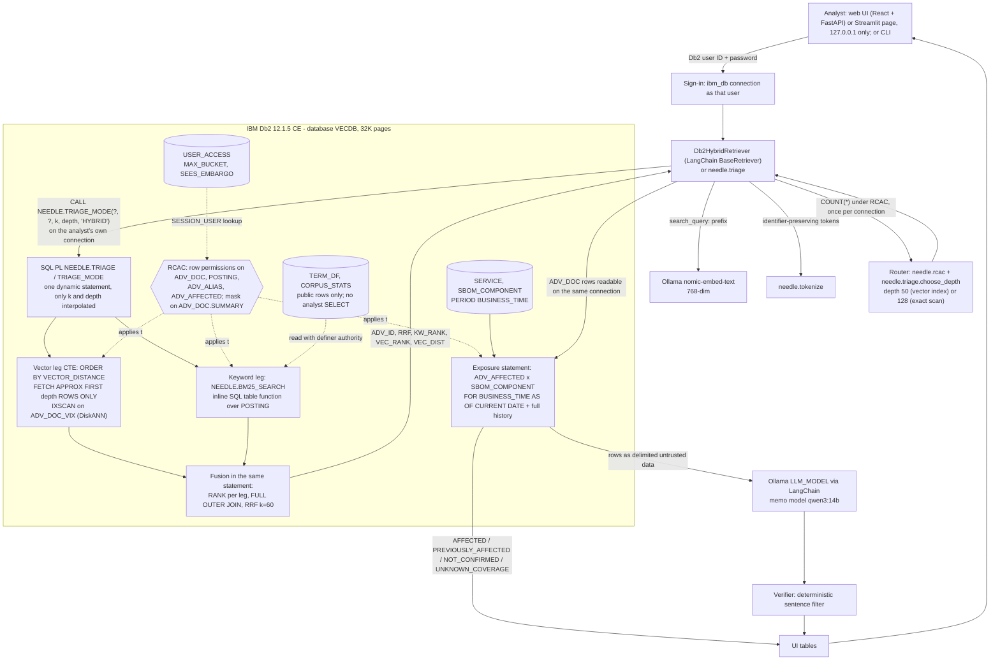

# System Architecture

## Overview
NEEDLE is permission-aware hybrid retrieval inside IBM Db2 12.1.5, applied to software-vulnerability triage.
An analyst signs in with their own Db2 user and pastes a vague report. One SQL PL call ranks advisories two ways:
BM25 keyword scoring in plain SQL, and approximate nearest-neighbour search (`FETCH APPROX`) on a DiskANN vector
index. One SQL statement inside the procedure fuses the two ranks with reciprocal rank fusion (RRF). Db2 row and
column access control (RCAC) applies to both legs, because every statement runs on the analyst's own connection.
A deterministic join of service SBOMs (with `BUSINESS_TIME` history) against OSV affected versions then says which
services are affected and since when. A local LLM writes a short memo, and a deterministic verifier removes every
sentence that the SQL results do not support.

Design rule: **Db2 decides; Python orchestrates; the LLM explains.** Python never filters rows for permissions,
never decides relevance, and never decides whether a service is affected.

Measured behaviour that shaped the design (`docs/evidence/rcac_real.md`): under a row permission whose value comes
from an entitlement subquery, every user shares one plan with a constant observed optimizer estimate (filter factor
0.495), the vector IXSCAN over-fetches by 1/FF (21 candidates for `FETCH APPROX FIRST 10`), and low-visibility users
get under-filled results. NEEDLE therefore chooses the search depth per session user (the router) instead of
passing one fixed depth to every user.

---

## Architecture Diagram



---

## Component Breakdown

1. **User interface / client layer**
   - `web/` (React 19 + TypeScript + Vite + Tailwind) over `src/needle/api.py` (FastAPI, `127.0.0.1` only, with a
     Host-header check): sign-in as your own Db2 user (the password stays in the API process's memory for the
     session); triage console with the exposure verdict, the three rank columns, the SQL with bound parameters and the
     captured access plans, the services table and the verified memo; a Finding view re-plotted from
     `eval/results/*.json` with a live three-identity comparison (demo switcher only); every number comes from the API or
     an evidence file. The API calls the same `service.do_run` as the Streamlit page; the browser never sees SQL
     built from text or any credential.
   - `src/needle/app.py` (Streamlit, bound to `127.0.0.1` by `.streamlit/config.toml`): sign-in with a Db2 user ID and
     password; query box; keyword / vector / hybrid rank columns; affected services with AFFECTED /
     PREVIOUSLY_AFFECTED / NOT_CONFIRMED / UNKNOWN_COVERAGE; the memo with the verifier's removed sentences.
     `NEEDLE_DEMO_SWITCHER=1` (recorded demo only) replaces the sign-in with a labelled switch between three demo
     identities (NDL_SENIOR, NDL_JUNIOR, NDL_P10) whose passwords the server reads from `.env`. The page prints the
     search depth the router chose for the signed-in user.
   - CLI: `python -m needle.triage "<text>"`, `scripts/run_sample_queries.py`, `eval/run_eval.py`, `eval/rcac_sweep.py`.
2. **Application layer (Python 3, `src/needle/`)**
   - `sbom.connect_as()` / `triage.connect()`: an `ibm_db` connection **as the analyst**. Every connection is closed
     in `finally`.
   - `tokenize.py`: identifier-preserving tokenizer (`log4j-core` -> `log4j-core`, `log4j`, `core`;
     `cve-2021-44228` stays whole; lowercase; no stemming). The same tokenizer builds the postings and the query terms.
   - `embed.py`: Ollama `nomic-embed-text`, 768 dims, prefixes `search_document: ` / `search_query: `.
   - `rcac.py`: the router. `choose_strategy(visible_rows, total_rows, k)` returns EXACT when the user may see at most
     T = 7,000 rows, else APPROX at the smallest fixed depth >= ceil(k / fraction x 3), with a search-list-size
     guideline. T and the factor 3 were fitted on the dev split only.
   - `triage.py`: `choose_depth()` maps the router's choice to a `TRIAGE` depth (50 keeps the vector index; 128 makes
     Db2 run an exact scan), `call_triage_ex()` calls `NEEDLE.TRIAGE_MODE` with bound values and retries only
     `SQL0901N` at depth 64, then 128, recording which depth answered.
   - `retriever.py`: `Db2HybridRetriever(BaseRetriever)`. As defence in depth it shows an advisory only if the same
     connection can read its `ADV_DOC` row.
   - `haystack_component.py`: the same triage as a Haystack component (`haystack-ai` 3.4.1).
   - `sbom.py`: synthetic fleet generator, PEP 503 package names, the exposure statement.
   - `llm_summary.py` + `verify.py`: memo prompt with advisory text as delimited untrusted data; deterministic verifier.
3. **Database layer (IBM Db2 12.1.5)**: raw and searchable advisories, vectors and the vector index, BM25 postings
   and statistics, SQL PL fusion, RCAC, temporal SBOM history, EXPLAIN evidence. See the schema below.
4. **AI / model orchestration layer**: LangChain retriever and chat model over local Ollama. The model sees SQL rows
   as delimited, untrusted data. It has no tools and no write path.
5. **Ingest and evaluation (offline)**: `ingest_osv.py`, `embed.py`, `bm25.py`, `scripts/load_*_in_codespace.py`,
   `eval/build_queries.py` (frozen slices with SHA-256), `eval/run_eval.py`, `eval/rcac_sweep.py`,
   `eval/rcac_router_fit.py`, `eval/rcac_report.py`.

---

## Data Flow

**Ingest (once)**
1. The OSV PyPI export (26,842 JSON records) is parsed as JSON only. Raw text and SHA-256 go to `ADV_RAW`.
2. Alias union-find (CVE / GHSA / PYSEC) gives `CANON_ID`. `ROW_BUCKET` (0-99) comes from a hash of `CANON_ID`, so
   all aliases share one bucket and the bucket is independent of content.
3. Non-withdrawn records (26,210) become `ADV_DOC` rows with a 768-dim embedding (`EMB ... NOT NULL`).
   Enumerated `affected[].versions` go to `ADV_AFFECTED` with PEP 503 package names.
4. The same tokenizer writes `POSTING` (term frequency, document length, and copies of `ROW_BUCKET` /
   `EMBARGO_UNTIL` taken from `ADV_DOC`).
5. Bulk inserts run next to the database (inside the Codespace), never through a port-forward tunnel.
6. Post-load: `CREATE VECTOR INDEX`, `RUNSTATS`, embargo marks, `NEEDLE.SYNC_POSTING_ACL` (re-copies the RCAC
   columns and recomputes public-only `TERM_DF` / `CORPUS_STATS`), permissions, mask, grants, activation.
   The index is built after the load: the build is offline, and `LOAD` cannot run against a table with a vector index.

**Query (each triage)**
1. Sign-in opens a connection as the analyst. Input: query text (length-capped) and the analyst's connection.
2. The router reads `COUNT(*)` on `ADV_DOC` as the session user (RCAC applies) and `SYSCAT.TABLES.CARD` once per
   connection, and picks the depth.
3. Tokens (one JSON array) + query embedding -> `CALL NEEDLE.TRIAGE_MODE(..., 'HYBRID')`. Db2 applies the row
   permission inside both legs.
4. The retriever reads the `ADV_DOC` rows of the fused IDs on the same connection. The exposure statement joins
   their enumerated versions to the SBOM history.
5. Optional memo; the verifier checks every sentence against the SQL rows.
6. Nothing is written back during a query.

---

## Sequence of a triage request

```mermaid
sequenceDiagram
    autonumber
    actor A as Analyst
    participant UI as Web UI + FastAPI (127.0.0.1)
    participant RT as Db2HybridRetriever / needle.triage
    participant OL as Ollama
    participant DB as Db2 (SESSION_USER = analyst)
    participant LLM as LLM_MODEL (qwen3:14b in the evidence runs)
    participant VF as Verifier

    A->>UI: Db2 user ID + password, query text
    UI->>DB: connect as that user (ibm_db)
    DB-->>UI: connection (RCAC binds to SESSION_USER)
    UI->>RT: run_triage(conn, query)
    RT->>RT: tokenize -> ["yaml","loader",...] (one JSON array; caps on length and term count)
    RT->>OL: embed("search_query: ...")
    OL-->>RT: 768 floats
    RT->>DB: SELECT COUNT(*) FROM NEEDLE.ADV_DOC  (RCAC applies; once per connection) + SYSCAT.TABLES.CARD
    DB-->>RT: visible rows, total rows
    RT->>RT: router -> depth 50 (vector index) or 128 (exact scan)
    RT->>DB: CALL NEEDLE.TRIAGE_MODE(?, ?, k, depth, 'HYBRID')  -- vector and terms bound
    Note over DB: k and depth checked 1..1000, then written as literals (FETCH APPROX FIRST n needs a literal)
    DB->>DB: one statement: vector CTE (FETCH APPROX, IXSCAN ADV_DOC_VIX) + BM25_SEARCH + RRF fusion
    Note over DB: row permission filters ADV_DOC and POSTING rows for SESSION_USER in both legs
    DB-->>RT: ADV_ID, RRF, KW_RANK, VEC_RANK, VEC_DIST (on SQL0901N: retry at depth 64, then 128)
    RT->>DB: SELECT ... FROM NEEDLE.ADV_DOC WHERE ADV_ID IN (?, ...)  -- defence in depth
    RT->>DB: exposure statement (ADV_AFFECTED x SBOM_COMPONENT, FOR BUSINESS_TIME AS OF CURRENT DATE)
    DB-->>RT: services, versions, statuses, exposed since
    RT-->>UI: ranks per leg + exposure rows
    UI->>LLM: rows as delimited untrusted data
    LLM-->>VF: memo draft
    VF-->>UI: kept sentences + removed sentences with reasons
    UI-->>A: ranks, AFFECTED / PREVIOUSLY_AFFECTED / NOT_CONFIRMED / UNKNOWN_COVERAGE, exposed since, memo
```

---

## IBM Db2 Schema & Storage Design

Authoritative DDL: `sql/01_schema.sql`, `sql/02_bm25.sql`, `sql/03_triage_proc.sql`, `sql/04_rcac.sql`,
`sql/05_sbom_temporal.sql`, validation in `sql/99_validation.sql`. Each file splits at `-- @POST_LOAD` into a
pre-load part and a post-load part (`scripts/setup_db.sh --phase pre|post`).

Database: `VECDB`, created with `PAGESIZE 32 K`. A 768-dim FLOAT32 vector index key is 3,072 bytes, which needs a
16K or 32K page.

| Table | Rows (our run) | Key columns | Notes |
|---|---|---|---|
| `NEEDLE.ADV_RAW` | 26,842 | `ADV_ID` PK | `RAW CLOB(2M)` unchanged OSV JSON, `SHA256` |
| `NEEDLE.ADV_DOC` | 26,210 | `ADV_ID` PK, `CANON_ID` | `EMB VECTOR(768, FLOAT32) NOT NULL`, `ROW_BUCKET`, `EMBARGO_UNTIL`; vector index `ADV_DOC_VIX` |
| `NEEDLE.ADV_ALIAS` | - | (`ADV_ID`, `ALIAS`) PK | alias graph; row permission |
| `NEEDLE.ADV_AFFECTED` | - | (`ADV_ID`, `ECOSYSTEM`, `PACKAGE`, `VERSION`) PK | index (`PACKAGE`, `VERSION`); row permission |
| `NEEDLE.POSTING` | 1,944,102 | (`TERM`, `ADV_ID`) PK | `TF`, `BM25_DL`, RCAC copies; index-only keyword leg |
| `NEEDLE.TERM_DF` | 183,662 | `TERM` PK | document frequency over public rows only |
| `NEEDLE.CORPUS_STATS` | 1 | `ID = 1` | N, AVGDL, AVG_IDF, k1, b, epsilon over public rows |
| `NEEDLE.USER_ACCESS` | 7 | `AUTHID` PK | `MAX_BUCKET`, `SEES_EMBARGO`; no analyst privilege |
| `NEEDLE.SERVICE`, `NEEDLE.SBOM_COMPONENT` | synthetic | `SBOM_COMPONENT` PK (`SERVICE_ID`, `PACKAGE`, `BUSINESS_TIME WITHOUT OVERLAPS`) | `PERIOD BUSINESS_TIME (BUS_START, BUS_END)` |

Row counts: `ADV_DOC` and the BM25 tables from `docs/evidence/rcac_real.md` and `docs/evidence/fix_c1_h2.txt`;
`ADV_RAW` from the OSV export count. "-" = not quoted in an evidence file.

```sql
-- Advisories (sql/01_schema.sql)
CREATE TABLE NEEDLE.ADV_RAW (
  ADV_ID     VARCHAR(64)  NOT NULL PRIMARY KEY,
  RAW        CLOB(2M)     NOT NULL,                 -- the OSV JSON record, unchanged
  SHA256     CHAR(64)     NOT NULL,
  LOADED_AT  TIMESTAMP    NOT NULL DEFAULT CURRENT TIMESTAMP
);

CREATE TABLE NEEDLE.ADV_DOC (
  ADV_ID         VARCHAR(64)   NOT NULL PRIMARY KEY,
  CANON_ID       VARCHAR(64)   NOT NULL,            -- alias group (ground-truth unit)
  KIND           VARCHAR(8)    NOT NULL,            -- GHSA / PYSEC / MAL / ...
  SUMMARY        VARCHAR(2000),                     -- masked for embargoed rows (sql/04_rcac.sql)
  DETAILS        CLOB(1M),                          -- CLOB: cannot be masked (SQL0350N); row permission only
  PACKAGES       VARCHAR(4000),
  PUBLISHED      TIMESTAMP,
  MODIFIED       TIMESTAMP,
  WITHDRAWN      TIMESTAMP,
  CVSS           VARCHAR(200),
  DOC_LEN        INTEGER       NOT NULL,
  ROW_BUCKET     SMALLINT      NOT NULL CHECK (ROW_BUCKET BETWEEN 0 AND 99),
  EMBARGO_UNTIL  TIMESTAMP,                         -- simulated; OSV has no embargo field
  EMB            VECTOR(768, FLOAT32) NOT NULL      -- NOT NULL: a nullable vector column forces exact search
);
CREATE INDEX NEEDLE.ADV_DOC_CANON ON NEEDLE.ADV_DOC (CANON_ID);

CREATE TABLE NEEDLE.ADV_ALIAS (
  ADV_ID  VARCHAR(64) NOT NULL,
  ALIAS   VARCHAR(64) NOT NULL,
  PRIMARY KEY (ADV_ID, ALIAS)
);
CREATE INDEX NEEDLE.ADV_ALIAS_ALIAS ON NEEDLE.ADV_ALIAS (ALIAS);

CREATE TABLE NEEDLE.ADV_AFFECTED (
  ADV_ID     VARCHAR(64)  NOT NULL,
  ECOSYSTEM  VARCHAR(32)  NOT NULL,
  PACKAGE    VARCHAR(256) NOT NULL,                 -- PEP 503 normalized
  VERSION    VARCHAR(128) NOT NULL,
  PRIMARY KEY (ADV_ID, ECOSYSTEM, PACKAGE, VERSION)
);
CREATE INDEX NEEDLE.ADV_AFFECTED_PV ON NEEDLE.ADV_AFFECTED (PACKAGE, VERSION);

-- @POST_LOAD
CREATE VECTOR INDEX NEEDLE.ADV_DOC_VIX ON NEEDLE.ADV_DOC (EMB) WITH DISTANCE COSINE;
-- followed by RUNSTATS on ADV_DOC (with distribution and indexes)

-- Keyword leg (sql/02_bm25.sql)
CREATE TABLE NEEDLE.POSTING (
  TERM           VARCHAR(128) NOT NULL,
  ADV_ID         VARCHAR(64)  NOT NULL,
  TF             SMALLINT     NOT NULL,
  BM25_DL        INTEGER      NOT NULL,
  ROW_BUCKET     SMALLINT     NOT NULL CHECK (ROW_BUCKET BETWEEN 0 AND 99),  -- copy of ADV_DOC, for RCAC
  EMBARGO_UNTIL  TIMESTAMP                                                    -- copy of ADV_DOC, for RCAC
);
CREATE UNIQUE INDEX NEEDLE.POSTING_PK_IX ON NEEDLE.POSTING (TERM, ADV_ID)
  INCLUDE (TF, BM25_DL, ROW_BUCKET, EMBARGO_UNTIL) CLUSTER;   -- keyword leg is index-only
ALTER TABLE NEEDLE.POSTING ADD CONSTRAINT POSTING_PK PRIMARY KEY (TERM, ADV_ID);
CREATE INDEX NEEDLE.POSTING_ADV_IX ON NEEDLE.POSTING (ADV_ID);
CREATE TABLE NEEDLE.TERM_DF (TERM VARCHAR(128) NOT NULL PRIMARY KEY, DF INTEGER NOT NULL);
CREATE TABLE NEEDLE.CORPUS_STATS (
  ID SMALLINT NOT NULL PRIMARY KEY CHECK (ID = 1), N INTEGER NOT NULL, AVGDL DOUBLE NOT NULL,
  AVG_IDF DOUBLE NOT NULL, K1 DOUBLE NOT NULL, B DOUBLE NOT NULL, EPSILON DOUBLE NOT NULL,
  BUILT_AT TIMESTAMP NOT NULL DEFAULT CURRENT TIMESTAMP
);

-- Entitlements (sql/04_rcac.sql); no analyst has any privilege on this table
CREATE TABLE NEEDLE.USER_ACCESS (
  AUTHID        VARCHAR(128) NOT NULL PRIMARY KEY,
  MAX_BUCKET    SMALLINT     NOT NULL CHECK (MAX_BUCKET BETWEEN 0 AND 100),
  SEES_EMBARGO  SMALLINT     NOT NULL DEFAULT 0 CHECK (SEES_EMBARGO IN (0, 1))
);

-- Fleet with deploy history (sql/05_sbom_temporal.sql); the fleet is synthetic
CREATE TABLE NEEDLE.SERVICE (
  SERVICE_ID  VARCHAR(64)  NOT NULL PRIMARY KEY,
  NAME        VARCHAR(128) NOT NULL,
  OWNER_TEAM  VARCHAR(128) NOT NULL,
  SYNTHETIC   SMALLINT     NOT NULL DEFAULT 1,
  CONSTRAINT SERVICE_NAME_UQ UNIQUE (NAME),
  CONSTRAINT SERVICE_SYN_CK CHECK (SYNTHETIC IN (0, 1))
);
CREATE TABLE NEEDLE.SBOM_COMPONENT (
  SERVICE_ID  VARCHAR(64)  NOT NULL,
  PACKAGE     VARCHAR(256) NOT NULL,
  VERSION     VARCHAR(128) NOT NULL,
  BUS_START   DATE         NOT NULL,
  BUS_END     DATE         NOT NULL,
  PERIOD BUSINESS_TIME (BUS_START, BUS_END),
  PRIMARY KEY (SERVICE_ID, PACKAGE, BUSINESS_TIME WITHOUT OVERLAPS),   -- one version per package per day
  CONSTRAINT SBOM_SVC_FK FOREIGN KEY (SERVICE_ID) REFERENCES NEEDLE.SERVICE (SERVICE_ID),
  CONSTRAINT SBOM_PKG_LOWER_CK CHECK (PACKAGE = LOWER(PACKAGE))
);
CREATE INDEX NEEDLE.SBOM_COMPONENT_PV ON NEEDLE.SBOM_COMPONENT (PACKAGE, VERSION);
```

### Routines (`sql/03_triage_proc.sql`)
- `NEEDLE.BM25_SEARCH(P_QTERMS CLOB(32K), P_DEPTH INTEGER) RETURNS TABLE (ADV_ID, KW_SCORE, KW_RANK)`: inline SQL.
  The terms arrive as one JSON array, wrapped as `{"t": [...]}` and walked with a recursive common table expression
  over `JSON_VALUE(doc, 'strict $.t[i]')` (the ISO `JSON_TABLE` in 12.1.5 accepts only the row path `'strict $'`;
  the legacy `SYSTOOLS.JSON_TABLE` was measured and rejected because it corrupted terms). BM25Okapi as in `rank_bm25`:
  IDF `ln(N - df + 0.5) - ln(df + 0.5)` with an epsilon floor, `k1` = 1.2, `b` = 0.75; at most 64 query terms,
  lowest DF first. `POSTING` is read with one `LATERAL` index probe per query term (see the design points below).
- `NEEDLE.TRIAGE_MODE(P_QVEC, P_QTERMS, P_K, P_DEPTH, P_MODE)` with `P_MODE` in HYBRID / KW / VEC, and
  `NEEDLE.TRIAGE(P_QVEC, P_QTERMS, P_K, P_DEPTH)` = HYBRID. Result set: `ADV_ID, RRF, KW_RANK, VEC_RANK, VEC_DIST`.
- `NEEDLE.SYNC_POSTING_ACL(OUT P_UPDATED)`: re-copies `ROW_BUCKET` / `EMBARGO_UNTIL` from `ADV_DOC` to `POSTING`
  with a `MERGE`, then recomputes `TERM_DF` and `CORPUS_STATS` over rows without an active embargo. Run as DB2INST1
  after every embargo or bucket change.

### The TRIAGE statement (excerpt from `sql/03_triage_proc.sql`, `NEEDLE.TRIAGE_MODE`)
```sql
  IF P_K IS NULL OR P_K < 1 OR P_K > 1000 THEN
    SIGNAL SQLSTATE '22023' SET MESSAGE_TEXT = 'P_K must be 1..1000';
  END IF;
  IF P_DEPTH IS NULL OR P_DEPTH < 1 OR P_DEPTH > 1000 THEN
    SIGNAL SQLSTATE '22023' SET MESSAGE_TEXT = 'P_DEPTH must be 1..1000';
  END IF;
  -- the only values concatenated into SQL text: two validated INTEGERs
  SET V_K = RTRIM(CHAR(P_K));
  SET V_DEPTH = RTRIM(CHAR(P_DEPTH));
  ...
    SET V_VEC0 = 'SELECT ADV_ID, DOUBLE(VECTOR_DISTANCE(EMB, VECTOR(CAST(? AS CLOB(100K)), 768, FLOAT32), COSINE)) '
              || 'FROM NEEDLE.ADV_DOC '
              || 'ORDER BY VECTOR_DISTANCE(EMB, VECTOR(CAST(? AS CLOB(100K)), 768, FLOAT32), COSINE) '
              || 'FETCH APPROX FIRST ' || V_DEPTH || ' ROWS ONLY';
  ...
    SET V_KW = 'SELECT B.ADV_ID, B.KW_RANK FROM TABLE(NEEDLE.BM25_SEARCH(CAST(? AS CLOB(32K)), '
            || V_DEPTH || ')) AS B';
  ...
  SET V_FSQL =
       'WITH VEC0 (ADV_ID, VEC_DIST) AS (' || V_VEC0 || '), '
    || 'KW (ADV_ID, KW_RANK) AS (' || V_KW || '), '
    || 'VEC (ADV_ID, VEC_DIST, VEC_RANK) AS ('
    || '  SELECT ADV_ID, VEC_DIST, RANK() OVER (ORDER BY VEC_DIST, ADV_ID) FROM VEC0), '
    || 'F (ADV_ID, RRF, KW_RANK, VEC_RANK, VEC_DIST) AS ('
    || '  SELECT COALESCE(K.ADV_ID, V.ADV_ID), '
    || '         COALESCE(1E0 / (60 + K.KW_RANK), 0E0) + COALESCE(1E0 / (60 + V.VEC_RANK), 0E0), '
    || '         K.KW_RANK, V.VEC_RANK, V.VEC_DIST '
    || '  FROM KW K FULL OUTER JOIN VEC V ON K.ADV_ID = V.ADV_ID) '
    || 'SELECT ADV_ID, RRF, INTEGER(KW_RANK) AS KW_RANK, INTEGER(VEC_RANK) AS VEC_RANK, VEC_DIST '
    || 'FROM F ORDER BY RRF DESC, ADV_ID FETCH FIRST ' || V_K || ' ROWS ONLY';
  PREPARE S_OUT FROM V_FSQL;
  IF V_MODE = 'HYBRID' THEN
    OPEN C_OUT USING P_QVEC, P_QVEC, P_QTERMS;
```
Design points, each measured (`docs/evidence/triage_explain.md`, `docs/evidence/triage_router_explain.md`):
- **One statement, no temporary table.** Every row is read from `ADV_DOC` / `POSTING` inside the caller's statement,
  so the caller's row permission applies to both legs. A temporary-table variant was built, measured and replaced.
- **`FETCH APPROX` inside a CTE keeps the vector index.** EXPLAIN of the fused statement shows IXSCAN on
  `VECIDX NEEDLE.ADV_DOC_VIX` inside the vector CTE; the fusion is a full outer hash join.
- **Depth is a literal.** `FETCH APPROX FIRST ? ROWS` (a parameter marker) did not use, in our EXPLAIN, the vector
  index on 12.1.5 (TBSCAN), so the procedure validates k and depth and writes them as literals. The vector and the terms
  stay bound (`OPEN ... USING`).
- **Deterministic order.** `RANK() OVER` uses `ADV_ID` as tie-break in both legs and in the final `ORDER BY`.
- **Depth per user under RCAC.** Depth 50 runs IXSCAN on the vector index (est. 102 candidates, about 50 after the
  permission); depth 128 runs an exact table scan of `ADV_DOC`. The router gives depth 50 to NDL_SENIOR, NDL_JUNIOR
  and NDL_P75 and depth 128 to NDL_P50, NDL_P25 and NDL_P10 (executed sections read with `EXPLAIN_FROM_SECTION`).
- **Per-term `LATERAL` lookup in the keyword leg.** Under the row permission on `POSTING`, the plain join made Db2
  scan all 1.94 million `POSTING_PK_IX` entries (permission checked per entry) and hash-join them with the query
  terms. `BM25_SEARCH` now reads `POSTING` through
  `LATERAL (SELECT P1.ADV_ID, P1.TF, P1.BM25_DL FROM NEEDLE.POSTING P1 WHERE P1.TERM = QI.TERM)`, which restores one
  index probe per term: EXPLAIN cost 5622 -> 970, BM25 p50 244.8 -> 27.2 ms for NDL_SENIOR, identical results
  (`docs/evidence/rcac_posting_overhead.md`, `docs/evidence/explain/kw_rcac_before.exfmt.txt`,
  `docs/evidence/explain/kw_rcac_after.exfmt.txt`). The keyword rank orders by `ROUND(KW_SCORE, 9) DESC, ADV_ID`, so
  ties do not depend on the summation order of a plan.

### Exposure statement (`src/needle/sbom.py`, `EXPOSURE_SQL_TEMPLATE`, abridged)
```sql
WITH AFF (ADV_ID, PACKAGE, VERSION) AS (
  SELECT DISTINCT A.ADV_ID, LOWER(REGEXP_REPLACE(A.PACKAGE, '[-_.]+', '-')), A.VERSION
  FROM NEEDLE.ADV_AFFECTED A
  WHERE A.ECOSYSTEM = 'PyPI' AND A.ADV_ID IN (?, ...)
    AND EXISTS (SELECT 1 FROM NEEDLE.ADV_DOC D WHERE D.ADV_ID = A.ADV_ID)   -- RCAC applies here
), ...
NOW_ALL AS (SELECT C.SERVICE_ID, C.PACKAGE, C.VERSION
            FROM NEEDLE.SBOM_COMPONENT FOR BUSINESS_TIME AS OF CURRENT DATE C), ...
-- AFFECTED: today's deployed version is listed; PREVIOUSLY_AFFECTED: an earlier, ended run of listed versions
--   (contiguous periods merged with LAG / running SUM; EXPOSED_SINCE = start of the run);
-- NOT_CONFIRMED: the package is deployed, the deployed version is not listed;
-- UNKNOWN_COVERAGE: the advisory names a deployed package but enumerates no versions for it.
```

### RCAC model (`sql/04_rcac.sql`)
Policy: a row is visible to session user U when `ROW_BUCKET < U.MAX_BUCKET` and the row is not under an active
embargo, or U has `SEES_EMBARGO = 1`. Embargo lifts by time (`EMBARGO_UNTIL <= CURRENT TIMESTAMP`); no DML touches
the indexed table to lift it. A user without a `USER_ACCESS` row sees nothing (the scalar subquery is NULL).

```sql
CREATE OR REPLACE PERMISSION NEEDLE.ADV_DOC_ROWS ON NEEDLE.ADV_DOC
  FOR ROWS WHERE
        ROW_BUCKET < (SELECT UA.MAX_BUCKET FROM NEEDLE.USER_ACCESS UA WHERE UA.AUTHID = SESSION_USER)
    AND (   EMBARGO_UNTIL IS NULL
         OR EMBARGO_UNTIL <= CURRENT TIMESTAMP
         OR (SELECT UA.SEES_EMBARGO FROM NEEDLE.USER_ACCESS UA WHERE UA.AUTHID = SESSION_USER) = 1)
  ENFORCED FOR ALL ACCESS
  ENABLE;
-- NEEDLE.POSTING_ROWS: the same predicate on POSTING's copies of ROW_BUCKET / EMBARGO_UNTIL.

CREATE OR REPLACE PERMISSION NEEDLE.ADV_ALIAS_ROWS ON NEEDLE.ADV_ALIAS
  FOR ROWS WHERE EXISTS (
    SELECT 1 FROM NEEDLE.ADV_DOC D, NEEDLE.USER_ACCESS UA
     WHERE D.ADV_ID = NEEDLE.ADV_ALIAS.ADV_ID
       AND UA.AUTHID = SESSION_USER
       AND D.ROW_BUCKET < UA.MAX_BUCKET
       AND (D.EMBARGO_UNTIL IS NULL OR D.EMBARGO_UNTIL <= CURRENT TIMESTAMP OR UA.SEES_EMBARGO = 1))
  ENFORCED FOR ALL ACCESS
  ENABLE;
-- NEEDLE.ADV_AFFECTED_ROWS: the same EXISTS predicate on ADV_AFFECTED.

-- Db2 12.1.5.0 rejected a mask on the CLOB column DETAILS:
--   SQL0350N ... the data type of the column is not supported. SQLSTATE=42962
CREATE OR REPLACE MASK NEEDLE.ADV_DOC_SUMMARY_MASK ON NEEDLE.ADV_DOC
  FOR COLUMN SUMMARY RETURN
    CASE WHEN EMBARGO_UNTIL IS NULL OR EMBARGO_UNTIL <= CURRENT TIMESTAMP THEN SUMMARY
         WHEN (SELECT UA.SEES_EMBARGO FROM NEEDLE.USER_ACCESS UA WHERE UA.AUTHID = SESSION_USER) = 1 THEN SUMMARY
         ELSE CAST('[embargoed]' AS VARCHAR(2000))
    END
  ENABLE;

GRANT CONNECT ON DATABASE TO USER NDL_SENIOR, USER NDL_JUNIOR, USER NDL_P10, USER NDL_P25, USER NDL_P50, USER NDL_P75;
GRANT SELECT ON NEEDLE.ADV_DOC      TO USER NDL_SENIOR, USER NDL_JUNIOR;
GRANT SELECT ON NEEDLE.POSTING      TO USER NDL_SENIOR, USER NDL_JUNIOR;
REVOKE SELECT ON NEEDLE.TERM_DF      FROM USER NDL_SENIOR, USER NDL_JUNIOR;   -- BM25_SEARCH reads them as definer
REVOKE SELECT ON NEEDLE.CORPUS_STATS FROM USER NDL_SENIOR, USER NDL_JUNIOR;
GRANT SELECT ON NEEDLE.ADV_ALIAS    TO USER NDL_SENIOR, USER NDL_JUNIOR;
GRANT SELECT ON NEEDLE.ADV_AFFECTED TO USER NDL_SENIOR, USER NDL_JUNIOR;
GRANT EXECUTE ON PROCEDURE NEEDLE.TRIAGE      TO USER NDL_SENIOR, USER NDL_JUNIOR;
GRANT EXECUTE ON PROCEDURE NEEDLE.TRIAGE_MODE TO USER NDL_SENIOR, USER NDL_JUNIOR;
GRANT EXECUTE ON FUNCTION  NEEDLE.BM25_SEARCH TO USER NDL_SENIOR, USER NDL_JUNIOR;
-- the sweep users NDL_P10 ... NDL_P75 get SELECT on ADV_DOC and POSTING and the same EXECUTE grants;
-- every analyst gets SELECT on SERVICE and SBOM_COMPONENT (sql/05_sbom_temporal.sql). No grant on USER_ACCESS or ADV_RAW.

ALTER TABLE NEEDLE.ADV_DOC      ACTIVATE ROW ACCESS CONTROL ACTIVATE COLUMN ACCESS CONTROL;
ALTER TABLE NEEDLE.POSTING      ACTIVATE ROW ACCESS CONTROL;
ALTER TABLE NEEDLE.ADV_ALIAS    ACTIVATE ROW ACCESS CONTROL;
ALTER TABLE NEEDLE.ADV_AFFECTED ACTIVATE ROW ACCESS CONTROL;
```

Users (Linux users in the Db2 container, OS authentication; passwords only in `.env`), from `USER_ACCESS`:

| User | MAX_BUCKET | SEES_EMBARGO | Visible rows (our run) | Purpose |
|---|---|---|---|---|
| NDL_SENIOR | 100 | 1 | 26,210 | demo: sees embargoed advisories |
| NDL_JUNIOR | 100 | 0 | 26,183 | demo: everything except 27 embargoed rows |
| NDL_P75 / P50 / P25 / P10 | 75 / 50 / 25 / 10 | 0 | 19,632 / 13,001 / 6,570 / 2,616 (sweep) | recall sweep |
| DB2INST1 | 100 | 1 | all | loader, setup and measurements |

Visible-row sources: `docs/evidence/rcac_real.md` (sweep, 25 embargoed rows at that time) and
`docs/evidence/triage_router_explain.md` (NDL_JUNIOR after the demo embargo, 27 embargoed rows).

**What the optimizer does with this permission** (`docs/evidence/rcac_real.md`): the executed section is
NLJOIN(USER_ACCESS lookup) -> FILTER(embargo clause) -> FETCH(`ROW_BUCKET < MAX_BUCKET`, FF 0.495) <- IXSCAN
`VECIDX NEEDLE.ADV_DOC_VIX`, est. 21 rows, for `FETCH APPROX FIRST 10`. The statement compiles to one package-cache
entry shared by every user, and the filter factor is a constant observed estimate of 0.495. This is a
selectivity-estimation and filtered top-K interaction, not an RCAC defect; RCAC makes it unavoidable and invisible to
the application. The router compensates outside the engine.

### Why each Db2 feature is here

| Db2 feature | Why NEEDLE uses it | Evidence |
|---|---|---|
| `VECTOR(768, FLOAT32) NOT NULL` + `VECTOR_DISTANCE(..., COSINE)` | Semantic leg for vague reports; NOT NULL so the optimizer may use the index | `SYSCAT.COLUMNS`; `docs/CONNECTOR_NOTES.md` note 1 |
| `CREATE VECTOR INDEX` (DiskANN) + `FETCH APPROX` | Fast vector leg: at 26,210 rows IXSCAN on `ADV_DOC_VIX`, median 4.8 ms vs 72.3 ms EXACT, top-10 overlap 0.995; the object of the RCAC study | `docs/evidence/g1_vector_index.md` |
| Literal k in `FETCH APPROX FIRST n` | A parameter marker disables the vector index | `docs/evidence/g1_vector_index.md`, `docs/evidence/explain/v3_param_fetch.exfmt.txt` |
| 32K page size | A 768-dim FLOAT32 index key needs at least a 16K page | `SYSCAT.TABLESPACES` |
| BM25 in plain SQL (postings + inline table function, index-only on `POSTING_PK_IX`) | Exact identifiers (CVE, GHSA, function names); the keyword leg sits under the same row permission; Db2 Text Search is not configured in the CE image (`CIE0774E`) | `docs/evidence/triage_explain.md`, `docs/evidence/text_search_probe.md` |
| SQL PL procedure with one dynamic statement | Both legs and the fusion run next to the data in one statement, under the caller's RCAC | `sql/03_triage_proc.sql`, `docs/evidence/explain/v6_final_hybrid.exfmt.txt` |
| `JSON_VALUE` with a recursive CTE | Query terms enter as one bound JSON value; no string-built SQL | `sql/03_triage_proc.sql` |
| RCAC (`CREATE PERMISSION`, `CREATE MASK`) on 4 tables | Permissions enforced by the database for every leg, every client and the exposure join | `docs/evidence/rcac_real.md`, `docs/evidence/rcac_raw/pytest_all_after_demo_embargo.log` |
| Optimization guideline `SEARCH_LIST_SIZE` | Raises ANN quality for the router's APPROX choices (SRCHLSIZ in EXPLAIN) | `docs/evidence/rcac_real.md` finding 6 |
| Application-period temporal table (`BUSINESS_TIME`, `WITHOUT OVERLAPS`) | Valid time of deployments: when a service actually ran a version (back-datable, unlike SYSTEM_TIME). "Exposed since" is plain SQL. It is not discovery time | `sql/05_sbom_temporal.sql`, `tests/test_app_db.py` |
| Raw JSON in CLOB + SHA-256 | Provenance: every derived row traces to the unchanged source record | `ADV_RAW` |
| `EXPLAIN`, `db2exfmt`, `EXPLAIN_FROM_SECTION`, `EXPLAIN_FROM_ACTIVITY`, `MON_GET_PKG_CACHE_STMT` | Prove which access path Db2 chose and ran, and that users share one plan; timing alone proves nothing | `docs/evidence/rcac_raw/`, `docs/evidence/explain/` |
| Least-privilege users (CONNECT, SELECT, EXECUTE) | Analysts can only read through RCAC and execute the search routines | `SYSCAT.TABAUTH`, `sql/04_rcac.sql` |

---

## Security & Secrets Management
- **Credentials:** read at runtime from `.env` (python-dotenv). Only `.env.example` with placeholders is committed.
  Setup scripts send analyst passwords to `chpasswd` on stdin, never as arguments, and never print them. Docker
  Compose passes `DB2_PASSWORD` to the container as an environment variable (the image's documented interface).
- **Identity:** the web UI and the Streamlit page sign the analyst in with their own Db2 user ID and password; RCAC binds to
  `SESSION_USER`. The demo switcher exists only with `NEEDLE_DEMO_SWITCHER=1` and is labelled "not authentication".
- **Network:** the FastAPI server (`python -m needle.api` refuses any other host) and Streamlit bind to `127.0.0.1`;
  the Db2 container port binds to `127.0.0.1:50000`.
- **SQL:** values are bound parameters. The only interpolated values are k and depth (validated integers inside the
  procedure) and, in the router helper, validated integers and identifiers. Query text never becomes SQL text.
- **Least privilege:** analysts have CONNECT, SELECT and EXECUTE only; `db2inst1` is for setup, loading and
  measurements.

| Threat | Control |
|---|---|
| SQL injection through query text | Terms are one bound JSON value; the vector is bound as a CLOB; closed statement shapes |
| Prompt injection in advisory text | Text passed as delimited data; the LLM decides nothing; deterministic verifier; planted synthetic injection in tests |
| Embargo leak through side tables | Row permissions on `ADV_DOC`, `POSTING`, `ADV_ALIAS`, `ADV_AFFECTED`; no analyst grant on `ADV_RAW` or `USER_ACCESS`; leak tests per table |
| Statistics side channel (`TERM_DF`, `CORPUS_STATS`) | Statistics over public rows only; SELECT revoked from analysts; difference-attack test returns an empty set |
| Embedding inversion of embargoed rows | `EMB` lives in `ADV_DOC` under the row permission; the vector leg was attacked with the embargoed advisory's own embedding (APPROX and EXACT) |
| Embargoed text through a relaxed permission | Mask on `SUMMARY`; `DETAILS` (CLOB) cannot be masked and relies on the row permission |
| Procedure runs with more privilege than the caller | The permission keys on `SESSION_USER` (the connected analyst), not the routine owner; leak tests call `TRIAGE` as each user |
| Any browser visitor picks a privileged identity | Sign-in with own Db2 credentials by default; demo switcher only behind `NEEDLE_DEMO_SWITCHER=1`; server bound to 127.0.0.1 |
| Results of one user shown to another | Results are tied to the user who ran them and hidden after a user change |
| LLM invents IDs, statuses, day counts or "safe" claims | Verifier removes unknown IDs (also obfuscated forms), unknown packages or services, safety claims, status mismatches, durations that differ from `DAYS_EXPOSED`, URLs and commands |
| Oversized input | Query length and term-count caps; k and depth bounded |
| Untrusted OSV / SBOM files | Parsed as JSON only; no URL fetch; no shell |
| Committed secrets | `.env` ignored; the organizer validator rejects `.env` files; the submission copy script checks every password value |
| Connection leaks | Every connection closed in `finally` |
