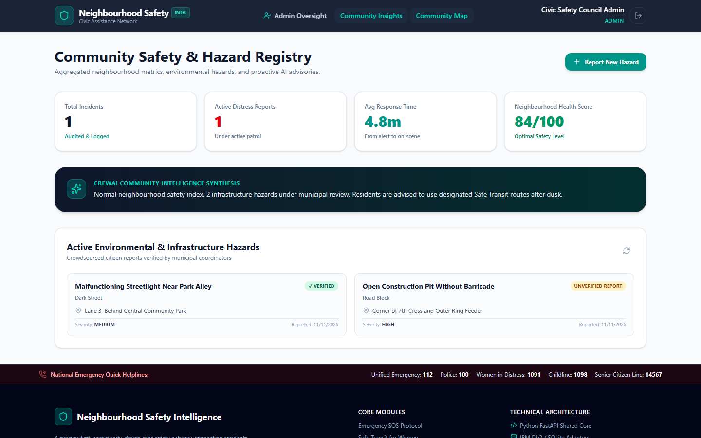
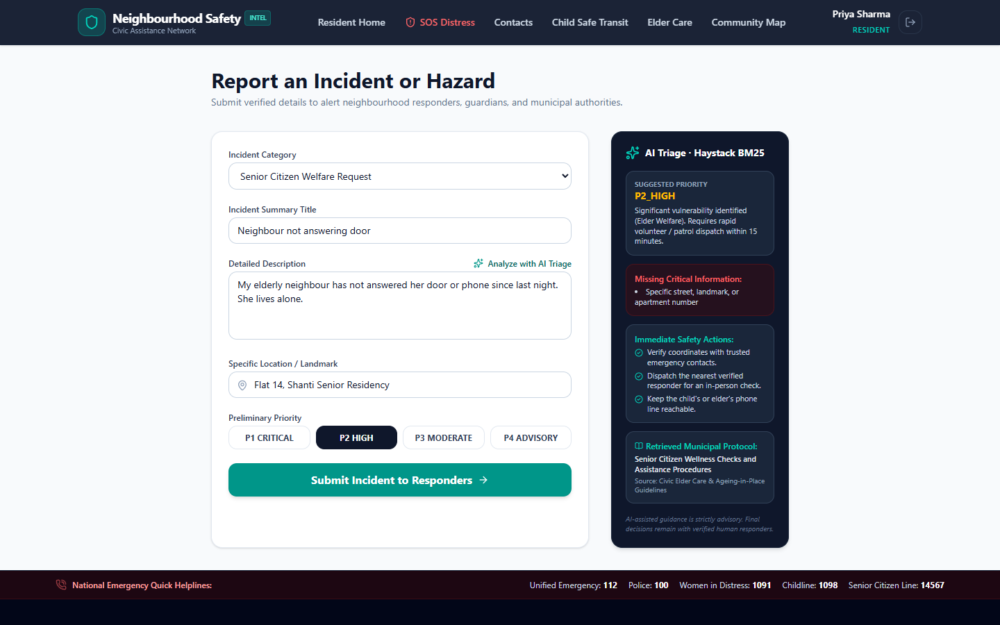
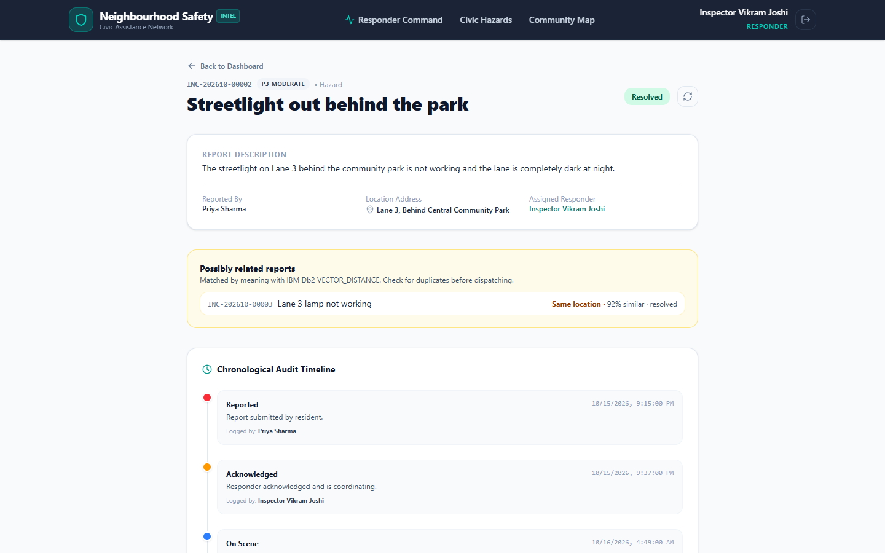
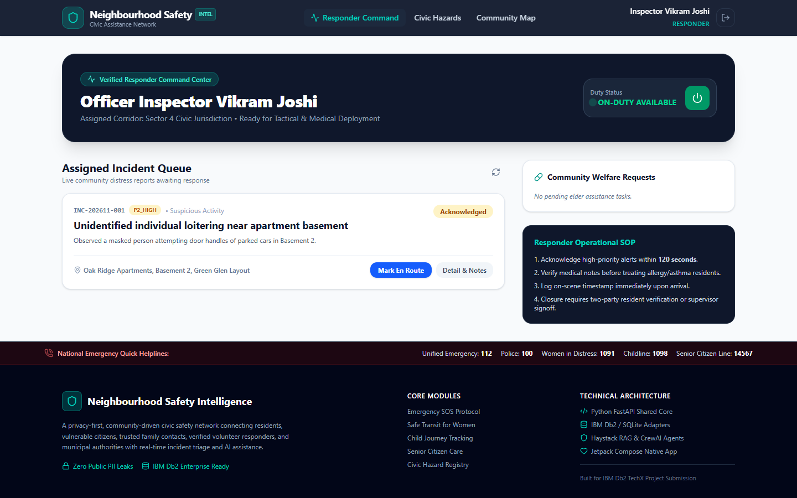
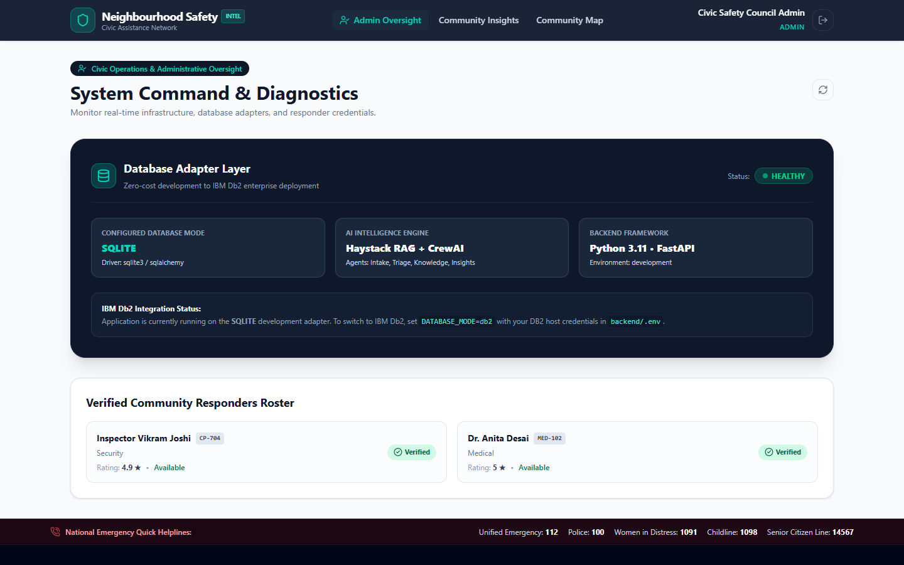
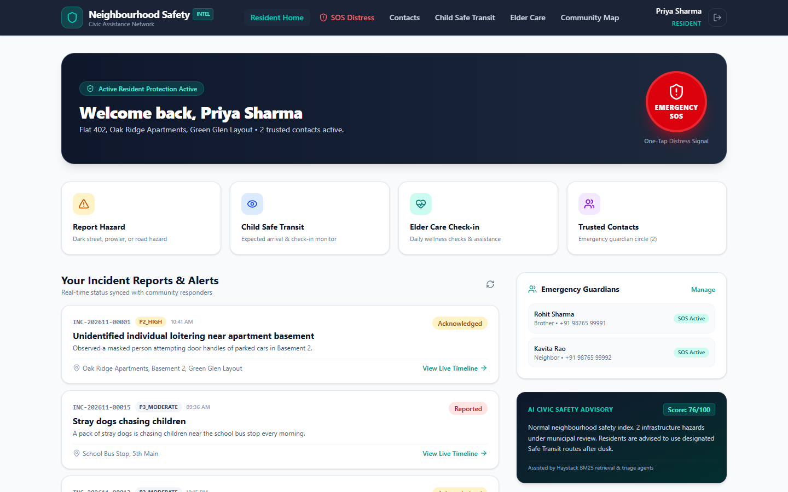
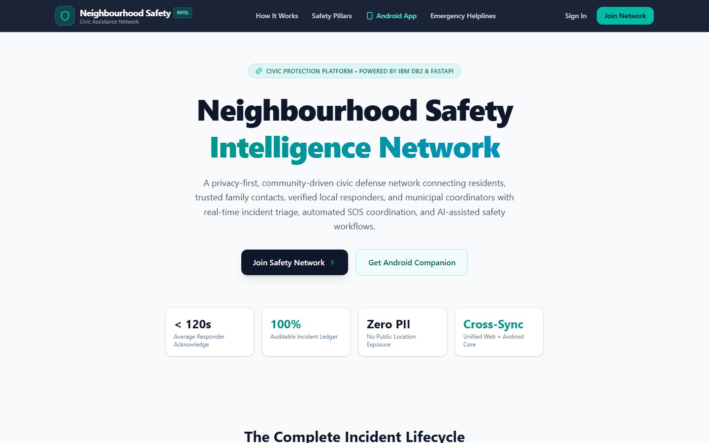
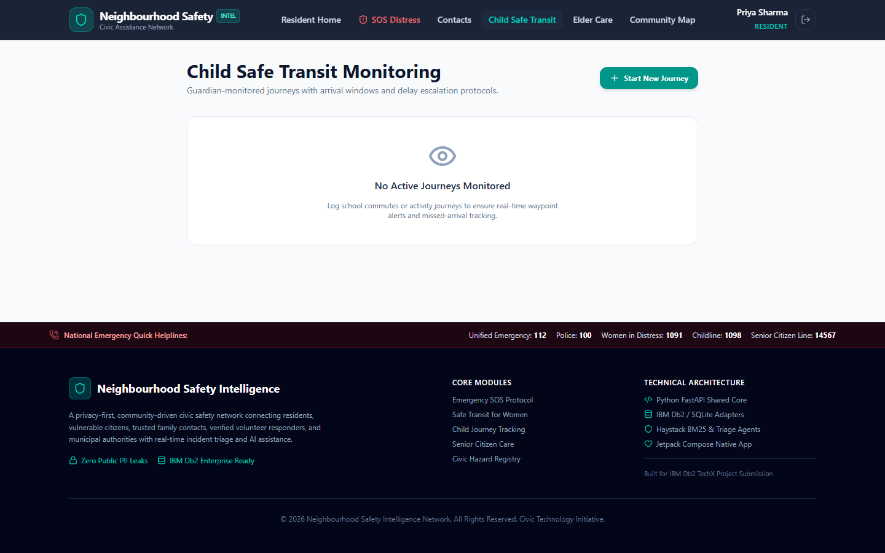
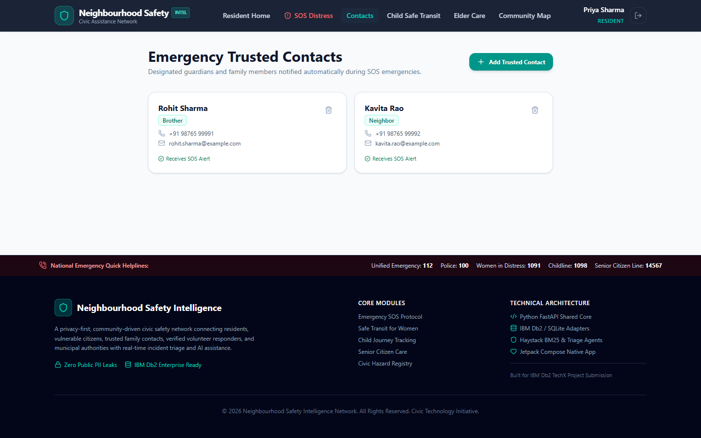

# Neighbourhood Safety Intelligence Network (NSIN)

> **One-Line Pitch:** A neighbourhood emergency and safety platform (web + Android + FastAPI) where IBM Db2 is the system of record. It stores every SOS, incident, status change and audit event, runs semantic search over safety protocols and incident reports with native `VECTOR` columns, and computes response-time analytics in Db2 SQL.



---

## Table of Contents
- [Documentation](#documentation)
- [Problem Statement](#problem-statement)
- [Solution Overview](#solution-overview)
- [IBM Db2 Integration](#ibm-db2-integration)
- [AI / LLM Architecture (if applicable)](#ai--llm-architecture-if-applicable)
- [Tech Stack](#tech-stack)
- [Prerequisites](#prerequisites)
- [Setup & Installation](#setup--installation)
- [Configuration](#configuration)
- [Running the Project](#running-the-project)
- [Testing & Verification](#testing--verification)
- [Screenshots & Demo](#screenshots--demo)
- [Known Limitations & Future Roadmap](#known-limitations--future-roadmap)
- [Team Members & Credits](#team-members--credits)

---

## Documentation
| Document | What's inside |
|---|---|
| [architecture.md](architecture.md) | Components, diagrams, data flow, Db2 schema and SQL |
| [docs/DB2_DEEP_DIVE.md](docs/DB2_DEEP_DIVE.md) | Every IBM Db2 feature in use (vectors, JSON, analytics SQL, transactions, roles), with code locations |
| [docs/AI_DESIGN.md](docs/AI_DESIGN.md) | Granite models, Haystack / CrewAI / LangChain pipelines, grounding and measured calibration |
| [docs/SECURITY.md](docs/SECURITY.md) | Threat model mapped to code and tests, least privilege, privacy, scan results |
| [docs/INNOVATION.md](docs/INNOVATION.md) | What is new, who benefits, and the evidence |
| [docs/TESTING.md](docs/TESTING.md) | Real-infrastructure tests, what each file proves, bugs caught on Db2 |

---

## Problem Statement
- **The problem:** When something goes wrong in a residential neighbourhood (a fall, someone following a woman home, a child who hasn't reached school, a broken streetlight), the people who can help fastest are nearby: family, neighbours and local volunteers. Today that help is coordinated in noisy WhatsApp groups with no priority, no status tracking and no record of who responded.
- **Who it's for:** Residents, especially women travelling alone, school-going children and senior citizens living independently. Also the volunteer responders and resident-welfare-association (RWA) admins who coordinate help.
- **Why existing tools fall short:** Emergency-number apps only reach official services. Chat groups have no incident lifecycle, prioritisation or accountability. Location-sharing apps don't cover hazards, elder check-ins or responder dispatch. Nothing ties these together around one trustworthy, auditable record, or measures how fast help actually arrives.

---

## Solution Overview

| Feature | What it does |
|---|---|
| **SOS dispatch** | Two-step confirmed SOS writes a `P1_CRITICAL` incident, its GPS point, the first status entry and an audit row in **one Db2 transaction**, and records how many trusted contacts and on-duty verified responders it reached. |
| **Incident lifecycle** | Enforced state machine `reported → acknowledged → responder_en_route → on_scene → resolving → resolved / false_alarm`. Illegal transitions return 409, and every step is appended to `incident_status_history`. |
| **AI triage with citations** | A CrewAI Flow classifies a free-text report, suggests a priority with reasoning, escalates critical reports, lists missing details and cites the exact protocol passage that matched (Haystack hybrid search over IBM Db2). The result is saved per incident. |
| **Filtered protocol search** | `GET /ai/guidance` answers safety questions with hybrid search plus metadata filters (protocol category, audience such as women, seniors or guardians). In Db2 the filters run as `JSON_VALUE` predicates. |
| **Related-report detection** | Responders see reports with similar meaning (Db2 `VECTOR_DISTANCE`), with reports at the same address ranked first, so duplicates are spotted before dispatch. |
| **Response analytics** | Median / p90 time-to-acknowledge per priority against SOP targets, `RANK()`-ordered hotspots and live SLA breaches, all computed in Db2 SQL. |
| **Child safe transit** | Guardians start a journey with an expected arrival; overdue journeys are flagged `delayed` automatically. |
| **Elder care** | Daily wellness check-ins and assistance requests; reports of unresponsive seniors escalate to P2. |
| **Trusted contacts & roles** | Per-resident emergency circle; resident, guardian, responder and admin roles. Responders must be verified by an admin before they can act. |

Web and Android share one REST API, so an SOS raised on a phone appears in the web responder queue.

---

## IBM Db2 Integration

- **Db2 Edition & Environment:** IBM Db2 12.1 Community Edition (`icr.io/db2_community/db2`), e.g. the instance created by the IBM Db2 VS Code extension, or the bundled container in [`docker-compose.yml`](docker-compose.yml). Db2 on IBM Cloud works by setting `DB2_SECURITY=SSL`.
- **Connector / Driver Used:**
  - `ibm_db_sa` (SQLAlchemy dialect) for all application reads and writes.
  - `ibm_db` (native driver) for the health probe (`SYSIBM.SYSDUMMY1`, `server_info()`) and parameterised `prepare` / `execute` with explicit commit / rollback ([`db2_adapter.py`](src/backend/app/database/db2_adapter.py)).
- **Database Schema / Data Models:** 14 tables, 11 secondary indexes. The real DDL, exported with `db2look`, is in [`db/db2_schema.sql`](db/db2_schema.sql); the design is explained in [architecture.md](architecture.md#ibm-db2-schema--storage-design).
  - 12 relational tables: users, contacts, responders, incidents, append-only status history, location events, child journeys, elder check-ins, assistance requests, hazards, AI analyses and audit events.
  - 2 tables with native **`VECTOR(384, FLOAT32)`** columns: `nsin_protocol_passages` (managed by IBM's Haystack integration, `ibm-db-haystack`, with metadata stored as BSON) and `incident_embeddings`.
- **Key Queries & Operations:**

| Db2 feature | Where it's used |
|---|---|
| `VECTOR(384, FLOAT32)` + `VECTOR_DISTANCE(..., COSINE)` | Protocol passages via IBM's `IBMDb2DocumentStore` / `IBMDb2EmbeddingRetriever` ([`rag_pipeline.py`](src/backend/app/ai/haystack/rag_pipeline.py)); related-incident search with `langchain-db2` `DB2VS` ([`db2_vector_store.py`](src/backend/app/ai/semantic/db2_vector_store.py)) |
| `JSON_VALUE(SYSTOOLS.BSON2JSON(meta), ...)` | Metadata filters (category, audience) on protocol passages, translated by the IBM Haystack store |
| IBM's agent-framework packages | `crewai-tools` **`DB2VectorSearchTool`** (CrewAI agents search protocol passages in Db2) and `langchain-db2` **`DB2VS`** (related-incident vector store), both on Granite embeddings |
| CTEs, `SECONDS_BETWEEN`, `MEDIAN`, `PERCENTILE_CONT(0.9) WITHIN GROUP` | Time-to-acknowledge statistics per priority ([`insights.py`](src/backend/app/analytics/insights.py)) |
| `RANK() OVER (ORDER BY COUNT(*) DESC)`, `HOUR()` | Hotspot ranking and hourly distribution |
| `SYSCAT.TABLES`, `SYSCAT.COLUMNS`, `CURRENT SCHEMA` | Catalog-driven DDL (create only what's missing) and schema tests |
| Transactions + identity columns | SOS / incident writes commit together; reference codes are derived from the identity value, so they never collide |
| Roles and grants | `NSIN_APP` role with data access only; `audit_events` is append-only for the app ([`db/least_privilege.sql`](db/least_privilege.sql)) |

- **Least privilege, proven:** the full test suite also runs as a restricted login (`nsinapp`), and tests assert that `CREATE`, `DROP`, `ALTER` and `UPDATE` / `DELETE` on `audit_events` are rejected with `SQL0551N`.
- **Db2 only:** there is no fallback database. If Db2 is unreachable the backend refuses to start, and every test runs against a real Db2.

---

## AI / LLM Architecture (if applicable)
- **Frameworks:**
  - **Haystack 2** with IBM's **`ibm-db-haystack`** integration (`IBMDb2DocumentStore`, `IBMDb2EmbeddingRetriever`) and **`ollama-haystack`** embedders (IBM Granite). A `DocumentSplitter` turns the protocols into passages, and `DocumentJoiner` fuses the keyword and vector branches by reciprocal rank fusion ([`rag_pipeline.py`](src/backend/app/ai/haystack/rag_pipeline.py)).
  - **CrewAI Flows** orchestrate the triage agents with typed state and a router (`@start` → `@listen` → `@router` → critical / standard branch) ([`agents.py`](src/backend/app/ai/crewai/agents.py)).
- **Model Provider & Model:** **IBM Granite**, served locally by **Ollama**: `granite-embedding:278m` (768-dim embeddings stored in Db2 `VECTOR` columns) and `granite3.3:2b` (chat model for the CrewAI crew). Resident reports never leave the machine. CrewAI and Haystack telemetry are disabled.
- **Pipelines:**
  - **Indexing** (Db2 mode): `DocumentSplitter` → `OllamaDocumentEmbedder` (Granite) → `DocumentWriter` into `IBMDb2DocumentStore`. Passages carry metadata (category, audience, source, updated date), stored as BSON in Db2.
  - **Query:** `OllamaTextEmbedder` (Granite) → `IBMDb2EmbeddingRetriever` (Db2 `VECTOR_DISTANCE`), alongside `InMemoryBM25Retriever`. The same metadata filters apply to both branches.
  - **Fusion and trust:**
    - The vector branch is gated by a calibrated distance and top-2 margin, so off-topic questions return nothing.
    - The keyword branch needs real word overlap.
    - Passages collapse to their protocol, `DocumentJoiner` applies RRF, and the triaged category adds a soft prior.
    - Each answer cites the passage that matched and says which branch found it.
  - **Triage flow (CrewAI):**
    1. **Intake** (whole-word rules: category, location, missing details).
    2. **Assess** (`P1_CRITICAL … P4_ADVISORY` with reasoning).
    3. **Router:** P1 reports take the **escalation** branch, which puts the "call 112" step first.
    4. **Knowledge:** hybrid retrieval.

    With an `incident_id`, the analysis is upserted into `ai_analysis_records` and audited.
  - **Related reports:** each new incident is embedded into `incident_embeddings`, and `GET /incidents/{id}/similar` returns related reports, same address first.
  - **Multi-agent briefing (CrewAI Crew on Granite):** `POST /ai/crew-briefing` runs a *Triage Analyst* and a *Protocol Advisor* agent. The advisor uses IBM's **`DB2VectorSearchTool`** (from `crewai-tools`) to search the protocol passages in Db2. Retrieved passages go into the task context; the answer is checked for a cited protocol (`grounded`), and the rule-based priority stays authoritative.
- **If Ollama is down**, retrieval keeps answering with the BM25 branch and the briefing endpoint returns the rule-based triage with `briefing_error`; `/health` reports why.

Output is advisory. Humans make every dispatch decision.

---

## Tech Stack
- **Backend / Core:** Python 3.11, FastAPI, SQLAlchemy 2, Pydantic 2, PyJWT (HS256), bcrypt
- **Database:** IBM Db2 12.1 only (`ibm_db`, `ibm_db_sa`, `ibm-db-haystack`): relational tables, `VECTOR` columns, BSON/JSON metadata
- **AI / Retrieval:** IBM's Db2 packages for **Haystack** (`ibm-db-haystack`), **CrewAI** (`crewai-tools` `DB2VectorSearchTool`) and **LangChain** (`langchain-db2` `DB2VS`); `ollama-haystack`, `langchain-ollama`; CrewAI (Flow + Crew); Ollama with IBM Granite models
- **Frontend / UI:** React 19 + TypeScript + Vite + Tailwind CSS 4 (web); Kotlin + Jetpack Compose + Material 3 + Retrofit (Android)
- **Libraries & Tools:** Docker Compose, pytest + pytest-cov, Robolectric, ruff, oxlint, Gradle wrapper

---

## Prerequisites
- **IBM Db2 12.1:** for example the instance created by the **IBM Db2 VS Code extension** ("Create Db2 instance"), any Db2 Community Edition container, or Db2 on IBM Cloud
- **Ollama** with the IBM Granite models: `ollama pull granite3.3:2b` and `ollama pull granite-embedding:278m`
- **Docker** with Docker Compose v2 (to run the stack in containers), or **Python ≥ 3.11** + **Node.js ≥ 18** (to run it directly)
- **JDK 17 + Android SDK 36**, or Android Studio (optional, Android app)

---

## Setup & Installation

```bash
git clone https://github.com/KunalGolaIBM/IBM_Db2_TechX_Project_Submission.git
cd IBM_Db2_TechX_Project_Submission/submissions/neighbourhood-safety-intelligence-network

ollama pull granite3.3:2b
ollama pull granite-embedding:278m

# Only needed when running without Docker:
python -m venv .venv
source .venv/bin/activate              # Windows: .venv\Scripts\activate
pip install -r src/backend/requirements.txt
npm --prefix src/web-app install
```

---

## Configuration

```bash
cp .env.example src/backend/.env       # then set DB2_PASSWORD (and the other DB2_* values)
cp src/web-app/.env.example src/web-app/.env
```

| Variable | Purpose |
|---|---|
| `DB2_HOST`, `DB2_PORT`, `DB2_DATABASE`, `DB2_USER`, `DB2_PASSWORD` | Db2 connection (`DB2_NAME`, `DB2_USERNAME`, `DB2_SSL` are accepted too) |
| `DB2_SECURITY` | Empty for a local Db2, `SSL` for Db2 on IBM Cloud |
| `DB2_SCHEMA` | Schema owning the tables, when connecting as the least-privilege login |
| `OLLAMA_HOST`, `OLLAMA_CHAT_MODEL`, `OLLAMA_EMBED_MODEL`, `EMBEDDING_DIM` | Local IBM Granite models (defaults: `granite3.3:2b`, `granite-embedding:278m`, 768) |
| `ENABLE_VECTOR_SEARCH`, `ENABLE_LLM_BRIEFING` | Turn the vector search or the LLM crew off |
| `JWT_SECRET` | Token signing key; required (32+ characters) when `APP_ENV=production` |
| `CORS_ORIGINS` | Comma-separated allowed web origins (no wildcard in production) |

The backend reads `src/backend/.env`; real environment variables take precedence.

> **Security Warning:** Never commit `.env` or any real API keys or database passwords to Git! `.env` is gitignored, and `.env.example` contains placeholders only.

---

## Running the Project

### Option A: Docker, with your existing Db2
```bash
DB2_PASSWORD=<your password> docker compose up --build
```
The backend connects to Db2 on the host (default database `TESTDB`, user `db2inst1`) and to Ollama on the host. On first start it creates the schema (12 relational + 2 vector tables), seeds a 30-day demo history, and embeds protocols and incidents into Db2 with Granite.

- Web app: **http://localhost:3000**
- API + Swagger UI: http://localhost:8000/docs
- Db2 status: http://localhost:8000/health shows the Db2 version, `vector_search.enabled` and `hybrid_retrieval.hybrid`

### Option B: Docker, with a bundled Db2
```bash
DB2_HOST=db2 DB2_PASSWORD=<choose one> docker compose --profile bundled-db2 up --build
```
This also starts Db2 Community Edition. Its first start takes 3–5 minutes.

### Option C: Run directly
```bash
cd src && uvicorn backend.app.main:app --reload --port 8000     # run from src/
npm --prefix src/web-app run dev                                # http://localhost:5173
```

### Least-privilege Db2 login
```bash
NSIN_APP_PASSWORD='choose-a-strong-password' DB2_CONTAINER=<db2 container> ./scripts/db2_least_privilege.sh
# then run the backend with DB2_USER=nsinapp, DB2_PASSWORD=<that password>, DB2_SCHEMA=DB2INST1
```

### Android
```bash
cd src/android
./gradlew :app:assembleDebug          # Windows: gradlew.bat
```
The app talks to `http://10.0.2.2:8000` (the host machine from the emulator); on a device, set your machine's LAN IP in **Settings**. Cleartext HTTP is allowed in debug builds only.

### Demo accounts (password `Password123!`)
| Role | Email | Try this |
|---|---|---|
| Resident | `resident@neighbourhood.org` | SOS, report an incident and run AI triage, trusted contacts, child journey |
| Responder | `responder@neighbourhood.org` | Claim an incident, move it to on-scene, open it to see related reports |
| Elder | `elder.ramesh@neighbourhood.org` | Daily check-in, assistance request |
| Admin | `admin@neighbourhood.org` | Db2 diagnostics, verify pending responders, community analytics |

### API overview (`/api/v1`, full schemas at `/docs`)
| Area | Endpoints |
|---|---|
| Auth & profile | `POST /auth/register`, `POST /auth/login`, `GET/PATCH /profiles/me` |
| SOS & incidents | `POST /sos`, `GET/POST /incidents`, `GET /incidents/{id}`, `GET /incidents/{id}/similar`, `POST /incidents/{id}/acknowledge`, `POST /incidents/{id}/status` |
| Contacts, children, elders | `/trusted-contacts`, `/children/journeys`, `/elder-care/checkins`, `/elder-care/assistance-requests` |
| Responders | `GET /responders/assignments`, `PATCH /responders/availability`, `GET /responders/roster`, `POST /responders/{user_id}/verify` (admin) |
| Community & AI | `GET /community/insights`, `GET/POST /community/hazards`, `POST /ai/incident-assistance`, `POST /ai/crew-briefing`, `GET /ai/guidance?query=&category=&audience=` |

---

## Testing & Verification

All tests are **integration tests against a real IBM Db2 and a real local Ollama**. Nothing is mocked and there is no SQLite. At the start of a run the application's tables are dropped and recreated, so use a dedicated database.

```bash
# Defaults: localhost:50000, database TESTDB, user db2inst1 (set DB2_PASSWORD, or the other DB2_* variables)
DB2_PASSWORD=<password> pytest tests/ --cov=src/backend/app

# As the least-privilege login (after the script above; keeps the existing tables)
NSIN_KEEP_DB=1 DB2_USER=nsinapp DB2_PASSWORD=<password> DB2_SCHEMA=DB2INST1 pytest tests/

npm --prefix src/web-app run build                          # type-check + production build
cd src/android && ./gradlew :app:testDebugUnitTest          # Android JVM tests (Robolectric)
```

| Suite | Result |
|---|---|
| Backend on IBM Db2 `TESTDB` + Ollama Granite (real, no mocks) | 77 passed, 5 skipped (least-privilege-only tests) · **96% line coverage** |
| Android `testDebugUnitTest` | 4 passed; `assembleDebug` builds |
| Web `npm run build` | passes (strict TypeScript) |

The tests cover:
- **Security:** admin self-registration blocked, login throttling, token tampering, private-incident isolation, privacy masking, responder verification, input limits sized to the Db2 columns, security headers.
- **Integrity:** the incident state machine, collision-free reference codes, SOS atomicity and audit rows, overdue journeys.
- **Db2:**
  - native `ibm_db` prepared statements, rollback and connection errors;
  - the catalog including the `VECTOR` columns;
  - analytics with exact median and p90 values;
  - semantic retrieval and off-topic rejection, metadata filters, duplicate-report linking;
  - DDL denied to the restricted login.
- **AI:**
  - triage wording traps;
  - the CrewAI flow's branches;
  - the Granite crew briefing, including degradation when Ollama is unreachable;
  - cited protocols per category.

**Inspect the data directly in Db2:**
```bash
docker exec -it <db2 container> su - db2inst1 -c "db2 connect to TESTDB && \
  db2 \"SELECT reference_code, priority, status FROM incidents ORDER BY id DESC FETCH FIRST 5 ROWS ONLY\" && \
  db2 \"SELECT JSON_VALUE(SYSTOOLS.BSON2JSON(meta), '$.category' RETURNING VARCHAR(40)) AS category, COUNT(*) AS passages FROM nsin_protocol_passages GROUP BY JSON_VALUE(SYSTOOLS.BSON2JSON(meta), '$.category' RETURNING VARCHAR(40))\""
```

---

## Screenshots & Demo
- **Live Demo Link:** Not hosted. Run locally with Option A.
- **Demo Video Link:** Submitted with the Db2Hack form (YouTube).
- All screenshots were captured from the Docker stack running on IBM Db2 ([`docs/screenshots/`](docs/screenshots/)):

| AI triage with a cited protocol | Related reports (Db2 `VECTOR_DISTANCE`) |
|---|---|
|  |  |
| **Responder queue** | **Admin: live Db2 diagnostics** |
|  |  |
| **Resident dashboard** | **Landing page** |
|  |  |
| **Child safe transit** | **Trusted contacts** |
|  |  |

---

## Known Limitations & Future Roadmap
- **Current Limitations:**
  - SOS alerts reach trusted contacts and responders in-app; SMS and push delivery are not wired to a provider yet.
  - Triage rules are deterministic. They are predictable and tested, but phrasing outside their vocabulary falls back to the reported category.
  - Location is a free-text address plus latitude/longitude; there are no spatial queries yet.
  - The login throttle is in-process (one backend instance).
- **Next Steps:**
  - An optional watsonx.ai Granite summary step behind the existing rule-based guardrails.
  - Add a Db2 vector index and more protocol sources (municipal circulars) as the corpus grows.
  - Spatial hotspot clustering, FCM push notifications and an SMS fallback for SOS.
  - Row-level access control for multi-society deployments on one Db2.

---

## Team Members & Credits
| Name | GitHub Handle | Role / Contribution |
|---|---|---|
| Yagnik Sharma | [@YagnikSharma](https://github.com/YagnikSharma) | Full stack: FastAPI backend, IBM Db2 integration (vectors, analytics, least privilege), Haystack + CrewAI pipelines, React web app, Android app |

**License:** MIT (see [LICENSE](LICENSE)). Third-party components keep their own licenses: FastAPI, SQLAlchemy, React and CrewAI are MIT; IBM Granite models are Apache-2.0; Haystack, `ibm-db-haystack`, Retrofit, `ibm_db` and `ibm_db_sa` are Apache-2.0; Db2 Community Edition is under the IBM license, accepted via `LICENSE=accept`.
