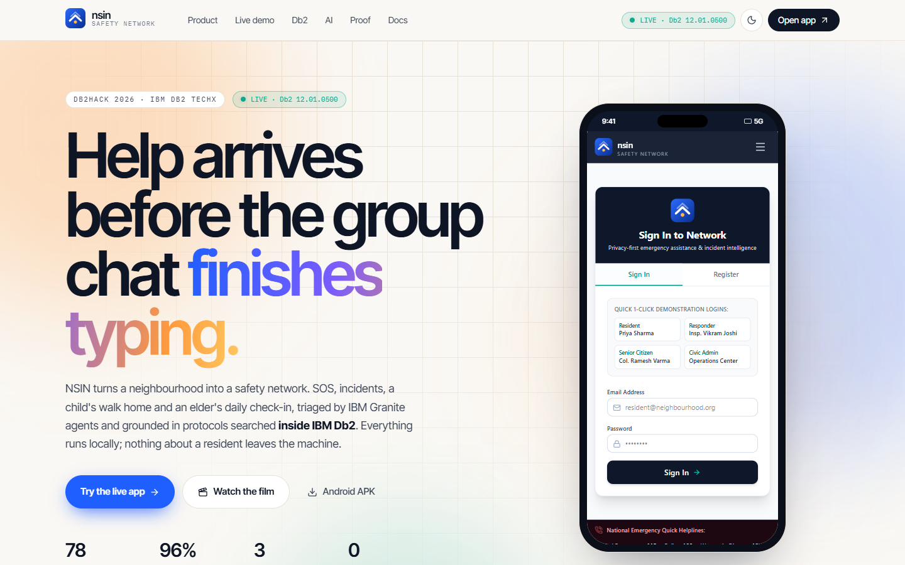
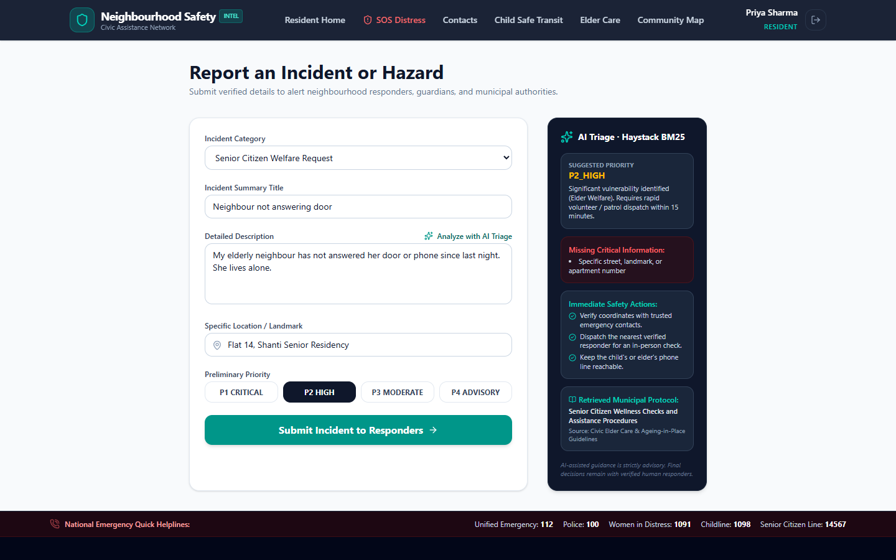
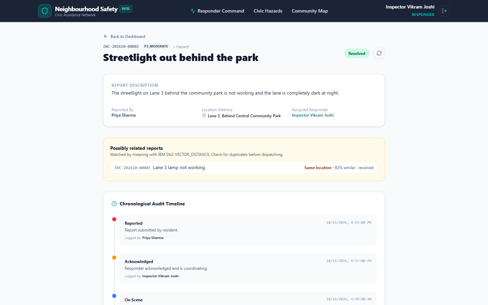
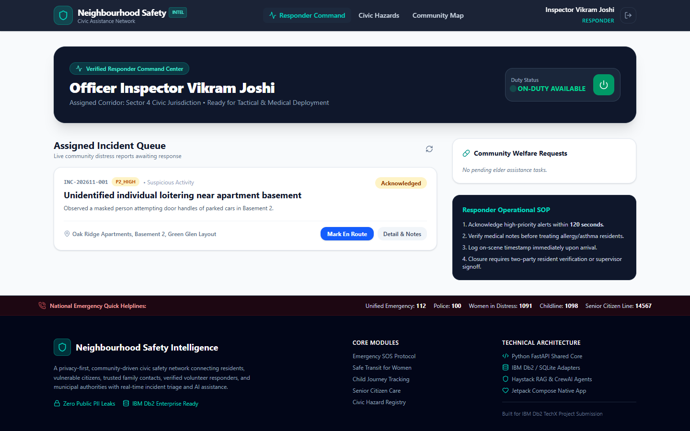
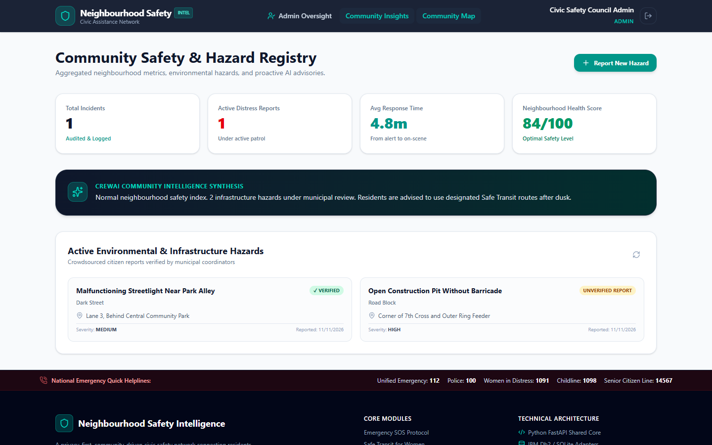
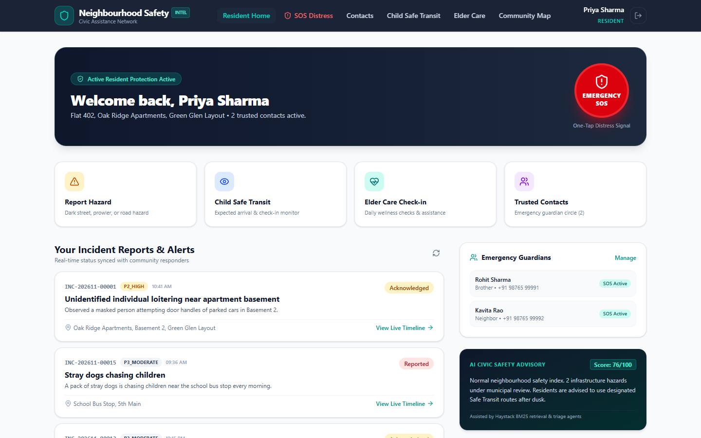
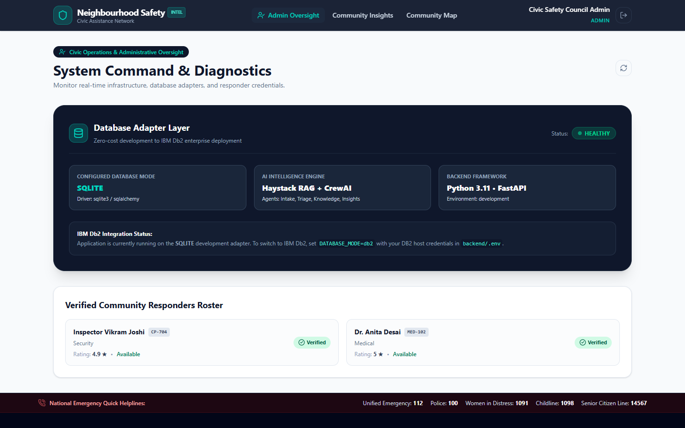
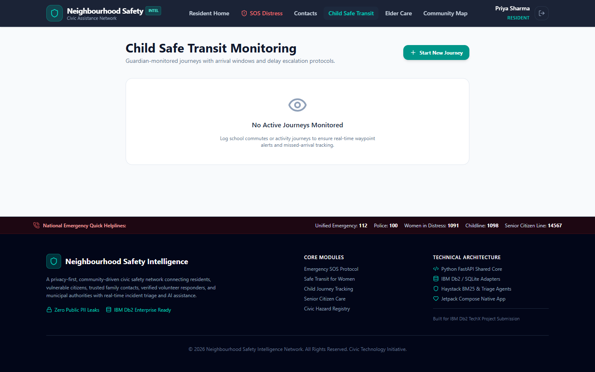
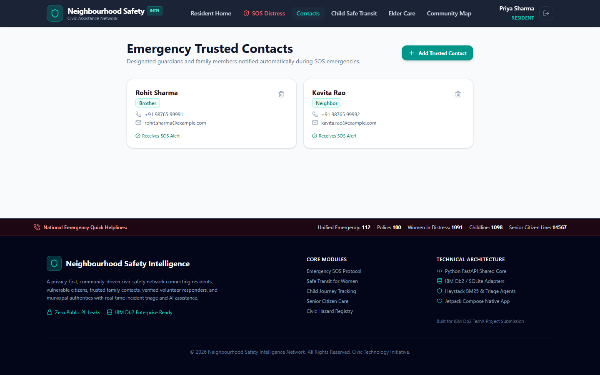
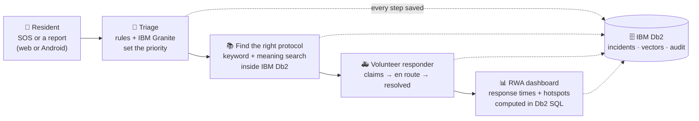

<div align="center">

# 🛡️ NSIN · Neighbourhood Safety Intelligence Network

### Help is two minutes away. NSIN makes sure it knows.

An emergency app for Indian neighbourhoods. A resident raises an SOS, AI works out how serious it is, the nearest verified volunteer is alerted, and every step is tracked until help arrives, with **IBM Db2** as the single source of truth.

[](https://ibm-db2-tech-x-project-submission-n.vercel.app)
[](docs/JUDGES_GUIDE.md)
[](https://ibm-db2-tech-x-project-submission-n.vercel.app/downloads/nsin-android.apk)

-0f62fe)


[](https://ibm-db2-tech-x-project-submission-n.vercel.app)

</div>

---

## ⏱️ NSIN in 30 seconds

| | |
|---|---|
| **The problem** | In a neighbourhood emergency, the people who can help fastest live next door. Today they find out through a noisy WhatsApp group, if at all: no priority, no owner, no record. |
| **What NSIN does** | One tap raises an SOS. AI reads the report and sets a priority. Verified volunteers nearby are alerted, claim it, and close it. Families also get child-commute tracking and daily elder check-ins. |
| **Why IBM Db2** | Db2 is not just storage here. It stores every incident safely in one transaction, **searches by meaning** with native `VECTOR` columns, and **computes response-time analytics** in SQL. |
| **Proof** | 78 integration tests on a real Db2 with real AI models and **zero mocks**, 96% coverage, a live demo, and an Android app that runs on a real phone. |

---

## 📖 A real story: 9:40 pm, Lotus Towers

> **Without NSIN.** Mrs Iyer, 74, lives alone on the 6th floor. Her daughter in Pune calls; no answer. She posts in the society WhatsApp group. The message sits between a lost-cat photo and a maintenance reminder. Someone sees it 50 minutes later.
>
> **With NSIN.** The daughter types *"My elderly mother has not answered her door or phone since evening. She lives alone in Flat 6B, Lotus Towers."*
> 1. **Triage in under a second.** NSIN classifies it as *elder welfare* and raises it to **P2 – High**: an unanswered door for a senior who lives alone needs an in-person check within 15 minutes. (With vaguer wording, NSIN lists the missing details to ask for, such as the flat number or whether anyone is with her.)
> 2. **The right protocol, cited.** The approved *Senior Citizen Wellness Check* procedure is attached, quoting the exact passage.
> 3. **The nearest verified volunteer** on the responder queue claims it. The status moves *acknowledged → en route → on scene*, each step written to Db2.
> 4. **Nothing is lost.** The RWA dashboard later shows how fast this kind of call is answered (median and 90th percentile), straight from Db2 SQL.

---

## 📸 See it

| ① A resident reports, AI triages and cites a protocol | ② Responders see related reports (Db2 `VECTOR_DISTANCE`) |
|---|---|
|  |  |
| **③ The responder queue: claim, en route, on scene, resolved** | **④ RWA analytics computed in Db2: median and p90, hotspots** |
|  |  |
| **⑤ The resident home: SOS, contacts, alerts** | **⑥ Admin: live Db2 diagnostics** |
|  |  |
| **⑦ Child safe transit with an expected arrival** | **⑧ Trusted contacts: your emergency circle** |
|  |  |

---

## 🧭 How it works (plain English)



| Step | What happens | What IBM Db2 does |
|---|---|---|
| **1. Raise** | Two-tap SOS, or a free-text report with location | Writes the incident, GPS point, first status and audit row in **one ACID transaction** |
| **2. Triage** | Rules + a CrewAI flow decide P1–P4. Critical reports skip the queue ("call 112" first) | Saves the AI analysis per incident, auditable |
| **3. Ground** | The approved safety protocol is retrieved, and the exact passage is quoted | **`VECTOR(768)` + `VECTOR_DISTANCE`** search by meaning, fused with keyword search |
| **4. Respond** | A verified volunteer claims it, and duplicates are spotted first | Finds related reports by meaning; an append-only status history |
| **5. Learn** | The RWA sees how fast help arrives, and where | `MEDIAN`, `PERCENTILE_CONT`, `RANK() OVER` in SQL |

**AI that is safe to be wrong.** The rule engine always runs, and IBM Granite models run **locally** through Ollama, so resident reports never leave the machine. AI output is advisory, and humans dispatch.

---

## 🇮🇳 Why this matters: the market

| Signal | Number | Source |
|---|---|---|
| Indians aged 60+ | **~15 crore** (10.5% of the population), rising to 20% by 2050 | UNFPA *India Ageing Report 2023* |
| Crimes against women registered | **4.45 lakh** cases in 2022 | NCRB *Crime in India 2022* |
| Children reported missing | **83,000+** in 2022 | NCRB *Crime in India 2022* |
| Where people live | Fast-growing gated societies and RWAs in metro and tier-2 cities, each already organised as a community with a committee | — |

**Who pays:** RWAs and society committees (per-flat SaaS), families (premium elder and child safety), and campuses, hostels and corporates (B2B). It is free for residents and volunteers, so the network grows.

### How NSIN is different

| | **NSIN** | Society apps (MyGate, NoBrokerHood) | 112 / police apps | WhatsApp groups | Family trackers (Life360) |
|---|:---:|:---:|:---:|:---:|:---:|
| AI triage with priority | ✅ | – | – | – | – |
| Nearby verified volunteers | ✅ | – | – | ⚠️ unverified | – |
| Incident tracked to resolution | ✅ | – | ✅ | – | – |
| Child commute + elder check-ins | ✅ | – | – | – | ⚠️ location only |
| Response-time analytics for the community | ✅ | – | – | – | – |
| Works with official 112 (not instead of it) | ✅ | – | ✅ | – | – |

---

## ✅ Proof, not promises

| What | Result | Evidence |
|---|---|---|
| Integration tests on a **real IBM Db2 + real Granite models** | **78 passed, 0 failed, 96% coverage, 0 mocks** | [docs/TESTING.md](docs/TESTING.md) |
| Least-privilege Db2 login | `CREATE` / `DROP` / `ALTER` and audit tampering **all rejected** (`SQL0551N`) | `test_least_privilege_login_is_denied_ddl_and_audit_tampering` |
| Analytics correctness | Exact median **7.0** and p90 **10.2** on a known timeline | `test_db2_sql_analytics_compute_exact_median_and_p90` |
| Search quality | The right protocol for questions with **no shared keywords**; off-topic questions return **nothing** | `test_semantic_retrieval_*` |
| Security scans | Bandit **0 issues**, npm audit **0**, ruff clean | [docs/SECURITY.md](docs/SECURITY.md) |
| Runs for real | Live web demo, Android APK on a real phone, one-command Docker | [Live demo](https://ibm-db2-tech-x-project-submission-n.vercel.app) |

---

## 🧑‍⚖️ For judges: evaluate in 5 minutes

1. **Open the [live demo](https://ibm-db2-tech-x-project-submission-n.vercel.app).** Click **Resident** (one-click demo login), then **Report incident**. Paste *"My elderly neighbour has not answered her door since last night"* and press **Analyze with AI Triage**.
2. Switch to **Responder** and open any incident to see **related reports** found by meaning in Db2.
3. Switch to **Admin** to see **live Db2 diagnostics** and the analytics.
4. Skim the [Proof table](#-proof-not-promises) and the [Db2 integration](#ibm-db2-integration) below.

Every judging criterion is mapped to evidence in **[docs/JUDGES_GUIDE.md](docs/JUDGES_GUIDE.md)**.

---

## 📚 Documentation
| Document | What's inside |
|---|---|
| [docs/JUDGES_GUIDE.md](docs/JUDGES_GUIDE.md) | **Start here:** every judging criterion mapped to evidence |
| [architecture.md](architecture.md) | Components, diagrams, data flow, Db2 schema and SQL |
| [docs/DB2_DEEP_DIVE.md](docs/DB2_DEEP_DIVE.md) | Every IBM Db2 feature in use, with code locations |
| [docs/AI_DESIGN.md](docs/AI_DESIGN.md) | Granite models, Haystack / CrewAI / LangChain pipelines, grounding and calibration |
| [docs/SECURITY.md](docs/SECURITY.md) | Threat model mapped to code and tests, least privilege, privacy, scans |
| [docs/INNOVATION.md](docs/INNOVATION.md) | What is new, who benefits, and the evidence |
| [docs/TESTING.md](docs/TESTING.md) | Real-infrastructure tests, what each file proves |
| [docs/LIVE_DEMO.md](docs/LIVE_DEMO.md) | How the hosted live demo works, and its security choices |

---

## Problem Statement
- **The problem:** When something goes wrong in a residential neighbourhood (a fall, someone following a woman home, a child who hasn't reached school, a broken streetlight), the people who can help fastest are nearby: family, neighbours and local volunteers. Today that help is coordinated in noisy chat groups with no priority, no status tracking and no record of who responded.
- **Who it's for:** Residents, especially women travelling alone, school-going children and senior citizens living independently. Also the volunteer responders and resident-welfare-association (RWA) admins who coordinate help.
- **Why existing tools fall short:**
  - Emergency-number apps only reach official services.
  - Chat groups have no incident lifecycle, prioritisation or accountability.
  - Location-sharing apps don't cover hazards, elder check-ins or responder dispatch.
  - Nothing ties these together around one trustworthy, auditable record, or measures how fast help actually arrives.

## Solution Overview

| Feature | What it does |
|---|---|
| **SOS dispatch** | A two-step confirmed SOS writes a `P1_CRITICAL` incident, its GPS point, the first status entry and an audit row in **one Db2 transaction**, and records how many trusted contacts and on-duty verified responders it reached |
| **Incident lifecycle** | An enforced state machine: `reported → acknowledged → responder_en_route → on_scene → resolving → resolved / false_alarm`. Illegal transitions return `409`, and every step is appended to `incident_status_history` |
| **AI triage with citations** | A CrewAI Flow classifies a free-text report, suggests a priority with reasoning, escalates critical reports, lists missing details and cites the exact protocol passage that matched (Haystack hybrid search over IBM Db2) |
| **Filtered protocol search** | `GET /ai/guidance` answers safety questions with hybrid search and metadata filters (category; audience such as women, seniors or guardians), run as `JSON_VALUE` predicates in Db2 |
| **Related-report detection** | Responders see reports with similar meaning (Db2 `VECTOR_DISTANCE`), with the same address ranked first, so duplicates are spotted before dispatch |
| **Response analytics** | Median and p90 time-to-acknowledge per priority against SOP targets, `RANK()`-ordered hotspots and live SLA breaches, all in Db2 SQL |
| **Child safe transit** | Guardians start a journey with an expected arrival; overdue journeys are flagged `delayed` automatically |
| **Elder care** | Daily wellness check-ins and assistance requests; reports of unresponsive seniors escalate to P2 |
| **Trusted contacts and roles** | A per-resident emergency circle; resident, guardian, responder and admin roles. Responders must be verified by an admin before they can act |

Web and Android share one REST API, so an SOS raised on a phone appears in the web responder queue.

## IBM Db2 Integration

- **Db2 edition and environment:** IBM Db2 12.1 Community Edition (`icr.io/db2_community/db2`), for example the instance created by the IBM Db2 VS Code extension, or the bundled container in [`docker-compose.yml`](docker-compose.yml). Db2 on IBM Cloud works with `DB2_SECURITY=SSL`.
- **Connectors and drivers:** `ibm_db_sa` (SQLAlchemy) for all application reads and writes. Native `ibm_db` handles the health probe and parameterised `prepare` / `execute` with explicit commit and rollback ([`db2_adapter.py`](src/backend/app/database/db2_adapter.py)).
- **Schema:** 14 tables and 11 secondary indexes. The real DDL, exported with `db2look`, is in [`db/db2_schema.sql`](db/db2_schema.sql). There are 12 relational tables and 2 tables with native **`VECTOR(768, FLOAT32)`** columns (`nsin_protocol_passages`, managed by IBM's `ibm-db-haystack`; and `incident_embeddings`).

| Db2 feature | Where it's used |
|---|---|
| `VECTOR(768, FLOAT32)` + `VECTOR_DISTANCE(..., COSINE)` | Protocol passages through IBM's `IBMDb2DocumentStore` / `IBMDb2EmbeddingRetriever` ([`rag_pipeline.py`](src/backend/app/ai/haystack/rag_pipeline.py)); related-incident search through `langchain-db2` `DB2VS` ([`db2_vector_store.py`](src/backend/app/ai/semantic/db2_vector_store.py)) |
| `JSON_VALUE(SYSTOOLS.BSON2JSON(meta), ...)` | Metadata filters (category, audience) on protocol passages |
| IBM's agent-framework packages | `crewai-tools` **`DB2VectorSearchTool`** (CrewAI agents search Db2 themselves) and `langchain-db2` **`DB2VS`** |
| CTEs, `SECONDS_BETWEEN`, `MEDIAN`, `PERCENTILE_CONT(0.9) WITHIN GROUP` | Time-to-acknowledge statistics per priority ([`insights.py`](src/backend/app/analytics/insights.py)) |
| `RANK() OVER (ORDER BY COUNT(*) DESC)`, `HOUR()` | Hotspot ranking and hourly distribution |
| `SYSCAT.TABLES`, `SYSCAT.COLUMNS`, `CURRENT SCHEMA` | Catalog-driven DDL (create only what's missing) and schema tests |
| Transactions + identity columns | SOS and incident writes commit together; reference codes derive from the identity value, so they never collide |
| Roles and grants | The `NSIN_APP` role has data access only, and `audit_events` is append-only ([`db/least_privilege.sql`](db/least_privilege.sql)) |

- **Least privilege, proven:** the full suite also runs as the restricted login `nsinapp`. `CREATE`, `DROP`, `ALTER`, and `UPDATE` / `DELETE` on `audit_events` are all rejected with `SQL0551N`.
- **Db2 only:** there is no fallback database. If Db2 is unreachable the backend refuses to start, and every test runs against a real Db2.

## AI / LLM Architecture (if applicable)
- **Models:** **IBM Granite**, served locally by **Ollama**. `granite-embedding:278m` gives 768-dimension vectors stored in Db2, and `granite3.3:2b` powers the CrewAI crew. Resident reports never leave the machine, and library telemetry is disabled.
- **Haystack 2 + `ibm-db-haystack`:** `DocumentSplitter` → Granite embedder → `IBMDb2DocumentStore`. Queries run `IBMDb2EmbeddingRetriever` alongside BM25, with the same metadata filters on both branches, fused by `DocumentJoiner` (reciprocal rank fusion). The vector branch is gated by a calibrated distance, so off-topic questions return nothing.
- **CrewAI Flow (triage):** intake → assess → **router** (P1 takes the escalation branch, "call 112" first) → knowledge retrieval. With an `incident_id`, the analysis is saved to `ai_analysis_records` and audited.
- **CrewAI Crew (briefing):** a *Triage Analyst* and a *Protocol Advisor*. The advisor searches Db2 with IBM's `DB2VectorSearchTool`. The answer must cite a retrieved protocol (`grounded`), and the rule-based priority stays authoritative.
- **If Ollama is down**, retrieval falls back to BM25 and the briefing returns the rule-based triage with `briefing_error`; `/health` says why.

Output is advisory. Humans make every dispatch decision.

## Tech Stack
- **Backend:** Python 3.11, FastAPI, SQLAlchemy 2, Pydantic 2, PyJWT, bcrypt
- **Database:** IBM Db2 12.1 only (`ibm_db`, `ibm_db_sa`, `ibm-db-haystack`): relational tables, `VECTOR` columns, BSON/JSON metadata
- **AI:** Haystack (`ibm-db-haystack`), CrewAI (`crewai-tools` `DB2VectorSearchTool`), LangChain (`langchain-db2` `DB2VS`), Ollama with IBM Granite
- **Frontend:** React 19 + TypeScript + Vite + Tailwind CSS 4 (web); Kotlin + Jetpack Compose + Material 3 + Retrofit (Android)
- **Tooling:** Docker Compose, pytest + pytest-cov, Robolectric, ruff, oxlint, Gradle

## Prerequisites
- **IBM Db2 12.1:** for example the instance from the **IBM Db2 VS Code extension**, any Db2 Community Edition container, or Db2 on IBM Cloud
- **Ollama** with `granite3.3:2b` and `granite-embedding:278m`
- **Docker** with Compose v2, or **Python ≥ 3.11** + **Node.js ≥ 18**
- Optional: **JDK 17 + Android SDK 36** for the Android app

## Setup & Installation
```bash
git clone https://github.com/KunalGolaIBM/IBM_Db2_TechX_Project_Submission.git
cd IBM_Db2_TechX_Project_Submission/submissions/neighbourhood-safety-intelligence-network
ollama pull granite3.3:2b && ollama pull granite-embedding:278m

# Only when running without Docker:
python -m venv .venv && source .venv/bin/activate      # Windows: .venv\Scripts\activate
pip install -r src/backend/requirements.txt
npm --prefix src/web-app install
```

## Configuration
```bash
cp .env.example src/backend/.env       # then set DB2_PASSWORD (and the other DB2_* values)
cp src/web-app/.env.example src/web-app/.env
```

| Variable | Purpose |
|---|---|
| `DB2_HOST`, `DB2_PORT`, `DB2_DATABASE`, `DB2_USER`, `DB2_PASSWORD` | Db2 connection (`DB2_NAME`, `DB2_USERNAME`, `DB2_SSL` are accepted too) |
| `DB2_SECURITY` | Empty for a local Db2, `SSL` for Db2 on IBM Cloud |
| `DB2_SCHEMA` | Schema owning the tables, when connecting as the least-privilege login |
| `OLLAMA_HOST`, `OLLAMA_CHAT_MODEL`, `OLLAMA_EMBED_MODEL`, `EMBEDDING_DIM` | Local IBM Granite models (defaults: `granite3.3:2b`, `granite-embedding:278m`, 768) |
| `ENABLE_VECTOR_SEARCH`, `ENABLE_LLM_BRIEFING` | Turn vector search or the LLM crew off |
| `JWT_SECRET` | Token signing key; 32+ characters required when `APP_ENV=production` |
| `CORS_ORIGINS` | Comma-separated allowed web origins (no wildcard in production) |

> **Security:** never commit `.env` or real credentials. `.env` is gitignored, and `.env.example` holds placeholders only.

## Running the Project

**Option A: Docker with your existing Db2**
```bash
DB2_PASSWORD=<your password> docker compose up --build
```
**Option B: Docker with a bundled Db2** (its first start takes 3–5 minutes)
```bash
DB2_HOST=db2 DB2_PASSWORD=<choose one> docker compose --profile bundled-db2 up --build
```
**Option C: Run directly**
```bash
cd src && uvicorn backend.app.main:app --reload --port 8000
npm --prefix src/web-app run dev                     # http://localhost:5173
```
- Web app: **http://localhost:3000** · API docs: http://localhost:8000/docs · Db2 status: http://localhost:8000/health
- On first start the backend creates the schema, seeds a 30-day demo history and embeds protocols and incidents into Db2.

**Least-privilege login:** `NSIN_APP_PASSWORD='<strong password>' DB2_CONTAINER=<container> ./scripts/db2_least_privilege.sh`, then run with `DB2_USER=nsinapp DB2_SCHEMA=DB2INST1`.

**Android:** `cd src/android && ./gradlew :app:assembleDebug`. The app finds the live demo backend from the site's `live.json`, so the [APK](https://ibm-db2-tech-x-project-submission-n.vercel.app/downloads/nsin-android.apk) works on a real phone.

**Demo accounts** (password `Password123!`)

| Role | Email | Try this |
|---|---|---|
| Resident | `resident@neighbourhood.org` | SOS, report an incident and run AI triage, trusted contacts, child journey |
| Responder | `responder@neighbourhood.org` | Claim an incident, move it to on-scene, see related reports |
| Elder | `elder.ramesh@neighbourhood.org` | Daily check-in, assistance request |
| Admin | `admin@neighbourhood.org` | Db2 diagnostics, verify responders, community analytics |

<details>
<summary><b>API overview</b> (<code>/api/v1</code>, full schemas at <code>/docs</code>)</summary>

| Area | Endpoints |
|---|---|
| Auth & profile | `POST /auth/register`, `POST /auth/login`, `GET/PATCH /profiles/me` |
| SOS & incidents | `POST /sos`, `GET/POST /incidents`, `GET /incidents/{id}`, `GET /incidents/{id}/similar`, `POST /incidents/{id}/acknowledge`, `POST /incidents/{id}/status` |
| Contacts, children, elders | `/trusted-contacts`, `/children/journeys`, `/elder-care/checkins`, `/elder-care/assistance-requests` |
| Responders | `GET /responders/assignments`, `PATCH /responders/availability`, `GET /responders/roster`, `POST /responders/{user_id}/verify` |
| Community & AI | `GET /community/insights`, `GET/POST /community/hazards`, `POST /ai/incident-assistance`, `POST /ai/crew-briefing`, `GET /ai/guidance` |
</details>

## Testing & Verification
All tests are **integration tests against a real IBM Db2 and a real local Ollama**. Nothing is mocked.

```bash
DB2_PASSWORD=<password> pytest tests/ --cov=src/backend/app
NSIN_KEEP_DB=1 DB2_USER=nsinapp DB2_PASSWORD=<password> DB2_SCHEMA=DB2INST1 pytest tests/   # as the restricted login
npm --prefix src/web-app run build
cd src/android && ./gradlew :app:testDebugUnitTest
```

| Suite | Result |
|---|---|
| Backend on IBM Db2 `TESTDB` + Granite (real, no mocks) | **78 passed**, 0 failed, 5 skipped (restricted-login-only tests) · **96% coverage** |
| Android `testDebugUnitTest` | 4 passed; `assembleDebug` builds |
| Web `npm run build` | passes (strict TypeScript) |

The tests cover:
- **Security:** blocked admin self-signup, throttling, token tampering, private-incident isolation, privacy masking.
- **Integrity:** the state machine, SOS atomicity and audit, overdue journeys.
- **Db2:** native `ibm_db`, catalog and `VECTOR` columns, exact median and p90, semantic retrieval, duplicate linking, DDL denied.
- **AI:** triage wording traps, flow branches, the Granite crew and its degradation.

## Screenshots & Demo
- **Live demo:** https://ibm-db2-tech-x-project-submission-n.vercel.app. The real app runs live while the demo machine is on; otherwise you see recorded real responses ([how it works](docs/LIVE_DEMO.md)).
- **Demo video:** submitted with the Db2Hack form.
- **Screenshots:** see [📸 See it](#-see-it) above. All were captured from the Docker stack on IBM Db2 ([`docs/screenshots/`](docs/screenshots/)).

## Known Limitations & Future Roadmap
- **Limitations:**
  - SOS alerts reach contacts and responders in-app; SMS and push are not wired to a provider yet.
  - Triage rules are deterministic, so phrasing outside their vocabulary falls back to the reported category.
  - There are no spatial queries yet.
  - The login throttle is per instance.
- **Next:**
  - An optional watsonx.ai Granite summary behind the rule guardrails.
  - A Db2 vector index and more protocol sources.
  - Spatial hotspot clustering, push and SMS fallback.
  - Row-level access control for multi-society deployments on one Db2.

## Team Members & Credits
| Name | GitHub Handle | Role / Contribution |
|---|---|---|
| Yagnik Sharma | [@YagnikSharma](https://github.com/YagnikSharma) | Full stack: FastAPI backend, IBM Db2 integration (vectors, analytics, least privilege), Haystack + CrewAI pipelines, React web app, Android app |

**License:** MIT (see [LICENSE](LICENSE)). Third-party components keep their own licenses: FastAPI, SQLAlchemy, React and CrewAI are MIT; IBM Granite models, Haystack, `ibm-db-haystack`, Retrofit, `ibm_db` and `ibm_db_sa` are Apache-2.0; Db2 Community Edition is under the IBM license (`LICENSE=accept`).
