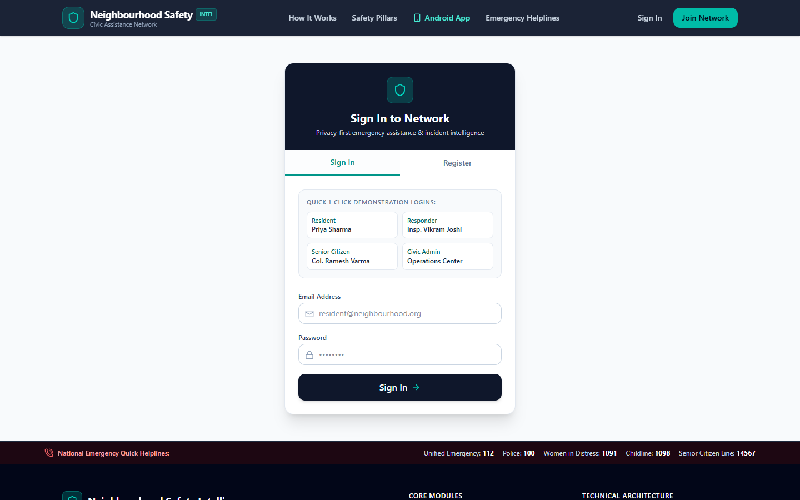

# Neighbourhood Safety Intelligence Network (NSIN)

> **One-Line Pitch:** A neighbourhood emergency and safety platform (web + Android + FastAPI) that lets residents raise SOS alerts, report incidents, track a child's commute and run elder wellness check-ins, with every incident, status change, triage result and audit event stored in IBM Db2.

---

## Table of Contents
- [Problem Statement](#problem-statement)
- [Solution Overview](#solution-overview)
- [IBM Db2 Integration](#ibm-db2-integration)
- [AI / LLM Architecture (if applicable)](#ai--llm-architecture-if-applicable)
- [Tech Stack](#tech-stack)
- [Prerequisites](#prerequisites)
- [Setup & Installation](#setup--installation)
- [Configuration](#configuration)
- [Running the Project](#running-the-project)
- [Testing & Verification](#testing--verification)
- [Screenshots & Demo](#screenshots--demo)
- [Known Limitations & Future Roadmap](#known-limitations--future-roadmap)
- [Team Members & Credits](#team-members--credits)

---

## Problem Statement
- **The problem:** When something goes wrong in a residential neighbourhood (a fall, a stalker, a child who hasn't reached school, a broken streetlight), the people who can help fastest are usually nearby: family, neighbours and local volunteers. Today that coordination happens in noisy WhatsApp groups with no structure, no status tracking and no record of who responded.
- **Who it's for:** Residents, and specifically the groups most exposed to everyday safety risk: women travelling alone, children commuting to school, and senior citizens living independently. Also for the volunteer responders and resident-welfare-association admins who coordinate help.
- **Why existing tools fall short:** Emergency-number apps only reach official services. Social apps have no incident lifecycle, no prioritisation and no accountability. Location-sharing apps don't cover hazards, elder check-ins or responder dispatch. Nothing ties these together around one trustworthy, auditable record.

---

## Solution Overview
NSIN is one backend with two clients (a React web app and a native Android app), backed by IBM Db2.

| Feature | What it does |
|---|---|
| **SOS dispatch** | Two-step confirmed SOS atomically creates a `P1_CRITICAL` incident, its GPS location event and the first status-history entry. It goes to the top of every on-duty responder's queue, and the resident's trusted-contact circle is shown alongside it. |
| **Incident lifecycle** | `reported → acknowledged → responder_en_route → on_scene → resolved`, with every transition written to an append-only `incident_status_history` table. |
| **Trusted contacts** | Each resident manages an emergency circle with per-contact SOS and location-sharing permissions. |
| **Child safe transit** | A guardian starts a journey (origin, destination, expected arrival); check-ins update it and overdue journeys are flagged. |
| **Elder care** | Daily wellness check-ins and non-emergency assistance requests (medicine, groceries, mobility). |
| **Responder roster** | Verified responders toggle availability, view assignments and claim incidents. |
| **Community hazards** | Residents report persistent hazards (dark streets, flooding, stray animals); admins see neighbourhood-level insights. |
| **Triage assistant** | A multi-agent pipeline classifies free-text reports, suggests a priority, flags missing details and retrieves the relevant safety protocol. Results are saved per incident in Db2. |
| **Role-based access** | Resident, guardian, elder, responder and admin roles with JWT auth. |

---

## IBM Db2 Integration
- **Db2 Edition & Environment:** IBM Db2 Community Edition in Docker (`icr.io/db2_community/db2`, wired up in [`docker-compose.db2.yml`](docker-compose.db2.yml)). The same code runs on Db2 on IBM Cloud by setting `DB2_SECURITY=SSL` and the service host/port.
- **Connector / Driver Used:**
  - `ibm_db_sa` (SQLAlchemy dialect, `db2+ibm_db://…`) for all application reads and writes through the ORM.
  - `ibm_db` (native driver) for the startup health probe (`SELECT CURRENT TIMESTAMP FROM SYSIBM.SYSDUMMY1`) and for raw parameterised queries via `ibm_db.prepare` / `ibm_db.execute` with explicit commit/rollback ([`db2_adapter.py`](src/backend/app/database/db2_adapter.py)).
- **Database Schema / Data Models:** 12 relational tables with primary keys, foreign keys, unique constraints and secondary indexes: `users`, `trusted_contacts`, `responders`, `incidents`, `incident_status_history`, `location_events`, `child_journeys`, `elder_checkins`, `assistance_requests`, `community_hazards`, `ai_analysis_records`, `audit_events`. The full DDL is in [architecture.md](architecture.md#ibm-db2-schema--storage-design).
- **Key Queries & Operations:**
  - On first start in Db2 mode the backend creates the schema in Db2 and seeds the demo personas, so a judge gets a working app against Db2 with no manual SQL.
  - Incident creation and every status transition run as one transaction (incident row plus history row commit together).
  - Responder dashboards filter incidents by status and priority, using the indexed `reporter_id`, `status` and `reference_code` columns.
  - Triage output is upserted into `ai_analysis_records` (unique per incident), and an `audit_events` row records who ran it.
  - `/health` reports live Db2 connectivity and server time straight from `SYSIBM.SYSDUMMY1`.
- **Strict mode:** if `DATABASE_MODE=db2` and Db2 is unreachable, the backend refuses to start. It never silently falls back to SQLite, so a "working" demo always means a working Db2 connection.
- **Other modes:** SQLite (zero-setup local development and the test suite) and PostgreSQL share the same SQLAlchemy models. Db2 is the target deployment database.

---

## AI / LLM Architecture (if applicable)
- **Framework:** A custom agent pipeline following CrewAI's role/goal/task pattern (`IncidentIntakeAgent → SafetyTriageAssistant → KnowledgeAssistant`, coordinated by `SafetyCrewOrchestrator`). Retrieval uses **Haystack 2** (`haystack-ai`): an `InMemoryDocumentStore` indexed with BM25 and an `InMemoryBM25Retriever` inside a Haystack `Pipeline`, filtered by category metadata ([`rag_pipeline.py`](src/backend/app/ai/haystack/rag_pipeline.py)). The agent orchestration is plain Python; the `crewai` package is not a dependency.
- **Model Provider & Model:** None. The agents are deterministic (keyword and entity rules plus BM25 ranking) and do not call an LLM. This is deliberate for a safety product: output is predictable, works offline, costs nothing per request and can't be prompt-injected by the free-text report. Every response carries an advisory notice, and humans make all dispatch decisions.
- **RAG / Tool-Calling Workflow:**
  1. **Intake:** extract category, location and missing critical details from the resident's free-text report.
  2. **Triage:** score risk signals (weapons, injuries, children, elders, time of day) into `P1_CRITICAL … P4_ADVISORY` with written reasoning and an immediate safety checklist.
  3. **Knowledge:** a Haystack BM25 pipeline over a curated set of civic safety SOPs, filtered by category, returning cited excerpts with scores (and an explicit "not found" result when no protocol shares keywords with the report).
  4. **Persist:** when an `incident_id` is passed, the full analysis is written to Db2 (`ai_analysis_records`) and audited (`audit_events`).

---

## Tech Stack
- **Backend / Core:** Python 3.11, FastAPI, Uvicorn, SQLAlchemy 2, Pydantic 2, python-jose (JWT), passlib/bcrypt
- **Database:** IBM Db2 (`ibm_db`, `ibm_db_sa`). SQLite for local development and tests; PostgreSQL optional.
- **Frontend / UI:** React 19 + TypeScript + Vite + Tailwind CSS 4 (web); Kotlin + Jetpack Compose + Material 3 + Retrofit (Android, MVVM)
- **AI / Retrieval:** Haystack 2 (`haystack-ai`): BM25 document store, retriever and pipeline
- **Libraries & Tools:** Docker / Docker Compose, Pytest, Robolectric, oxlint

---

## Prerequisites
- **Docker** with Docker Compose v2 (for the one-command stack and Db2 Community Edition; Db2 needs about 4 GB RAM)
- **Python ≥ 3.11** and `pip` (for running the backend and tests without Docker)
- **Node.js ≥ 18** and `npm` (web app)
- **Android Studio** (Ladybug or newer) or Gradle 8.x with JDK 17 (optional, Android app)

---

## Setup & Installation

```bash
# 1. Clone the repository and go to this submission
git clone https://github.com/KunalGolaIBM/IBM_Db2_TechX_Project_Submission.git
cd IBM_Db2_TechX_Project_Submission/submissions/neighbourhood-safety-intelligence-network

# 2. Backend dependencies (includes ibm_db and ibm_db_sa)
python -m venv .venv
source .venv/bin/activate          # Windows: .venv\Scripts\activate
pip install -r src/backend/requirements.txt

# 3. Web app dependencies
npm --prefix src/web-app install
```

---

## Configuration

```bash
cp .env.example src/backend/.env               # backend settings (Db2 credentials, JWT secret, CORS)
cp src/web-app/.env.example src/web-app/.env   # web app → backend URL
```

| Variable | Purpose |
|---|---|
| `DATABASE_MODE` | `db2`, `sqlite` or `postgresql` |
| `DB2_HOST`, `DB2_PORT`, `DB2_DATABASE`, `DB2_USER`, `DB2_PASSWORD` | Db2 connection |
| `DB2_SECURITY` | Empty for local Db2 CE, `SSL` for Db2 on IBM Cloud |
| `JWT_SECRET` | Token signing key: set a long random value |
| `CORS_ORIGINS` | Comma-separated web origins allowed to call the API |
| `VITE_API_BASE_URL` | (web app) backend URL, default `http://localhost:8000` |

The backend reads `src/backend/.env` at startup; real environment variables take precedence.

> **Security Warning:** Never commit `.env` or any real API keys or database passwords to Git! `.env` is listed in this project's `.gitignore`.

---

## Running the Project

### Option A: Full stack on IBM Db2 (Docker)
```bash
docker compose -f docker-compose.yml -f docker-compose.db2.yml up --build
```
This starts Db2 Community Edition (database `NSIN`), waits for it to become healthy (first boot takes about 3–5 minutes), then starts the backend in Db2 mode, which creates the schema and seeds the demo data, and finally starts the web app.

- Web app: http://localhost:3000
- API + Swagger UI: http://localhost:8000/docs
- Db2 health: http://localhost:8000/health → `"database": {"mode": "db2", "connected": true, ...}`

### Option B: Quick start without Db2 (SQLite)
```bash
docker compose up --build
```

### Option C: Run locally without Docker
```bash
# Terminal 1: backend (run from src/ because the code is imported as the `backend` package)
cd src
uvicorn backend.app.main:app --reload --port 8000

# Terminal 2: web app
npm --prefix src/web-app run dev        # http://localhost:5173
```
To point a local backend at Db2, start only the database with `docker compose -f docker-compose.yml -f docker-compose.db2.yml up -d db2`, then set `DATABASE_MODE=db2` and the `DB2_*` values in `src/backend/.env`.

### Android app
Open `src/android/` in Android Studio and run the `app` configuration on an emulator. The app targets `http://10.0.2.2:8000` (the host machine's backend) by default; on a physical device, change the base URL in the app's **Settings** screen to your machine's LAN IP.
```bash
cd src/android
gradle :app:assembleDebug     # → app/build/outputs/apk/debug/app-debug.apk
```

### Demo accounts (seeded automatically, password `Password123!`)
| Role | Email | Try this |
|---|---|---|
| Resident | `resident@neighbourhood.org` | Trigger SOS, report an incident, run AI triage, manage trusted contacts, start a child journey |
| Responder | `responder@neighbourhood.org` | Toggle availability, acknowledge an incident and advance its status |
| Elder | `elder.ramesh@neighbourhood.org` | Daily check-in, assistance request |
| Admin | `admin@neighbourhood.org` | Community insights, responder roster, database diagnostics |

The web login page has one-click buttons for each role.

### API overview (`/api/v1`)
| Area | Endpoints |
|---|---|
| Auth & profile | `POST /auth/register`, `POST /auth/login`, `GET/PATCH /profiles/me` |
| SOS & incidents | `POST /sos`, `GET/POST /incidents`, `GET /incidents/{id}`, `POST /incidents/{id}/acknowledge`, `POST /incidents/{id}/status` |
| Trusted contacts | `GET/POST /trusted-contacts`, `DELETE /trusted-contacts/{id}` |
| Child transit | `GET/POST /children/journeys`, `POST /children/journeys/{id}/check-in` |
| Elder care | `GET/POST /elder-care/checkins`, `GET/POST /elder-care/assistance-requests` |
| Responders | `GET /responders/roster`, `GET /responders/assignments`, `PATCH /responders/availability` |
| Community | `GET /community/insights`, `GET/POST /community/hazards` |
| AI | `POST /ai/incident-assistance`, `GET /ai/guidance?query=…` |

Full request/response schemas are at http://localhost:8000/docs.

---

## Testing & Verification

```bash
# From this submission folder (tests use an isolated, auto-seeded SQLite file)
pytest tests/ -v

# Web app type-check and production build
npm --prefix src/web-app run build

# Android JVM unit tests (Robolectric)
cd src/android && gradle :app:testDebugUnitTest
```

The 8 backend tests cover health, auth and profile, trusted contacts, the full incident lifecycle across resident and responder accounts, SOS, knowledge retrieval, the agent pipeline, and persistence of triage results (including the upsert and 404 paths).

The full flow (schema creation, seeding, SOS, triage persistence and the responder lifecycle) has been run end to end against Db2 Community Edition in Docker.

**Verifying the Db2 integration:**
1. Start Option A and open http://localhost:8000/health: `database.mode` is `db2`, `connected` is `true` and `server_time` comes from Db2.
2. Log in as the resident, report an incident and run AI triage on it.
3. Query Db2 directly:
   ```bash
   docker exec -it nsin_db2 su - db2inst1 -c "db2 connect to NSIN && \
     db2 \"SELECT reference_code, status, priority FROM incidents ORDER BY id DESC FETCH FIRST 5 ROWS ONLY\" && \
     db2 \"SELECT incident_id, suggested_priority FROM ai_analysis_records\" && \
     db2 \"SELECT incident_id, status, created_at FROM incident_status_history ORDER BY id DESC FETCH FIRST 10 ROWS ONLY\""
   ```

---

## Screenshots & Demo
- **Live Demo Link:** Not hosted. Run locally with Option A or B above.
- **Demo Video Link:** Will be shared with the judges at the Top 10 pitch.
- Screenshots (captured from the running app with seeded demo data) are in [`docs/screenshots/`](docs/screenshots/):

| Landing page | Sign-in with one-click demo roles |
|---|---|
|  |  |
| **Resident dashboard: SOS, incidents, guardians** | **Report an incident** |
|  |  |
| **Responder command: incident queue and duty status** | **Admin dashboard** |
|  |  |
| **Child safe transit** | **Trusted contacts** |
|  |  |
| **Community insights and hazards** | |
|  | |

---

## Known Limitations & Future Roadmap
- **Current Limitations:**
  - SOS "notifications" to trusted contacts are recorded and shown in-app; SMS and push delivery are not wired to a provider yet.
  - Triage is rule-based. It is predictable and offline-capable, but it won't understand phrasing outside its vocabulary.
  - Location history is stored as latitude/longitude columns; there are no spatial queries yet.
  - No Gradle wrapper JAR is committed; use Android Studio or a local Gradle install.
- **Next Steps:**
  - Optional LLM step (IBM watsonx.ai Granite) for report summarisation, behind the existing rule-based guardrails.
  - Move the Haystack document store into Db2: store protocol embeddings in Db2's `VECTOR` type and use `VECTOR_DISTANCE` for hybrid BM25 + semantic retrieval.
  - Db2 temporal tables for incident history, and row-level access control for multi-society deployments.
  - Push notifications (FCM) and SMS fallback for SOS.

---

## Team Members & Credits
| Name | GitHub Handle | Role / Contribution |
|---|---|---|
| Yagnik Sharma | [@YagnikSharma](https://github.com/YagnikSharma) | Full stack: FastAPI backend, IBM Db2 integration, triage pipeline, React web app, Android app |

**License:** MIT (see [LICENSE](LICENSE)). Third-party libraries keep their own licenses (FastAPI, SQLAlchemy, React and Retrofit: MIT / Apache-2.0; `ibm_db` / `ibm_db_sa`: Apache-2.0; Db2 Community Edition: IBM license, accepted via `LICENSE=accept`).
