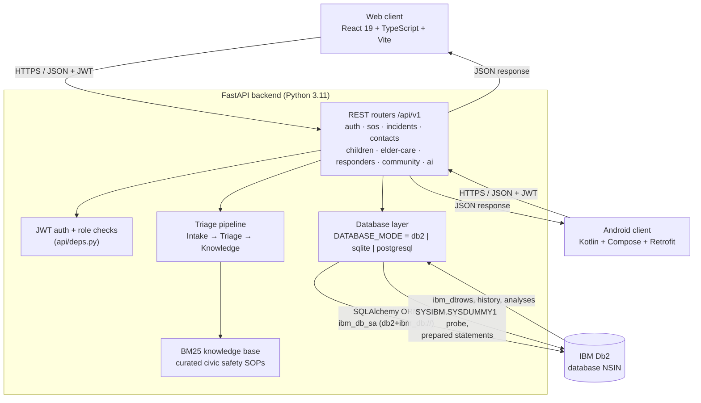
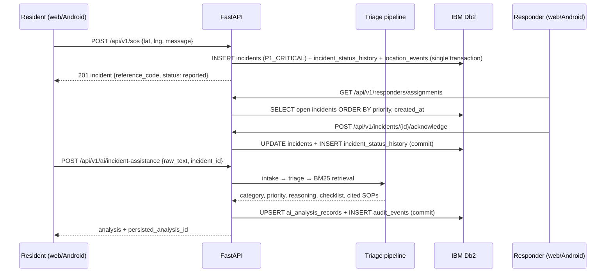

# System Architecture

## Overview
NSIN is a three-tier system. Two thin clients, a React web app and a native Android app, talk to a single FastAPI backend over JSON/REST with JWT bearer tokens. The backend owns all business rules (role-based access, the incident state machine, SOS fan-out, journey and check-in tracking) and runs the triage agent pipeline in-process. All state lives in IBM Db2 and is reached through SQLAlchemy with the `ibm_db_sa` dialect. A native `ibm_db` connection handles health probing and raw parameterised SQL. SQLite and PostgreSQL adapters share the same models, for local development and tests.

---

## Architecture Diagram



### SOS → triage → persistence sequence



---

## Component Breakdown

1. **User Interface / Client Layer**
   - **Web (`src/web-app`)**: React Router pages per role (resident dashboard, SOS, report incident, incident timeline, trusted contacts, child transit, elder care, responder command, admin, community map). `AuthContext` keeps the JWT, and `services/api.ts` is a typed client for every endpoint.
   - **Android (`src/android`)**: Jetpack Compose with Material 3 in an MVVM layout (`SafetyViewModel` → `SafetyRepository` → Retrofit `SafetyApiService`). The base URL can be changed at runtime from the Settings screen (emulator `10.0.2.2` or LAN IP).
   - Both clients use the same API contract, so an incident raised on Android appears on the web responder dashboard immediately.

2. **Application Backend Layer (`src/backend/app`)**
   - `api/v1/*`: 10 routers and 27 endpoints. Pydantic schemas validate every request body (for example, triage text is limited to 3–4000 characters).
   - `api/deps.py`: decodes the JWT, loads the user, and enforces role checks (responder/admin-only routes).
   - `core/security.py`: bcrypt password hashing and HS256 JWT issuing.
   - `core/config.py`: twelve-factor settings from environment variables or `src/backend/.env`. No secrets are hard-coded for production.
   - Incident state machine: `reported → acknowledged → responder_en_route → on_scene → resolving → resolved | false_alarm`. Each transition appends to `incident_status_history`.

3. **Database Layer (IBM Db2)**
   - `database/base.py`: picks the adapter from `DATABASE_MODE` and exposes the `get_db()` session dependency.
   - `database/db2_adapter.py`:
     - `test_connection()`: native `ibm_db.connect` followed by `SELECT CURRENT TIMESTAMP FROM SYSIBM.SYSDUMMY1`, reporting native Db2 error text on failure.
     - `execute_query()` / `execute_non_query()`: `ibm_db.prepare` + `ibm_db.execute` with bound parameters. Autocommit is off, with explicit `commit` / `rollback`.
     - `get_session_factory()`: SQLAlchemy engine on `db2+ibm_db://…` with `pool_pre_ping`, runs `create_all` (DDL in Db2), and seeds the demo personas on first run.
   - **Fail-fast**: in Db2 mode an unreachable database stops startup instead of falling back silently.

4. **AI / Model Orchestration Layer (`src/backend/app/ai`)**
   - `crewai/agents.py`: four role/goal agents coordinated by `SafetyCrewOrchestrator`:
     - `IncidentIntakeAgent`: category detection, location entity extraction, missing-information prompts.
     - `SafetyTriageAssistant`: risk signals mapped to `P1_CRITICAL … P4_ADVISORY`, with written reasoning and an immediate checklist.
     - `KnowledgeAssistant`: category-filtered retrieval of protocols.
     - `CommunityInsightsAgent`: neighbourhood-level summary for the admin and community views.
   - `haystack/rag_pipeline.py`: an in-memory BM25 index over curated SOP documents (`documents.py`) with a relevance threshold and a "not found" fallback.
   - Deterministic by design: there are no outbound LLM calls, so resident-written text can't hijack the output and the system works offline. Every response carries an advisory notice, and dispatch decisions stay with human responders.

---

## Data Flow

1. **Input Ingestion**: a resident triggers SOS or files a report from either client. Pydantic validates the payload and the JWT identifies the reporter and role.
2. **Context Retrieval**: the backend reads the reporter's profile and medical notes, trusted contacts, on-duty responders and open incidents from Db2 through indexed lookups (`users.email`, `incidents.reporter_id`, `incidents.reference_code`, `trusted_contacts.user_id`).
3. **Augmentation & Inference**: on request, the triage pipeline structures the free text, assigns a priority and retrieves cited SOP excerpts from the BM25 knowledge base.
4. **State Persistence**: the incident, its status history and location pings are written in one transaction. Triage output is upserted into `ai_analysis_records`, and an `audit_events` row records who did what.
5. **Response Delivery**: JSON goes back to the caller. Responder and resident dashboards poll (refresh) the same Db2-backed endpoints, so both sides see the same timeline.

---

## IBM Db2 Schema & Storage Design

The tables are generated from the SQLAlchemy models in [`src/backend/app/models/entities.py`](src/backend/app/models/entities.py) by `ibm_db_sa` on first start. The equivalent Db2 DDL is:

```sql
CREATE TABLE users (
    id               INTEGER GENERATED BY DEFAULT AS IDENTITY PRIMARY KEY,
    email            VARCHAR(255) NOT NULL UNIQUE,
    hashed_password  VARCHAR(255) NOT NULL,
    full_name        VARCHAR(255) NOT NULL,
    phone            VARCHAR(50),
    role             VARCHAR(50)  NOT NULL DEFAULT 'resident',  -- resident | guardian | elder | responder | admin
    is_active        SMALLINT,
    is_verified      SMALLINT,
    emergency_notes  CLOB,
    address          VARCHAR(255),
    created_at       TIMESTAMP,
    updated_at       TIMESTAMP
);

CREATE TABLE trusted_contacts (
    id                  INTEGER GENERATED BY DEFAULT AS IDENTITY PRIMARY KEY,
    user_id             INTEGER NOT NULL REFERENCES users(id),
    name                VARCHAR(255) NOT NULL,
    relationship        VARCHAR(100) NOT NULL,
    phone               VARCHAR(50)  NOT NULL,
    email               VARCHAR(255),
    can_receive_sos     SMALLINT,
    can_track_location  SMALLINT,
    created_at          TIMESTAMP
);
CREATE INDEX ix_trusted_contacts_user_id ON trusted_contacts(user_id);

CREATE TABLE responders (
    id                    INTEGER GENERATED BY DEFAULT AS IDENTITY PRIMARY KEY,
    user_id               INTEGER NOT NULL UNIQUE REFERENCES users(id),
    badge_number          VARCHAR(100) NOT NULL,
    service_type          VARCHAR(100),          -- medical | security | fire | community_patrol
    is_available          SMALLINT,
    current_lat           DOUBLE,
    current_lng           DOUBLE,
    rating                DOUBLE,
    is_verified_by_admin  SMALLINT,
    created_at            TIMESTAMP
);

CREATE TABLE incidents (
    id                     INTEGER GENERATED BY DEFAULT AS IDENTITY PRIMARY KEY,
    reference_code         VARCHAR(50)  NOT NULL UNIQUE,      -- e.g. INC-202611-001
    reporter_id            INTEGER NOT NULL REFERENCES users(id),
    title                  VARCHAR(255) NOT NULL,
    description            CLOB NOT NULL,
    incident_type          VARCHAR(50)  NOT NULL,             -- sos | hazard | medical | child_alert | elder_welfare | suspicious_activity
    priority               VARCHAR(50)  NOT NULL,             -- P1_CRITICAL .. P4_ADVISORY
    status                 VARCHAR(50)  NOT NULL,             -- reported .. resolved | false_alarm
    location_address       VARCHAR(255),
    latitude               DOUBLE,
    longitude              DOUBLE,
    assigned_responder_id  INTEGER REFERENCES users(id),
    created_at             TIMESTAMP,
    updated_at             TIMESTAMP,
    resolved_at            TIMESTAMP
);
CREATE INDEX ix_incidents_reporter_id ON incidents(reporter_id);

CREATE TABLE incident_status_history (          -- append-only audit trail of every transition
    id             INTEGER GENERATED BY DEFAULT AS IDENTITY PRIMARY KEY,
    incident_id    INTEGER NOT NULL REFERENCES incidents(id),
    status         VARCHAR(50) NOT NULL,
    notes          CLOB,
    updated_by_id  INTEGER NOT NULL REFERENCES users(id),
    created_at     TIMESTAMP
);
CREATE INDEX ix_incident_status_history_incident_id ON incident_status_history(incident_id);

CREATE TABLE location_events (
    id           INTEGER GENERATED BY DEFAULT AS IDENTITY PRIMARY KEY,
    incident_id  INTEGER REFERENCES incidents(id),
    user_id      INTEGER NOT NULL REFERENCES users(id),
    latitude     DOUBLE NOT NULL,
    longitude    DOUBLE NOT NULL,
    accuracy     DOUBLE,
    event_type   VARCHAR(50),
    timestamp    TIMESTAMP
);

CREATE TABLE child_journeys (
    id                     INTEGER GENERATED BY DEFAULT AS IDENTITY PRIMARY KEY,
    guardian_id            INTEGER NOT NULL REFERENCES users(id),
    child_name             VARCHAR(255) NOT NULL,
    origin                 VARCHAR(255) NOT NULL,
    destination            VARCHAR(255) NOT NULL,
    expected_arrival_time  TIMESTAMP NOT NULL,
    actual_arrival_time    TIMESTAMP,
    status                 VARCHAR(50) NOT NULL,   -- active | completed | delayed | alert_triggered
    last_check_in          TIMESTAMP,
    notes                  CLOB,
    created_at             TIMESTAMP
);

CREATE TABLE elder_checkins (
    id               INTEGER GENERATED BY DEFAULT AS IDENTITY PRIMARY KEY,
    user_id          INTEGER NOT NULL REFERENCES users(id),
    scheduled_time   TIMESTAMP NOT NULL,
    checked_in_at    TIMESTAMP,
    status           VARCHAR(50) NOT NULL,       -- pending | completed | missed | flagged
    wellness_status  VARCHAR(50) NOT NULL,       -- good | needs_assistance | emergency
    notes            CLOB,
    created_at       TIMESTAMP
);

CREATE TABLE assistance_requests (
    id              INTEGER GENERATED BY DEFAULT AS IDENTITY PRIMARY KEY,
    user_id         INTEGER NOT NULL REFERENCES users(id),
    request_type    VARCHAR(100),                -- grocery | medicine | mobility | check_in | urgent
    description     CLOB NOT NULL,
    urgency         VARCHAR(50),
    status          VARCHAR(50),
    assigned_to_id  INTEGER REFERENCES users(id),
    created_at      TIMESTAMP,
    resolved_at     TIMESTAMP
);

CREATE TABLE community_hazards (
    id              INTEGER GENERATED BY DEFAULT AS IDENTITY PRIMARY KEY,
    reported_by_id  INTEGER NOT NULL REFERENCES users(id),
    title           VARCHAR(255) NOT NULL,
    hazard_type     VARCHAR(100) NOT NULL,
    severity        VARCHAR(50),
    latitude        DOUBLE,
    longitude       DOUBLE,
    address         VARCHAR(255) NOT NULL,
    status          VARCHAR(50),
    verified_at     TIMESTAMP,
    created_at      TIMESTAMP
);

CREATE TABLE ai_analysis_records (              -- one triage result per incident (upserted)
    id                        INTEGER GENERATED BY DEFAULT AS IDENTITY PRIMARY KEY,
    incident_id               INTEGER NOT NULL UNIQUE REFERENCES incidents(id),
    intake_summary            CLOB NOT NULL,
    suggested_priority        VARCHAR(50) NOT NULL,
    triage_reasoning          CLOB NOT NULL,
    recommended_actions_json  CLOB NOT NULL,
    retrieved_protocols_json  CLOB NOT NULL,
    created_at                TIMESTAMP
);

CREATE TABLE audit_events (
    id             INTEGER GENERATED BY DEFAULT AS IDENTITY PRIMARY KEY,
    user_id        INTEGER REFERENCES users(id),
    action         VARCHAR(100) NOT NULL,
    resource_type  VARCHAR(100) NOT NULL,
    resource_id    VARCHAR(100),
    ip_address     VARCHAR(50),
    details_json   CLOB,
    timestamp      TIMESTAMP
);
```

**Design notes**
- Status values are stored as short `VARCHAR` codes rather than lookup tables. This keeps the state machine in application code, where it is tested, while every transition is still kept in `incident_status_history`.
- `UNIQUE (incident_id)` on `ai_analysis_records` makes re-running triage an update rather than a duplicate row.
- Variable-length free text (`description`, `notes`, JSON payloads) uses `CLOB`, and bounded identifiers use `VARCHAR`.
- All application SQL is bound-parameter SQL, either through the ORM or through `ibm_db.prepare` / `execute`. No query is built by string concatenation.

---

## Security & Secrets Management
- Database credentials, the JWT signing key and allowed CORS origins are read at runtime from environment variables or `src/backend/.env`. `.env` is gitignored, and `.env.example` contains placeholders only.
- Passwords are stored as bcrypt hashes. API access uses short-lived HS256 JWTs, and responder and admin routes are role-gated.
- CORS is an explicit allow-list (no `*`).
- Db2 on IBM Cloud connections use `SECURITY=SSL` when `DB2_SECURITY=SSL`.
- Least privilege: the application only needs DML rights plus `CREATE TABLE` on first run. In production, run the schema creation once with an admin user, then point the app at a user that has only `SELECT/INSERT/UPDATE/DELETE` on the NSIN tables.
- Triage never sends resident text to a third-party model, and its output is advisory only.
