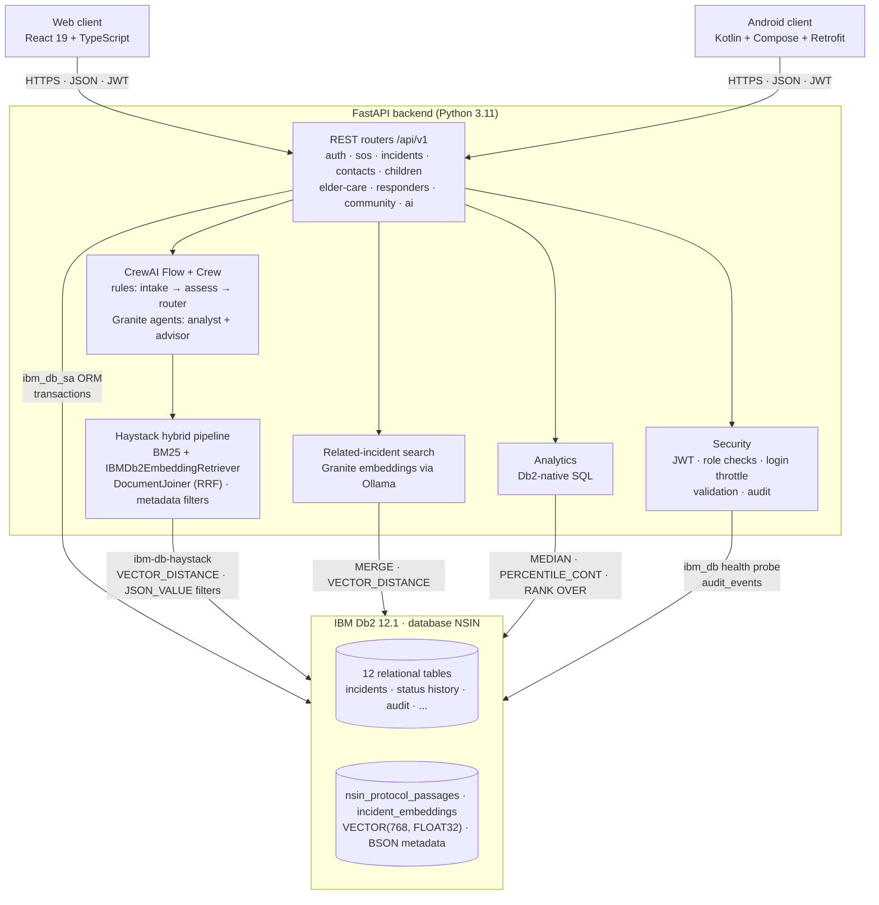
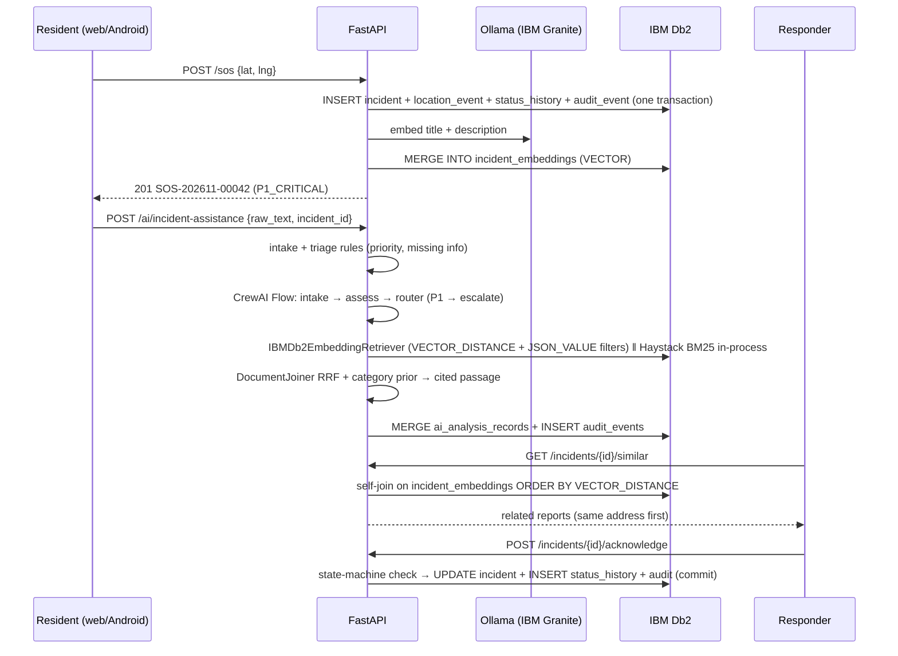

# System Architecture

## Overview
NSIN has three tiers. A React web app and a native Android app talk to one FastAPI backend over JSON/REST with JWT bearer tokens. The backend owns all business rules: role checks, the incident state machine, SOS routing, journey and check-in tracking, triage and retrieval. **IBM Db2 is the system of record**, and it also does work beyond storage:
- semantic search over protocol and incident embeddings, with native `VECTOR` columns and `VECTOR_DISTANCE`;
- response-time and hotspot analytics in SQL;
- privilege separation, through a data-only role and an append-only audit table.

Access goes through SQLAlchemy with the `ibm_db_sa` dialect, plus the native `ibm_db` driver for health checks and prepared statements. Db2 is the only database: there is no fallback, and the tests run against a real Db2. AI models (IBM Granite) run locally in **Ollama**.

---

## Architecture Diagram



### SOS → triage → related reports



---

## Component Breakdown

1. **User Interface / Client Layer**
   - **Web (`src/web-app`)**: role-based pages for resident, responder, admin, community analytics and incident detail with related reports. `services/api.ts` is a typed client and turns validation errors into readable messages.
   - **Android (`src/android`)**: Compose + Material 3 in MVVM (`SafetyViewModel` → `SafetyRepository` → Retrofit). The base URL can be changed at runtime. Cleartext HTTP is debug-only, and backups are disabled because the app stores a session token. It ships with a Gradle wrapper.

2. **Application Backend Layer (`src/backend/app`)**
   - `api/v1/*`: 10 routers. Pydantic schemas validate every request with enums, coordinate ranges, and length limits sized to the Db2 columns.
   - `api/deps.py`: JWT verification; `ensure_verified_staff` blocks unverified responders.
   - `api/v1/incidents.py`: an explicit `ALLOWED_TRANSITIONS` state machine (409 on illegal moves), identity-based reference codes, eager loading (no N+1), pagination, and privacy masking of other residents' identities and coordinates. Private incidents return 404 to non-owners.
   - `core/`: bcrypt hashing; HS256 JWT; a sliding-window login throttle (429 + `Retry-After`) with constant-time behaviour for unknown emails; a same-transaction audit helper; a production guard that refuses default secrets or wildcard CORS.
   - `main.py`: security headers, and a generic 500 handler that never returns SQL or driver details.

3. **Database Layer (IBM Db2)**
   - `database/db2_adapter.py`:
     - Native `ibm_db` health probe (server time, version via `server_info()`, `CURRENT SCHEMA`) and prepared-statement helpers with explicit commit / rollback.
     - The `ibm_db_sa` engine is built with `URL.create`, so credentials are escaped. `CurrentSchema` support lets a least-privilege login resolve the owner's tables.
     - Table existence is checked in `SYSCAT.TABLES` for `CURRENT SCHEMA`, and DDL runs only for missing tables, so the restricted login never attempts it.
   - `ai/semantic/db2_vector_store.py`: raw DDL for the `VECTOR` tables, `MERGE` upserts, the `VECTOR_DISTANCE` protocol search with confidence gating, an incident self-join for related reports, and a backfill of incidents that have no embedding yet.
   - `analytics/insights.py`: Db2-native SQL for the response-time distribution, hotspots, hourly counts and SLA breaches, plus a portable Python path. A Db2 test asserts both give identical results.
   - **Fail-fast:** if `DATABASE_MODE=db2` and Db2 is unreachable, startup is refused.

4. **AI / Retrieval Layer (`src/backend/app/ai`)**
   - `crewai/agents.py`: the triage agents run as a **CrewAI Flow** with typed Pydantic state:
     - `@start` intake → `@listen` assess → `@router` → critical (escalation) or standard branch → knowledge retrieval.
     - The agents themselves are deterministic, whole-word keyword rules, so "person" never matches "son".
     - CrewAI telemetry and tracing are disabled.
   - `haystack/rag_pipeline.py`, **Haystack 2 with IBM's `ibm-db-haystack`**:
     - **Indexing:** `DocumentSplitter` → `OllamaDocumentEmbedder` (granite-embedding:278m) → `DocumentWriter` into `IBMDb2DocumentStore` (table `NSIN_PROTOCOL_PASSAGES`: `VECTOR(768)` plus BSON metadata).
     - **Query:** `OllamaTextEmbedder` → `IBMDb2EmbeddingRetriever`, plus `InMemoryBM25Retriever`, with the same metadata filters on both branches (Db2 runs them as `JSON_VALUE` predicates).
     - **Fusion:** passages collapse to protocols, then `DocumentJoiner` applies reciprocal rank fusion, with a category prior from triage.
     - **Trust:** distance/margin gating on the vector branch, and every answer cites its passage. Without Db2 the BM25 branch runs alone.
   - `semantic/db2_vector_store.py`: incident embeddings and the related-report self-join.
   - `crewai/crew.py`: a **CrewAI Crew** on `granite3.3:2b` (via Ollama) with a *Triage Analyst* and a *Protocol Advisor*. The advisor has a CrewAI tool that searches the Db2 protocol passages; retrieved passages go into the task context, and the answer is checked for a cited protocol. Served by `POST /ai/crew-briefing`; if Ollama is down, the rule-based triage is still returned with `briefing_error`.
   - Everything is local (Ollama on the same machine): resident text never leaves the deployment, and output is advisory.

---

## Data Flow

1. **Input Ingestion**: a resident raises an SOS or files a report from either client. Pydantic validates the payload, and the JWT identifies the user and role.
2. **Context Retrieval**: the backend reads the reporter's profile, SOS-enabled trusted contacts and on-duty verified responders from Db2. For triage it retrieves protocols with BM25 and Db2 `VECTOR_DISTANCE`.
3. **Augmentation & Inference**: the triage agents structure the free text, assign a priority with reasoning and attach the best-matching cited protocol.
4. **State Persistence**: the incident, location event, first status entry and audit row commit in one transaction. The incident is then embedded with `MERGE` into `incident_embeddings`, and triage output is upserted into `ai_analysis_records`.
5. **Response Delivery**: JSON goes back to the caller. Responder queues, related reports and community analytics are served from Db2 queries, so web and Android always see the same state.

---

## IBM Db2 Schema & Storage Design

The full DDL, exported from a live database with `db2look`, is in [`db/db2_schema.sql`](db/db2_schema.sql): 14 tables, 11 secondary indexes, primary, foreign and unique keys. The core tables:

```sql
CREATE TABLE incidents (
    id                    INTEGER NOT NULL GENERATED BY DEFAULT AS IDENTITY PRIMARY KEY,
    reference_code        VARCHAR(50)  NOT NULL UNIQUE,      -- INC-202611-00042, derived from id
    reporter_id           INTEGER      NOT NULL REFERENCES users(id),
    title                 VARCHAR(255) NOT NULL,
    description           CLOB         NOT NULL,
    incident_type         VARCHAR(50)  NOT NULL,             -- sos | hazard | medical | child_alert | elder_welfare | suspicious_activity
    priority              VARCHAR(50)  NOT NULL,             -- P1_CRITICAL .. P4_ADVISORY
    status                VARCHAR(50)  NOT NULL,             -- reported .. resolved | false_alarm (state machine in code)
    location_address      VARCHAR(255),
    latitude DOUBLE, longitude DOUBLE,
    assigned_responder_id INTEGER REFERENCES users(id),
    created_at TIMESTAMP, updated_at TIMESTAMP, resolved_at TIMESTAMP
);
CREATE INDEX ix_incidents_status_priority ON incidents (status, priority);   -- responder queues
CREATE INDEX ix_incidents_created_at      ON incidents (created_at);         -- 30-day analytics windows
CREATE INDEX ix_incidents_reporter_id     ON incidents (reporter_id);

CREATE TABLE incident_status_history (                 -- append-only lifecycle trail
    id INTEGER NOT NULL GENERATED BY DEFAULT AS IDENTITY PRIMARY KEY,
    incident_id   INTEGER NOT NULL REFERENCES incidents(id),
    status        VARCHAR(50) NOT NULL,
    notes         CLOB,
    updated_by_id INTEGER NOT NULL REFERENCES users(id),
    created_at    TIMESTAMP
);
CREATE INDEX ix_status_history_incident_status_time
    ON incident_status_history (incident_id, status, created_at);    -- first-acknowledgement CTE

CREATE TABLE audit_events (                            -- append-only for the application role
    id INTEGER NOT NULL GENERATED BY DEFAULT AS IDENTITY PRIMARY KEY,
    user_id INTEGER REFERENCES users(id),
    action VARCHAR(100) NOT NULL, resource_type VARCHAR(100) NOT NULL, resource_id VARCHAR(100),
    ip_address VARCHAR(50), details_json CLOB, timestamp TIMESTAMP
);

-- Semantic search inside Db2
-- Protocol passages: table created and managed by IBMDb2DocumentStore (ibm-db-haystack)
CREATE TABLE nsin_protocol_passages (
    id VARCHAR(512) NOT NULL PRIMARY KEY, content CLOB(2M), meta BLOB /* BSON */, embedding VECTOR(768, FLOAT32)
);  -- filters: JSON_VALUE(SYSTOOLS.BSON2JSON(meta), '$.category' RETURNING VARCHAR(1000)) = ?
CREATE TABLE incident_embeddings (
    incident_id INTEGER NOT NULL PRIMARY KEY REFERENCES incidents(id) ON DELETE CASCADE,
    embedding VECTOR(768, FLOAT32) NOT NULL, embedding_model VARCHAR(100) NOT NULL,
    created_at TIMESTAMP NOT NULL DEFAULT CURRENT TIMESTAMP
);
```

Other tables: `users`, `trusted_contacts`, `responders`, `location_events`, `child_journeys`, `elder_checkins`, `assistance_requests`, `community_hazards` and `ai_analysis_records` (one row per incident, unique `incident_id`).

### Representative Db2 SQL

```sql
-- Time to first acknowledgement per priority (analytics/insights.py)
WITH first_ack AS (
    SELECT incident_id, MIN(created_at) AS ack_at
    FROM incident_status_history WHERE status = 'acknowledged' GROUP BY incident_id)
SELECT i.priority, COUNT(*) AS incidents, COUNT(a.ack_at) AS acknowledged,
       MEDIAN(DOUBLE(SECONDS_BETWEEN(a.ack_at, i.created_at)))                     AS median_ack_s,
       PERCENTILE_CONT(0.9) WITHIN GROUP
           (ORDER BY DOUBLE(SECONDS_BETWEEN(a.ack_at, i.created_at)))             AS p90_ack_s
FROM incidents i LEFT JOIN first_ack a ON a.incident_id = i.id
WHERE i.created_at >= :since
GROUP BY i.priority;

-- Hotspots
SELECT RANK() OVER (ORDER BY COUNT(*) DESC) AS hotspot_rank, location_address, COUNT(*) AS incidents
FROM incidents WHERE created_at >= :since AND location_address IS NOT NULL
GROUP BY location_address ORDER BY hotspot_rank FETCH FIRST 5 ROWS ONLY;

-- Related reports: self-join on embeddings (db2_vector_store.py)
SELECT other.incident_id, VECTOR_DISTANCE(other.embedding, target.embedding, COSINE) AS distance
FROM incident_embeddings target
JOIN incident_embeddings other ON other.incident_id <> target.incident_id
WHERE target.incident_id = :incident_id
ORDER BY distance FETCH FIRST 20 ROWS ONLY;
```

**Design notes**
- Status and type codes are short `VARCHAR`s validated by Pydantic enums. The lifecycle rules live in one tested state machine, and every transition is kept in `incident_status_history`.
- Reference codes are derived from the identity value inside the same transaction, so they can't collide; the earlier random 4-digit scheme could.
- Embeddings are stored next to the data they describe, so similarity search, joins and access control all stay inside Db2.
- Boolean filters are written as `col == True` in SQLAlchemy, which renders `= 1`. The alternative `.is_(True)` renders `IS 1`, which Db2 rejects (SQL0104N). The Db2 test run caught this.

---

## Security & Secrets Management
- **Secrets:** database credentials, the JWT key and CORS origins come from the environment or `src/backend/.env` (gitignored). With `APP_ENV=production` the app refuses the development JWT secret, short secrets and wildcard CORS, and `/health` hides connection details.
- **Least privilege in Db2:** [`db/least_privilege.sql`](db/least_privilege.sql) creates role `NSIN_APP`:
  - `SELECT/INSERT/UPDATE/DELETE` on the 14 application tables, and no DDL;
  - `audit_events` is insert/read only.
  
  The app runs as login `nsinapp` with `DB2_SCHEMA=DB2INST1`. Tests prove `CREATE`, `DROP`, `ALTER` and audit tampering fail with `SQL0551N`.
- **Authentication:** bcrypt (cost 12), HS256 JWTs, throttled failed logins (429), identical responses and timing for unknown emails. Admin accounts can't be self-registered, and responders act only after admin verification.
- **Authorisation and privacy:**
  - Private incidents are visible only to the reporter and verified staff; others get 404, so ids can't be probed.
  - Public alerts hide the reporter's identity and coordinates from other residents.
  - Responders' live GPS is hidden from residents.
  - AI analyses can only be attached by the reporter or staff.
- **Input and output:**
  - All SQL is parameterised: ORM, `ibm_db.prepare`, or bound `text()` parameters. The only interpolated values are validated integers in `FETCH FIRST n ROWS`.
  - Request limits are sized to the Db2 columns, so oversized input returns 422 instead of a 500.
  - Security headers are set on every response.
  - Unhandled errors return a generic 500 and are logged server-side.
- **Containers and clients:**
  - The backend runs as a non-root user, with the embedding model baked in, so there are no outbound calls at runtime.
  - Haystack and CrewAI telemetry are disabled.
  - Android allows cleartext HTTP in debug builds only.
- **AI safety:**
  - The LLM runs locally (Ollama, IBM Granite), so resident text stays inside the deployment.
  - The rule-based priority is authoritative; the crew only explains and advises, using retrieved Db2 passages, and its output is checked for a cited protocol.
  - Triage output is advisory.
