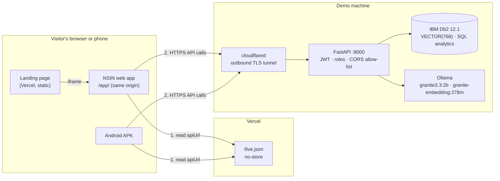
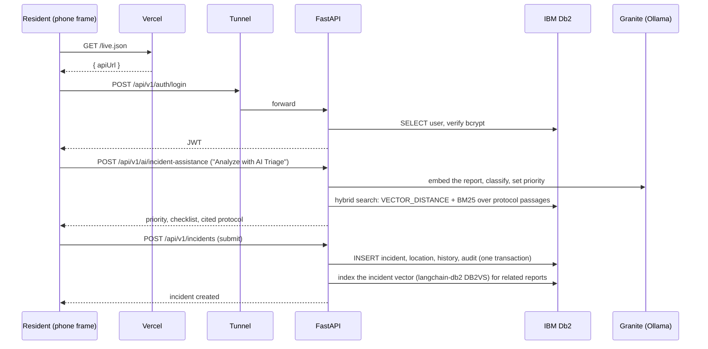

# Live demo: how the hosted NSIN works

**Try it:** https://ibm-db2-tech-x-project-submission-n.vercel.app

The landing page runs the **real NSIN web app**, not a video or a mock-up, inside a phone frame, a desktop browser frame and a full-screen "immersive" view. It talks to the real backend: FastAPI, IBM Db2 12.1, and IBM Granite on Ollama.

## Architecture



## How one request flows



## Why it is built this way
| Decision | Reason |
|---|---|
| The app is served from the same site, under `/app/` | One origin, so there's no third-party framing, cookies or extra CORS for the frame. Judges see exactly the app that ships. |
| The backend URL lives in `live.json`, read at start-up | A new tunnel URL needs no rebuild of the web app or the APK. |
| `Cache-Control: no-store` on `live.json` | Browsers never keep a dead URL. |
| A quick tunnel instead of cloud hosting | Db2 and Granite stay on our machine, so resident data and model calls never reach a cloud AI. That is the privacy promise of NSIN. |
| An honest offline mode | When the machine is off, the page shows "backend offline · recorded mode" and the **recorded real responses** with their date, Db2 version and model names. It never fakes a live answer. |

## Demo accounts
| Role | Email | Password |
|---|---|---|
| Resident | `resident@neighbourhood.org` | `Password123!` |
| Responder | `responder@neighbourhood.org` | `Password123!` |
| Admin | `admin@neighbourhood.org` | `Password123!` |

These are seeded test users with no real people's data. One-click buttons for them are on the sign-in screen.

## Running the live demo (operator notes)
1. Start Db2 and Ollama, then the backend with the site in `CORS_ORIGINS`:
   ```bash
   CORS_ORIGINS="https://ibm-db2-tech-x-project-submission-n.vercel.app,http://localhost:5173" \
   DB2_PASSWORD=*** python -m uvicorn backend.app.main:app --host 127.0.0.1 --port 8000
   ```
2. Open the tunnel: `cloudflared tunnel --url http://localhost:8000`, and copy the `https://…trycloudflare.com` URL.
3. Put it in `site/public/live.json` in the deployment repo, then commit and push. Vercel redeploys in about a minute, and the page's pill turns green: **LIVE · Db2 12.01**.

The web app is built into the site with `scripts/build-app.sh` in the deployment repo.

## Limits (stated honestly)
- The live demo works only while the demo machine, Docker (Db2), Ollama and cloudflared are running.
- Quick-tunnel URLs change on every restart, so `live.json` must be updated each time.
- Granite runs on CPU. A full crew briefing takes about 30 seconds (32 s measured on 12 Nov 2026).
