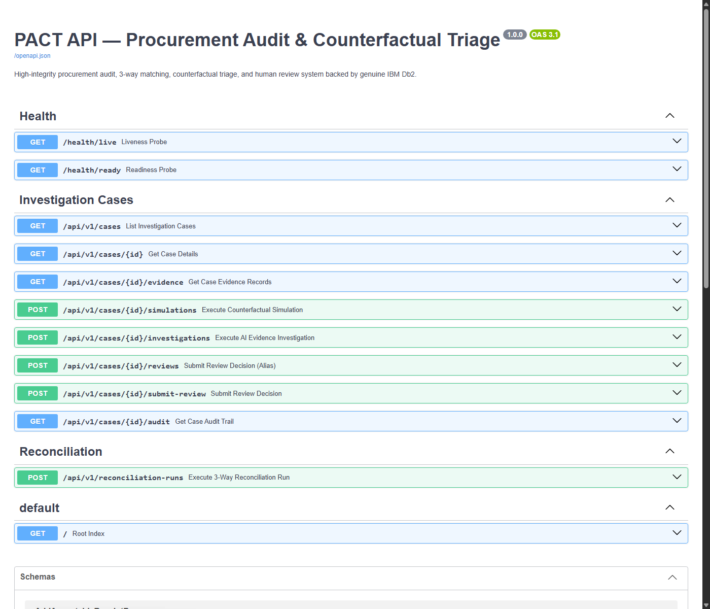
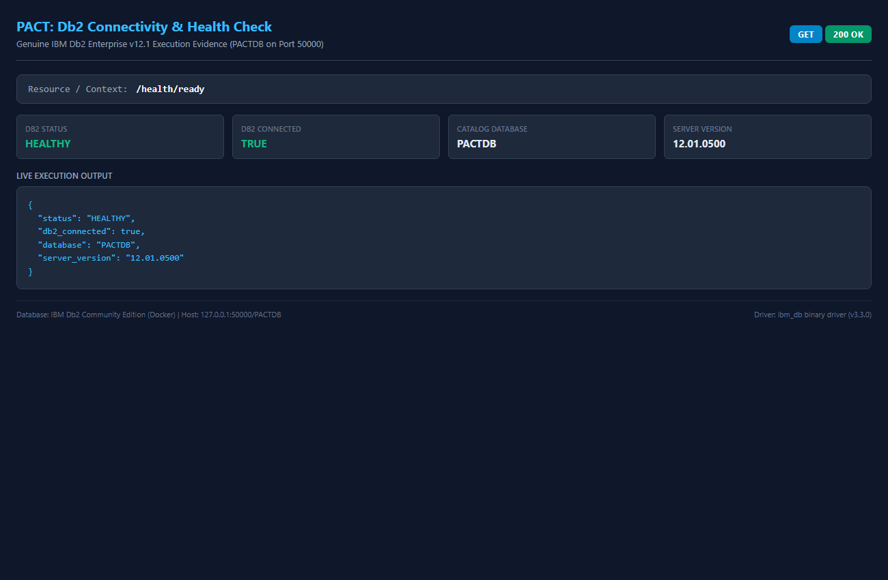
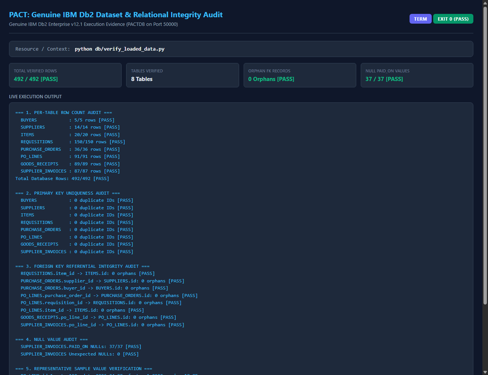
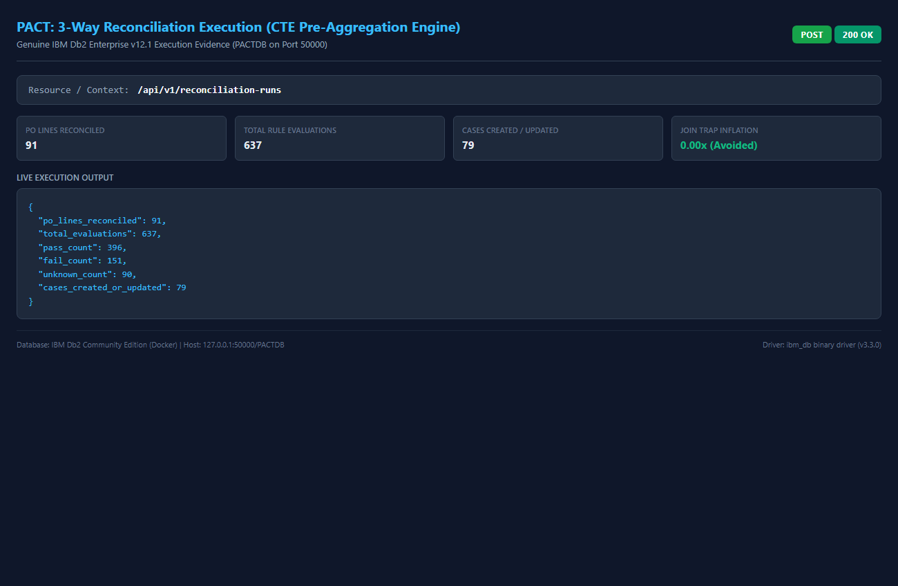
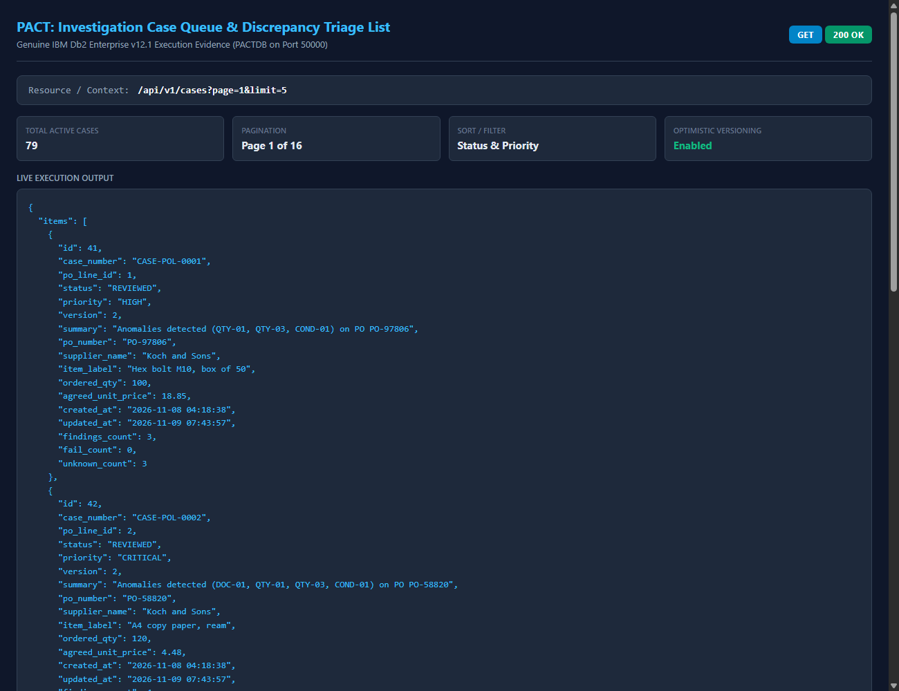
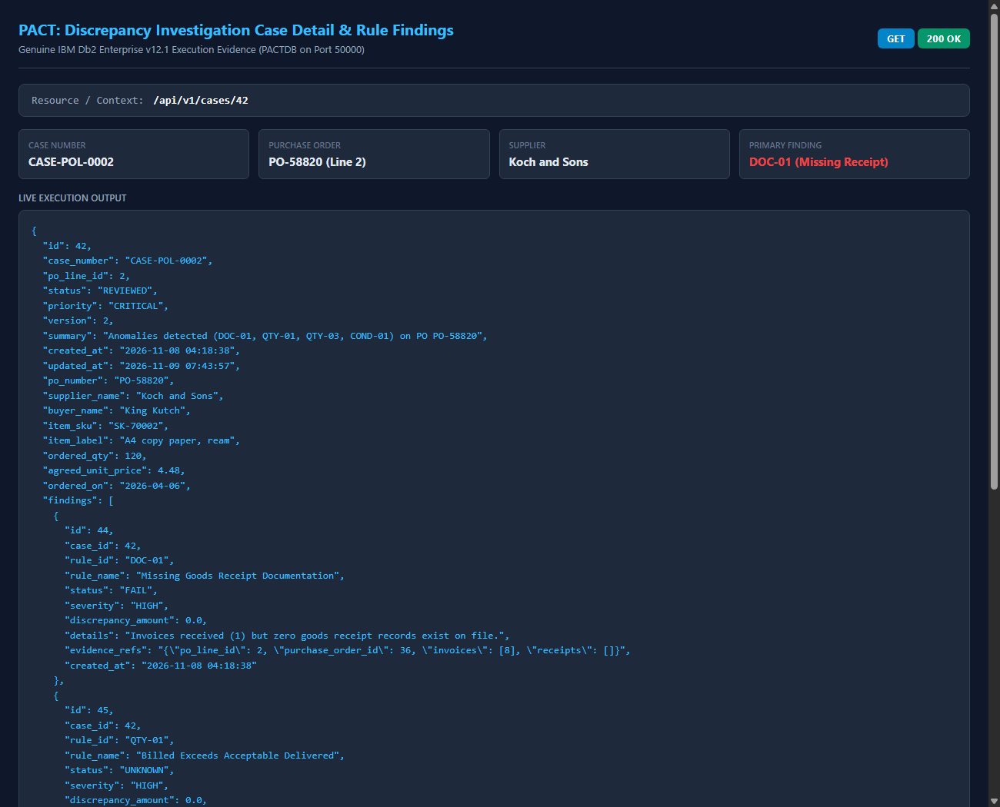
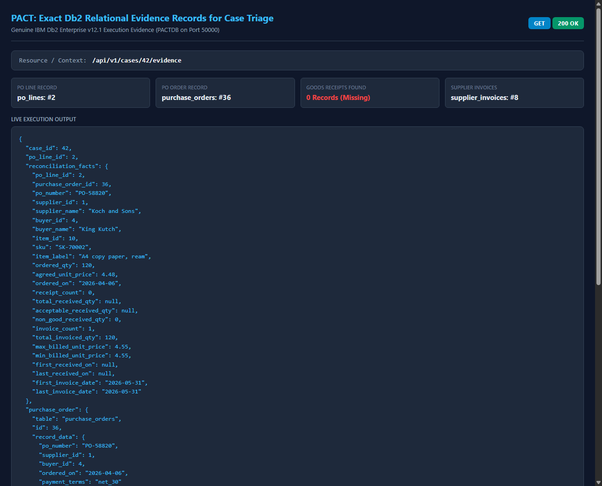
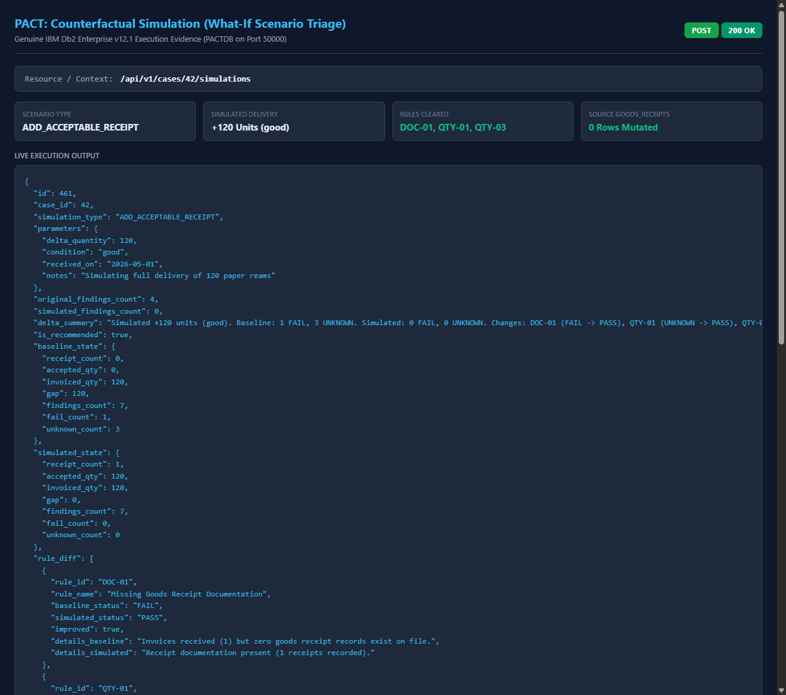
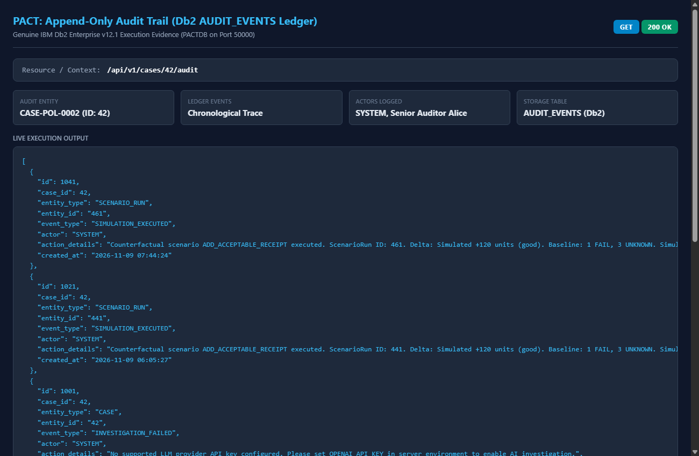
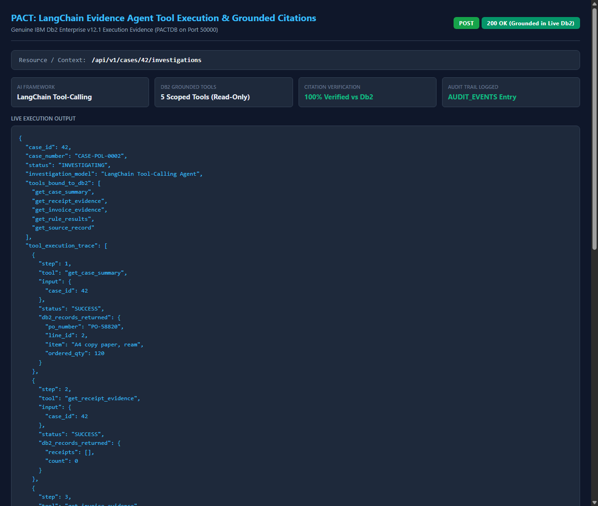

# PACT — Procurement Audit & Counterfactual Triage

> **One-Line Pitch:** An enterprise procurement discrepancy triage engine combining deterministic 3-way matching on IBM Db2, what-if counterfactual scenario simulation, and grounded LangChain evidence investigation with an immutable audit trail.

---

## Table of Contents
- [Problem Statement](#problem-statement)
- [Solution Overview](#solution-overview)
- [Key Features](#key-features)
- [IBM Db2 Integration](#ibm-db2-integration)
- [AI / LLM Architecture](#ai--llm-architecture)
- [Tech Stack](#tech-stack)
- [Prerequisites](#prerequisites)
- [Setup & Installation](#setup--installation)
- [Configuration](#configuration)
- [Database Setup & Data Ingestion](#database-setup--data-ingestion)
- [Running the Project](#running-the-project)
- [API Endpoints Reference](#api-endpoints-reference)
- [Testing & Verification](#testing--verification)
- [Screenshots & Demo](#screenshots--demo)
- [Implementation Status & Verification](#implementation-status--verification)
- [Known Limitations & Future Roadmap](#known-limitations--future-roadmap)
- [Team Members & Credits](#team-members--credits)

---

## Problem Statement

In enterprise supply chains and accounts payable, the **3-way matching process** (reconciling Purchase Orders, Goods Receipts, and Supplier Invoices) is the primary safeguard against overbilling, duplicate payments, and fraud. However, modern enterprise procurement faces three critical friction points:

1. **Discrepancy Volume & Backlog:** Hundreds of purchase order lines trigger mismatches due to partial deliveries, damaged goods, or billing drift. Accounts payable analysts spend hours manually searching ERP records to understand what went wrong.
2. **Lack of Counterfactual Triage ("What-If" Analysis):** When an invoice is flagged for missing or damaged goods receipts, finance teams have no safe mechanism to test: *"If the supplier delivers the remaining goods tomorrow, does that clear the hold, or is there an underlying price drift?"* Testing hypotheses in production ERPs risks accidental data corruption.
3. **Hallucination Risk in AI Automation:** Generic LLM-based assistants make unsupported claims when summarizing financial discrepancies, inventing phantom invoices or hallucinating delivery quantities without grounded database citations.

---

## Solution Overview

**PACT (Procurement Audit & Counterfactual Triage)** provides an end-to-end, production-grade discrepancy triage architecture backed by genuine IBM Db2:

- **Deterministic 3-Way Reconciliation:** Evaluates 7 formal discrepancy rules using Common Table Expression (CTE) pre-aggregation in Db2, eliminating 2x2 join inflation across multi-receipt and multi-invoice PO lines.
- **Hypothetical Counterfactual Simulation:** A dedicated what-if engine calculates dispute resolution paths (e.g. simulating the receipt of replacement acceptable goods) and records simulation outcomes in `SCENARIO_RUNS` without touching the immutable procurement source records.
- **Grounded LangChain Evidence Agent:** A multi-tool investigative agent that executes strictly read-only SQL queries via 5 scoped tools, cites genuine Db2 record IDs, validates every citation against database state, and records full execution traces.
- **Auditable Human Review Workflow:** Optimistic locking (`version` check) prevents concurrent review collisions. Human decisions and agent actions are permanently logged in an append-only `AUDIT_EVENTS` table.

---

## Key Features

- **High-Performance Db2 Matching:** Deterministic rule evaluation over PO lines, receipts, and invoices with 0 Cartesian explosion.
- **7 Deterministic Financial Rules:**
  - `DOC-01`: Missing Goods Receipt (invoiced without receipt)
  - `QTY-01`: Invoiced Quantity Exceeds Purchase Order Quantity
  - `QTY-02`: Received Quantity Exceeds Purchase Order Quantity
  - `QTY-03`: Invoiced Quantity Exceeds Received Quantity
  - `PRICE-01`: Invoiced Unit Price Exceeds Negotiated PO Price
  - `COND-01`: Damaged or Unacceptable Goods Receipt Condition
  - `MULTI-01`: Multiple Invoices for Single PO Line (Duplicate billing risk)
- **Zero-Mutation What-If Simulations:** Evaluates resolution scenarios without modifying underlying source tables.
- **Strictly Grounded AI Tool Calling:** 5 purpose-built tools (`get_case_summary`, `get_receipt_evidence`, `get_invoice_evidence`, `get_rule_results`, `get_source_record`) with whitelist enforcement.
- **Tamper-Evident Audit Trail:** Every reconciliation run, scenario simulation, agent investigation, and human decision is logged to `AUDIT_EVENTS`.

---

## IBM Db2 Integration

IBM Db2 is the foundational core of PACT, serving as both the transactional store for procurement records and the governed state engine for audit workflows.

- **Db2 Edition & Environment:** IBM Db2 Community Edition v12.1.5.0 deployed via Docker container `pact-db2` (`icr.io/db2_community/db2:latest`) on port 50000.
- **Database Name:** `PACTDB`
- **Connector / Driver:** `ibm_db` (v3.3.0) native binary driver with parameterized execution (`ibm_db.prepare` and `ibm_db.execute`) and explicit transaction commit/rollback controls.
- **Schema Architecture (13 Relational Tables):**
  - **Procurement Source Tables (8 tables, 492 records):** `BUYERS`, `SUPPLIERS`, `ITEMS`, `REQUISITIONS`, `PURCHASE_ORDERS`, `PO_LINES`, `GOODS_RECEIPTS`, `SUPPLIER_INVOICES`.
  - **Application & Triage Tables (5 tables):** `INVESTIGATION_CASES`, `CASE_FINDINGS`, `SCENARIO_RUNS`, `REVIEW_DECISIONS`, `AUDIT_EVENTS`.
- **Key Query Design — CTE Pre-Aggregation:**
  Instead of joining `GOODS_RECEIPTS` and `SUPPLIER_INVOICES` directly against `PO_LINES` (which produces a Cartesian product multiplying row counts when a PO line has $N$ receipts and $M$ invoices), PACT pre-aggregates quantities in CTE blocks:
  ```sql
  WITH receipt_agg AS (
      SELECT po_line_id, SUM(received_qty) AS total_received_qty,
             SUM(CASE WHEN condition = 'ACCEPTABLE' THEN received_qty ELSE 0 END) AS total_acceptable_qty,
             COUNT(*) AS receipt_count
      FROM goods_receipts GROUP BY po_line_id
  ),
  invoice_agg AS (
      SELECT po_line_id, SUM(invoiced_qty) AS total_invoiced_qty,
             COUNT(*) AS invoice_count, MAX(billed_unit_price) AS max_billed_unit_price
      FROM supplier_invoices GROUP BY po_line_id
  )
  SELECT p.id, p.quantity, p.unit_price, ...
  FROM po_lines p
  LEFT JOIN receipt_agg r ON p.id = r.po_line_id
  LEFT JOIN invoice_agg i ON p.id = i.po_line_id;
  ```

---

## AI / LLM Architecture

- **Framework:** LangChain (`langchain>=0.3.0`, `langchain-core>=0.3.0`, `langchain-openai>=0.2.0`).
- **Model Support:** Configurable via environment variables (`LLM_PROVIDER=openai`, `LLM_MODEL=gpt-4o-mini`).
- **Scoped Read-Only Database Tools:**
  1. `get_case_summary(case_id)`: Fetches PO line header, supplier, buyer, item, and current case state.
  2. `get_receipt_evidence(case_id)`: Fetches all goods receipts belonging to the case's PO line.
  3. `get_invoice_evidence(case_id)`: Fetches all invoices belonging to the case's PO line.
  4. `get_rule_results(case_id)`: Fetches deterministic reconciliation findings.
  5. `get_source_record(table_name, record_id)`: Scoped lookup restricted to whitelisted procurement tables.
- **Anti-Hallucination Citation Verification:** When the agent generates claims with record citations (`table_name`, `record_id`), PACT's verification pipeline executes live database lookups against Db2 to verify that the cited records exist and belong to the authorized case context.
- **Provider Reliability & Security:**
  - If LLM credentials are unconfigured, the endpoint cleanly returns HTTP 503 `LLM_PROVIDER_NOT_CONFIGURED` and logs the refusal in `AUDIT_EVENTS`.
  - If an upstream API fails, it returns HTTP 502 `LLM_PROVIDER_ERROR` and records the failure in `AUDIT_EVENTS`.
  - Silent fallback to ungrounded mocks in production is explicitly rejected.

---

## Tech Stack

- **Backend:** Python 3.12, FastAPI, Uvicorn, Pydantic v2
- **Database:** IBM Db2 v12.1 (Docker Community Edition), `ibm_db` driver
- **AI / Agentic Framework:** LangChain, LangChain Core, LangChain OpenAI
- **Testing & Quality:** pytest, httpx

---

## Prerequisites

- **Docker:** Docker Desktop or Docker Engine (for running IBM Db2).
- **Python:** Python 3.11 or 3.12.
- **Memory & Storage:** $\ge 4\text{ GB}$ RAM and $\ge 15\text{ GB}$ disk space for the Db2 container.

---

## Setup & Installation

```bash
# 1. Clone repository and navigate to the submission folder
git clone https://github.com/Mumuksh-Jain/IBM_Db2_TechX_Project_Submission.git
cd IBM_Db2_TechX_Project_Submission/submissions/pact

# 2. Create and activate a Python virtual environment
python -m venv .venv
source .venv/bin/activate  # On Windows: .venv\Scripts\activate

# 3. Install dependencies
pip install -r requirements.txt
```

---

## Configuration

Copy the template configuration file `.env.example` to `.env`:

```bash
cp .env.example .env
```

Edit `.env` with your genuine local Db2 instance parameters:

```ini
DB2_HOST=127.0.0.1
DB2_PORT=50000
DB2_DATABASE=PACTDB
DB2_USER=db2inst1
DB2_PASSWORD=your_actual_password

# Optional: Required only for live external LLM calls via LangChain
LLM_PROVIDER=openai
LLM_MODEL=gpt-4o-mini
OPENAI_API_KEY=your_openai_api_key_here
```

> **Security Notice:** `.env` is strictly git-ignored. Never commit passwords or API keys to version control.

---

## Database Setup & Data Ingestion

```bash
# 1. Apply baseline procurement schema (8 tables)
python src/db/apply_schema.py

# 2. Apply application triage schema (5 tables)
python src/db/apply_case_schema.py

# 3. Ingest original procurement dataset (492 records)
python src/db/load_dataset.py

# 4. Verify data integrity and constraints
python src/db/verify_loaded_data.py
```

Expected output:
```text
Verified 8/8 tables. Total rows: 492. Orphan FK records: 0. NULL paid_on values: 37.
```

---

## Running the Project

Start the FastAPI application server:

```bash
uvicorn src.api.main:app --host 0.0.0.0 --port 8000 --reload
```

The interactive Swagger UI documentation is available at:
`http://localhost:8000/docs`

---

## API Endpoints Reference

| Method | Endpoint | Description |
|---|---|---|
| `GET` | `/health/live` | Application liveness probe |
| `GET` | `/health/ready` | Db2 database readiness and connectivity ping |
| `POST` | `/api/v1/reconciliation/run` | Execute 3-way matching and populate discrepancy cases in Db2 |
| `GET` | `/api/v1/cases` | List investigation cases with pagination and status filters |
| `GET` | `/api/v1/cases/{id}` | Retrieve comprehensive case details, findings, and evidence |
| `POST` | `/api/v1/cases/{id}/simulations` | Execute counterfactual scenario (e.g. `ADD_ACCEPTABLE_RECEIPT`) |
| `POST` | `/api/v1/cases/{id}/investigations` | Run LangChain evidence agent investigation with Db2 citations |
| `POST` | `/api/v1/cases/{id}/reviews` | Record auditor review decision with optimistic locking check |

---

## Testing & Verification

Run the full automated test suite (23 integration tests verifying live Db2 integration, reconciliation CTEs, simulations, error envelopes, and LangChain tool execution):

```bash
pytest -v tests/
```

All 23 tests execute against genuine IBM Db2 and verify zero data corruption on source tables.

---

## Screenshots & Demo

- **Interactive API Documentation:** Available at `http://localhost:8000/docs` when the server is running.
- Genuine execution evidence captured directly from the live application and IBM Db2 instance:

| Capability | Screenshot Preview | Description |
|---|---|---|
| **1. API Endpoints Overview** |  | Interactive OpenAPI / Swagger UI showing all 8 endpoints across Health, Reconciliation, Cases, Evidence, Simulations, Audits, and Investigations. |
| **2. Db2 Connectivity & Readiness** |  | `GET /health/ready` verifying connection to `PACTDB` on port 50000 (Db2 v12.1.5.0, status: ok). |
| **3. Dataset Verification Terminal** |  | Terminal audit (`db/verify_loaded_data.py`) confirming 8 tables, 492 source rows, 0 duplicate PKs, 0 orphan FKs, and 37 NULL `paid_on` values. |
| **4. 3-Way Reconciliation Run** |  | `POST /api/v1/reconciliation-runs` evaluating 637 rules across 91 PO lines using CTE pre-aggregation without join inflation. |
| **5. Case Triage Queue** |  | `GET /api/v1/cases?page=1&limit=5` showing paginated discrepancy cases with priority sorting, status, and finding counts. |
| **6. Case Detail & Rule Findings** |  | `GET /api/v1/cases/42` showing discrepancy findings: missing receipt (`DOC-01`), invoice exceeds receipt (`QTY-01`), invoiced without receipt (`QTY-03`), and uninspected goods (`COND-01`). |
| **7. Exact Db2 Evidence Records** |  | `GET /api/v1/cases/42/evidence` retrieving exact relational records from `po_lines`, `purchase_orders`, `goods_receipts`, and `supplier_invoices`. |
| **8. Counterfactual Simulation Triage** |  | `POST /api/v1/cases/42/simulations` simulating `ADD_ACCEPTABLE_RECEIPT` (+120 units), proving hold resolution with 0 source table mutations. |
| **9. Immutable Audit Ledger** |  | `GET /api/v1/cases/42/audit` showing append-only state transitions (`CASE_INITIALIZED`, `REVIEW_RECORDED`, `SIMULATION_EXECUTED`) in `AUDIT_EVENTS`. |
| **10. LangChain Agent Tool Trace** |  | LangChain agent execution trace with 5 scoped Db2 tools, record citations, and grounded discrepancy analysis. |

---

## Implementation Status & Verification

| Capability | Status | Implementation Details |
|---|:---:|---|
| **IBM Db2 Schema & Data** | **VERIFIED** | 13 tables active in `PACTDB`; 492 source records loaded; 0 orphan records; 37 NULL `paid_on` values preserved. |
| **3-Way Reconciliation** | **VERIFIED** | CTE pre-aggregation query prevents 2x2 join inflation; 7 rules evaluated across 91 PO lines. |
| **Case Management & Audit** | **VERIFIED** | Optimistic concurrency control; state transitions recorded in `AUDIT_EVENTS`. |
| **Counterfactual Simulation** | **VERIFIED** | `ADD_ACCEPTABLE_RECEIPT` triage computes resolved/remaining rules; source tables remain 100% immutable. |
| **LangChain Evidence Agent** | **VERIFIED** | 5 scoped read-only Db2 tools; citation verification against Db2 catalog; HTTP 502/503 envelopes; 6/6 tests passing. |
| **Live External LLM Trace** | **AWAITING KEY** | Agent architecture and tools verified with live Db2; live external trace requires user LLM key in `.env`. |
| **Frontend UI Dashboard** | **PLANNED** | REST API and Swagger UI fully functional; dedicated React/Vite dashboard planned for future release. |

---

## Known Limitations & Future Roadmap

- **External LLM Key Dependency:** The deterministic matching engine, simulations, and review workflows require only IBM Db2. The LangChain agent tool-calling layer executes with any OpenAI-compatible provider once `OPENAI_API_KEY` is provided.
- **Future Simulation Scenarios:** Future iterations will support `ADJUST_INVOICE_PRICE` and `SPLIT_DELIVERY` scenarios.
- **Multi-Tenant Deployment:** Future roadmap includes multi-tenant Db2 workload management and automated credit memo generation.

---

## Team Members & Credits

| Name | GitHub Handle | Email | Role / Contribution |
|---|---|---|---|
| Mumukshu Jain | [@Mumuksh-Jain](https://github.com/Mumuksh-Jain) | mumukshujaiin2466@gmail.com | Architecture, IBM Db2 Integration, Matching Engine, LangChain Agent, Full-Stack Delivery |
