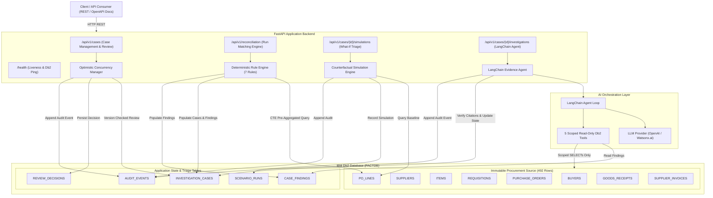

# System Architecture — PACT (Procurement Audit & Counterfactual Triage)

## Overview

**PACT (Procurement Audit & Counterfactual Triage)** is an enterprise financial audit platform engineered to detect, simulate, and resolve procurement discrepancies. In modern enterprise supply chains, three-way matching discrepancies (Purchase Orders, Goods Receipts, Supplier Invoices) lock millions of dollars in working capital and introduce systemic risk of overbilling and duplicate payments.

PACT combines:
1. **Deterministic Three-Way Matching on IBM Db2:** Common Table Expression (CTE) pre-aggregation algorithms executing directly against relational schemas without Cartesian product inflation.
2. **Read-Only Counterfactual Simulation:** A what-if triage engine that computes dispute resolution paths (e.g., simulating receipt deliveries) and persists outcomes to an isolated scenario ledger without mutating immutable source records.
3. **LangChain Evidence Agent:** A grounded AI investigator equipped with 5 scoped, strictly read-only Db2 tools to analyze discrepancies, cite factual record IDs, and prevent hallucinations.
4. **Tamper-Evident Audit Trail:** An append-only state ledger in IBM Db2 tracking all reconciliation runs, simulations, human reviews, and agent investigations.

---

## Architecture Diagram



---

## Component Breakdown

### 1. User Interface / Client Layer
- **OpenAPI / Swagger UI (`/docs`)**: Interactive exploration and validation of all REST endpoints, request/response models, and status envelopes.
- **REST Clients**: Standard HTTP clients (cURL, Python `httpx`/`requests`, frontend portals) interfacing via standardized JSON envelopes (`{"data": ...}`, `{"error": {"code": ..., "message": ...}}`).

### 2. Application Backend Layer (FastAPI & Python 3.12)
- **FastAPI Core (`src/api/main.py`)**: Asynchronous, high-performance web service with strict Pydantic v2 schemas and centralized exception handlers.
- **Reconciliation Service (`src/core/reconciliation.py`)**: Executes deterministic SQL matching across PO lines, receipts, and invoices.
- **Rule Engine (`src/core/rules.py`)**: Evaluates 7 formal business rules:
  - `DOC-01`: Missing Goods Receipt
  - `QTY-01`: Invoice Quantity exceeds Purchase Order Quantity
  - `QTY-02`: Received Quantity exceeds Purchase Order Quantity
  - `QTY-03`: Invoiced Quantity exceeds Received Quantity
  - `PRICE-01`: Invoiced Unit Price exceeds PO Negotiated Unit Price
  - `COND-01`: Damaged Goods Receipt condition
  - `MULTI-01`: Multiple Invoices for Single PO Line (Risk of duplicate billing)
- **Counterfactual Simulation Service (`src/api/services/simulations.py`)**: Calculates the deterministic effect of resolving missing or damaged goods receipts without modifying the actual database records.
- **Review & Audit Workflow (`src/api/services/cases.py`)**: Implements optimistic locking on cases (`WHERE id = ? AND version = ?`), transitions lifecycle states (`OPEN` $\to$ `INVESTIGATING` $\to$ `RESOLVED` / `CLOSED`), and writes to `AUDIT_EVENTS`.

### 3. Database Layer (IBM Db2 v12.1)
- **Genuine IBM Db2 Enterprise Container**: Running `icr.io/db2_community/db2:latest` on port 50000 with database `PACTDB`.
- **Connector**: Native `ibm_db` driver providing high-throughput binary connectivity, explicit transaction management, and parameterized queries.
- **Strict Data Segmentation**:
  - **Source Tables (8 tables, 492 rows)**: Treated as strictly read-only after initial load; primary and foreign key constraints enforce referential integrity.
  - **Application Tables (5 tables)**: Manage case lifecycle, discrepancy findings, scenario simulations, human review decisions, and tamper-evident audit logs.

### 4. AI & Agent Orchestration Layer (LangChain)
- **LangChain Tool-Calling Agent (`src/api/services/investigations.py`)**:
  - Dynamically binds 5 scoped, strictly read-only database tools.
  - Generates factual claims citing real Db2 record IDs.
  - Verifies citations against genuine Db2 catalog records via `verify_evidence_citation`.
  - Records full invocation traces (`tool_name`, `arguments`, `status`, `record_ids`) and logs the investigation event to Db2 `AUDIT_EVENTS`.
  - Rejects execution cleanly (HTTP 503 `LLM_PROVIDER_NOT_CONFIGURED`) when external provider credentials are not present, avoiding silent mock fallbacks.

---

## Data Flow

```text
[1. Reconciliation Trigger]
        │
        ▼
[2. IBM Db2 CTE Matching Query] ──► Aggregates Receipts & Invoices by PO Line
        │
        ▼
[3. Rule Evaluation Engine] ─────► Detects Violations across 7 Deterministic Rules
        │
        ▼
[4. State Persistence] ──────────► Inserts/Updates INVESTIGATION_CASES & CASE_FINDINGS
        │
        ├────────────────────────┬────────────────────────┐
        ▼                        ▼                        ▼
[A. Counterfactual Sim]   [B. LangChain Agent]    [C. Human Auditor Review]
  - Simulates Receipts      - Executes 5 Tools      - Approves/Rejects Action
  - Writes SCENARIO_RUNS    - Cites Db2 Records     - Optimistic Concurrency Check
  - Zero Source Mutation    - Verifies Citations    - Writes REVIEW_DECISIONS
        │                        │                        │
        └────────────────────────┴────────────────────────┘
                                 │
                                 ▼
                     [5. Db2 AUDIT_EVENTS Trail]
```

### 1. Reconciliation & Case Ingestion
1. The user or cron triggers `POST /api/v1/reconciliation/run`.
2. A single CTE query pre-aggregates all `GOODS_RECEIPTS` (`SUM(received_qty)`) and `SUPPLIER_INVOICES` (`SUM(invoiced_qty)`) per `po_line_id` to prevent Cartesian multi-counting.
3. The query joins with `PO_LINES`, `PURCHASE_ORDERS`, `ITEMS`, `SUPPLIERS`, and `BUYERS`.
4. The 7 rules are evaluated. Any PO line with at least one violation triggers case creation/updating in `INVESTIGATION_CASES` and findings insertion in `CASE_FINDINGS`.
5. An audit entry `RECONCILIATION_RUN` is appended to `AUDIT_EVENTS`.

### 2. Counterfactual Simulation Workflow
1. The auditor triggers `POST /api/v1/cases/{id}/simulations` with scenario `ADD_ACCEPTABLE_RECEIPT`.
2. The simulation service retrieves the baseline PO line, receipts, and invoices from Db2.
3. It constructs a hypothetical receipt delivery with `condition = 'ACCEPTABLE'` and re-evaluates all 7 rules.
4. The delta (resolved vs. remaining violations) is computed.
5. The result is stored in `SCENARIO_RUNS` with `scenario_type = 'ADD_ACCEPTABLE_RECEIPT'`, and an event `SCENARIO_SIMULATED` is written to `AUDIT_EVENTS`.
6. **Integrity Guarantee:** `GOODS_RECEIPTS` is never touched; the hypothetical receipt remains completely virtual.

### 3. Grounded LangChain Evidence Investigation
1. The auditor triggers `POST /api/v1/cases/{id}/investigations`.
2. The system checks configured LLM credentials (HTTP 503 if unconfigured).
3. The LangChain agent receives the discrepancy prompt and queries Db2 using 5 read-only tools:
   - `get_case_summary`: Details on PO, buyer, supplier, and case.
   - `get_receipt_evidence`: Receipts associated with the authorized PO line.
   - `get_invoice_evidence`: Invoices associated with the authorized PO line.
   - `get_rule_results`: Active deterministic findings.
   - `get_source_record`: Scoped lookup on whitelisted tables.
4. Each claim emitted by the model is validated against Db2 records.
5. Case status transitions to `INVESTIGATING` (with version increment), and an audit event is logged.

### 4. Human Review & Decision Persistence
1. Auditor reviews findings, simulations, and agent evidence.
2. Auditor posts `POST /api/v1/cases/{id}/reviews` with `action` (`DISPUTE`, `ACCEPT_OVERAGE`, `RE_RECEIVE`, `CLOSE`), `reason`, and the expected case `version`.
3. If `version` does not match the current database row, HTTP 409 `CONCURRENT_MODIFICATION_CONFLICT` is returned.
4. If version matches, the case status is updated, a `REVIEW_DECISIONS` row is inserted, and an `AUDIT_EVENTS` row is written within a single atomic database transaction.

---

## IBM Db2 Schema & Storage Design

### Procurement Source Tables (Immutable Baseline, 492 Records)

```sql
-- 1. Buyers
CREATE TABLE buyers (
    id INT NOT NULL PRIMARY KEY,
    first_name VARCHAR(50) NOT NULL,
    last_name VARCHAR(50) NOT NULL,
    email VARCHAR(100) NOT NULL,
    team VARCHAR(50) NOT NULL
);

-- 2. Suppliers
CREATE TABLE suppliers (
    id INT NOT NULL PRIMARY KEY,
    supplier_name VARCHAR(100) NOT NULL,
    country VARCHAR(50) NOT NULL,
    payment_terms VARCHAR(20) NOT NULL
);

-- 3. Items
CREATE TABLE items (
    id INT NOT NULL PRIMARY KEY,
    sku VARCHAR(50) NOT NULL,
    catalogue VARCHAR(50) NOT NULL,
    item_label VARCHAR(100) NOT NULL,
    unit VARCHAR(20) NOT NULL,
    list_price DECIMAL(10,2) NOT NULL
);

-- 4. Requisitions
CREATE TABLE requisitions (
    id INT NOT NULL PRIMARY KEY,
    requester_dept VARCHAR(50) NOT NULL,
    item_id INT NOT NULL REFERENCES items(id),
    quantity_requested INT NOT NULL,
    list_price DECIMAL(10,2) NOT NULL,
    requested_on DATE NOT NULL
);

-- 5. Purchase Orders
CREATE TABLE purchase_orders (
    id INT NOT NULL PRIMARY KEY,
    po_number VARCHAR(50) NOT NULL,
    supplier_id INT NOT NULL REFERENCES suppliers(id),
    buyer_id INT NOT NULL REFERENCES buyers(id),
    ordered_on DATE NOT NULL,
    payment_terms VARCHAR(20) NOT NULL
);

-- 6. PO Lines
CREATE TABLE po_lines (
    id INT NOT NULL PRIMARY KEY,
    purchase_order_id INT NOT NULL REFERENCES purchase_orders(id),
    requisition_id INT NOT NULL REFERENCES requisitions(id),
    item_id INT NOT NULL REFERENCES items(id),
    quantity INT NOT NULL,
    ordered_on DATE NOT NULL,
    negotiated_factor DECIMAL(5,2) NOT NULL,
    unit_price DECIMAL(10,2) NOT NULL
);

-- 7. Goods Receipts
CREATE TABLE goods_receipts (
    id INT NOT NULL PRIMARY KEY,
    po_line_id INT NOT NULL REFERENCES po_lines(id),
    received_on DATE NOT NULL,
    received_share DECIMAL(5,2) NOT NULL,
    received_qty INT NOT NULL,
    condition VARCHAR(20) NOT NULL
);

-- 8. Supplier Invoices
CREATE TABLE supplier_invoices (
    id INT NOT NULL PRIMARY KEY,
    po_line_id INT NOT NULL REFERENCES po_lines(id),
    invoice_no VARCHAR(50) NOT NULL,
    invoice_date DATE NOT NULL,
    qty_ratio DECIMAL(5,2) NOT NULL,
    invoiced_qty INT NOT NULL,
    billing_drift DECIMAL(5,2) NOT NULL,
    billed_unit_price DECIMAL(10,2) NOT NULL,
    status VARCHAR(20) NOT NULL,
    paid_on DATE
);
```

### Application State & Audit Tables

```sql
-- 9. Investigation Cases
CREATE TABLE investigation_cases (
    id INT GENERATED ALWAYS AS IDENTITY PRIMARY KEY,
    po_line_id INT NOT NULL UNIQUE REFERENCES po_lines(id),
    status VARCHAR(20) NOT NULL DEFAULT 'OPEN',
    version INT NOT NULL DEFAULT 1,
    discrepancy_summary VARCHAR(1000),
    total_discrepancy_amount DECIMAL(12,2) DEFAULT 0.00,
    created_at TIMESTAMP NOT NULL DEFAULT CURRENT_TIMESTAMP,
    updated_at TIMESTAMP NOT NULL DEFAULT CURRENT_TIMESTAMP,
    CONSTRAINT chk_case_status CHECK (status IN ('OPEN', 'INVESTIGATING', 'PENDING_REVIEW', 'RESOLVED', 'CLOSED'))
);

-- 10. Case Findings
CREATE TABLE case_findings (
    id INT GENERATED ALWAYS AS IDENTITY PRIMARY KEY,
    case_id INT NOT NULL REFERENCES investigation_cases(id) ON DELETE CASCADE,
    rule_code VARCHAR(20) NOT NULL,
    severity VARCHAR(10) NOT NULL,
    finding_message VARCHAR(1000) NOT NULL,
    evidence_payload CLOB,
    created_at TIMESTAMP NOT NULL DEFAULT CURRENT_TIMESTAMP,
    CONSTRAINT chk_finding_severity CHECK (severity IN ('CRITICAL', 'HIGH', 'MEDIUM', 'LOW', 'INFO'))
);

-- 11. Scenario Runs (Counterfactual Triage)
CREATE TABLE scenario_runs (
    id INT GENERATED ALWAYS AS IDENTITY PRIMARY KEY,
    case_id INT NOT NULL REFERENCES investigation_cases(id) ON DELETE CASCADE,
    scenario_type VARCHAR(50) NOT NULL,
    input_parameters CLOB NOT NULL,
    outcome_summary VARCHAR(1000) NOT NULL,
    rules_cleared VARCHAR(500),
    rules_remaining VARCHAR(500),
    financial_impact DECIMAL(12,2) DEFAULT 0.00,
    created_at TIMESTAMP NOT NULL DEFAULT CURRENT_TIMESTAMP
);

-- 12. Review Decisions
CREATE TABLE review_decisions (
    id INT GENERATED ALWAYS AS IDENTITY PRIMARY KEY,
    case_id INT NOT NULL REFERENCES investigation_cases(id) ON DELETE CASCADE,
    decision_action VARCHAR(50) NOT NULL,
    decision_rationale CLOB NOT NULL,
    reviewer_id VARCHAR(100) NOT NULL,
    version_at_review INT NOT NULL,
    created_at TIMESTAMP NOT NULL DEFAULT CURRENT_TIMESTAMP,
    CONSTRAINT chk_decision_action CHECK (decision_action IN ('APPROVE_PAYMENT', 'DISPUTE_INVOICE', 'REQUEST_CREDIT_MEMO', 'ACCEPT_OVERAGE', 'RE_RECEIVE_GOODS', 'CLOSE_NO_ACTION'))
);

-- 13. Audit Events (Append-Only Log)
CREATE TABLE audit_events (
    id INT GENERATED ALWAYS AS IDENTITY PRIMARY KEY,
    entity_type VARCHAR(50) NOT NULL,
    entity_id INT NOT NULL,
    event_type VARCHAR(50) NOT NULL,
    actor VARCHAR(100) NOT NULL,
    event_payload CLOB,
    created_at TIMESTAMP NOT NULL DEFAULT CURRENT_TIMESTAMP
);
```

---

## Security & Secrets Management

1. **Strict Secrets Exclusion**:
   - Database credentials (`DB2_USER`, `DB2_PASSWORD`) and LLM API keys (`OPENAI_API_KEY`) are read strictly from runtime environment variables.
   - `.env` and all credential patterns are registered in `.gitignore` and enforced by automated pre-commit and submission validation scripts.
   - `.env.example` provides non-sensitive placeholders only.
2. **Parameterized Execution**:
   - Every database query across the core matching engine, agent tools, and REST services utilizes parameterized queries (`ibm_db.prepare` and `ibm_db.execute`) with zero SQL string interpolation.
3. **Optimistic Locking**:
   - State mutations on `investigation_cases` verify row version integrity, preventing race conditions or concurrent overwrite in multi-auditor environments.
4. **Append-Only Tamper-Evident Audit Trail**:
   - Critical events (reconciliation, simulation, human reviews, agent tool calls) are permanently recorded in `AUDIT_EVENTS`, ensuring complete transparency and compliance.
